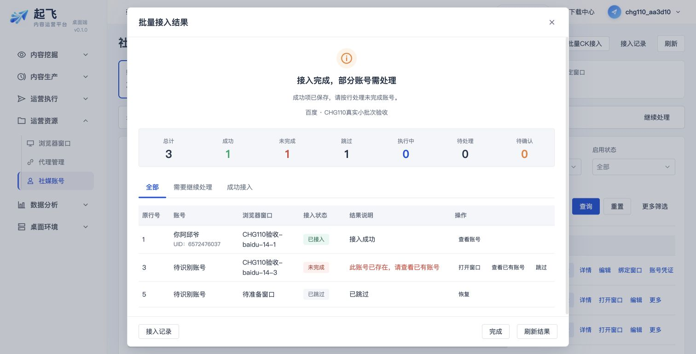
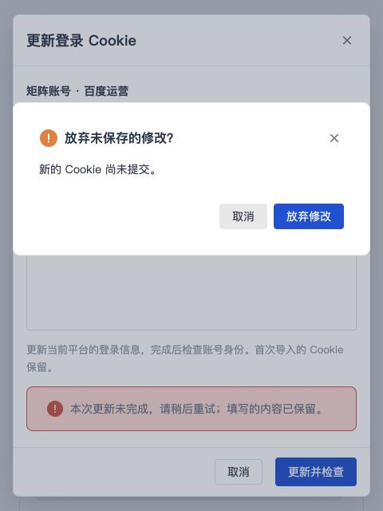

# CHG-20261030-113 走查与验证记录

## 结论与边界

本轮浮层视觉实现、自检与必要回归通过；M2-D 整体人工签收仍待完成。Cloud 是唯一 Vue 源码，Desktop 未改运行时代码，仅重建安装包。没有数据库、接口、账号权限、Cookie 写入规则或接入执行流程变更。其他会话正在修改的 example 文件未纳入本次提交。

Cloud 实现：`d370177`、`5f99e95`；PR [#23](https://github.com/piqiu96/wt-media-cloud/pull/23)。最终安装包前端版本 `0.1.0+5f99e95`。

依据：`example/proto/social-accounts/index.html`、`example/common/index.html`，以及 `AdminUI页面规范.md` §6/7、`前端交互规范.md` §8/9/11/14、`前端架构与视觉规范.md` §4.4/4.5。原型按源码的容器、分区、尺寸和动作核对；未将隔离场景当作原型或真实业务验收。

## 已修正的遗漏

- 全部标签、保存成功、绑定成功、空闲窗口选择仍使用旧 Dialog：统一复用 ResourceOverlay；成功摘要和固定底部操作保持同一模式。
- 批量接入自建的图标、七项计数与公共批量检查样式重复：提取 OperationResultSummary，共享图标/标题/计数；移除旧摘要和重复 CSS。
- 全失败、全部跳过、待确认原来的标题/颜色易产生误判：分别展示红色未完成、中性未接入、橙色待确认；进行中保持蓝色，部分完成与暂停为橙色。
- 详情重复失败告知、Cookie 失败同时 Alert 和 Toast、待确认重复告知：保留一处明确原因和已有后续入口。
- 窗口候选缺少可见搜索标签、无窗口时无恢复动作：补标签、单一公共空态与刷新；未选中/加载/错误时禁止无效提交。
- 预览和结果表缺少浮层内滚动约束；长 UID/原因/标签和窄屏布局遗漏：表格内部滚动，其余文本换行，身份对照窄屏上下排列。
- 长标签导致普通标签竖排：改用 TDesign break-line 并限制标签项宽度，清除无效 wrap 用法。
- Cookie 编辑关闭会直接丢弃输入：复用现有未保存确认；取消放弃保留输入，处理中禁止关闭，待确认回执可关闭后核实。
- 公共确认框在 480px 宽度贴边：沿用 480px 上限并补两侧 16px 留白；确认/告知语义不变。

## 逐项入口核对

下表“生产场景”指临时挂载真实生产 Vue 模板/样式，以本地演示数据展示；没有改写组件结构，没有平台调用。场景与临时入口已从 Cloud 删除，未提交测试后门。运行页面基于真实 Cloud 数据只读进入，未新建批次或更新 Cookie。

| 入口 / 状态 | 方式与实际结果 | 结论 |
|---|---|---|
| 新增、编辑 | 真实列表进入；640px 标准表单与底部操作；分类与标签复用公共字段 | PASS |
| 保存成功、绑定成功 | 生产场景；560px 成功摘要，信息与底部引导分区 | PASS |
| 绑定 / 更换窗口 | 真实列表进入与生产场景；960px 候选表，已占用同平台候选不可选，未选中提交禁用 | PASS |
| 无窗口空态 | 生产场景复核修正后只有“暂无可关联窗口”及刷新动作 | PASS |
| 浏览器窗口详情 | 真实管理员入口；800px 抽屉，完整 ID、窗口信息、运行状态；成员电脑状态未冒充本机状态 | PASS |
| 账号详情 | 真实入口与生产场景；分区一致，未知状态为中性 | PASS |
| 身份不一致 / 检查失败 | 生产场景；长昵称和 80 位 UID 换行；失败原因只显示一处 | PASS |
| 全部标签 | 生产场景与 480px 长标签复核；普通标签不被压缩竖排 | PASS |
| 凭证、更新、失败、待确认 | 真实凭证空值入口 + 生产场景；空值禁用显示/复制；演示长 Cookie 展开后仅内容内部纵向滚动；失败红、待确认橙 | PASS |
| Cookie 关闭确认 | 真实生产关闭函数的隔离操作；取消放弃后 textarea 仍为 DEMO_ONLY=visual；确认框左右均 16px | PASS |
| 批量接入输入 | 真实浏览器入口与生产场景；字段、步骤、固定底部一致。浏览器没有 Tauri 本地桥时呈现既有明确错误，不据此声称本地接入成功 | PASS（展示） |
| 预览、历史、历史空态 | 生产场景预览/空态，真实历史入口；表格内部滚动、底部操作可达 | PASS |
| 批次部分完成 | 真实既有 CHG110 百度批次只读查看：总计 3 / 成功 1 / 未完成 1 / 跳过 1；原因、查看已有账号等动作对应，浮层 body 宽与 scrollWidth 均 952px | PASS |
| 成功、全失败、暂停、待确认、全跳过、执行中 | 生产场景逐项打开；颜色/标题/七项计数对应，暂停/核实等既有入口保留 | PASS（展示） |
| 空闲窗口选择 | 生产场景；560px 有标签，未选择按钮禁用；未提交复用 | PASS（展示） |
| 批量检查中、批量检查结果 | 生产场景；共享摘要和七项计数；进行中禁关、结果重试入口保留 | PASS（展示） |
| 启停、更换、更新提交、接入草稿/复用确认 | 源码核对均走同一公共 confirmWarning；公共确认交互取消路径实测，不执行这些有副作用的最终确认 | PASS（共用样式） |

共打开 28 种生产模板展示场景，另对 11 种在 480×640 视口复核；相关 body 的 clientWidth 与 scrollWidth 相等。宽表在自身滚动区滚动，长表单正文独立滚动，固定底部按钮保持可达。临时视口已恢复。原始尺寸记录见 `隔离场景尺寸记录.json`。

## 自动化与构建

| 命令 / 检查 | 预期 | 实际 | 结果 |
|---|---|---|---|
| `cd wt-media-cloud/web && npm test -- --reporter=dot` | 必要 Web 行为回归通过 | 最终提交：109 文件 / 931 项通过；新增 9 个结果语义场景与 3 个 Cookie 关闭场景 | PASS |
| `npm run build:cloud` | Cloud Web 可构建 | 最终提交构建成功；仅既有大 chunk 提示 | PASS |
| Workspace `bin/control.sh start` | 从最新源码完整重建/重启与验证 | migrations 0 applied / 87 total；Cloud、Agent、BitBrowser、两类 worker、5173/5174、资源新鲜度与配置、DMG、admin 登录 smoke 全部 PASS；退出码 0 | PASS |
| 安装包复核 | 最新 DMG 可启动 | 已挂载启动，前端版本 0.1.0+5f99e95；原生登录页已有未完成输入，予以保留，未覆盖用户登录内容；本轮包内业务人工走查仍待登录后签收 | PASS（构建与启动） |
| Cloud PR CI | 测试、迁移、双前端与 release 构建通过 | run 41079324172 / verify success | PASS |
| `git diff --check` | 无空白错误 | 通过；仅计划内 Cloud UI 和测试文件 | PASS |
| Workspace alignment / delivery governance | CHG、主计划、索引一致 | 通过 | PASS |

## 人工验收与截图

[人工验收清单](人工验收清单.md) 可逐项填写。`screenshots/真实-*` 为真实运行页面，`screenshots/隔离-*` 为生产组件演示数据。隔离结果不代表重新执行过真实 Cookie 更新、接入或平台自动化；本轮不重复触发这些外部副作用。

