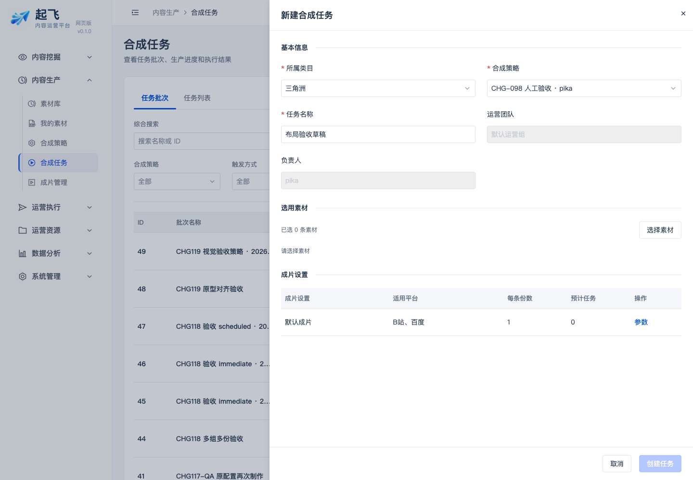
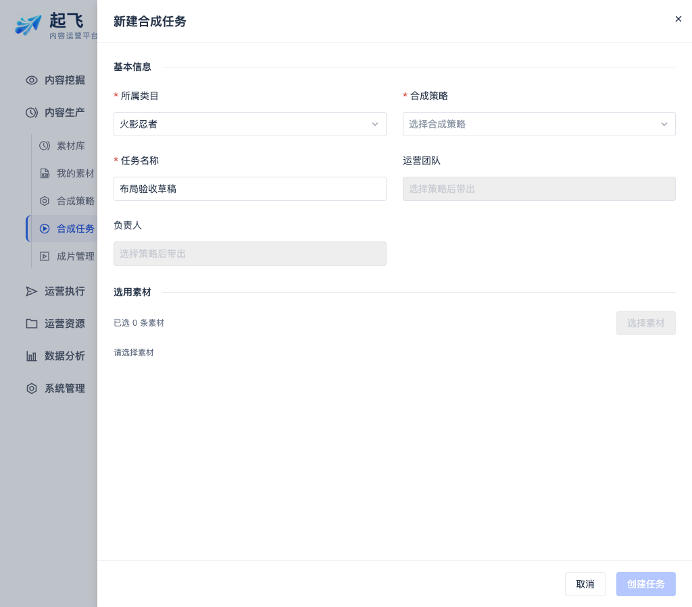

# 创建任务布局与联动验收

日期：2026-11-05；Cloud 提交 `94331d1`；CHG-20261105-120，状态保持 VERIFYING，待用户人工签收。

## 本次验证

- `npm --prefix web test -- --reporter=dot src/modules/compose`：31 个文件、184 项测试通过。覆盖策略候选角色范围、策略归属继承、空值／过期／禁用／越界详情拒绝、原配置再次制作与既有任务参数提交回归。
- `npm --prefix web run build:cloud`、`build:desktop`：均通过；已有主包体积提示仍存在。
- 本机开发页面 `/compose`，admin、operator01、senior01 三账号实查：首行类目／策略同排；任务名称半宽；无策略时选材禁用；选择真实授权策略后团队／负责人只读带出。素材选择请求中的 strategy_id、operator_id 与策略一致，管理角色未被替换为当前登录人。
- 参数确认后更换类目：取消更换保留原策略及负责人，确认更换清空策略／归属／参数并禁用选材，任务名称保留。三个角色均通过，未出现页面 JS 异常。
- 1440、1024 宽度下表单排列和抽屉检查通过。截图见下方。
- `git diff --check`：Cloud 与本轮 Workspace 文档无空白错误。

本轮只验收开发页面草稿与选材读取，不提交新合成任务、不触发 Worker，不代表新安装包原生验收；再次制作使用原有自动回归。本轮没有变更后台接口、数据库或授权。

## 截图

