# 发布管理与运营工具后端接口及数据库设计

> 设计评审稿，2026-11-14。本轮只设计方案，不实施代码、接口或数据库变更。已确认：首次手动启动发布计划；前一批满足阈值时自动执行下一批，不满足时由运营确认。

产品规则已于 2026-11-17 回写 [PRD 第六章](../product/prd/详细文档/第六章_发布管理.md)。本稿的表、接口与执行方案仍待工程评审；其中沿用的旧字段、状态或动作应对照 PRD 调整，不反向覆盖正式产品规则。

先看第 1–5 节：业务关系、6 张云端新增表与本地草稿、接口清单、业务总流程和待确认项。**集中 Review 状态与动作时，直接看附录 B：每类对象都有状态表、动作条件及转换图。** 字段、SQL 和执行细节放在其余附录。

## 1. 先看业务关系

**发布计划管目标和批次顺序，发布批次管一组发布任务，发布任务管一个账号发布一个成片。**

| 对象 | 举例 | 负责什么 |
| --- | --- | --- |
| 发布计划 | 本周 B站、百家号共发布 100 条 | 定目标、拆批次、控制各批次何时启动、统计总体结果 |
| 发布批次 | B站第一批，目标 30 条 | 选账号和成片、配置标题封面、生成任务、执行与处理异常；一个批次只有一个平台 |
| 发布任务 | 用账号 A 把成片 X 发布到 B站 | 保存实际发布内容，执行发布，记录结果 |
| 执行尝试 | 任务首次执行失败后，再执行一次 | 记录每一次执行的步骤、时间和结果；重试仍属于原任务 |

正常流程：**填写计划（可缓存到本机）→ 确认创建计划及批次 → 配置批次并生成任务 → 手动启动计划 → 批次间按阈值推进。**

也支持独立批次，以及不经过计划和批次的快速发布任务。建议继续使用现有 Go 后端和 MySQL，发布浏览器操作由 Local Agent 执行。

## 2. 数据库整体：云端 6 张新增表，客户端 1 张 SQLite 草稿表

**云端 MySQL：发布管理 4 张表，通用图片库和封面模板各 1 张，复用已有文件表。客户端：Desktop 的 SQLite 保存新建草稿，浏览器只保留在 Memory。AI 和封面生成通过 SSE 返回进度与逐条结果。**

`publication_task` 是本次拟新增的**发布专用任务表**，只保存运营确认创建后的正式任务。

### 2.1 表清单

| 表名（单数） | 所属能力 | 保存什么 |
| --- | --- | --- |
| `publication_plan` | 发布管理 | 负责人、周期、目标矩阵、批次推进状态 |
| `publication_batch` | 发布管理 | 所属计划、平台、类目目标、批次配置和执行控制 |
| `publication_task` | 发布管理 | 单账号/成片的正式发布任务、当前内容和平台结果 |
| `publication_attempt` | 发布管理 | 每次执行的固定输入、步骤和结果，重试保留历史 |
| `image_asset` | 运营工具 → 图片库 | 通用图片的文件引用、名称、用途、类目与启停 |
| `cover_template` | 运营工具 → 封面模板 | 通用模板的规格、草稿、当前发布配置、启停与默认项 |
| `operations_files`（已有，复用扩展） | 文件管理 | 实际文件、对象地址、摘要、尺寸与生成来源 |

以上为 **6 张云端新表、扩展 1 张云端已有表**。Desktop 另外使用本地 SQLite 的 `publication_draft` 保存三类新建草稿，见 A.10；它不属于云端业务表。浏览器 Memory 不建表。账号、成片、类目和审计日志继续复用。

新增数据库表统一采用 **snake_case 单数实体名**；数据库没有必须使用复数的要求。已有表按实际名称引用，本轮不重命名。HTTP 集合路径继续用复数，例如 `/publication-plans`、`/image-assets`；接口路径与表名分别按各自约定命名。

图片库和封面模板是可被多个业务使用的通用能力，表中不设 publication_id、batch_id 或 plan_id。发布管理只引用图片/模板，不拥有它们的生命周期；菜单入口为 **运营工具 → 图片库 / 封面模板**，发布内容配置中提供选择和跳转入口。

### 2.2 数据保存位置

| 数据 | 保存位置 | 生命周期 |
| --- | --- | --- |
| Desktop 的计划/批次/任务新建草稿 | 本机 SQLite：`publication_draft` | 每个环境、用户、类型各一份；保存后重启可继续，正式创建成功后清理 |
| 浏览器的新建表单与已采用内容 | 当前应用的 Memory（Vue Store） | 当前页面会话内保留；刷新、关闭页面或退出登录后清空 |
| 已经创建的计划及其批次配置 | Cloud MySQL 的计划/批次表 | 创建后成为服务端业务事实，编辑通过保存接口提交 |
| 封面模板的编辑草稿 | Cloud `cover_template.draft_config_json` | 模板已创建；保存草稿与发布生效是两个业务动作 |
| 图片原件、已生成封面 | 现有服务端文件管理/对象存储 | 表单与本地草稿仅保存 file_id，正式创建时重新核验 |

Desktop 经原生桥调用 Local Agent 的本地草稿接口，由 Agent 统一读写 SQLite；Vue 和 Desktop 壳不直接打开数据库。这里只存三类新建表单，不同步 Cloud 业务副本，也不提供离线正式创建或离线发布。

草稿保存输入、已采用文字、文件 ID、schema_version、saved_at 和创建 request_key，不保存大段 Base64。提交时保留原请求内容；结果不明时，仍用原 key、原内容核对/重试。创建成功清理该份草稿，失败保留。SQLite 不跨设备同步；浏览器没有持久化恢复，页面仍在时才保留请求 key 与结果。

浏览器刷新后若丢失尚未确认的创建请求，不自动重新创建，先查询正式列表/详情核实是否已经创建；不为恢复表单而增加 Cloud 草稿或另一套浏览器持久化。

Desktop 使用“保存草稿”；浏览器只能“暂存本次填写”，并明确提示刷新或关闭后清空。已有记录编辑只调用服务端保存接口，不写入新建草稿。本地或内存中的文件引用不产生服务端资源占用。

### 2.3 AI 和封面生成使用 SSE

前端通过 POST 提交候选，后端在同一个 HTTP 响应流中持续推送：**开始 → 处理进度 → 逐条结果/失败 → 本次完成**。

- **AI 文案**：按候选生成发布标题、封面短标题、话题、标签及可选正文，每条完成后立即返回完整结果。
- **封面合成**：按实际短标题、固定底图与发布模板合成真实图片，推送校验/渲染/保存阶段及最终文件 ID。
- **批量处理**：AI 每请求最多 10 条，更多候选由前端分组；后端推送实际完成数量，前端汇总整轮进度。封面每请求处理一条候选的必要规格。
- **采用结果**：运营选择采用已收到的结果，再通过配置保存或正式创建接口提交。

处理生命周期与当前连接绑定。取消或连接中断后停止后续处理，保留客户端已收到的完整结果；用户可选择失败或未完成项重新生成。事件协议见 G.3。

### 2.4 其他取舍

| 处理 | 理由 | 接受的代价 |
| --- | --- | --- |
| 计划目标/批次目标放所属表 JSON | 目标随整个对象配置，没有独立流程 | 跨计划按目标明细查询不如独立明细表直接，当前先不建设此类报表 |
| 当前内容与执行快照 | 当前内容在任务，实际执行内容在 attempt 快照 | 不提供每次未执行编辑的历史恢复 |
| 图片库只做文件的业务扩展 | 一张图片可同时作现成封面和底图 | 查询图片要关联现有文件表，避免重复存对象地址和摘要 |
| 模板草稿与发布配置同表 | 首版只需要一份编辑草稿和一份当前发布内容 | 不提供模板历史版本列表；任务与封面文件各自保存当时的配置快照 |

高频筛选、领取、排序和唯一约束使用普通列，JSON 用于有界配置及快照。

## 3. 接口整体有哪些

下面列出全部接口。Cloud 业务与 Cloud 执行端接口统一以 `/api/v1` 开头，表中省略这个前缀；Local Agent 的接口会单独标出。

| 分组 | 数量 | 做什么 |
| --- | --- | --- |
| 发布计划 | 14 | 创建、合法编辑、启动、批次推进、取消、补量及统计 |
| 发布批次 | 16 | 创建或配置已有批次、生成任务、执行控制 |
| 发布任务 | 12 | 快速发布、编辑、启动、重试、核实结果 |
| AI 与封面生成 | 2 | SSE 推送文字/封面生成进度及逐条结果 |
| 资源与推荐 | 5 | 账号、成片、资源盘点、拆批推荐 |
| 运营工具：图片库 | 8 | 通用图片登记、筛选、编辑、启停、选底图及引用 |
| 运营工具：封面模板 | 9 | 通用模板创建、草稿编辑、校验、发布、启停及复制 |
| 执行端 | 5 | 4 条 Agent 调用 Cloud，1 条 Desktop 调用本机 Agent |
| 本地草稿 | 3 | 仅 Desktop 经原生桥访问 Local Agent，读写 SQLite；浏览器不调用 |
| **合计** | **74** | **66 条业务接口、5 条执行端接口、3 条本地草稿接口；不包含复用的既有文件接口** |

新建表单草稿没有 Cloud CRUD 接口；Desktop 仅调用第 3.9 节的本地接口。复制新建通过详情数据在当前运行端生成新配置，不新增云端草稿。

### 3.1 发布计划 14 条

| 用途 | 方法与路径 | 操作结果 |
| --- | --- | --- |
| 查计划列表 | `GET /publication-plans` | 返回筛选后的计划及进度摘要 |
| 确认创建计划 | `POST /publication-plans` | 一次事务创建 ready 计划和全部批次骨架，暂不生成任务 |
| 查计划详情 | `GET /publication-plans/{id}` | 返回目标、批次顺序、当前进展和可用操作 |
| 检查计划配置 | `POST /publication-plans/precheck` | 检查目标、拆批数量和资源风险 |
| 调整批次规划 | `PUT /publication-plans/{id}/structure` | 保存允许修改的批次数量、目标和顺序 |
| 首次启动计划 | `POST /publication-plans/{id}/start` | 手动启动第一批；后续按阈值推进 |
| 暂停计划推进 | `POST /publication-plans/{id}/pause` | 不再启动下一批，当前批次继续 |
| 恢复计划推进 | `POST /publication-plans/{id}/resume` | 重新检查条件，恢复自动推进 |
| 人工确认下一批 | `POST /publication-plans/{id}/confirm-next` | 超阈值等情况下，明确允许启动下一批 |
| 新建补量批次 | `POST /publication-plans/{id}/makeup-batches` | 为目标缺口追加一个待配置批次 |
| 确认结束计划 | `POST /publication-plans/{id}/finish` | 确认不再补量，以当前实际结果结束 |
| 取消计划 | `POST /publication-plans/{id}/cancel` | 停止后续执行，已执行结果保留 |
| 查计划统计 | `GET /publication-plans/{id}/statistics` | 返回总览、平台、类目或交叉统计 |
| 查计划操作记录 | `GET /publication-plans/{id}/operations` | 返回谁在何时做了什么 |

系统自动启动下一批使用内部逻辑，不再增加一个给前端调用的“自动推进接口”。首次启动与人工确认下一批是两个不同动作。

### 3.2 发布批次 16 条

| 用途 | 方法与路径 | 操作结果 |
| --- | --- | --- |
| 查批次列表 | `GET /publication-batches` | 返回独立批次和计划内批次 |
| 确认创建独立批次 | `POST /publication-batches` | 一次事务创建单平台批次及正式任务，暂不执行 |
| 查批次详情 | `GET /publication-batches/{id}` | 返回目标、配置进度、执行状态和统计 |
| 保存账号与成片配置 | `PUT /publication-batches/{id}/resources` | 保存候选配对，暂不占用成片 |
| 推荐账号与成片配对 | `POST /publication-batches/allocation-preview` | 返回建议配对及数量不足的原因 |
| 保存发布内容 | `PUT /publication-batches/{id}/content` | 保存标题、正文、封面等配置 |
| 检查批次配置 | `POST /publication-batches/precheck` | 检查必填项、封面、重复占用和目标缺口 |
| 确认已有批次并生成任务 | `POST /publication-batches/{id}/confirm` | 将计划生成的已有批次定版，创建正式任务并占用成片 |
| 查批次内任务 | `GET /publication-batches/{id}/publications` | 分页返回任务及其状态 |
| 查看执行前检查结果 | `POST /publication-batches/{id}/execution-preview` | 返回能执行与不能执行的任务及原因 |
| 启动批次 | `POST /publication-batches/{id}/start` | 授权批次内任务执行；计划内批次仍检查计划顺序 |
| 暂停批次 | `POST /publication-batches/{id}/pause` | 暂停尚未开始的任务，运行中任务继续 |
| 恢复批次 | `POST /publication-batches/{id}/resume` | 恢复尚未开始的任务 |
| 停止剩余发布 | `POST /publication-batches/{id}/stop` | 取消尚未领取的任务，保留已运行任务的真实结果 |
| 取消批次 | `POST /publication-batches/{id}/cancel` | 首次启动前取消批次及未执行任务；启动后使用 stop |
| 查批次操作记录 | `GET /publication-batches/{id}/operations` | 返回配置、启动、停止等操作记录 |

三个动作按阶段区分：首次启动前可以取消批次；启动后可以暂停/恢复，或停止剩余发布。停止不能恢复已取消任务；在途任务仍按真实结果收尾。状态与影响范围见 B.3、B.7。

### 3.3 发布任务 12 条

| 用途 | 方法与路径 | 操作结果 |
| --- | --- | --- |
| 查任务列表 | `GET /publications` | 按计划、批次、平台、账号、状态等筛选 |
| 检查快速发布配置 | `POST /publications/precheck` | 检查单条任务的账号、成片和内容 |
| 创建快速发布任务 | `POST /publications` | 创建独立正式任务并占用成片；暂不执行 |
| 查任务详情 | `GET /publications/{id}` | 返回身份、内容、状态、平台结果和当前操作 |
| 修改任务内容 | `PUT /publications/{id}/content` | 在允许阶段保存当前内容，更新对象 revision |
| 修改执行时间 | `PUT /publications/{id}/schedule` | 调整尚未被领取任务的执行时间 |
| 启动任务 | `POST /publications/{id}/start` | 任务进入执行队列 |
| 安全重试任务 | `POST /publications/{id}/retry` | 原任务重新排队，下次领取时新增执行记录 |
| 安全取消任务 | `POST /publications/{id}/cancel` | 未领取可直接取消；已领取须有安全停止且未提交证据；继续保留成片占用 |
| 核实或补录结果 | `POST /publications/{id}/resolve` | 保存平台真实结果、链接和核实依据 |
| 放弃并释放成片 | `POST /publications/{id}/abandon` | 安全终结任务，释放成片供重新安排 |
| 查执行记录 | `GET /publications/{id}/attempts` | 查看每次执行的步骤、时间和结果 |

### 3.4 AI 与封面 SSE 生成 2 条

| 用途 | 方法与路径 | 操作结果 |
| --- | --- | --- |
| AI 生成/润色文字 | `POST /publication-content/generate` | SSE 推送处理进度、各 row_key 的完整文字候选及逐条错误 |
| 合成封面 | `POST /covers/render` | SSE 推送校验/渲染/保存进度，完成后返回各规格真实文件 ID、尺寸及预览地址 |

两条接口均返回 `text/event-stream`，共用事件格式；前端通过 fetch 读取 POST 响应流。生成结果先进入当前表单，保存或创建时再写入业务对象。已有文件上传、列表和资源访问复用 `/files` 及 `/file-resources/{token}`。

### 3.5 资源与拆批推荐 5 条

| 用途 | 方法与路径 | 操作结果 |
| --- | --- | --- |
| 查平台发布能力 | `GET /publication-capabilities` | 哪些平台可用、需要填写哪些字段和封面规格 |
| 资源盘点 | `GET /publication-resource-inventory` | 账号、成片、今日公开量及可安排情况 |
| 查可选账号 | `GET /publication-account-options` | 账号候选、类目范围及不可用原因 |
| 查可选成片 | `GET /publication-output-options` | 成片候选、文件状态及指定平台占用情况 |
| 推荐计划拆批 | `POST /publication-plan-recommendations` | 按目标返回可编辑的批次建议，不直接创建批次 |

### 3.6 运营工具：通用图片库 8 条

| 用途 | 方法与路径 | 操作结果 |
| --- | --- | --- |
| 查图片列表/选择图片 | `GET /image-assets` | 按名称、用途、类目、启停、尺寸筛选，返回缩略图及文件信息 |
| 登记图片 | `POST /image-assets` | 将已有上传 file_id 加入图片库；一个文件只登记一次 |
| 查图片详情 | `GET /image-assets/{id}` | 返回用途、类目、尺寸、归属和引用摘要 |
| 修改图片属性 | `PATCH /image-assets/{id}` | 修改名称、用途、类目和 enabled，不替换原文件 |
| 批量修改 | `POST /image-assets/bulk-update` | 批量修改用途/类目/启停，返回明确结果 |
| 选一张底图 | `POST /image-assets/select-background` | 按已确认的类目优先/通用规则随机选一张；不预占图片 |
| 查引用情况 | `GET /image-assets/{id}/references` | 按模板、生成封面、批次配置和执行历史返回引用 |
| 删除未引用图片 | `DELETE /image-assets/{id}` | 无引用才删除图片库记录；底层文件仍由文件管理维护 |

批量上传 = 复用现有文件上传后逐个登记，界面按文件显示结果；不保证整个上传批次原子成功。同一图片可有两种用途，平台、具体游戏都复用既有类目/能力配置，不新建字典或分类映射表。

### 3.7 运营工具：通用封面模板 9 条

| 用途 | 方法与路径 | 操作结果 |
| --- | --- | --- |
| 查模板列表/选择模板 | `GET /cover-templates` | 按内容状态、启停、尺寸、推荐标签筛选；使用端只选启用的发布配置 |
| 新建模板 | `POST /cover-templates` | 保存固定基础信息，创建一份停用的设计草稿 |
| 查模板详情 | `GET /cover-templates/{id}` | 返回草稿、当前发布配置、版本号和引用摘要 |
| 保存编辑草稿 | `PUT /cover-templates/{id}/draft` | 允许设计不完整，不影响当前已发布配置 |
| 预览与校验 | `POST /cover-templates/{id}/validate` | 同步检查短/长/自定义样例并返回实际预览和可定位问题 |
| 发布/发布更新 | `POST /cover-templates/{id}/publish` | 重检已保存草稿，替换发布配置并递增 published_revision |
| 启用/停用 | `PATCH /cover-templates/{id}/usage` | 只改变 enabled；未发布的模板不能启用 |
| 复制新模板 | `POST /cover-templates/{id}/copy` | 复制配置并适配新规格，创建新的停用草稿 |
| 删除模板 | `DELETE /cover-templates/{id}` | 仅从未发布且无引用的模板可删除 |

模板名称、规格、范围和推荐标签创建后固定；需要修改基础信息时复制。首次发布仍停用，更新发布保持原启停；重新启用仍使用当前发布内容。模板不设置默认项，由使用方选择适用模板。

### 3.8 执行端 5 条

前 4 条由 Local Agent 调用 Cloud；最后 1 条由 Desktop 调用本机 Agent。运营页面不直接用它们代替发布业务接口。

| 用途 | 方法与路径 | 操作结果 |
| --- | --- | --- |
| 领取任务 | `POST /cloud-agent/publication-tasks/claim` | 领取当前用户可以执行的一条任务，并创建执行记录 |
| 上报心跳 | `POST /cloud-agent/publication-tasks/{id}/heartbeat` | 告知 Cloud 仍在执行，读取停止指令 |
| 上报执行过程 | `POST /cloud-agent/publication-tasks/{id}/progress` | 保存当前步骤、进度和人工卡点 |
| 上报执行结果 | `POST /cloud-agent/publication-tasks/{id}/complete` | 保存已接收、已公开、失败或结果未知等事实 |
| 恢复人工处理现场（Local Agent） | `POST /publication-runs/{attempt_id}/resume` | 登录/验证码处理后，继续同一次执行 |

### 3.9 Desktop 本地草稿 3 条（Local Agent）

| 用途 | 方法与路径 | 操作结果 |
| --- | --- | --- |
| 读取新建草稿 | `GET /publication-drafts/{draft_type}` | 从 SQLite 读取当前环境/用户的一份草稿；不存在则返回空 |
| 保存新建草稿 | `PUT /publication-drafts/{draft_type}` | 按环境、用户、类型覆盖同一份 SQLite 草稿 |
| 清理新建草稿 | `DELETE /publication-drafts/{draft_type}` | 正式创建成功或用户明确丢弃后清理 |

draft_type 只允许 plan/batch/task。这三条属于本机 Local Agent，不是 Cloud 接口；环境和当前用户沿用已建立的 Desktop/Agent 上下文，不由前端任意指定其他用户。浏览器只更新当前内存，不调用这些接口。

## 4. 先看总流程，再 Review 各对象状态

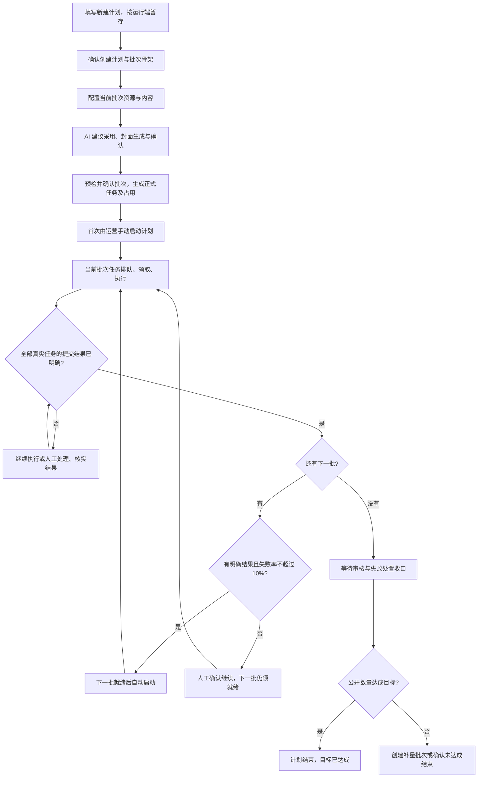

上图是正常主流程；暂停、停止、取消和历史批次重试的完整条件见附录 B。独立批次从批次配置开始，快速发布从单条内容配置开始，均不进入计划统计。

| 想 Review 什么 | 阅读位置 | 图的重点 |
| --- | --- | --- |
| 计划何时启动、暂停、结束 | [B.2 计划](#b2-发布计划状态与动作) | 主状态、原因、动作前置条件 |
| 批次如何配置、执行和结束 | [B.3 批次](#b3-发布批次配置阶段执行控制工作台摘要) | 配置与执行分离，待处理是汇总展示 |
| 任务与重试如何流转 | [B.4 任务](#b4-发布任务状态正常执行与异常处理)、[B.5 执行尝试](#b5-执行尝试与任务结果分开) | 正常路径、人工/未知分支、同次继续与新次重试 |
| 自动推进与停止的影响范围 | [B.6 批次衔接](#b6-批次衔接什么时候自动推进什么时候人工确认)、[B.7 控制动作](#b7-暂停停止取消影响范围与跨对象流程) | 10% 边界、未决阻断、跨对象取消流程 |
| AI、封面、图片和模板 | [B.8 内容准备](#b8-ai-建议与封面成品生成采用失效)、[B.9 图片](#b9-图片库启停与删除)、[B.10 模板](#b10-封面模板内容与启停分开) | 生成与采用、成品失效、启停与发布分开 |
| SSE 前后端如何配合 | [G.3 生成协议](#g3-ai-与封面生成的-sse-协议) | 一次请求内持续返回进度与结果 |

评审时共同遵守以下 7 条规则：

1. **缓存、创建、执行分开。** Desktop 新建草稿存本地 SQLite，浏览器只存 Memory；创建计划生成批次骨架；创建独立批次或确认已有批次才生成任务并占用成片；启动才执行。
2. **批次按阈值推进。** 首次手动启动；前批没有在途或未知结果，且明确失败率≤10%时自动下一批；超过10%时人工确认。人工也不能绕过未知结果。
3. **提交成功与公开成功分开。** 审核中可按本稿建议参与批次衔接，但不算公开发布目标。分母为0时不当成失败率0%。
4. **目标和实际数量分开。** 目标30、明确只生成28条任务时，目标仍是30；执行进度按28条实际任务计算。
5. **取消和释放分开。** 取消仍占用成片；确认不会形成发布结果、旧执行已停止后，明确放弃才释放。结果未知时不重发。
6. **重试保留实际执行历史。** 原任务新增执行记录，任务数不增加；每次执行保存当时的内容快照，未执行的编辑不单独做版本记录。
7. **计划只管理所属批次。** 独立批次、独立任务不计入其他计划的目标与进度。

这里的“结果已明确”是指：可以确认已公开、平台已接收，或者确定失败。它不等于“所有任务都发布成功”。更细的状态、公式和边界分别见附录 B、F。

## 5. 本轮需要 Review 的取舍

建议先确认下表中的业务行为，再核对接口输入输出。标为“建议”的项尚未成为已批准规则。

| 项目 | 本稿建议 | 代价/影响 |
| --- | --- | --- |
| 新建草稿 | **已确认**：Desktop 用 SQLite，浏览器用 Memory；正式创建前不写云端业务表 | SQLite 不跨设备；浏览器刷新/关闭后清空 |
| 内容生成方式 | SSE 在当前请求中推送阶段、进度和逐条结果 | 连接中断保留已收结果；失败/未完成项由用户重试；流超时和分组大小需实测 |
| 图片与模板 | **已确认**：归运营工具的通用能力；各一张表，复用文件表，模板仅存草稿和当前发布配置 | 不建设图片版本库、模板历史版本界面或通用资源引用平台 |
| 首次手动、后续自动 | **已确认**；阈值 10%、恰好 10% 放行 | 首次启动由运营操作，后续按批次实际结果推进 |
| 审核中参与衔接 | 有明确接收结果就参与提交衔接；不计公开目标 | 后一批可在前批审核未完时执行；迟到失败不回退游标 |
| 最终结束/补量 | **已确认**：全部批次执行完毕或合法终止、实际任务处置收口后才处理补量；终止计划不再补量 | 执行期间不追加补发，补量仍按实际公开缺口计算 |
| 计划结构锁定 | **已确认**：首次合法启动后关闭计划编辑，锁定平台、类目、目标、周期及批次结构和顺序；暂停不解锁 | 启动前仅未锁定部分可按约束调整，既有后续批次仍按自身权限完成配置 |
| 取消计划与单批停止 | **已确认**：终止计划停止全部所属批次；单独终止批次仅影响该批，后续按原有衔接条件继续 | 未开始任务安全取消并保留占用，在途及未知结果继续核实；实现仍按本稿评审 |
| 执行后内容 | 批次首次接受执行后整体锁定；失败重试可修正当前内容，下次领取再保存输入快照 | 保持批次快照清楚，不提供运行中全批编辑 |
| 批次取消与停止 | 首次启动前取消；启动后停止剩余发布，暂停另行可恢复 | 两个入口按阶段出现；停止后在途结果仍需收尾，不代表已撤稿 |
| 首版平台 | B站/百家号先联通，小红书能力关闭直至专用验收 | 完整小红书账号/Agent 支持需要单独范围，不能靠多一个枚举完成 |
| 批次执行归属 | 同批只用一个所属用户的账号；计划可跨负责人批次 | 避免本机执行越权；若原型意图是同批多人，需调整范围 |
| 质量分层 | 如必须保留质量优先分配，只加账号/成片两个 nullable 人工字段 | 需账号/成片管理页及接口承接，无自动评分 |
| 日额度未知 | 返回未知、提示核实，不提供日额度硬调度 | 用户填写本批数量不等于平台额度；后续明确来源再做日配额 |
| 批次规模 | 单批≤500、计划≤100原始批次 | 大批次拆分，保持确认事务简单；上限经实际数据验证后调整 |

表中待评审业务取舍随方案批准后回写产品与工程事实源。

## 附录 A 云端六张新表、文件表扩展与本地 SQLite 草稿

本节是设计评审结构，不执行数据库变更。A.2–A.7 为新增的 MySQL 表，A.8 为已有文件表扩展；A.10 是本机 SQLite 表。新增表统一用单数实体名，接口无需与表一一对应。

### A.1 关系

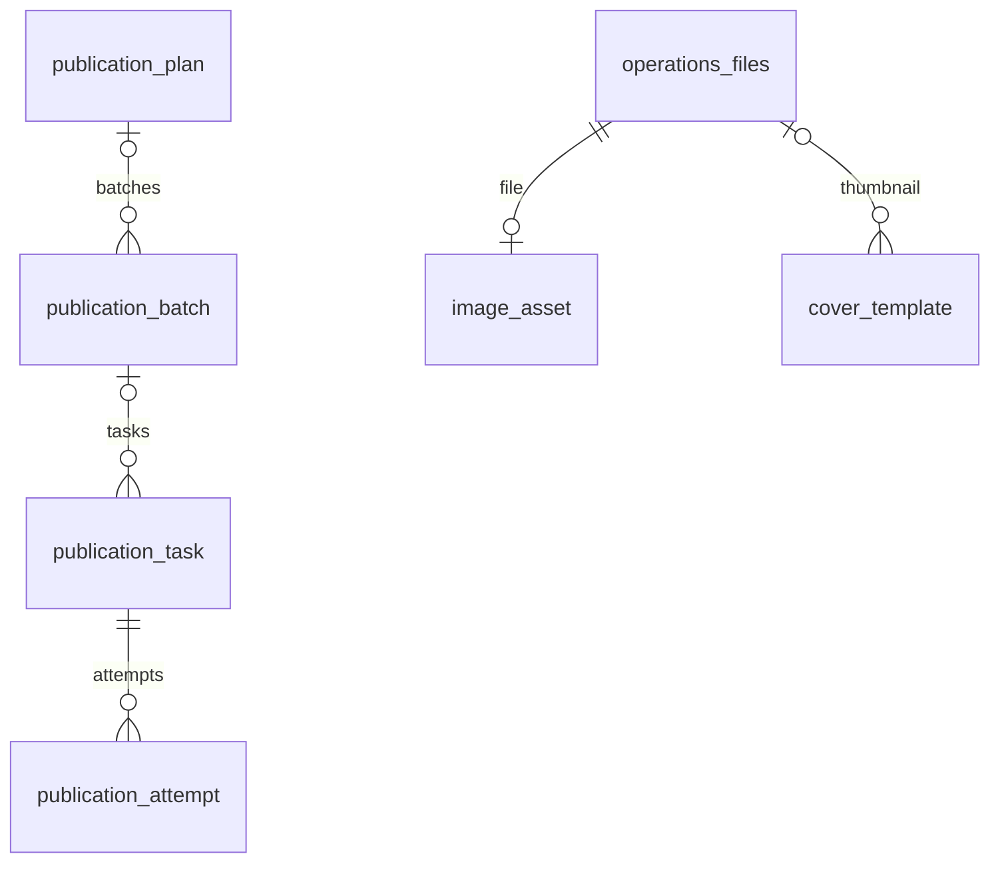

图片/模板通过已校验的配置 JSON 被发布内容引用，图中不画成独立映射表。新建表单草稿在客户端；计划创建后产生的真实批次，其待配置内容保存在批次 JSON。

### A.2 发布计划 publication_plan

```sql
CREATE TABLE publication_plan (
  id BIGINT UNSIGNED NOT NULL AUTO_INCREMENT,
  team_id BIGINT UNSIGNED NOT NULL,
  owner_id BIGINT UNSIGNED NOT NULL,
  name VARCHAR(128) NOT NULL,
  description VARCHAR(1000) NOT NULL DEFAULT '',
  date_start DATE NULL,
  date_end DATE NULL,
  goals_json JSON NOT NULL,
  status VARCHAR(16) NOT NULL DEFAULT 'ready',
  pause_reason VARCHAR(32) NULL,
  end_reason VARCHAR(16) NULL,
  end_note VARCHAR(1000) NULL,
  failure_threshold_bp SMALLINT UNSIGNED NOT NULL DEFAULT 1000,
  current_batch_id BIGINT UNSIGNED NULL,
  goals_locked_at DATETIME(6) NULL,
  first_started_at DATETIME(6) NULL,
  cancel_requested_at DATETIME(6) NULL,
  ended_at DATETIME(6) NULL,
  revision BIGINT UNSIGNED NOT NULL DEFAULT 1,
  request_key VARCHAR(64) NOT NULL,
  request_hash CHAR(64) NOT NULL,
  created_by BIGINT UNSIGNED NOT NULL,
  created_at DATETIME(6) NOT NULL,
  updated_at DATETIME(6) NOT NULL,
  PRIMARY KEY (id),
  UNIQUE KEY uq_pp_create (created_by, request_key),
  KEY idx_pp_team_list (team_id, created_at, id),
  KEY idx_pp_team_state (team_id, status, created_at, id),
  KEY idx_pp_scheduler (status, id)
) ENGINE=InnoDB DEFAULT CHARSET=utf8mb4;
```

计划只在正式创建时写入，此时 goals_json 与全部批次骨架在一个事务中生成，初始 ready。新建表单的拆批建议在客户端缓存，不另存服务端 draft_json。总目标由 goals_json 中的数量求和，不另存一份可修改总数。

```json
[
  {"platform": "bilibili", "category_id": "11", "target_count": 30},
  {"platform": "baidu", "category_id": "11", "target_count": 20}
]
```

正式确认时拒绝重复的平台/类目组合、非整数/负目标和无效类目；按固定平台顺序及 category_id 排序保存。目标为 0 的单元格不保存。

### A.3 发布批次 publication_batch

```sql
CREATE TABLE publication_batch (
  id BIGINT UNSIGNED NOT NULL AUTO_INCREMENT,
  team_id BIGINT UNSIGNED NOT NULL,
  owner_id BIGINT UNSIGNED NOT NULL,
  plan_id BIGINT UNSIGNED NULL,
  kind VARCHAR(16) NOT NULL DEFAULT 'original',
  name VARCHAR(128) NOT NULL,
  description VARCHAR(1000) NOT NULL DEFAULT '',
  platform VARCHAR(32) NOT NULL,
  targets_json JSON NOT NULL,
  group_order INT UNSIGNED NOT NULL DEFAULT 0,
  batch_order INT UNSIGNED NOT NULL DEFAULT 0,
  config_stage VARCHAR(16) NOT NULL DEFAULT 'resource',
  execution_state VARCHAR(16) NOT NULL DEFAULT 'ready',
  draft_json JSON NULL,
  revision BIGINT UNSIGNED NOT NULL DEFAULT 1,
  confirmed_at DATETIME(6) NULL,
  first_started_at DATETIME(6) NULL,
  cancel_requested_at DATETIME(6) NULL,
  dispatch_finished_at DATETIME(6) NULL,
  handoff_at DATETIME(6) NULL,
  request_key VARCHAR(64) NULL,
  request_hash CHAR(64) NULL,
  created_by BIGINT UNSIGNED NOT NULL,
  created_at DATETIME(6) NOT NULL,
  updated_at DATETIME(6) NOT NULL,
  PRIMARY KEY (id),
  UNIQUE KEY uq_pb_create (created_by, request_key),
  KEY idx_pb_plan_order (plan_id, kind, group_order, batch_order, id),
  KEY idx_pb_team_list (team_id, created_at, id)
) ENGINE=InnoDB DEFAULT CHARSET=utf8mb4;
```

`targets_json` 形如 `[{"category_id":"11","target_count":20}]`，类目不能重复；平台由 platform 决定。同计划原始批次的目标必须逐格等于计划目标，检查和修改在持有计划行锁的同一事务中完成。补量 `kind=makeup`，不增加原计划目标。

`draft_json` 保存有界的候选配对、默认内容、逐字段覆盖、行 input_revision、field_revisions 和封面输出引用。定版后生成任务并清空可写候选，避免两份内容同时可编辑。

原始批次按 `group_order,batch_order,id` 推进，同平台组连续；补量在已有批次处理后追加。`handoff_at` 表示计划已经越过本批次，迟到结果不能再次触发推进。

### A.4 发布专用任务 publication_task

```sql
CREATE TABLE publication_task (
  id BIGINT UNSIGNED NOT NULL AUTO_INCREMENT,
  team_id BIGINT UNSIGNED NOT NULL,
  operator_id BIGINT UNSIGNED NOT NULL,
  batch_id BIGINT UNSIGNED NULL,
  platform VARCHAR(32) NOT NULL,
  category_id BIGINT UNSIGNED NOT NULL,
  media_account_id BIGINT UNSIGNED NOT NULL,
  platform_account_id VARCHAR(255) COLLATE utf8mb4_bin NOT NULL,
  composite_output_id BIGINT UNSIGNED NOT NULL,
  resource_snapshot_json JSON NOT NULL,
  content_json JSON NOT NULL,
  task_order INT UNSIGNED NOT NULL DEFAULT 0,
  status VARCHAR(24) NOT NULL DEFAULT 'pending',
  current_attempt_id BIGINT UNSIGNED NULL,
  attempt_count INT UNSIGNED NOT NULL DEFAULT 0,
  not_before DATETIME(6) NULL,
  authorized_at DATETIME(6) NULL,
  authorization_kind VARCHAR(24) NULL,
  cancel_requested_at DATETIME(6) NULL,
  accepted_at DATETIME(6) NULL,
  published_at DATETIME(6) NULL,
  platform_work_id VARCHAR(255) COLLATE utf8mb4_bin NULL,
  work_url VARCHAR(2048) NULL,
  failure_code VARCHAR(64) NULL,
  failure_message VARCHAR(1000) NULL,
  retry_safe TINYINT(1) NOT NULL DEFAULT 0,
  revision BIGINT UNSIGNED NOT NULL DEFAULT 1,
  request_key VARCHAR(64) NULL,
  request_hash CHAR(64) NULL,
  created_by BIGINT UNSIGNED NOT NULL,
  created_at DATETIME(6) NOT NULL,
  updated_at DATETIME(6) NOT NULL,
  occupied_output_id BIGINT UNSIGNED GENERATED ALWAYS AS
    (CASE WHEN status <> 'abandoned'
      THEN composite_output_id ELSE NULL END) STORED,
  executing_account_id VARCHAR(255) COLLATE utf8mb4_bin GENERATED ALWAYS AS
    (CASE WHEN status IN ('running','awaiting_human','uncertain','awaiting_link')
      THEN platform_account_id ELSE NULL END) STORED,
  PRIMARY KEY (id),
  UNIQUE KEY uq_pub_output (platform, occupied_output_id),
  UNIQUE KEY uq_pub_execution (platform, executing_account_id),
  UNIQUE KEY uq_pub_create (created_by, request_key),
  KEY idx_pub_team_list (team_id, created_at, id),
  KEY idx_pub_team_state (team_id, status, created_at, id),
  KEY idx_pub_batch (batch_id, status, id),
  KEY idx_pub_claim (operator_id, status, not_before, id),
  KEY idx_pub_today (team_id, published_at, platform, category_id),
  CHECK (CHAR_LENGTH(platform_account_id) > 0)
) ENGINE=InnoDB DEFAULT CHARSET=utf8mb4;
```

仅正式创建时插入完整 pending 行，所有账号/成片/平台字段必填，operator_id 等于账号所属用户。执行端只领取已正式创建并获得执行授权的任务。

content_json 保存当前标题、正文、标签、封面成品及模板快照，合法修改增加对象 revision。实际执行输入由 attempt 固定。

只有 abandoned 释放成片；cancelled、failed、reviewing、published 继续占用。MySQL 唯一索引允许多个 NULL，依据见 [CREATE INDEX](https://dev.mysql.com/doc/refman/8.0/en/create-index.html)。

真实平台账号 UID 保存为不可随意改写的身份；同 UID 多窗口共享执行唯一约束。Agent 同时按本机 Profile 串行操作。`authorization_kind=standalone/batch/individual_retry` 仍用于区分合法执行意图，不增加授权表。

### A.5 执行记录 publication_attempt

```sql
CREATE TABLE publication_attempt (
  id BIGINT UNSIGNED NOT NULL AUTO_INCREMENT,
  publication_id BIGINT UNSIGNED NOT NULL,
  attempt_no INT UNSIGNED NOT NULL,
  executor_user_id BIGINT UNSIGNED NOT NULL,
  claim_request_key VARCHAR(64) NOT NULL,
  input_snapshot_json JSON NOT NULL,
  status VARCHAR(24) NOT NULL,
  stage VARCHAR(32) NOT NULL,
  report_seq BIGINT UNSIGNED NOT NULL DEFAULT 0,
  heartbeat_at DATETIME(6) NOT NULL,
  started_at DATETIME(6) NOT NULL,
  submit_started_at DATETIME(6) NULL,
  finished_at DATETIME(6) NULL,
  result_status VARCHAR(24) NULL,
  error_code VARCHAR(64) NULL,
  error_message VARCHAR(1000) NULL,
  steps_json JSON NOT NULL,
  evidence_json JSON NOT NULL,
  result_hash CHAR(64) NULL,
  resolved_by BIGINT UNSIGNED NULL,
  resolved_at DATETIME(6) NULL,
  resolution_note VARCHAR(2000) NULL,
  PRIMARY KEY (id),
  UNIQUE KEY uq_pa_number (publication_id, attempt_no),
  UNIQUE KEY uq_pa_claim (executor_user_id, claim_request_key),
  KEY idx_pa_recovery (status, heartbeat_at, id)
) ENGINE=InnoDB DEFAULT CHARSET=utf8mb4;
```

Agent 领取任务时，在同一事务内把当前内容及资源快照完整复制进 input_snapshot_json，增加 attempt_count，并指向 current_attempt_id。后续内容修改和重试不更新旧执行的输入快照。排队尚未领取不创建 attempt。

状态、心跳、步骤和结果可以按协议更新；输入快照不可更新。report_seq 小于等于已保存序号时不重复应用；最终结果另以 result_hash 判断重复或冲突。保留 claim_request_key 是为了领取响应丢失后返回原 attempt，避免误领下一条。

当前内容和执行快照中的内容形状如下；input_snapshot_json 还包含账号 UID 和成片/封面文件摘要等实际资源事实：

```json
{
  "content": {
    "title": "实际发布标题",
    "description": "正文或简介",
    "cover_title": "封面短标题",
    "topics": ["三角洲"],
    "tags": ["游戏攻略"],
    "visibility": "public",
    "platform_fields": {},
    "cover": {
      "mode": "template",
      "template_id": "21",
      "template_revision": 4,
      "template_snapshot": {},
      "outputs": [{"file_id": "401", "sha256": "..."}]
    }
  },
  "resources": {"platform_account_id": "verified-uid", "composite_output_id": "301"}
}
```

保存输入快照会在不同执行记录间重复少量文字与文件引用，这是为了让每次执行可以独立核对；媒体文件本身不重复保存。

### A.6 图片库 image_asset

```sql
CREATE TABLE image_asset (
  id BIGINT UNSIGNED NOT NULL AUTO_INCREMENT,
  team_id BIGINT UNSIGNED NOT NULL,
  file_id BIGINT NOT NULL,
  name VARCHAR(160) NOT NULL,
  allow_as_cover TINYINT(1) NOT NULL DEFAULT 1,
  allow_as_background TINYINT(1) NOT NULL DEFAULT 0,
  category_ids_json JSON NOT NULL,
  enabled TINYINT(1) NOT NULL DEFAULT 1,
  revision BIGINT UNSIGNED NOT NULL DEFAULT 1,
  created_by BIGINT UNSIGNED NOT NULL,
  created_at DATETIME(6) NOT NULL,
  updated_at DATETIME(6) NOT NULL,
  PRIMARY KEY (id),
  UNIQUE KEY uq_ia_file (file_id),
  KEY idx_ia_team_state (team_id, enabled, created_at, id),
  CHECK (allow_as_cover = 1 OR allow_as_background = 1)
) ENGINE=InnoDB DEFAULT CHARSET=utf8mb4;
```

- file_id 对应已完成上传且有权使用的 operations_files 图片；按实际图片解码取得尺寸，不能相信客户端扩展名。图片库不重复存 URL、对象 key、大小和 SHA。
- 登记以 file_id 去重；同文件同配置返回已有记录，不同配置返回冲突，通过修改接口更新。
- category_ids_json 保存既有类目 ID 数组，空数组代表通用；按 ADR-0028 使用平面类目。至少一种用途，可同时作封面和底图。
- 图片原文件不可替换；换图必须上传新文件、登记新图片。重命名、改分类和停用不改变旧任务已经固定的文件及内容快照。
- 图片停用后不进入新选择；已确认的封面成品仍可使用。未引用图片可删除库记录，底层文件单独由现有文件管理维护。

### A.7 封面模板 cover_template

```sql
CREATE TABLE cover_template (
  id BIGINT UNSIGNED NOT NULL AUTO_INCREMENT,
  team_id BIGINT UNSIGNED NOT NULL,
  name VARCHAR(128) NOT NULL,
  canvas_width INT UNSIGNED NOT NULL,
  canvas_height INT UNSIGNED NOT NULL,
  scope VARCHAR(16) NOT NULL DEFAULT 'general',
  platform_codes_json JSON NOT NULL,
  category_ids_json JSON NOT NULL,
  draft_config_json JSON NULL,
  published_config_json JSON NULL,
  published_revision INT UNSIGNED NOT NULL DEFAULT 0,
  published_thumbnail_file_id BIGINT NULL,
  enabled TINYINT(1) NOT NULL DEFAULT 0,
  revision BIGINT UNSIGNED NOT NULL DEFAULT 1,
  request_key VARCHAR(64) NOT NULL,
  request_hash CHAR(64) NOT NULL,
  created_by BIGINT UNSIGNED NOT NULL,
  created_at DATETIME(6) NOT NULL,
  updated_at DATETIME(6) NOT NULL,
  PRIMARY KEY (id),
  UNIQUE KEY uq_ct_create (created_by, request_key),
  KEY idx_ct_select (team_id, enabled, canvas_width, canvas_height, id),
  CHECK (canvas_width > 0 AND canvas_height > 0),
  CHECK (enabled = 0 OR published_config_json IS NOT NULL)
) ENGINE=InnoDB DEFAULT CHARSET=utf8mb4;
```

固定基础信息为 name、canvas_width/height、scope 和推荐平台/类目；需要换规格或基础信息时复制。scope 只描述推荐范围，不绕过真实输出规格检查。

一行同时保存最多一份 draft_config_json 和一份 published_config_json。图层、背景、唯一动态主标题、字体与排版参数都在配置 JSON，不给图层建表。不完整草稿可以保存；正式生成只能使用启用模板的发布配置。

| 动作 | 同一行如何变化 |
| --- | --- |
| 新建 | draft 有值，published 为空，published_revision=0，enabled=false |
| 保存编辑 | 更新 draft，revision++；不动 published、缩略图和 enabled |
| 发布/更新 | 重检保存的 draft；将其写入 published，published_revision++，清空 draft；更新实际缩略图，保持原 enabled |
| 启停 | 只改 enabled 和 revision；只有已发布内容才能启用 |
| 复制 | 优先复制已保存草稿，否则复制当前发布配置；新 ID、新名称/规格，作为新草稿且 enabled=false；不复制发布事实 |

published_revision 仅标识当前发布配置，不对应另一张版本表；历史模板配置在生成封面文件的来源信息及任务执行快照中保留。内容筛选“有草稿”与“已发布”可同时成立，不能用单个 status 二选一表达。

配置 JSON 的最小形状如下，实际样式字段复用当前编辑器已经定义的字体、描边、行距及缩放参数。引用统一使用 ID，不把临时图片 URL 保存为模板事实：

```json
{
  "background": {"mode": "fixed", "image_id": "101", "file_id": "201", "fit": "cover"},
  "layers": [
    {"id": "title", "type": "text", "binding": "cover_title", "visible": true,
     "box": {"x": 60, "y": 100, "width": 960, "height": 240},
     "style": {"font": "configured-font", "font_size": 72, "min_font_size": 40, "max_lines": 2}}
  ]
}
```

背景 mode 为 solid/fixed/business；fixed 固定引用库图片，business 在正式渲染时绑定本次实际底图，编辑样例不存成业务输入。最多一个 cover_title 动态绑定，其他文字只能是固定内容。宽高由模板基础字段决定，不允许配置 JSON 覆盖。

预览/发布检查沿用 [封面模板 V1](cover-templates.md)：一个可见动态主标题、固定文字有效、字体可用、短长样例不溢出、画布及安全区合规、固定图片可读取、真实渲染成功。发布更新需 expected_revision，校验及渲染在事务外执行，写入前重检 revision；过期结果不发布。

### A.8 复用并扩展 operations_files

现有表已经保存 owner_id/team_id、name、type、content_type、object_key、size_bytes、sha256、uploaded_at 和 resource_token。本设计只建议新增一列 `metadata_json JSON NULL`，不重建上传/存储体系：

| 文件类型 | metadata_json 保存内容 |
| --- | --- |
| 上传图片 | 后端读取的 width、height、实际 format；旧文件使用前补齐实际检查结果 |
| 模板预览/正式封面 | width、height、origin=cover_preview 或 cover_render、render_input_hash、模板 ID/发布修订/完整配置快照、所用底图文件 ID及摘要、实际标题、渲染器版本 |

生成图片由封面服务通过既有文件 Service 保存并登记，不自动加入运营图片库。一个正式封面可以直接被任务引用，无须先创建 image_asset。metadata_json 来源信息只由服务端写入；正式创建拒绝 origin=cover_preview 的样例图片，不把它当成真实标题的成品。

文件上传/资源路由复用现有 `/files`、`/file-resources/{token}`。文件接口按需返回尺寸，图片库 JOIN 文件表取得预览、大小和摘要。JSON 只存对象引用及小型来源配置，不存图片 Base64。

### A.9 引用、删除与查询

- 主对象关联及图片 file_id、模板缩略图等按现有 migration 风格建立外键；引用既有 ID 的列类型须与原表一致。operations_files.id 为有符号 BIGINT，以上 file_id/缩略图列相同，不能直接套用新表主键类型。
- 目标 JSON、图片类目数组和模板标签由服务端验证：复用现有类目、去重、范围权限与非负数量。首版按对象 revision 整体编辑，不做逐字段协同合并。
- 图片可引用于模板草稿/发布配置、生成封面来源、已有批次配置、任务当前内容及历史 attempt。引用详情按这些已知来源查询，不建立通用资源引用表，也不保存容易失真的引用计数。
- **删除保护须同时接入图片库和已有文件 DELETE**：仍有图片库记录、模板缩略图、生成封面来源或批次/任务/attempt 引用的文件，不允许物理删除。创建引用与删除走同一文件/图片记录锁；图片库删除也锁本行再检查引用。这里保护的是明确的引用关系，图片停用与文件删除分别处理。
- 只存在本地缓存中的文件引用不阻止文件管理删除；恢复缓存时显示失效项，正式创建重新检查。服务端不得把客户端缓存当成资源占用依据。
- 计划/批次/任务与实际 attempt 保留；模板从未发布且无引用才可删除；图片有引用只能停用。正式封面及历史文件的清理沿用文件管理，不提前建设自动回收系统。
- 列表先应用权限/平台/类目/状态等过滤再计数分页；目标合计在 Go 中计算，实际发布结果由 SQL 聚合。JSON 不能直接作为普通列索引，技术限制见 [MySQL JSON](https://dev.mysql.com/doc/refman/8.0/en/json.html)。当前不预建多值索引或目标明细报表。
- 公开结果属于 publication_task，作品管理复用此事实；不新增发布结果表。

### A.10 Desktop 本地草稿 publication_draft（SQLite）

这张表由 Local Agent 的本地存储管理，不执行 Cloud migration；浏览器端没有对应数据库表。

```sql
CREATE TABLE publication_draft (
  environment TEXT NOT NULL,
  user_id TEXT NOT NULL,
  draft_type TEXT NOT NULL CHECK (draft_type IN ('plan', 'batch', 'task')),
  payload_json TEXT NOT NULL,
  schema_version INTEGER NOT NULL DEFAULT 1,
  saved_at TEXT NOT NULL,
  PRIMARY KEY (environment, user_id, draft_type)
);
```

payload_json 保存该类型的新建表单、已采用结果、文件引用和创建 request_key；请求结果不明时还保留原提交内容。保存使用同主键覆盖，不保留草稿历史，不增加草稿状态机。成功正式创建或明确丢弃后删除。SQLite 的持久化只帮助恢复尚未创建的输入；实际资源和占用仍由 Cloud 在正式创建时重新检查。

## 附录 B 状态、动作与状态转换图

本节统一原型中的业务状态和操作。**中文是界面用语，英文是本稿建议的后端枚举；箭头标注触发动作或条件。** 全部内容仍属设计评审，不代表接口已经实现。图中未画出的转换默认不允许；自环表示修改信息但不改变主状态。

### B.1 先分清：哪些是状态，哪些只是展示结果

| 对象/维度 | 保存位置 | 界面例子 | 说明 |
| --- | --- | --- | --- |
| 计划执行控制 | `publication_plan.status` | 待执行、执行中、已暂停、停止中、已结束 | 暂停原因、结束原因分别保存，不扩充主状态 |
| 批次配置阶段 | `publication_batch.config_stage` | 待资源配置、待内容配置、已定版 | 与执行控制分开；定版才创建正式任务 |
| 批次执行控制 | `publication_batch.execution_state` | 待执行、执行中、已暂停、停止中、执行已收口、已取消 | 不直接等同于“全部已发布” |
| 批次工作台摘要 | 查询时计算 | 草稿、待执行、执行中、待处理、已结束、已取消 | 根据配置、控制状态及任务结果生成，不另建一个可写状态 |
| 发布任务 | `publication_task.status` | 待执行、等待人工、结果待确认、平台审核中、已发布等 | 一条任务只有一个当前主状态 |
| 执行尝试 | `publication_attempt.status` | 执行中、等待人工、已结束、执行中断 | 表达执行进程，不替代任务的平台结果 |
| AI/封面处理与采用 | 当前页面；已采用内容随配置保存 | 生成中、待采用、已采用、已过期、封面待重新合成 | 不建立生成任务表，也不增加发布任务主状态 |
| 图片/模板使用资格 | 各自表的 `enabled` | 启用、停用 | 不影响已经确认的封面文件和任务快照 |
| 模板内容 | 是否有 draft/published 配置 | 仅草稿、已发布、已发布且有草稿 | 内容与启停是两个维度，可以组合 |

“目标已达成/未达成/待最终核实”“全部已发布/部分已发布”“资源不足”“提交已收口”都由事实计算。它们可以与主状态同时展示，不增加数据库状态列。上传中、保存中、校验失败、生成百分比是当前请求反馈。

### B.2 发布计划：状态与动作

| 界面名称 | `status` | 含义 | 可用业务动作 |
| --- | --- | --- | --- |
| 待执行 | `ready` | 已正式创建批次骨架，尚未首次启动 | 配置批次、允许范围内调整结构、首次启动、取消 |
| 执行中 | `running` | 允许观察当前批次并按条件启动下一批 | 暂停推进、进入批次处理、取消；已有批次全部处置后补量/结束 |
| 已暂停 | `paused` | 不再启动新的下一批，当前批次继续 | 按暂停原因恢复、人工确认下一批、处理配置、取消 |
| 停止中 | `stopping` | 已撤销后续授权，仍有在途或未知任务需要收尾 | 查看、处理人工、核实结果；不允许新提交和重试 |
| 已结束 | `ended` | 计划控制结束，结果与原因保留 | 查看、复制配置到新建表单 |

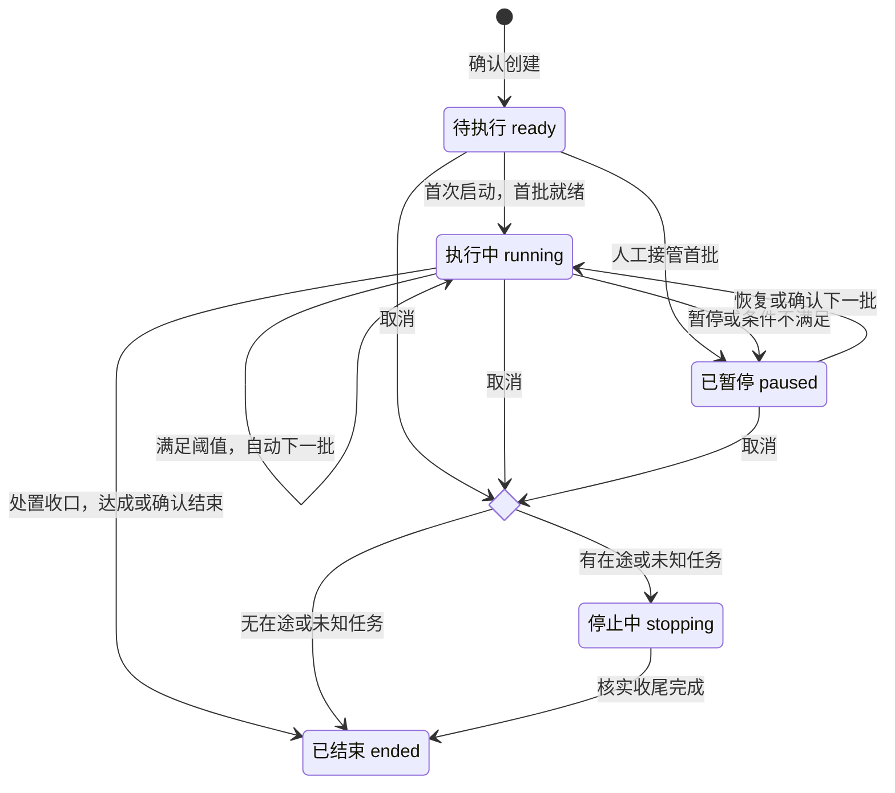

`pause_reason` 为 `manual/failure_threshold/next_batch_not_ready/no_known_result`，不是额外主状态。历史批次重新重试产生未决任务时，也按人工暂停推进处理，并返回具体阻断任务。`end_reason` 为 `achieved/unachieved/cancelled`；界面的“已取消计划”对应 `ended + cancelled`，不再加一个计划主状态。结束原因记录结束时结论，迟到公开结果继续更新统计，不改写原结束理由。

| 动作 | 前置条件 | 成功后发生什么 | 接口/入口 |
| --- | --- | --- | --- |
| 首次启动 | `ready`；首批已定版；至少一条通过执行检查；部分执行须明确确认 | 写首次启动时间，锁定计划目标/周期，授权首批 | `POST /publication-plans/{id}/start` |
| 暂停推进 | `running` | `paused/manual`；当前批次继续 | `POST /publication-plans/{id}/pause` |
| 恢复推进 | `paused`；重新检查当前位置和全部未决任务 | 继续观察当前批；已收口才检查下一批，不重复启动 | `POST /publication-plans/{id}/resume` |
| 人工确认下一批 | 超阈值或无明确结果；无未决任务；下一批就绪 | 只推进游标和授权，不把原任务改成成功 | `POST /publication-plans/{id}/confirm-next` |
| 人工接管当前批次 | 当前合法位置；就绪且执行检查通过；明确确认接管 | 计划 paused/manual，当前批次由人工启动；首次接管也写首次启动并锁定 | `POST /publication-batches/{id}/start`，带明确接管确认 |
| 补量/确认结束 | `running`；无下一原始批次；已有批次全部处置收口 | 追加待配置补量，或 `ended/unachieved` | `makeup-batches` / `finish` |
| 取消 | `ready/running/paused` | 先停止新派发；根据在途情况进入 `stopping` 或 `ended/cancelled` | `POST /publication-plans/{id}/cancel` |
| 复制 | 已结束；只读配置可取 | 打开对应运行端的新建表单；不复制执行、作品和占用事实 | 前端填充新建表单，确认后调用创建接口 |

首次启动失败且未取得执行授权，不记录首次启动、不锁定计划。计划暂停只停止**下一批启动**；需要暂停当前批次时操作批次自己的暂停。恢复不能绕过失败率人工确认、未决结果或下一批未就绪。

### B.3 发布批次：配置阶段、执行控制、工作台摘要

**先看配置阶段。** 计划创建的是待配置骨架；独立批次在新建表单中完成配置，确认创建时直接生成已定版批次及正式任务。

| `config_stage` | 界面名称 | 允许动作 | 完成标志 |
| --- | --- | --- | --- |
| `resource` | 待资源配置 | 选账号/成片、推荐配对、保存配置 | 配对满足要求后进入内容配置 |
| `content` | 待内容配置 | 编辑文字、AI 生成并采用、生成并确认封面、预检 | 运营确认有效候选与缺口 |
| `confirmed` | 已定版 | 首次启动前按规则修改当前内容、执行预检、启动 | 正式任务已创建并取得成片占用 |

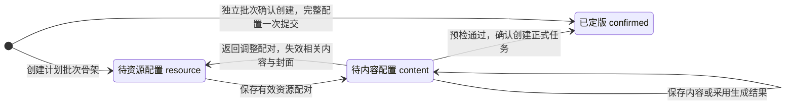

`confirmed_at` 后任务身份和批次目标不可直接改写，不能退回配置阶段覆盖已有任务。首次启动前允许的内容编辑仍在当前任务上保存；首次启动后批次内容锁定，只有明确失败任务可修正下次重试内容。

**再看执行控制。** `execution_state` 初始为 `ready`，但未定版时不能执行。这里的 `finished` 表示本轮派发与提交已收口，审核/失败仍可能待处理。

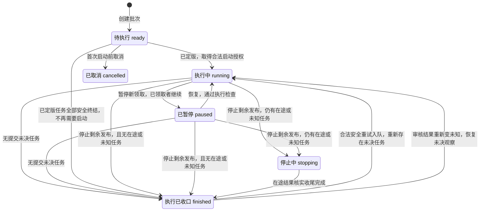

`finished → running` 表示重新出现提交未决，需要继续观察；它不自动授予新派发权限。安全重试必须单独授权；审核结果变未知只恢复待核实观察，不重复提交。停止后不能借此恢复批次整体执行、已取消任务或父计划；父计划仍在 `stopping` 时不允许重试。若停止控制还没有收尾，重新出现的未知结果继续保持 `stopping`。

| 动作 | 前置条件 | 结果 |
| --- | --- | --- |
| 启动 | 已定版、至少一条可执行；计划内批次必须满足当前位置和调度权 | 记录首次启动，固定批次配置，给有效任务授权 |
| 暂停/恢复 | `running` / `paused` | 保留未领取队列；运行中任务继续；恢复时重新检查 |
| 取消批次 | **首次启动前**，且尚未取消 | 取消骨架及尚未执行任务，保留历史与占用 |
| 停止剩余发布 | 已启动，仍有剩余任务或在途任务 | 取消未领取任务，撤销新派发，在途任务按真实结果收尾 |
| 处理异常 | 存在等待人工、未知、失败、待补链接或审核待核实项 | 进入对应任务执行允许动作，不把整批退回配置阶段 |
| 复制 | 已结束或已取消 | 新表单只继承目标与可复用规则；不继承任务、执行记录、作品和占用 |

从批次入口手动启动计划内批次，须明确确认人工接管：先暂停计划的自动推进、完成必要的首次锁定，再授权当前合法位置的批次。不能直接启动后面的批次；自动推进与人工接管不能同时派发。回到计划恢复推进时重新检查当前批次真实状态，不重复启动。以上变化使用现有 plan/batch 状态与审计记录，不另建控制权表。

**工作台展示取以下优先级，自上向下匹配。**

| 条件 | 工作台主标签 | 说明 |
| --- | --- | --- |
| `execution_state=cancelled` | 已取消 | 未启动批次的取消结果 |
| `execution_state=stopping` | 停止中 | 等待在途/未知结果收尾 |
| `execution_state=paused` | 已暂停 | 可恢复的新领取暂停 |
| 未定版 | 草稿 | 已建骨架仍在配置；不等同于运行端新建草稿 |
| 正式任务全部为 `published/cancelled/abandoned` | 已结束 | 已处置收口，不代表都已发布 |
| 已定版、从未启动 | 待执行 | 可启动或编辑允许的内容 |
| 有排队/执行，或有已授权可派发任务 | 执行中 | 按实际运行队列展示 |
| 其余已启动批次 | 待处理 | 例如仅剩失败、审核、人工或未知结果 |

“待处理”是任务汇总，不入 `execution_state`。同时显示已发布数、待处理数和提交是否收口，不用一个绿色完成标签掩盖审核与失败。

### B.4 发布任务：状态、正常执行与异常处理

| 界面名称 | `status` | 判定事实 | 主要动作 |
| --- | --- | --- | --- |
| 待执行 | `pending` | 已正式创建；未授权或定时未到 | 允许范围内编辑/改时间、执行、取消 |
| 排队中 | `queued` | 已授权且到时，等待所属用户 Agent 领取 | 查看；领取前可取消 |
| 执行中 | `running` | 已领取，当前 attempt 正在执行 | 查看步骤，不覆盖执行快照 |
| 等待人工 | `awaiting_human` | 登录、验证码、平台人工确认等卡点 | 去处理，验证后继续原现场；反馈可能已提交则核实 |
| 结果待确认 | `uncertain` | 可能已提交，结果不明 | 核实；不能直接重试、取消或释放 |
| 待补链接 | `awaiting_link` | 人工反馈已完成，公开链接/证据未齐 | 补录并核实，不计公开成功 |
| 平台审核中 | `reviewing` | 有平台明确接收证据 | 核实审核/公开结果，不重复提交 |
| 已发布 | `published` | 有可信公开作品及账号/稿件依据 | 查看作品、复制配置 |
| 发布失败 | `failed` | 有明确失败依据；确定未形成可发布作品；旧执行安全结束 | 修正允许项后重试，或安全放弃 |
| 已取消 | `cancelled` | 未执行，或有当前执行安全停止且未提交的证据 | 查看；满足条件可放弃释放；不能恢复 |
| 已放弃 | `abandoned` | 确认不会形成发布结果且旧执行停止 | 只读/复制配置，成片占用已释放 |

原型“执行失败”和“发布失败”统一展示为**发布失败**，后端只用 `failed`。平台明确拒绝但仍存在可继续发布的稿件时，不能直接认定可重发，先保留待核实结果。

**正常执行图：**

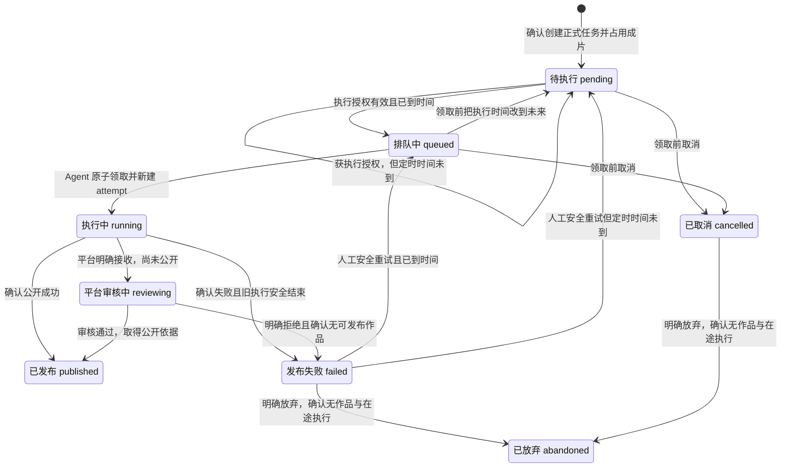

**人工、未知与补录图：** 以下是上图执行过程的分支，不是另一种任务。

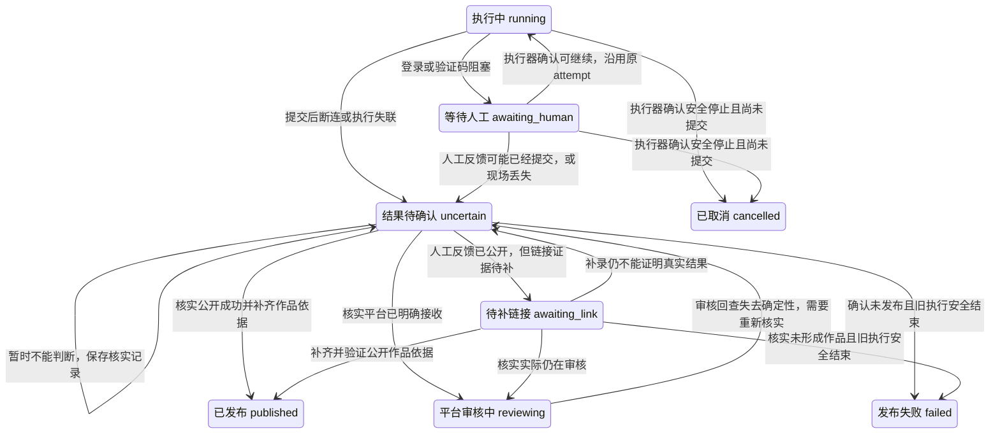

平台审核中若回查结果失去确定性，可以退到 `uncertain` 待核实；不能因为“暂时查不到”就记失败。失联不等于旧进程已停止，不能仅凭超时取消或释放。

| 动作 | 允许条件 | 状态/数据变化 | 接口/入口 |
| --- | --- | --- | --- |
| 详情/作品 | 所有状态可查看有权数据；作品须已公开 | 不改变状态 | GET 详情；作品管理入口 |
| 编辑内容 | pending 且未领取，所属批次尚未首次启动；独立 pending 无此父限制；或安全失败后的下次重试内容 | 增加当前 revision；不改旧 attempt；queued 不直接编辑 | `PUT /publications/{id}/content` |
| 修改执行时间 | pending/queued 且未领取、尚未提交 | 新时间已到且授权有效才 queued，否则 pending | `PUT /publications/{id}/schedule` |
| 执行 | pending；资源有效；有合法父级或独立授权 | 到时 queued，否则 pending；不创建 attempt | `POST /publications/{id}/start` |
| 去处理/继续 | awaiting_human；本地原现场存在；执行器确认 safe-to-resume | 继续原 attempt，回到 running；不再次上传 | Desktop 原现场入口；Agent 使用现有 progress 回报 |
| 核实/补录 | uncertain、awaiting_link、reviewing；结论与证据匹配当前 attempt | 写核实人、依据、链接和真实结果；无结论则保持待核实 | `POST /publications/{id}/resolve` |
| 重试 | failed；确认未形成作品；旧执行已停止；父级允许或另有合法单条授权 | 原任务重新授权，领取后才创建新 attempt | `POST /publications/{id}/retry` |
| 取消 | pending/queued 未领取；或 running/awaiting_human 已有当前 attempt 安全停止、未提交证据 | cancelled，继续占用；无安全证据时不改成已取消 | `POST /publications/{id}/cancel` |
| 放弃释放 | cancelled/failed；确认无作品、无在途执行 | abandoned，仅此动作释放成片占用 | `POST /publications/{id}/abandon` |
| 复制 | failed/published/cancelled/abandoned | 填充新的当前表单；不继承 attempt、作品和占用，创建时重新预检 | 前端复制配置，确认后调用创建接口 |

人工“继续”与失败“重试”必须分开：前者继续同一次执行，后者下次领取生成新的执行记录。复制不是恢复旧任务；同平台成片仍被旧任务占用时，不能用复制绕过占用。

### B.5 执行尝试：与任务结果分开

| `publication_attempt.status` | 含义 | 对发布任务的影响 |
| --- | --- | --- |
| `running` | 正在执行固定输入快照 | 通常对应任务 running |
| `awaiting_human` | 原执行停在人工卡点 | 对应任务 awaiting_human；继续时沿用本条记录 |
| `completed` | 执行过程结束，记录本次结果 | 任务可为 reviewing/published/failed/uncertain 等，不能据此认定已公开 |
| `interrupted` | 心跳失联或执行中断，终止情况尚需核实 | 任务进入 uncertain；不自动创建新尝试或释放账号执行位 |

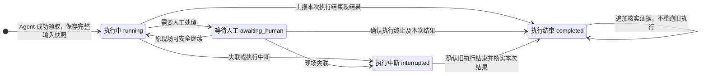

排队不创建 attempt。失败重试保留旧 attempt；新领取才增加 attempt_no。`completed + result_status=uncertain` 仍需核实任务结果；账号是否可再执行取决于任务是否仍未决，不仅看 attempt 是否结束。

### B.6 批次衔接：什么时候自动推进，什么时候人工确认

先区分两种“完成”，再计算失败率。

| 名称 | 判据 | 用在哪里 |
| --- | --- | --- |
| 提交未决 | 任一 `pending/queued/running/awaiting_human/uncertain/awaiting_link` | 阻断下一批；定时未到也属于未决 |
| 明确结果 | `published/reviewing/failed`；failed 须确认未形成可发布稿件 | 失败率分母 |
| 提交收口 | 当前正式任务中未决数量为 0 | 可以检查下一批衔接；不代表全部公开 |
| 处置收口 | 已定版且至少一条任务，每条均为 `published/cancelled/abandoned`；未定版骨架已明确取消也可收口 | 最终结束与补量 |

创建计划保存 `failure_threshold_bp=1000`，即 10%，不开放运营编辑。整数比较：`failed * 10000 <= (published + reviewing + failed) * 1000`。取消与放弃不进分子分母。

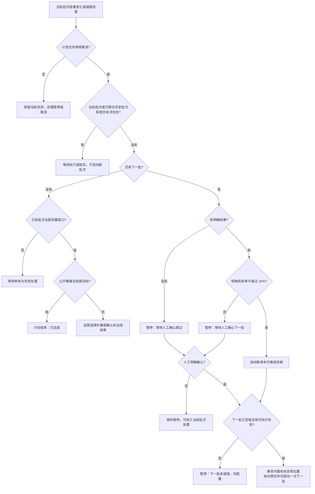

图中的“计划允许推进”指自动检查时处于 running，或已经接受合法 resume/confirm-next；人工确认与最终推进写入在同一事务重新校验。人工可接受高失败率或无明确结果，但不能越过未知/在途任务，也不能启动未就绪批次。

- **恰好 10% 自动推进**：1/10 放行；2/10 等人工；0 个明确结果不按 0% 放行。
- **目标与执行分开**：目标 30、明确只生成 28 条、28 条均发布时，可以按 28 条真实任务收口与衔接，目标仍为 30，保留缺口 2。
- **迟到结果不倒退**：上一批审核后失败只更新结果，不回退游标、不重复启动已启动批次。
- **历史重试会阻断新一批**：已经 handoff 的任务重新重试后，resume、confirm-next 和自动推进均检查它的未决状态；当前已经启动的批次继续。
- **单条失败不立即停全批**：10% 只决定批次之间的衔接，不自动停止同批其他账号。

### B.7 暂停、停止、取消：影响范围与跨对象流程

| 动作 | 停止下一批启动 | 停止当前批次新领取 | 未领取任务 | 已领取任务 | 能否恢复 |
| --- | --- | --- | --- | --- | --- |
| 暂停计划 | 是 | 否 | 当前批次队列保留 | 继续原执行 | 可恢复计划推进 |
| 暂停批次 | 当前批次未决会阻断推进 | 是 | 队列保留 | 继续原执行 | 可恢复本批领取 |
| 取消未启动批次 | 当前批次取消后重新检查推进条件 | 是 | 取消，保留占用 | 不应存在 | 不恢复该批次 |
| 停止剩余发布 | 当前批次在途收口后重新检查推进条件 | 是 | 取消，保留占用 | 提交前检查取消；已提交核实真实结果 | 不恢复批次整体执行 |
| 取消计划 | 是，永久停止 | 是，作用于所属全部批次 | 取消；未定版骨架也取消 | 安全收尾；真实审核/公开结果保留 | 不恢复计划 |

终止计划级联停止全部所属批次、单独停止批次不连带终止后续批次，已按 PRD 6.2.5／6.3.5 确认；本稿的接口与执行机制仍需工程评审。取消/停止不撤稿，不把审核中改成失败，不自动释放成片。批次首次启动前用“取消批次”，启动后用“停止剩余发布”，两个入口按阶段使用。

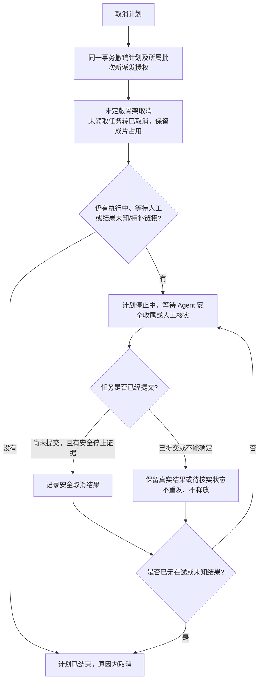

“已结束/取消”是调度控制结果；平台审核仍可继续并产生迟到公开结果，后续按真实事实更新。单任务取消与 Agent 领取竞争时必须锁同一任务；已领取且无安全证据不能直接记取消。

### B.8 AI 建议与封面成品：生成、采用、失效

**AI 有两层临时状态。** 当前 SSE 请求为“生成中 → 完成/失败/中断”；已完整收到的每条、每字段建议另有“待采用/已采用/已过期”。一次请求失败或中断，不使已经收到的完整建议作废。

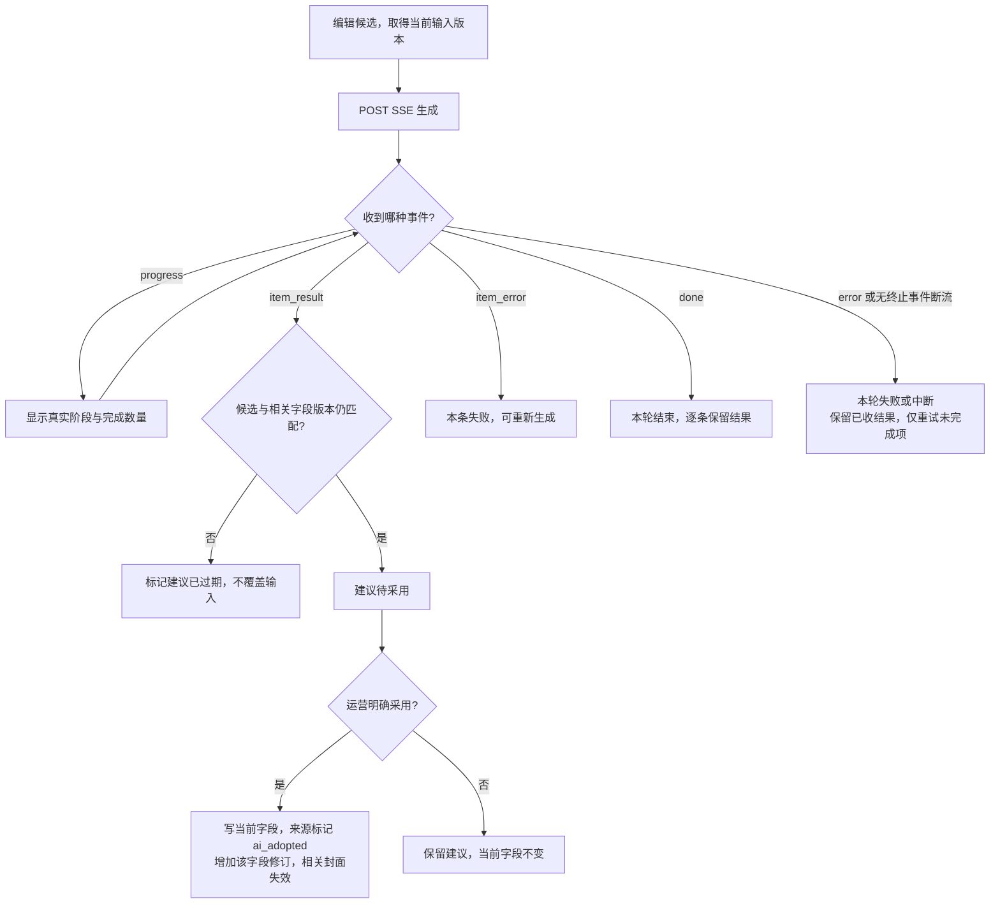

字段来源为 `inherit/manual/ai_adopted`；“已采用”不等于正式任务已创建。新建表单结果保存在客户端；已有批次通过保存配置接口保存已采用内容。使用“生成上下文版本 + 各字段修订”检查建议：上下文变化使本行建议过期；某字段被修改只使该字段旧建议过期。采用标题只提升标题字段修订，仍可继续采用同一结果中的标签、正文。重新生成同字段时，只允许采用当前请求对应的结果。默认只填空白/继承项，覆盖手工内容需明确选择。

**封面另有生成与确认状态。** 下图是页面内的成品准备流程，不增加一张封面任务表，也不增加 `publication_task.status`。

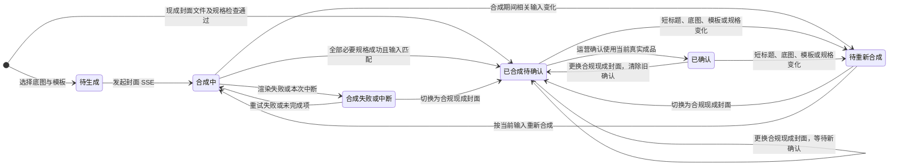

现成封面跳过合成，通过尺寸/文件检查后进入待确认；替换现成封面必须清除旧确认，新文件单独确认。单条候选必须收齐所有必要规格才能确认；预览、采用与导出使用同一真实文件。标题、底图、模板等相关变化清除旧确认；正文等无关字段不重绘。已确认 PNG 及其来源快照不因模板后续发布/停用而失效；再次生成则使用当前可用配置。输入版本与来源校验见 G.3。

### B.9 图片库：启停与删除

图片没有“已发布”状态，业务使用资格只用 `enabled`；图片上传、尺寸读取失败属于上传过程反馈。


| 动作 | 前置条件 | 影响 |
| --- | --- | --- |
| 上传/创建 | 文件上传成功、图片类型和尺寸有效 | 新建图片条目，复用文件 ID |
| 修改信息 | 有维护权限 | 不改原文件内容；一张图可同时用作现成封面和底图 |
| 启用/停用 | 条目存在 | 只改变新选择资格；已有任务、封面和模板引用保留 |
| 删除 | 未被任务内容、模板发布配置/已保存草稿及其他业务引用 | 删除业务条目；文件物理删除仍按现有文件管理引用规则执行 |

“已删除”表示记录生命周期结束，不新增一个 deleted 枚举列。图片库与文件管理的两个删除入口都检查引用。停用图片若仍被模板引用，不能绕过图片可用性检查用于新的渲染；已经确认的成品不变。

### B.10 封面模板：内容与启停分开

**内容状态由两份配置是否存在计算：**

| 内容标签 | 条件 | 可用动作 |
| --- | --- | --- |
| 仅草稿 | draft 有值；published 为空 | 编辑、保存、预览与校验、首次发布、复制；无引用时删除 |
| 已发布 | published 有值；无待发布差异 | 编辑生成草稿、启停、复制 |
| 已发布且有草稿 | published 与 draft 同时有值 | 继续编辑、发布更新、启停当前发布配置、复制 |

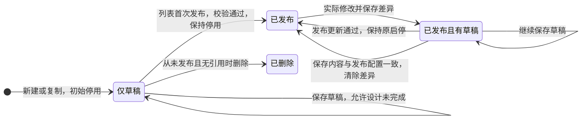

**启停只控制当前发布配置的使用资格：**

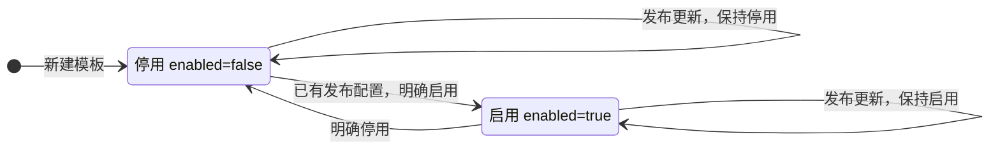

| 动作 | 前置条件 | 数据变化/影响 |
| --- | --- | --- |
| 新建 | 名称、固定尺寸等基础信息合法 | 新 ID，草稿，停用；基础信息固定 |
| 保存草稿 | 允许内容尚未完成 | 仅改 draft；不改 published、正式缩略图或启停 |
| 预览与校验 | 有当前编辑内容 | 显示问题，不自动保存、发布或启用 |
| 首次发布/发布更新 | 有已保存差异；动态主标题、字体、安全区、图片及渲染检查通过 | 替换 published，发布修订加一，清草稿；启停保持原值 |
| 启用/停用 | 启用必须已有 published | 只改 enabled；草稿不参与正式生成 |
| 复制 | 有已保存草稿或发布配置 | 优先复制草稿，否则复制发布配置；新 ID、新草稿、停用；换规格后重新校验 |
| 删除 | 从未发布且无引用 | 删除草稿；已发布模板通过停用退出新选择 |
| 取消编辑/返回 | 有未保存改动时提示处理 | 丢弃或保存本次编辑，不改变已发布事实 |

打开编辑器不产生草稿；只有实际修改并保存才出现“有草稿”。保存中、校验中、失败是请求反馈；发布失败保留原发布配置和启停。启停不改写任务已有配置快照。

### B.11 哪些内容什么时候锁定

| 内容 | 可改到什么时候 | 锁定后怎么处理 |
| --- | --- | --- |
| 计划原目标与周期 | 计划首次合法启动前，且满足未锁定范围与逐格守恒约束 | 启动后不编辑，暂停不解锁；全部批次执行完后再处理补量或未达成结束 |
| 未定版批次规划 | 计划首次合法启动前，未锁定部分可按约束调整 | 首次启动后不再调整批次结构和顺序；后续既有批次仅按自身权限完成资源和内容配置 |
| 批次资源与正式任务身份 | 创建/定版正式任务前 | 不能换账号、平台、成片或类目；处理原资源，或取消/安全放弃后另建 |
| 批次当前发布内容 | 首次启动前 | 锁定整批；明确失败任务可修正下次重试内容 |
| 单次执行输入 | Agent 领取前固定 | attempt 输入快照永久不改；重试另存新快照 |
| 模板当前发布配置 | 可通过发布更新替换当前配置 | 已生成封面与任务保留当时快照，不追改 |

补量仅在计划 running、无提交未决、已有批次全部处置收口时创建；每批单平台，只覆盖原目标矩阵中的正缺口，不增加原目标。每格数量不得超过 `max(原目标-已公开,0)`；同一轮补量处置完成前不并行新建第二个补量，省去并行预占机制。旧失败任务继续占用成片，补量不能绕过。

补量创建后若旧任务迟到公开，重算缺口：未定版补量可调减；已定版补量提示处理，由运营取消多余未领取任务，不静默删除任务或改目标。执行前再次提示潜在超量。

### B.12 跨图必须共同遵守的规则

1. 一个批次只属于一个平台；plan_id 可空。一个任务只属于一个账号、成片和类目；batch_id 可空，任务表不重复保存 plan_id。
2. 原始批次的每个“平台 × 类目”目标合计等于计划对应目标；补量不计入该守恒等式。
3. 候选不占用成片；同一平台同一成片最多一个未放弃正式任务，跨平台允许复用。
4. 正式创建、执行授权、Agent 领取、平台接收、公开成功分别记录，不能用一个“完成”代替。
5. 同一真实平台账号串行；同 UID 多窗口仍是同一账号。未知结果未核实前保留执行占用。
6. 取消不释放、不恢复；明确安全放弃才释放。未知、审核中、已公开不能直接放弃。
7. 自动/人工推进共用一次事务入口，不重复启动、不越过未决任务。
8. 重试不增加任务数；每次领取固定输入快照，不改历史。
9. 动作按钮由详情响应的 allowed_actions/action_blockers 计算；服务端执行命令时重检状态和前置条件，不以按钮是否显示作为授权依据。

## 附录 C 事务、重复请求与并发处理

### C.1 最小一致性机制

保留四件事：事务、唯一索引、对象 revision、attempt 校验。它们直接防止重复发布、丢失编辑和串错执行结果；不引入分布式事务、通用幂等平台或补偿框架。

创建计划、独立批次、正式任务或模板时使用 request_key/request_hash，同 key 同内容返回已有对象，同 key 异内容返回 409。确认已有批次是一次性状态转换：先锁对象；已经定版则返回已有结果；未定版必须匹配 expected_revision，再重新校验并生成任务。重复确认不应用新配置，修改必须走允许的编辑接口。其他修改/启动/重试命令只带 expected_revision；响应丢失先 GET 查看当前状态，再决定是否重试。过期 revision 返回 409，不为每类命令额外保存一套 key/hash。

普通编辑使用 `UPDATE ... WHERE id=? AND revision=?`；影响目标行数为 0 返回冲突和最新 revision。心跳与进度不提升业务对象 revision，避免每 15 秒让运营编辑无故失败；最终结果及控制状态变化才提升 revision。

涉及所属关系时，统一锁顺序 **plan → batch（ID 升序）→ publication（ID 升序）→ attempt**；没有父对象则跳过。锁内只做 SQL，不做模型、文件、渲染或平台网络请求。可预测死锁允许仅重试一次纯数据库事务；含外部副作用的调用栈不自动重试。

### C.2 核心事务表

| 动作 | 一个事务必须完成 | 失败结果 |
| --- | --- | --- |
| 创建计划 | 校验逐格守恒/能力；写 ready 计划及 goals_json；生成全部批次及 targets_json | 整体回滚，无半份有效计划；request_key 防重 |
| 保存计划结构 | 锁 plan/受影响 batch；验证目标锁与定版批次；保存未锁批次及排序、提升 revision | 整体回滚，不短暂出现目标不平衡 |
| 最终确认批次 | 锁 plan/batch；重新检查候选/版本；写全部正式任务与当前内容；唯一索引占用；confirmed；锁计划目标 | 任一成片冲突整体回滚，返回冲突行，不隐式部分创建 |
| 创建独立批次 | 校验完整配置；写批次、targets_json、全部任务与内容；取得成片占用 | 任一失败整体回滚，保留本地输入 |
| 快速创建 | 直接插入完整 pending 行；同时保存内容及占用，request_key 防重 | 不创建服务端草稿或隐式批次 |
| 首次启动计划 | 锁 plan/首批；重检当前可执行任务；锁目标/内容；授权首批，任务入队或待到时 | 无可执行任务则不启动、不锁定 |
| 自动/人工推进 | 锁 plan/当前及下一批；重新聚合状态；校验当前位置/阈值/人工授权；标当前 handoff；启动下一批 | 后一调用读到位置已变化，只返回当前状态 |
| 取消/领取 | 取消与 claim 都先锁相同父对象及任务；未领取可 cancelled，领取成功才生成 attempt；已领取须先取得安全停止且未提交证据 | 保证二者只有一个先发生，不把仍在运行或可能已提交的任务直接取消 |
| 提交结果 | 锁父对象/任务/attempt；验用户/attempt/序号/证据；写结果、时间、发布身份；结束 attempt | 相同结果幂等；不一致结果拒绝或转核实 |
| 安全放弃 | 验旧执行已停止、未形成作品；写 abandoned/审计；生成列释放占用 | 未知/审核/公开状态拒绝，不能先释放后核实 |
| 新建补量 | 锁 plan；全量重算缺口和既有批次处置；插一批骨架及 targets_json；revision++ | 并发第二请求看到未处置补量后拒绝，不超配 |

### C.3 预检与部分创建

预检只返回当前事实，不颁发独立“可执行令牌”，不锁资源、不维护预检会话表。最终命令重新校验关键事实。已有对象返回 revision；新建表单只返回客户端输入版本、各 row_key 的错误和数量，不虚构服务端 revision，不把预检通过当最终承诺。

部分创建必须显式提交 `included_row_keys`、`excluded_row_keys`、`allow_shortfall=true`，并附上预期各类目缺口。后端重算并比较，用户确认的候选集合在一个事务内全成或全败。不能按“当前还能成功几条”静默丢行。

启动时允许显式 `allow_partial_execution`：只授权当前可执行行，其余正式任务仍保留 pending/阻断原因，继续阻断计划衔接。执行检查失败不会偷偷取消任务、降低目标或释放占用。

### C.4 计划推进伪代码

```text
advance(plan_id, mode, expected_current_batch_id):
  begin
  lock plan
  require current_batch_id == expected_current_batch_id
  require plan.status == running OR 合法的人工阈值确认
  lock 当前批次与下一批次
  read 当前批次实时任务聚合
  if 已推进历史批次存在重新打开的提交未决: 返回等待
  if 存在提交未决: 返回等待，不能推进
  if 没有下一批: 保留最终结果待办，交给结束/补量判断
  if auto 且失败率不满足: paused + reason，commit
  if 下一批未定版/无可执行行: paused(next_batch_not_ready)，commit
  record 当前批次 handoff_at
  change current_batch_id，启动下一批，写授权及审计
  commit
```

Scheduler 每 5 秒检查 running 计划，复用该入口；无须以计划行长期租约控制。多实例可重复扫描，事务行锁及游标保证只有一次推进。使用 `FOR UPDATE` 的事务语义参见 [MySQL Locking Reads](https://dev.mysql.com/doc/refman/8.0/en/innodb-locking-reads.html)；不把 `SKIP LOCKED` 用于不允许漏读的最终统计/缺口判断。

## 附录 D 请求参数、示例与错误

### D.1 公共约定

第 3 节接口清单省略了统一前缀 `/api/v1`。普通 JSON 响应沿用现有 `errcode/message/data/logid` 格式，请求字段用 snake_case。AI/封面生成成功建立连接后返回 SSE，事件约定见 G.3；建立流前的校验错误仍用普通 JSON 响应。新状态与错误码在实施时由 Cloud 统一发布，本稿先定义其含义，不提前分配数字码。

```json
{
  "errcode": 0,
  "message": "ok",
  "data": {
    "id": "1201",
    "revision": 8,
    "status": "paused",
    "pause_reason": "failure_threshold",
    "allowed_actions": ["confirm_next", "cancel"],
    "action_blockers": {"resume": "当前批次失败率超过阈值，请先确认"}
  },
  "logid": "existing-request-log-id"
}
```

`allowed_actions` 是当前业务动作的读投影，不是通用权限引擎；命令仍需服务端重检。详情返回引用对象的 ID、名称、合法入口信息，三类独立详情统一使用该模型。前端负责返回列表及恢复筛选，不把 UI 路由写入业务表。

列表请求通用 `page/page_size/keyword/created_from/created_before`；响应 `items,total,page,page_size`。计划支持 `status/platform/category_id/needs_attention/owner_id`；批次支持 `plan_id/platform/category_id/execution_state/config_stage/owner_id`；任务支持 `batch_id/plan_id/platform/category_id/media_account_id/status/operator_id/published_from/published_before`。`plan_id` 筛选任务通过 batches JOIN，独立任务不会混入。where 条件先应用权限范围，再计数与分页。

详情不一次返回 500 条完整内容和全部尝试：计划返回矩阵/批次概要，批次任务分页，任务尝试单独分页。统计按同一口径读取；客户端新建草稿不进入列表或统计。

### D.2 关键请求与响应示例

**确认批次并显式接受目标缺口：**

```json
{
  "expected_revision": 12,
  "included_row_keys": ["row-1", "row-2"],
  "excluded_row_keys": ["row-3"],
  "allow_shortfall": true,
  "expected_shortfalls": [{"category_id": "11", "count": 1}]
}
```

```json
{
  "id": "1201",
  "revision": 13,
  "config_stage": "confirmed",
  "execution_state": "ready",
  "target_count": 3,
  "created_count": 2,
  "creation_shortfall": 1,
  "publication_ids": ["2201", "2202"]
}
```

响应中的总数均为读投影，不是新增持久化列。3 条目标不会因为创建 2 条改成 2。

**人工确认阈值超限后进入下一批：**

```json
{
  "expected_revision": 20,
  "expected_current_batch_id": "1201",
  "next_batch_id": "1202",
  "reason": "已核实 3 条明确失败，确认继续下一批"
}
```

若 20 条明确结果中 3 条失败，则 15% 需要该动作；若还有 1 条 uncertain，即使用户确认也返回 `publication_unsettled`。若 next ID 已变化，返回 `publication_revision_conflict`，不替用户确认新的下一批。

### D.3 错误语义

| HTTP | 语义名称 | 需要前端展示的具体信息 |
| --- | --- | --- |
| 400 | `publication_invalid` | 字段路径、非法值/缺失条件 |
| 403/404 | 沿用权限与不可见对象约定 | 不可操作或不可见 |
| 409 | `publication_revision_conflict` | 当前 revision、要求刷新 |
| 409 | `publication_output_occupied` | 冲突 row_key、成片、可见范围内的占用任务 |
| 409 | `publication_identity_busy` | 同一真实账号执行中/待核实 |
| 409 | `publication_plan_position_conflict` | 当前批次/预期位置变化 |
| 409 | `publication_unsettled` | 在途/人工/未知等阻断数量 |
| 409 | `publication_content_stale` | 过期 AI/封面输入行、需重新生成字段 |
| 409 | `publication_idempotency_conflict` | 相同 request_key 对应不同输入 |
| 422 | `publication_precheck_failed` | 明确的业务/平台字段阻断，修复入口 |
| 422 | `publication_platform_unavailable` | 平台尚未接入或当前能力不支持 |

不会把“数据库异常”“AI 失败”“资源读取失败”转换成可用量 0、预检通过或成功创建。未知错误沿用统一 5xx/logid，界面保留输入；不新增自动降级到演示数据的路径。

### D.4 关键接口的补充规则

- 创建计划时必填名称、负责人和有效周期，至少一个正目标及一个正目标批次；目标总数由矩阵求和。预检直接接收未创建的表单，不要求先创建服务端草稿。
- 新建独立批次的 POST 接收完整资源/内容候选并生成任务；已有计划批次使用 resources/content 保存配置、confirm 定版。batch precheck/allocation-preview 支持表单 payload，可附 batch_id/revision 校验已有记录。
- start 用于首次启动计划；confirm-next 绑定当前与下一批 ID，防止在旧弹窗中确认错批次。复制计划清空执行事实、账号/成片配置和周期。
- 批次暂停保留待执行队列，恢复后继续领取；首次启动前 cancel，启动后 stop。停止/取消均保留成片占用；已取消计划/批次不能整体恢复。
- 计划内批次启动必须检查计划顺序；从批次入口启动须明确人工接管，先暂停自动推进并完成必要的首次锁定，再授权当前位置批次，不绕过计划控制或隐式启动后续批次。
- 部分创建需明确包含/排除的候选行及各类目缺口，后端整体成功或整体失败，不静默漏掉问题行。
- 创建请求带 request_key；修改请求带 expected_revision。前者防止响应丢失后重复创建，后者防止覆盖别人已保存的修改。字段与校验详见附录 C。
- 批次任务 start 只能在批次已授权时使用；安全失败任务单独重试使用 individual_retry 授权，不恢复已取消上层。计划 stopping 时先收尾，不接受重试。
- 已推进旧批次重新重试时，暂停后续新批次推进；resume/confirm-next 同样检查历史批次的未决任务。
- 重试由用户明确发起，不自动无限重跑。确认旧执行已停止且未形成作品后，才允许安全重试或放弃。
- “创建并启动”串行调用创建、start；创建成功而 start 失败时只重试 start，不再创建一次。


## 附录 E Agent 执行协议与结果回传

### E.1 跨仓接口边界

发布执行使用专用协议，接口清单见第 3.8 节；实施时遵守现有 Desktop session 与 Agent Token 的认证边界。

续报沿用既有 report-safe 鉴权模式：用户与 attempt 匹配、Token 有效；新 claim 要求当前有效 Desktop session。业务 session 不代替 Agent Token。断网/关闭 Desktop 不增加设备节点、租约迁移、执行票据或新 credential 体系。

claim 必带 `request_key`，成功领取后写入 attempt 的 claim_request_key，按执行用户唯一。相同 key 永远返回原 attempt 及其当前结果，不会领取第二条；下一次轮询用新 key。响应不明先按原 key 重试，结合本地 checkpoint 确认是否已开始；只有确认尚未本地执行才运行该 attempt。无任务返回 `data.task=null`，不是失败，无需为无任务轮询写幂等记录。

claim 结果至少包含 task/attempt ID、固定输入快照、账号 UID、Profile 引用、成片和封面对象摘要、短效下载地址与有效期、not_before、heartbeat_interval。不得包含长期存储凭证；下载地址过期按该 attempt 申请同对象新地址，不创建新任务、不重跑平台发布。

### E.2 领取与执行流程

1. start 仅保存执行授权；未到 not_before 保持 pending，已到时转 queued。Scheduler 只处理已有 authorized_at 的任务，不能把所有 pending 自动入队。
2. Agent 轮询领取自己的 queued。Cloud 在父对象锁内按下表重新检查授权、时间、任务占用与账号身份；将任务置 running、写新的 attempt、固定内容快照，提交后返回。并发 claim 受任务锁与真实账号唯一索引约束；账号繁忙时跳过该账号，其他账号可继续。
3. Agent 验证本机登录 UID 与任务快照一致，验证文件摘要和当前 Profile；不匹配时回报卡点/失败，不把账号身份静默改成当前浏览器用户。
4. Agent 按阶段取文件→上传→填写→提交。每条 attempt 的输入来自领取时保存的完整输入快照；模板后续更新/停用不改写已定版内容和产物。
5. 点击最终平台提交前，Agent 先用 progress 持久化 `stage=submitting`、`submit_started_at`，并取得允许继续响应。Cloud 此时复查该 attempt 和取消标记；未确认允许时不点击提交。该检查是发布自身必要的提交边界，不是恢复通用 permit。
6. 平台回执明确接收记 reviewing；有可信公开作品链接/身份与证据才记 published；提交后断连记 uncertain。人工只确认“页面填好了”不能记已发布。
7. Agent 将最终结果先写已有本地 checkpoint/outbox，再重试上报；服务端相同 attempt/result_hash 幂等。断网恢复先补报结果，绝不重放已完成的浏览器提交。

暂停只影响新领取，取消/停止在心跳及提交前检查中生效。已经取得提交许可与取消事务可能存在短窗口，无法撤销真实平台操作；故取消只能等待该 attempt 按真实结果收尾，不能承诺“点击取消后绝无在途投稿”。

| 授权与父状态 | 新 claim | 已领取 attempt 提交前检查 |
| --- | --- | --- |
| standalone，无父对象 | 自身 queued、已到时即允许 | 没有自身取消请求才允许 |
| batch，独立批次 plan_id=NULL，批次 running | 允许 | 没有批次/任务取消请求才允许 |
| batch，计划 running，当前批次 running | 允许 | 没有取消请求才允许 |
| batch，计划 paused，当前批次仍 running | 允许；计划暂停只阻止启动下一批 | 允许安全继续 |
| batch，批次 paused | 拒绝，队列保留 | 暂停前已领取者允许继续 |
| batch，父计划 stopping/ended 或批次 stopping/cancelled | 拒绝 | 取消已生效且尚未取得提交许可则拒绝；已提交只核实 |
| individual_retry，父控制已安全终结或计划已暂停 | 明确授权有效时允许，不恢复父调度 | 没有此授权之后的新取消请求才允许 |

individual_retry 只有 `authorized_at` 晚于既有父取消时刻才允许越过该历史取消；之后若又有新的父/任务取消，则本授权失效。所有任务自身 cancel_requested_at 在一条新且合法的重试授权中明确重置。批次暂停、计划暂停不会自行创建这种授权，Agent 只能消费，不能自行选择授权类型。

### E.3 人工、失联与迟到回报

- 登录/验证码由 awaiting_human 保存原现场，继续同 attempt，不再上传。若本地现场丢失，先确认旧执行终止与平台结果，不能伪造可恢复 checkpoint。
- 有提交可能的超时进入 uncertain 并保留账号执行位/成片占用。即使没有提交标记，失联本身也不等于进程停止；首版统一要求确认旧执行停止后才安全重试，不建设自动恢复推理系统。
- Scheduler 每 30 秒扫描 heartbeat 失联的活动 attempt，标记 interrupted/uncertain；不创建新 attempt，不直接释放占用。审核中不属于活动执行超时。
- 原 attempt 迟到结果：没有更新 attempt 且没有人工冲突结论，可收敛到明确结果；相同最终结果重复返回成功；与已有人工结论冲突则保留证据并进入核实，不能覆盖已发生的后续身份/释放事实。
- 新 attempt 存在后旧结果不再驱动当前状态；保留在历史并发出待核实提示。放弃前须有旧进程停止依据，避免“先释放、旧进程后发布”。
- 首版审核/公开核实由用户在 Desktop 发起、查看同账号已有稿件并回填；不增加全天候轮询所有平台作品的后台系统。日后接入平台回查时复用 resolve 规则。

### E.4 执行副作用必须保留的最小证据

明确接收：平台回执、稿件 ID 或账号作品列表中的对应记录。公开成功：合法平台作品 URL，匹配平台/账号/稿件的可核对依据；无可靠 work_id 时保存 URL 和核实来源，不凭 URL 语法推断一定公开。确认失败：可核对的错误及“未形成可发布稿件”结论。安全重试/放弃：旧执行停止、无已接收/公开作品的依据及操作人。

这里不增加双人复核、审批、20 字数门槛、截图全量留存或额外签名链；沿用正常业务审计即可。

## 附录 F 统计公式与查询方式

### F.1 单一统计公式

| 指标 | 来源与公式 |
| --- | --- |
| 计划目标 | 对 publication_plan.goals_json 的 target_count 求和 |
| 批次目标 | 对 publication_batch.targets_json 的 target_count 求和 |
| 原始计划分配 | kind=original 的批次 targets_json 求和，逐格等于计划 goals_json |
| 补量尝试数量 | kind=makeup 的 targets_json 单独求和，不改计划目标 |
| 正式创建数 | COUNT(publication_task.id)，重试不增加 |
| 创建缺口 | max(批次目标−正式创建数,0) |
| 已公开数 | 当前 status=published 的任务数，按 task ID 去重，不按 attempt 数 |
| 目标完成率 | 已公开数/原目标，原目标 0 返回 null |
| 提交进度 | (正式数−提交未决数)/正式数，正式数 0 返回 null |
| 处置进度 | (published+cancelled+abandoned)/正式数，正式数 0 返回 null |
| 失败率 | failed/(published+reviewing+failed)，分母 0 返回 null |
| 最终目标缺口 | max(原目标−全部所属批次已公开数,0)，含补量的公开结果 |
| 当前目标结论 | 公开数达到目标=achieved；仍有审核/未知=awaiting_verification；否则 unachieved |

计划只通过 batches 汇总；本地新建草稿不参与统计。目标 JSON 在 Go 中逐格合计，任务结果由 SQL 按 batch/platform/category 聚合，再在内存按键组合，不把目标数组展开后与每条任务相乘。attempt 不参与任务数量计数。

**例 1**：目标 30，显式只创建 28，28 条公开，正式提交/处置都为 28/28，目标为 28/30，创建缺口 2、失败率 0%。不补两条虚假 pending。

**例 2**：正式 20，已公开 10、审核中 8、确定失败 2：提交收口 20/20、失败率 10%，满足阈值可以自动下一批；处置进度 10/20、公开目标仅 10。2 条失败没有被改成成功，8 条审核也没算公开。

**例 3**：20 条中已公开 17、失败 2、unknown 1：已知失败率约 10.53%，但应先因 unknown 阻断，人工也不能直接跨过；不能只看“17 条已经成功”启动下一批。

失败任务被用户明确放弃后退出失败率分母，这是沿用既有口径的结果；操作日志与累计“曾失败任务数”仍保留，UI 不得让当前失败率看起来像从未失败。人工放弃不是系统自动抹平阈值。

### F.2 查询与负载预算

列表先做权限/筛选及分页，再对页内 plan/batch ID 集合执行少量 GROUP BY；不为每一行请求任务列表。计划详情使用一组按 batch/platform/category 聚合的查询，不返回全量内容。统计按钮从上述同一聚合投影，不另建实时统计表。

QPS≤100 不意味着数据量有限。首版不缓存核心事实，使用索引限定团队、父 ID、状态和时间范围；上线前用至少 10 万任务、30 万 attempt 和 100 批计划验证 EXPLAIN/延迟。若慢查询集中于计划历史聚合，再为已结束计划增加可重算摘要；不预先搭 Redis 缓存与异步双写。

建议活动详情 5 秒轮询，离开页面停止，隐藏页面降频；内容生成使用 SSE 推送进度。示例预算：30 个活动执行心跳约 2 QPS，50 个活动详情约 10 QPS，其余留给操作、内容生成和阶段报告；这是预算示例，实际并发与用户数需要压测确认。进度上报限频避免 100 QPS 全被上传进度占满。

发布 Scheduler 在现有调度设施中增加三个作业：到期入队每 5 秒、计划衔接每 5 秒、失联扫描每 30 秒，只扫相关索引中的活动状态。内容生成的 SSE 连接由 HTTP 服务处理。

## 附录 G 资源分配、AI 和封面规则

### G.1 资源查询 API 与口径

盘点返回 `as_of/business_date/timezone`。今日公开数按 published_at，审核中独立，今日已安排按 not_before/授权时间单列；同成片跨平台资源总数去重，任务目标按平台分别计数。

账号按当前 team/user 权限与启用、已核验身份、类目、登录/环境状态区分“可用/待处理/不可用”。Cloud 登录检查是最近事实，不代表当前浏览器实时在线；最终执行仍由 Agent 实读。资源失败返回错误，不能返回 0 冒充真实库存。

可安排任务上限以成片同平台去重、账号类目资格及用户设置的每号本批数量联合计算；多类目账号共享预算，一次分配后扣减剩余预算，不分别估算后直接相加。**每号本批数量不是日额度。** 未有权威日额度时 `daily_capacity=null,capacity_status=unknown`，不推导账号数×视频数，不按任意常量硬阻断计划目标。

### G.2 分配算法保持简单

1. 过滤不合格账号/成片和已占用的同平台成片。
2. 按用户设定账号顺序处理，默认保留该顺序；目标相同的资源优先给可选账号较少的类目只是建议。
3. 在每个类目内，已标注的优质成片优先优质号，再普通号；普通成片优先普通号，再新号。未标质量单列为 unknown，不猜成普通或优质。
4. 按本批预算逐号填充，消耗成片一次；剩余明确返回“缺账号类目覆盖/缺成片/超本批预算/占用冲突”。
5. 用户人工调整配对后，预检、最终确认都重新验证身份/类目/数量，不依赖算法建议作为授权。

计划拆批先实现确定性规则：按平台组，再按期望批规模切分各类目数量，逐格守恒。当前“AI 推荐”不能静默用规则结果冒充模型输出；若保留 AI 推荐入口，应明确调用现有模型、输出同一批次建议结构并用同样校验器验证。它不是计划执行的必要依赖。

若本轮要求正式支持质量偏好，建议分别给 `media_accounts` 加可空字段 `quality_tier=high/normal/new`、给 `composite_outputs` 加可空字段 `quality_grade=high/normal`，由各自管理页人工维护。两个字段是运营分层，不从登录状态、媒体分辨率或任意 tag 推断。这项依赖列在第 5 节，仍待批准。日额度配置本稿暂不落库，接口明确表达其已知或未知即可。

### G.3 AI 与封面生成的 SSE 协议

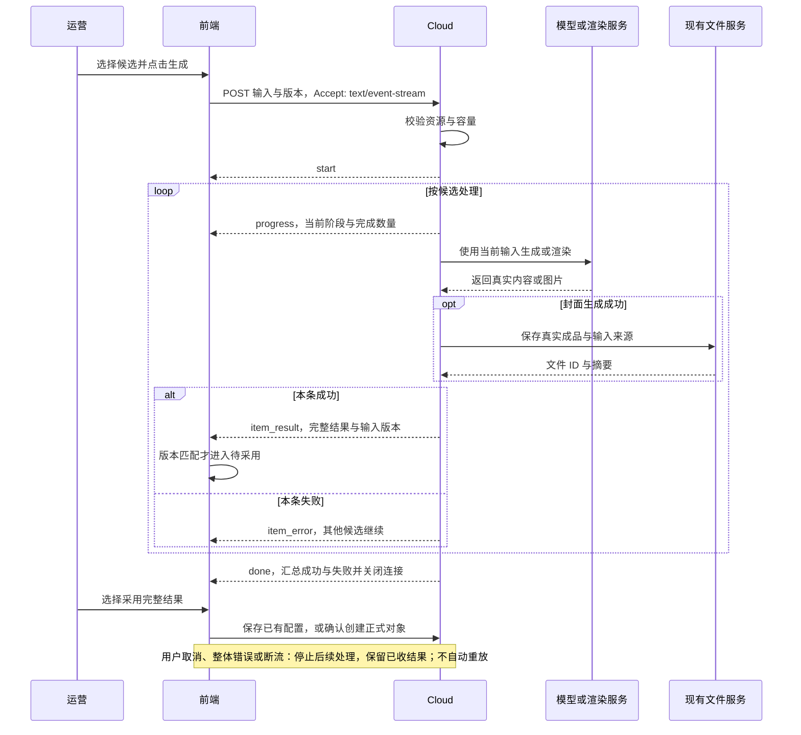

**请求与处理范围**

两个生成接口都使用 POST JSON，`Accept: text/event-stream`；鉴权沿用业务接口。AI 每请求最多 10 条候选，封面每请求处理一条候选的必要规格。超过范围由前端分组，默认同一页面一次只建立一个生成流。

AI 请求逐行带 row_key、input_revision、field_revisions、平台、成片及所需字段；Cloud 读取有权使用的素材信息，接入模型客户端。同一条候选一次生成发布标题、封面短标题、话题、标签及可选正文；每条结果完整解析并校验后才推送，尚未完成的模型文字不作为可采用内容。

封面请求包含实际短标题、明确底图及各输出规格的模板 ID/发布修订。后端校验启用的发布配置及实际文字排版，按正确画布渲染，再通过文件 Service 保存真实图片及 metadata_json 来源信息。每条候选的必要规格全部完成后返回文件 ID、尺寸、render_input_hash 和预览地址。

**事件格式**

SSE 的 data 使用 JSON；UTF-8 编码，每个事件以空行结束。一次请求内，后端串行写出完整事件并立即 flush。格式依据 [HTML Server-sent events](https://html.spec.whatwg.org/multipage/server-sent-events.html#parsing-an-event-stream)。

| event | 何时发送 | data 主要字段 |
| --- | --- | --- |
| `start` | 请求校验通过、开始处理 | request_id、total、logid |
| `progress` | 候选开始、阶段切换或完成数量变化 | row_key、input_revision、stage、completed、total；封面可带 output_key |
| `item_result` | 一条候选已完整生成且校验通过 | row_key、input_revision、field_revisions、content，或封面 outputs 及 render_input_hash |
| `item_error` | 一条候选失败，其他候选继续 | row_key、input_revision、code、message、stage |
| `done` | 全部候选均已返回结果或逐条失败 | total、succeeded、failed |
| `error` | 请求整体无法继续，如超时或共享依赖故障 | code、message、completed、total、logid |

request_id 只用于当前连接与日志关联。progress.stage 使用明确阶段，例如 generating_text、validating、rendering、saving。completed 等于已发送 item_result/item_error 的条数；前端按 completed/total 展示进度，在模型等待阶段显示处理状态，不编造模型内部完成百分比。

```text
event: start
data: {"request_id":"req-01","total":1,"logid":"log-01"}

event: progress
data: {"row_key":"row-1","input_revision":3,"stage":"generating_text","completed":0,"total":1}

event: item_result
data: {"row_key":"row-1","input_revision":3,"field_revisions":{"title":1,"cover_title":2,"topics":0,"tags":0},"content":{"title":"发布标题","cover_title":"封面短标题","topics":["游戏攻略"],"tags":["攻略"]}}

event: done
data: {"total":1,"succeeded":1,"failed":0}

```

每条候选只产生一个最终 item_result 或 item_error；正常完成时 total=succeeded+failed。整次处理以 done 或 error 结束后关闭连接。断流且未收到终止事件时，前端标记“处理中断”，保留已收到的完整结果，将其余候选留待重试。

**前端接收、采用与取消**

共用 Vue 通过 fetch POST 并增量读取 response.body，按 SSE 事件边界解析，不能把每个网络 chunk 当成完整事件，也不能调用 response.json() 等到整流结束。客户端使用 AbortController 取消当前连接，并停止后续分组。流式读取与取消依据 [Fetch API 文档](https://developer.mozilla.org/en-US/docs/Web/API/Fetch_API/Using_Fetch)。

候选字段表达 inherit/manual/ai_adopted；实际内容为“本行覆盖 > 批次默认值”。AI 结果先作为建议，默认只填空白/继承项，覆盖手工字段由用户明确选择范围。

版本分为两层：input_revision 是本行生成上下文版本，账号、成片、平台、类目、底图、模板或作为生成依据的继承值变化时递增；field_revisions 保存各文字字段自己的编辑修订，手工编辑或采用结果只增加对应字段修订。接收/采用建议时要求 row_key、上下文版本、对应字段修订及该字段最新请求匹配。采用一个字段不使同一结果的其他字段自动过期；若某文字字段本身被指定为生成依据，改它时同时更新生成上下文。

封面请求与结果同样携带上下文及相关字段修订，前端还核对发起时的短标题、底图、模板与规格是否仍为当前输入；后端确认时核对 render_input_hash。无关正文变化不让封面过期。已有批次配置保存另检查整个 batch.revision，正式创建重新检查最终资源及内容。这些版本保存在候选配置内，不增加状态表。

后端观测到连接断开、写失败、取消或处理截止时间时，停止未开始项，向在途模型/渲染调用传递取消。已收到的完整结果可以继续采用。用户重试时只提交失败/未完成项，并使用当前输入版本；前端和代理均不自动重放生成 POST。已生成但未送达客户端的文件由现有文件管理维护。

**错误、超时与部署**

- 建立流前完成鉴权、参数/资源权限及并发容量检查；失败使用对应 HTTP 状态和普通 JSON 错误响应。
- 发送 SSE 响应头后发生逐条错误用 item_error；整体错误用 error 并结束连接，不能再切换成 JSON 或修改 HTTP 状态。前端以终止事件判断是否完成。
- 响应头为 `Content-Type: text/event-stream; charset=utf-8`、`Cache-Control: no-cache`；事件间空闲时约每 15 秒发送 `: ping` 注释并 flush。心跳用于保持连接，不增加进度，也不延长整体截止时间。
- AI 流建议整体截止时间 180 秒，封面流 60 秒；模型调用使用剩余期限，网关/客户端流超时需覆盖该期限。并发上限按模型配额和渲染资源配置，资源满时在建流前返回忙。数值在实施时用真实耗时验证。
- SSE 路由关闭代理响应缓冲与缓存，配置 `proxy_buffering off` 或 `X-Accel-Buffering: no`，避免压缩层积攒事件；上线验证首个事件和后续进度确实逐步到达。代理行为见 [Nginx proxy_buffering](https://nginx.org/en/docs/http/ngx_http_proxy_module.html#proxy_buffering)。

**封面来源与有效性**

render_input_hash 由实际标题、底图文件摘要、模板发布配置、输出规格及渲染器版本计算。确认正式任务时，后端比对最终输入与文件来源/摘要；后续模板发布或停用不改变已确认 PNG，使用生成时配置快照。现成封面按实际文件及平台规格检查。

标题、底图、模板等变化使相关封面失效，只重做受影响项；正文等无关字段不触发重绘。预览、采用与导出引用同一真实文件。

## 附录 H 容量与通用字段约定

| 项目 | 建议初值 | 依据与代价 |
| --- | --- | --- |
| 业务流量 | 峰值总 API QPS ≤100 | 心跳、步骤及 SSE 建流请求均计入；连接并发和事件吞吐另行观察 |
| 生成流范围/时限 | AI≤10条/180秒，封面1条/60秒 | 每页面默认一个流；阶段切换即时推送，空闲约15秒发送注释心跳 |
| 单批正式任务 | 1–500 | 支持一次事务整体创建；超过则拆批，不先引入分片确认 |
| 单计划原始批次 | ≤100，目标合计 ≤50,000 | 限制结构编辑/确认事务大小；不是承诺可一次执行完 |
| 同时浏览器执行 | 每用户 3，每真实账号 1，部署可调整 | 吞吐受浏览器和平台限制，不能由 API QPS 推导 |
| 列表分页 | page/page_size，默认 20，最大 100 | 稳定 `created_at DESC,id DESC`，规模增大后再换游标 |
| Desktop SQLite 草稿 / 浏览器 Memory / 已有批次配置 | 单份 JSON 建议≤2 MiB，单批候选≤500 | 前两者是确认前输入，后者是云端业务配置；图片只存 file_id |
| 步骤上报 | 阶段变化立即报，频繁进度最多每 5 秒合并一次 | 不逐秒存日志、不存每帧截图 |
| 心跳/失联 | 建议 15 秒/90 秒；可配置 | 失联标记需要核实，绝不自动重跑平台提交 |

容量上限是本稿建议，实施前用代表性数据和真实浏览器确认。读列表/详情的建议验收目标为 100 QPS 下 P95≤500ms；500 条批次确认 P95≤3s，尚非已测结果。

Cloud MySQL 表使用 InnoDB、utf8mb4；云端新增 ID 均为 `BIGINT UNSIGNED AUTO_INCREMENT`。API 新增 ID 输出十进制字符串，不因前端精度丢失关联。云端内部 UTC `DATETIME(6)`，API RFC3339；运营日期按 `Asia/Shanghai`，查询今日公开使用 UTC 的半开区间。本地 SQLite 草稿使用 A.10 的独立结构，saved_at 为 RFC3339 文本。周期起止是 DATE，不自动触发/取消计划；定时发布使用任务 `not_before`，不混用平台预约发布能力。

平台存 `bilibili/baidu/xiaohongshu` 等稳定代码，中文仅展示。小红书接通前能力返回 false，所有正式创建/启动都拒绝未接入平台；不做“创建成功再运行必失败”的兜底。

## 附录 I 权限、审计与运行边界

采用既有团队隔离、角色和账号所属用户判定，不增加资源策略语言、字段权限平台或新令牌体系。由于 M3–M5 的权限 ADR 不直接裁定 M6，下面是发布侧推荐规则，需随设计批准：

图片库与模板归通用运营工具，沿用团队资源的既有维护/使用权限，不要求先有发布计划或批次。客户端草稿按环境和当前登录用户隔离；退出登录清理浏览器内存，SQLite 草稿仍按所属用户读取。

| 角色 | Cloud 计划/批次/任务 | 本机执行/核实 |
| --- | --- | --- |
| 普通运营 | 创建管理自己负责的计划/批次，使用自己账号及有权使用的团队成片 | 只执行自己的账号；只能核实自己可见且负责的任务 |
| 高级运营 | 管理本团队计划、分配批次负责人、查看/处理团队待办 | 自己的 Agent 只执行自己的账号；他人账号由所属用户执行 |
| 管理员 | 跨团队查看、结构配置和业务审计 | 沿用现有规则，不签发本机 Agent Token，不代操作浏览器 |

为避免首版跨用户批次调度复杂度，**一个批次的账号必须属于同一个 owner_id**，任务 operator_id 继承账号本人；一个计划可以组合不同负责人的批次，自动推进只创建授权，目标用户 Agent 在线后才实际领取。对离线用户展示“已授权，等待执行环境”，不伪装正在上传。若必须一个批次混合多个账号归属，再改该边界，不能由当前高级运营的本机 Agent 执行所有账号。

发布使用成片的权限单独校验团队/负责范围，不能把“有 URL”视为可用，也不从 created_by 推断历史负责人。未获得可靠账号/成片身份的历史数据不猜测回填；先补齐事实再进入发布。

复用 audit_logs 记录确认、结构调整、首次启动、自动/人工推进、暂停/恢复、停止/取消、部分创建、内容修改、安全重试、结果核实、放弃释放和补量。写业务状态与必要审计同一事务；自动动作 actor 可空，summary 保存 plan/batch/task ID、command key、前后状态、计数/原因，不记录 Cookie、Agent Token 和下载签名 URL。

日志仅增加可定位的 plan/batch/publication/attempt/logid；监控优先看 queued 等待时长、活动 attempt、失联/unknown 数、阈值暂停数、唯一占用冲突、确认耗时。无需单独建设审计报表或异常自动修复系统。

## 附录 J 架构与职责

采用 Go 模块化单体和 MySQL：关系字段保存身份、状态与约束，有界 JSON 保存配置和快照。内容生成通过 HTTP SSE 返回阶段、进度和逐条结果。

### J.1 职责与依赖

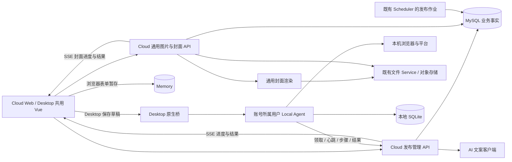

- **Cloud publishing**：业务校验、资源候选、正式任务、占用、状态、阈值、授权、统计、审计。
- **Cloud Scheduler**：定时任务入队、计划衔接、失联尝试标记。仅操作数据库，不操作浏览器，不下载上传视频。
- **Cloud 运营工具**：维护通用图片库、封面模板与封面渲染；供发布及其他业务引用，菜单归运营工具。渲染通过 SSE 返回进度，通过现有 files Service 保存图片。
- **Cloud 文案生成**：保留发布相关输入与平台规则，在当前请求中调用模型并推送 SSE。外部调用与渲染均在数据库事务外执行。
- **Local Agent**：按当前用户执行发布及回传结果；统一维护本机 SQLite，包括执行检查点和三类新建草稿，二者分表保存。
- **共用 Vue / Desktop**：Vue 展示、分组和采用生成结果；Web 新建输入只放 Memory，Desktop 通过原生桥调用本地草稿接口持久化。Desktop 同时管理登录、Agent 生命周期与本机环境提示。

发布管理放 `internal/modules/publishing/{model,repository,service}` 加 Handler/Router；通用图片/封面能力放运营工具模块，按 image/template/render 分文件。二者都在既有 Go 模块化单体内，遵守 Handler → Service → Repository；不拆独立部署服务，不抽通用素材引擎或通用 Repository。发布管理通过运营工具的 Service 使用图片、模板及渲染结果；文件、账号、成片与身份继续通过所属模块的 Service/明确查询接口读取。

## 附录 K 设计依据

- [PRD 第六章](../product/prd/详细文档/第六章_发布管理.md)：计划、批次、任务、内容与执行设置、图片库、封面模板的正式业务规则。
- [发布管理导航](publishing.md)、[模板编辑器交互](cover-templates.md)：原型入口、待对齐项与专项体验要求。
- [系统架构](../engineering/architecture/社媒运营平台工程架构与分层设计_V1.md)、[认证边界 ADR-0022](../decisions/0022-session-only-auth-and-agent-token.md)、[平面类目 ADR-0028](../decisions/0028-flat-business-categories.md)、[契约索引](../contracts/contract-map.md)。
- Cloud 的 mediaaccount、production、files、filetransfer 模块及 migrations：账号、成片、文件与执行协议的依赖来源。
- Cloud `web/example/proto/publishing-design/`：发布管理及封面模板交互原型。

## 附录 L 验收场景与批准后承接

### L.1 需要覆盖的业务证据

| 场景 | 必须观察到的事实 |
| --- | --- |
| 并发创建同平台同成片 | 仅一个任务成功；另一请求指向占用冲突；无半批任务 |
| 同成片跨平台 | 两个平台各一个任务合法，资源总数仍只算一个成片 |
| 同真实账号两个窗口 | 仅一个 running；另一条等待；不同真实账号可并行 |
| 计划/独立批次/快速任务创建响应丢失 | 原 request_key 返回已有结果；已有批次重复确认返回既有任务，首次确认校验 expected_revision |
| 批次确认与计划结构编辑并发 | 一个成功，一个冲突/重新校验，不破坏逐格守恒和定版快照 |
| 自动推进与人工确认并发 | 只推进一次、只授权一次下一批，游标和审计一致 |
| 阈值边界 | 1/10 自动；2/10 暂停；分母0人工；有unknown始终阻断 |
| 取消与 Agent 领取竞态 | 未领取者 cancelled；已领取者真实收尾；不会领取已取消任务 |
| 提交许可后断网/取消 | 不承诺平台未提交；保留 uncertain/真实回执，不自动重试 |
| 审核中及迟到拒绝 | 不计公开成功；可按建议口径衔接；迟到拒绝不倒退/重复执行计划 |
| 30目标28实际 | 收口按28条、目标仍30，不补造两条pending |
| 补量并发与迟到公开 | 不重复分配缺口；迟到成功显式提示调整，不静默发超量 |
| SSE 生成过程中用户改内容 | 事件结果按 row_key/input_revision 检查，过期结果不能覆盖手工字段，任务只使用匹配来源的真实成品 |
| AI 同次结果逐字段采用 | 上下文与字段修订分开；采用标题后仍可采用未改动的标签；手改字段不被旧建议覆盖 |
| 状态图与动作一致 | queued 改期可回 pending；审核重新变未知仅恢复观察、不重复提交；按钮前置条件与状态表一致 |
| 现成封面更换 | 替换文件清除旧确认，新文件校验后重新确认；不沿用旧成品确认标记 |
| 两端草稿与正式创建 | Desktop SQLite 按环境/用户/类型一份，可重启恢复；浏览器仅 Memory，刷新/关闭清空；创建前无云端业务行或占用，失败保留、成功清理；已有记录编辑不写新建草稿 |
| 通用能力边界与命名 | 菜单归运营工具；图片/模板表及接口无发布前缀；新增表使用单数；发布及其他使用方引用同一份通用配置 |
| 图片引用及删除 | 图片可兼具两种用途；停用不破坏历史；图片库和文件管理两个删除入口都阻止删除已引用文件 |
| 模板发布与启停 | 保存草稿不影响发布配置；首次发布仍停用；更新保持启停；旧 PNG 和任务保持原配置快照 |
| SSE 进度与完成 | 首个事件和阶段事件逐步到达；item_result/item_error 按条推送，done 计数一致 |
| SSE 取消、断连及错误 | 终止处理保留已收结果，未完成项可单独重试；HTTP 200 后整体错误以 error 事件结束；无终止事件按中断处理 |
| 取消/放弃与复制 | 取消仍占用、不可恢复；明确安全放弃后释放；复制不带attempt和作品结果 |
| Cloud/Agent 重启 | 已授权队列从数据库恢复；Agent先补报结果，不重放真实提交 |
| 账号改归属/切换登录UID | 新领取拒绝不匹配；旧任务历史不改写，不自动换执行人 |
| 统计与权限 | independent任务不进计划、attempt不重复计数；团队/执行归属不能靠前端隐藏越过 |

验证采用目标 Service/Repository 测试、真实 MySQL 唯一约束/事务竞态、接口集成和逐平台真实浏览器闭环。图形原型、模拟回执或 HTTP 200 不能作为真实发布成功证据。本轮只有设计，不执行这些运行验证。

### L.2 文档与契约承接

批准后，稳定业务规则回写既有 [发布 PRD](../product/prd/详细文档/第六章_发布管理.md)，工程方案进入 `docs/engineering/specs/` 并登记索引。Cloud 负责正式 OpenAPI、业务 Schema/Enum/错误码及 migration；Agent 负责发布 Local API 和执行结果契约；Desktop 固定相关版本并复用 Vue。Workspace 仅维护边界、决策与人类可读说明，不维护另一套可执行 OpenAPI。

由于现有 Active CHG 全是原型范围，后端实施需要在方案批准后另行确认交付单元。本文不创建或启动实施 CHG，不改变现有 CHG 状态，不执行数据库 migration、平台提交、部署或代码改造。
