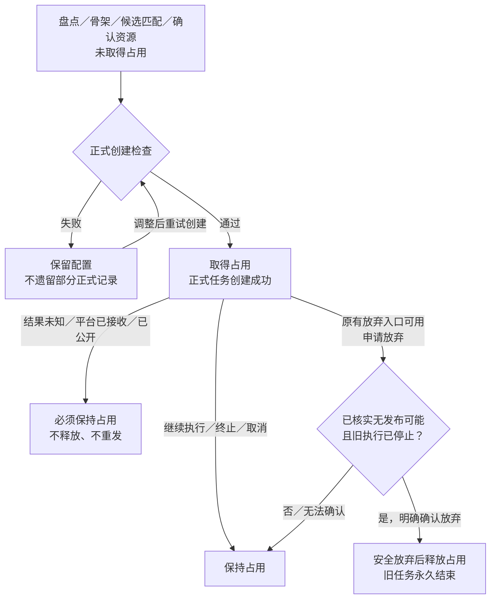
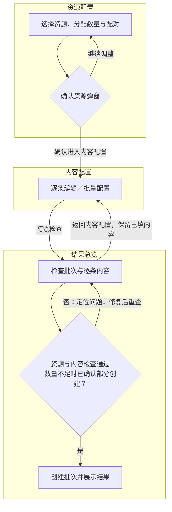

# 发布管理 PRD 可读性优化与重构方案

**本次重构要替读者完成分类和判断：占用看生命周期，动作查状态表，推进看决策，数量用实例解释。** 不能把原文拆短后原样保留信息关系。

写作行为遵循[《PRD 写作规范与 AI 编写指引》](<../standards/PRD 写作规范与 AI 编写指引.md>)。事实取自[现有第六章](../product/prd/详细文档/第六章_发布管理.md)；本文件是评审方案，案例尚未替换正文，不成为第二份业务规则。

本轮仅修改两份写作与方案文档。原型、代码、第六章和其他规范及入口保持不变，不开展额外业务评审。批次仍为“资源配置 → 内容配置 → 结果总览”，检查、创建与反馈都在第三阶段内。

## 1. 当前文档的七个组织问题

| 典型原文与位置 | 理解成本在哪里 | 采用的组织方式 |
| --- | --- | --- |
| 6.8.2：“同一成片可以用于不同平台，同平台只允许存在一条有效占用任务。” | 范围、取得、保留和释放分散在多段，读者需自行拼出生命周期 | 一句核心范围＋生命周期图，必要身份条件另补；见 2.1 |
| 6.8.2：“同账号任务串行。账号本批次上限、平台真实日额度与资源估算各自表达” | 占用小节同时承担执行、额度和资源故障主题 | 移回执行、资源配置与待办；去向见第 3 节，不在原位置继续加标题 |
| 6.4.2：“各状态允许的动作见 [6.8.4](../product/prd/详细文档/第六章_发布管理.md#684-状态权限与动作速查)。” | 操作远离任务列表，多次跳转后仍需拼接条件 | 就近放紧凑状态操作表，条件仅维护一次；见 2.2 |
| 6.2.2：“每次衔接先检查当前批次的正式任务结果，再检查下一批是否就绪” | 原表同时列未决、失败率和下一批配置，条件可能并存，优先级不直观 | 决策表显示检查顺序与阻断结果；见 2.3 |
| 6.3.1：“确认后，本份配置的平台、类目目标、账号和成片映射锁定；不取得正式资源占用，也不创建任务。” | 锁定、占用、创建三个边界容易被当成同一次完成 | 三阶段流程表达先后，规则只补锁定与创建边界；见 2.4 |
| 6.3.2：“目标 30、明确只创建 28 条、28 条均已发布，可以结束本批次的执行，但仍保留目标缺口 2。” | 指标公式分散，容易把任务完成当作目标达成 | 统一数字案例区分正式任务、公开数量、原目标和缺口；见 2.5 |
| 6.2.1：“失败保留输入”；6.2.3：“保存失败保留本次输入” | 相似提醒重复，正式 PRD 继续追加后重点被稀释 | 常规行为引用全局规范，创建未知与编辑失败的业务差异各归所属操作 |

原文引用用于定位问题，不用于重新评审业务。以下样本先确定主题和关系，再选主表达；图表不另配完整文字复述。

## 2. 可用于正式重构的真实样本

每例的“原文／组织判断”属于评审材料；“拟写入 PRD”后的内容才是正文样本。正式 PRD 不带入写作分析、自评或“改进说明”。

### 2.1 成片占用生命周期

**原文｜6.8.2**

> 同一成片可以用于不同平台，同平台只允许存在一条有效占用任务。判定依据为成片身份和目标平台，不以标题、封面、账号更换或重新分批规避。
>
> 计划盘点、批次骨架、候选匹配和资源确认均不取得占用；正式创建任务时统一复查，任何一项失败不能遗留半份正式记录。候选与草稿可以提示软冲突，但不能代替创建时检查。
>
> 正式任务的平台、类目、账号和成片身份固定。终止或取消保留占用；明确放弃且确认无发布可能、旧执行已停止后才释放。结果未知、平台已接收或已公开均不能释放或重发。

**组织判断：** 只回答“同平台成片何时被占用、何时能再安排”。账号串行、平台额度和资源恢复移出；生命周期用一张图承载，不再逐分支复述。

**拟写入 PRD**

**同一成片在同一平台只允许一条有效占用任务；正式创建取得占用，终止或取消保持占用，只有允许放弃且安全条件核实通过时才释放。**



- 占用按“成片身份＋目标平台”判断。同一成片可用于不同平台；改标题、封面、账号或批次不能绕过同平台限制。
- 正式任务的平台、类目、账号和成片身份固定。候选或草稿的冲突提示不能代替正式创建检查。

### 2.2 发布任务状态与操作

**原文｜6.8.4、6.4.5**

> 待执行 | 详情、编辑、执行、符合条件时终止；批次任务执行需满足所属批次授权
>
> 结果待确认 | 核实结果；禁止直接重试、终止和释放

> “发布失败”先说明具体失败阶段和可恢复原因。确认未形成可发布作品、原执行已结束、资源与内容仍有效，且所属批次未停止时，才能“重试”。重试仍使用原任务，增加一次执行尝试，不增加任务数，不覆盖旧尝试。
>
> 列表“终止”只在未领取，或已取得当前执行安全停止且尚未提交的证据时可用。确认后为“已取消”，不恢复原任务，资源占用仍保留。已公开、平台已接收或结果未知的任务不能这样终止。

完整状态来源为[现 6.8.4](../product/prd/详细文档/第六章_发布管理.md#684-状态权限与动作速查)，本例同时承接现 6.4.5 的重试、原稿核实、终止和复制条件。

**组织判断：** 用“状态／主要操作／关键条件”回答“现在能做什么”，只另列复杂动作条件。不再为每种状态新增解释段；未列明的按钮不自行补齐。

**拟写入 PRD**

**任务业务动作从列表发起，按当前状态和安全条件开放；详情只读，已发布任务可查看关联作品。**

| 状态 | 主要操作 | 关键条件 |
| --- | --- | --- |
| 待执行 | 编辑、执行、终止 | 编辑须未领取；批次首次执行后还须未停止。执行满足批次授权、时间、间隔与资源条件；未领取且安全时可终止 |
| 排队中 | 终止 | 未领取且安全；不重复执行或编辑当次输入 |
| 执行中 | 符合条件时终止 | 已取得当前执行安全停止、且尚未提交的证据后才可终止 |
| 等待人工 | 去处理 | 在原账号环境验证后继续原尝试；有提交可能先核实 |
| 结果待确认 | 核实结果 | 禁止直接重试、终止或释放成片 |
| 平台审核中 | 补录结果 | 不计公开目标，不重新投稿 |
| 发布失败 | 重试、放弃、复制（按条件） | 查看失败阶段与可恢复原因；批次内先恢复原资源，无法继续时按安全条件放弃；复杂条件见下文 |
| 已发布 | 复制 | 历史只读，可查看关联作品 |
| 已取消 | 复制 | 原任务不恢复，普通取消保留占用 |
| 已放弃 | 复制 | 旧任务永久结束，已按安全条件释放占用 |

所有动作在提交时复查权限、资源、状态和内容变化；复制仅限既有入口提供时使用，不由本表新增按钮。

终止确认后记为「已取消」；已公开、平台已接收或结果未知的任务不适用此操作。历史尝试的输入不因后续编辑而改变。

仅以下复杂动作补充条件：

- **重试**：同时满足未形成可发布作品、原执行已结束、资源与内容有效、所属批次未停止。沿用原任务新增尝试，不增任务数、不覆盖旧尝试；平台拒绝但留有可处理稿件时，先核实原稿件，不直接重新上传。
- **放弃**：按[成片占用生命周期](#21-成片占用生命周期)核实安全条件。原资源无法恢复时，合法处置旧任务后再创建新安排。
- **复制**：仅复用允许的内容进入新建，重新选择或校验资源；同平台原成片仍占用时，不能形成第二条有效任务。

核实证据与补录字段见[核实结果](../product/prd/详细文档/第六章_发布管理.md#644-核实不明确的发布结果)和[补录结果](../product/prd/详细文档/第六章_发布管理.md#646-补录发布结果)。

### 2.3 计划中的批次执行推进

**原文｜6.2.2**

> 正常情况下，计划按平台组和组内批次顺序自动推进。每次衔接先检查当前批次的正式任务结果，再检查下一批是否就绪：

> 失败率按“确认失败且未形成可发布作品的任务数 ÷ 有明确结果的任务数”计算。明确结果包括已公开、平台明确接收／审核中及确认失败；取消、放弃不计入分子或分母，分母为零不能当作失败率 0%。审核中可以参与衔接判断，但不计公开发布目标。

原表还分别列出未决任务、超过阈值、无明确结果和下一批未配置，完整来源见[现 6.2.2](../product/prd/详细文档/第六章_发布管理.md#622-启动并跟进计划)。

**组织判断：** 主题是“有后续批次时能否推进”。按检查顺序组织决策，区分人工确认和资源就绪两个关口；页面查询、抽屉与编辑范围不留在此处。

**拟写入 PRD**

**计划按平台组和组内顺序推进；先处理当前批次，再检查衔接条件和下一批就绪情况。**

有后续批次时，按下表从上向下检查，前项未通过不进入后项：

| 顺序 | 当前条件 | 系统反馈／运营动作 |
| --- | --- | --- |
| 1 | 计划已人工暂停 | 等待「恢复计划」；恢复时重新检查，不因配置完成自动恢复 |
| 2 | 当前仍有待执行、排队、执行、等待人工或结果待确认任务 | 停留当前批次，先处理；人工确认也不能绕过 |
| 3 | 无未决执行、明确结果数为 0，且尚未确认跳过 | 等待「确认跳过当前批次」；跳过不计发布成功 |
| 4 | 无未决执行、明确结果数大于 0、失败率超过 10%，且尚未确认继续 | 查看结果后「确认进入下一批」 |
| 5 | 前述判断通过，但下一批未就绪 | 等待配置；完成后重新检查，不自动跳过 |
| 6 | 前述判断通过，下一批已就绪 | 执行下一批 |

失败率＝确认失败且未形成可发布作品的任务数 ÷ 明确结果任务数。明确结果包括已公开、平台已接收／审核中和确认失败；取消、放弃不计入。零分母按第 3 项处理，审核中不计公开目标。

| 其他控制 | 适用边界 |
| --- | --- |
| 单独终止某批 | 仅结束该批；收尾后仍按上表衔接，不连带终止计划 |
| 首次启动前已有前序批次被终止 | 无未决任务时保留其终止结果，启动确认后从后续首个可执行批次开始；未就绪仍须配置，不自动跳过 |
| 暂停或人工接管 | 暂停不停止已经开始的执行；从批次单独执行须确认接管并暂停自动推进，只能接管当前位置，不重复派发 |

### 2.4 新建批次的三阶段与创建边界

**原文｜6.3.1**

> 点击“确认资源”后，弹窗展示匹配数量、缺口和锁定影响。运营可继续调整，或确认“进入内容配置”。确认后，本份配置的平台、类目目标、账号和成片映射锁定；不取得正式资源占用，也不创建任务。
>
> **最后创建检查。** “预览检查”进入独立检查区域，核对批次名称、原目标、本次创建数量、缺口、发布设置及每条最终内容。问题定位到具体条目，修复后重新检查；“返回内容配置”保留已有内容。

**组织判断：** 图中按三个阶段呈现确认、返回及创建检查分支；规则就近归入对应阶段，不再汇总为大规则表。成功反馈仍属于结果总览。

**拟写入 PRD**

**确认资源只锁定本份配置；在结果总览完成创建，才产生正式任务与平台成片占用。**



**资源配置**

- 从列表新建时自行确定平台、类目和各类目数量；从计划进入时继承平台、类目和分目标，保持原值。成片管理多选可带入资源，仍检查有效性与占用。
- 可用成片数量可点击查看明细，类目优先级可拖拽；账号选择、顺序、每号本批次上限及配对可调整。系统给出匹配建议并保留兼容人工分配，不足时指出原因。
- 独立批次参考目标可不填；与类目合计不同或资源不足时可继续配置，差额可见，最终类目数量仍须明确。配对满足平台、类目资格和可用条件，同账号跨类目共用本批次上限，该上限不等于平台日额度。
- 确认资源弹窗展示匹配数、缺口和锁定影响；确认进入内容配置后，锁定本份配置的平台、类目目标及账号成片映射。

**内容配置**

发布账号与成片分列且只读，文案、封面与确认沿用[内容与封面规则](../product/prd/详细文档/第六章_发布管理.md#65-发布内容与执行设置)，不通过编辑更换已锁定账号或成片。

**结果总览**

- 核对批次名称、原目标、本次创建数、缺口、发布设置及每条实际内容。至少有有效候选、内容已就绪且资源未被占用，才可创建；部分创建保留原目标与缺口。
- 点击「创建批次」再查全部资源和当前内容，统一创建批次及任务并取得占用。重复提交不重复生成；失败保留配置，结果不明先核对。
- 成功后展示原目标、实际创建数和缺口，批次为待执行。正式列表仅展示已创建任务的批次；待配置骨架仍从计划进入。

### 2.5 用数字区分统计与资源规则

**原文｜6.3.2、6.8.3、6.3.1、6.8.2**

> 任务处理与公开目标分别统计。例如目标 30、明确只创建 28 条、28 条均已发布，可以结束本批次的执行，但仍保留目标缺口 2。计划是否继续，由计划的衔接规则判断，不以批次页面是否仍有审核待办代替。

> 同一账号跨类目共用本批次上限；每号本批次数量不是平台日额度。

**组织判断：** 目标与缺口、衔接阈值、资源上限分别举例。数字仅代入已确认口径，不引入新上限或阈值；样本只解释这些易混点，不替代全部统计规则。

**拟写入 PRD：统计口径**

**执行结束与目标达成分别判断；发布成功率始终以原目标为分母。**

原目标 30 条，明确只创建 28 条。比较同一批次的两个时间点：

| 指标 | 24 条公开、4 条审核中 | 28 条全部公开 |
| --- | --- | --- |
| 正式任务数 | 28，重试不增加 | 28 |
| 创建缺口 | 30－28＝2 | 仍为 2 |
| 发布成功率 | 24÷30＝80% | 28÷30≈93.33% |
| 目标缺口 | 30－24＝6 | 30－28＝2 |

实际任务全部完成时可结束本批次执行，原目标不降为 28，补量也不提高原目标。目标为 0 时比例显示不适用；未知和读取失败不按 0 处理。

**拟写入 PRD：衔接阈值示例**

以下均假定计划未暂停、当前无未决执行且下一批就绪，失败率沿用 2.3 的定义：

| 明确结果 | 失败率 | 衔接结果 |
| --- | --- | --- |
| 9 条公开＋1 条确认失败 | 1÷10＝10% | 自动继续 |
| 8 条公开＋2 条确认失败 | 2÷10＝20% | 等待确认继续 |
| 8 条公开＋1 条审核中＋1 条确认失败 | 1÷10＝10% | 可自动衔接；审核中不算公开成功 |
| 仅取消 4 条、放弃 1 条 | 分母为 0，不是 0% | 等待确认跳过 |

**拟写入 PRD：账号本批次上限示例**

**同一账号的本批次上限由所有类目共用。**

账号 A 本批次上限为 5，已给类目甲分配 3 条，则类目乙最多再分配 2 条。

## 3. 信息归属与重复收敛

不同主题先归位，表达形式随后确定。以下内容全部保留，不再塞回“成片占用”：

| 主题 | 正式重构时归属 | 主要表达 |
| --- | --- | --- |
| 成片占用及任务身份 | 共用规则：资源占用与防重复发布 | 生命周期图＋身份条件 |
| 账号执行顺序、执行时间和间隔 | 共用规则：执行时间与任务间隔 | 按执行条件组织；简单串行规则一句话 |
| 每号本批次上限与匹配能力 | 新建批次：资源配置 | 配置说明＋跨类目数字案例 |
| 平台真实额度与未知值 | 资源盘点／执行检查的相关规则 | 直接区分上限、真实额度、估算，不推导新能力 |
| 登录失效、文件不可取得 | 批次待办及任务恢复 | 具体原因、恢复入口与后续动作 |
| 公开目标、正式任务与缺口 | 共用规则：目标、进度与结果口径 | 口径表保留一次，难点配数字案例 |
| 计划汇总、统计时间与迟到结果 | 同上，各按自己的口径说明 | 保留所属任务去重、实际公开时间和统一业务时区；迟到结果只更新统计，不改历史或重复推进，不混入目标缺口案例 |

正式正文中，生命周期图不再配同内容的占用表；状态操作表不再逐状态复述；推进只选决策表，不另画一张等价分支图。案例中的数字只解释边界，不代替完整口径。

同一规则在多个场景使用时，保留一个完整来源，其他位置只保留当前决策必需的结论与引用。原型交互、常规失败反馈和通用视觉沿用已有规范；创建结果不明、部分创建、历史保留等业务差异仍写在对应操作旁。

## 4. 推荐的第六章目录

目录按业务对象和用户任务划分，不要求每个页面套同样标题。状态操作表、图表和实例写在所属章节内，不为它们额外建页面或独立文档。

```text
第六章 发布管理
6.1 发布管理概览
    6.1.1 计划、批次、任务与工具的使用入口
    6.1.2 从准备内容到确认公开的完整流程
6.2 发布计划
    6.2.1 计划列表
    6.2.2 新建与编辑计划
    6.2.3 计划详情
    6.2.4 执行与推进计划
    6.2.5 补量与结束计划
    6.2.6 终止计划
6.3 发布批次
    6.3.1 批次列表
    6.3.2 新建批次
        资源配置 → 内容配置 → 结果总览
    6.3.3 编辑批次
    6.3.4 批次详情
    6.3.5 执行与处理待办
    6.3.6 终止与停止发布
6.4 发布任务
    6.4.1 任务列表
    6.4.2 快速发布与编辑
    6.4.3 任务详情
    6.4.4 执行与终止任务
    6.4.5 处理人工介入
    6.4.6 核实与补录结果
    6.4.7 处理失败任务
6.5 内容配置与封面
    6.5.1 编辑单条内容
    6.5.2 批量配置内容
    6.5.3 选择或制作封面
    6.5.4 检查并确认内容
6.6 图片库（运营工具）
    6.6.1 图片列表与选用
    6.6.2 上传图片
    6.6.3 维护与清理图片
6.7 封面模板（运营工具）
    6.7.1 模板列表
    6.7.2 新建模板
    6.7.3 编辑与发布更新
    6.7.4 复制制作其他规格
    6.7.5 停用与清理模板
6.8 共用业务规则与验收
    6.8.1 新建续编与正式记录
    6.8.2 资源占用与防重复发布
    6.8.3 执行时间与任务间隔
    6.8.4 目标、进度与结果口径
    6.8.5 操作权限与历史保留
    6.8.6 关键业务验收场景
```

计划详情保留目标矩阵、推进、待办、记录和计划内批次抽屉；批次详情保留信息、统计、任务及唯一“发布成功率”进度条；任务详情保留任务信息、发布内容和执行历史。列表状态动作就近归位，详情不新增整组日常操作。

图片库与封面模板标明运营工具属性，暂留 6.6、6.7；6.5 只说明调用。以后确有跨模块维护需要，再统一迁入一份运营工具 PRD，本次不新增工具文档。

## 5. 样本验证与正式重构方式

本节属于评审材料，不写入正式 PRD。

| 验证点 | 样本如何证明 |
| --- | --- |
| 先组织，再表达 | 占用只处理取得／保留／释放；账号执行、额度和故障恢复已明确移位 |
| 一处承载主要逻辑 | 生命周期只用图，动作匹配只用紧凑状态表，推进优先级只用决策表，不附等价长文 |
| 条件没有丢失 | 占用保留创建复查和安全释放；动作保留重试与终止的且／或；推进保留 10%、零分母、暂停和就绪约束 |
| 数字检验理解 | 30／28 区分执行和目标，10%／20% 检验衔接，跨类目 3＋2 检验账号共用上限 |
| 不改变产品 | 三阶段不变，状态表保留条件性动作、不补新入口，数字不是新默认值，正式正文尚未修改 |

后续获准重构时：

1. 按主题重新归类受影响事实，找出核心结论和关系；只处理当前原文与已确认变更，不做全量业务审计。
2. 在原第六章内选主表达并直接重写，按第 3 节移位混合主题，同步删除被替代的段落；不用文末补丁维护。
3. 将本方案的正文样本放回对应章节，删除评审分析；占用图、状态操作表、推进决策和统计口径各有一个完整来源。
4. 对照条件与例外是否完整，逐段删除没有独立信息价值的解释，不删必要业务条件。
5. 通读用户路径并检查链接，提交正文评审。明显矛盾单列待确认，不自行改规则或顺带修改原型、代码与其他规范。

## 6. 新验收标准

| 验收动作 | 通过要求 |
| --- | --- |
| 快速看首句 | 几秒内能说出本节最重要的结论，不先读完所有条件 |
| 遮住补充文字，只看主图表 | 能找到主要路径、状态动作或判断顺序；不靠正文重新讲一遍 |
| 检查分类与递进 | 同级采用一致维度；流程和判断有顺序，异主题已归位 |
| 删除重复 | 没有图文双份流程、状态表后逐状态复述、实例后同义长解释 |
| 逐段删除没有独立信息价值的解释 | 保留下来的每段有图表未承载的独立信息，必要业务条件完整 |
| 对照业务含义 | 条件、逻辑关系、状态、动作、占用、指标与例外完整，未知值和零分母未被简化掉 |
| 检查范围 | 只调整表达与归属；正式 PRD 不夹写作自评，本轮不修改第六章或产品行为 |

人工阅读与业务含义对照是主要验收，句长、标题数或图表数量不能替代。当前交付停在两份文档修订，等待评审。

