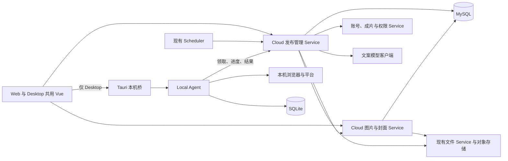
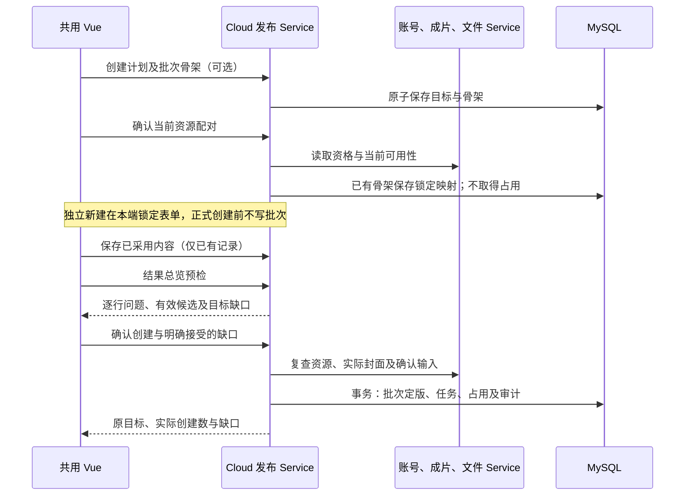
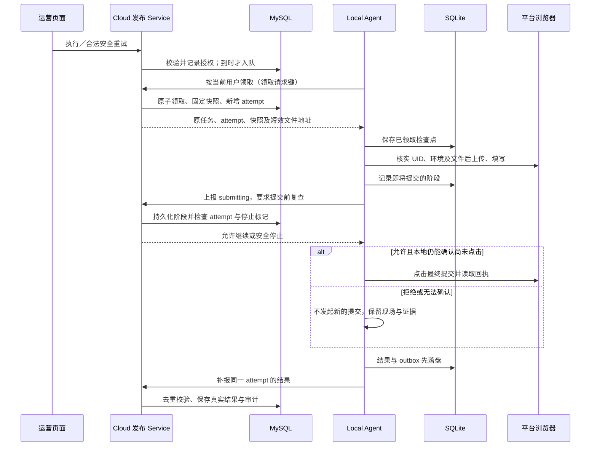
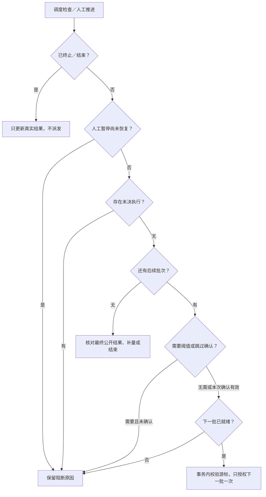
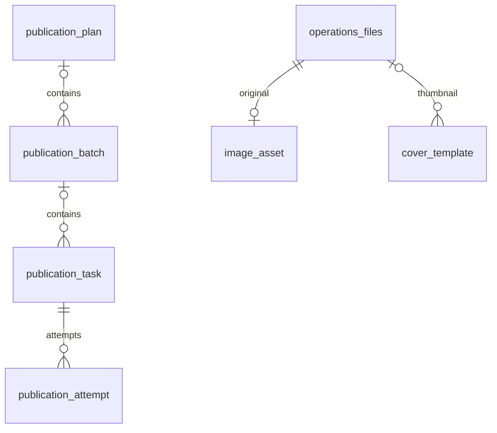

# 发布管理与运营工具工程设计

**发布管理继续使用现有 Cloud、Local Agent 和 Desktop。Cloud 管任务和执行授权，Agent 操作浏览器，Desktop 连接本机能力。数据库新增六张业务表，文件仍由现有文件服务管理。**

本文回答三个问题：系统由谁负责、数据怎么保存、出现并发和故障时怎么处理。**这是待实现的设计，不表示功能已经上线。** 用户流程和操作规则见 [PRD 第六章](../../product/prd/详细文档/第六章_发布管理.md)，页面见 [原型](https://github.com/piqiu96/wt-media-cloud/tree/main/web/example/proto/publishing-design)。本文的字段、接口和状态是实施建议；实际数据库迁移与接口契约由提供方在开发时落地。

依赖：[系统架构](../architecture/社媒运营平台工程架构与分层设计_V1.md)、[社媒账号](social-accounts.md)、[运营资源](2026-10-29-operating-resources.md)、[内容生产](2026-09-24-m4-m5-cloud-content-production.md)、[认证 ADR-0022](../../decisions/0022-session-only-auth-and-agent-token.md)、[契约映射](../../contracts/contract-map.md)。

## 1. 总体架构

### 1.1 模块与调用边界



| 位置 | 职责 | 实现边界 |
| --- | --- | --- |
| Cloud 发布管理 | 配置校验、正式创建、占用、授权、派发、结果核实、推进、统计和审计 | 在 `internal/modules/publish` 内按 Handler → Service → Repository 组织；通过所属模块 Service 使用账号、成片、身份和文件 |
| Cloud 运营工具 | 图片库、模板草稿与发布配置、真实封面渲染 | 图片、模板、渲染按主题分文件，供发布管理引用；不拆独立部署服务或通用资源引擎 |
| Cloud Scheduler | 到时入队、计划推进、失联检查 | 调用发布 Service，不访问浏览器或运营电脑，不自行改写另一套状态 |
| Local Agent | 实读账号环境、取文件、上传、填写、提交、保留现场和执行证据、补报结果 | 只执行所属用户的账号；不直接写 Cloud 数据库，不自行授予重试权限 |
| 共用 Vue / Desktop | 配置与审阅、显示进度、调用本机能力 | Vue 不直连 SQLite；Tauri 不复制业务校验、平台自动化或 Cloud 页面源码 |

### 1.2 复用范围与新增实现

**已有底层能力可以复用，但发布执行器、发布接口和封面渲染仍需要开发。**

| 已有能力与代码依据 | 可以复用 | 发布管理仍需实现 |
| --- | --- | --- |
| [Cloud Scheduler](https://github.com/piqiu96/wt-media-cloud/blob/main/internal/scheduler/scheduler.go) | 作业注册、周期调用和进程退出控制 | 发布入队、推进和失联检查的业务函数 |
| Cloud `mediaaccount`、`production` Service | 授权范围、账号身份、成片与文件事实 | 发布资格、同平台占用及资源盘点投影；不复制账号或成片管理模块 |
| [Cloud files Service](https://github.com/piqiu96/wt-media-cloud/blob/main/internal/modules/files/service/service.go) | 上传、对象存储、摘要、文件登记和短效访问地址 | 图片尺寸、生成来源元信息、渲染文件登记及业务引用删除保护 |
| [Cloud Agent 鉴权](https://github.com/piqiu96/wt-media-cloud/blob/main/internal/modules/localagent/auth.go) | 新工作严格鉴权、已领取工作 report-safe 收尾 | 为每次发布执行增加归属、状态和证据校验；不能像普通下载那样超时后自动重领 |
| [Agent checkpoint/outbox](https://github.com/piqiu96/wt-media-agent/blob/main/src/wt_media_agent/storage/checkpoint_store.py) | 本机保存执行进度和未成功上报结果的能力 | 新增发布执行器；提交前记录现场，断网后只补报原结果 |
| [Desktop 本机调用](https://github.com/piqiu96/wt-media-desktop/blob/main/src-tauri/src/commands/account.rs) | Tauri → Local Agent 的受控桥接方式 | 发布现场继续及新建续编接口的桥接 |

当前 Agent 运行入口注册的是文件下载执行器；文案模型客户端、模板封面渲染与三平台发布适配也不能由原型演示推定为已经实现。不新建 MQ、Redis 锁、工作流引擎、设备节点或通用执行许可系统。

### 1.3 V1 实施边界

产品范围以 [PRD 平台范围](../../product/prd/详细文档/第六章_发布管理.md)和[批次资源配置](../../product/prd/详细文档/第六章_发布管理.md#632-新建批次)为准。工程实现沿用已有身份与任务边界：

- 正式创建按每个账号的所属用户确定 task 的 `operator_id`，不使用批次负责人或创建人统一代填。领取时将 Agent 认证用户与该任务及账号归属核对；离线保留待办，不转派、不新增协作服务。
- 当前百度账号与待执行任务入口正常展示，不设置百度准备开关。创建任务只保存 pending，不等于授权执行或已接通投稿。其他平台按 PRD 顺序接入；授权及领取必须独立验证执行能力，不能靠隐藏准备入口代替执行校验。
- 资源查询与推荐只消费已有资格、顺序和数量，不新增质量评级字段、维护 API／页面或等级匹配输入。

## 2. 服务交互

### 2.1 配置、确认资源与正式创建

**资源确认锁定本份映射，正式创建取得占用，执行授权另行发生。** 批次界面始终为「资源配置 → 内容配置 → 结果总览」，结果总览是预览与创建检查，不增加持久化配置状态。



计划创建只写计划和骨架。独立批次提交完整配置；计划骨架确认使用同一创建校验器。已有骨架进入内容配置时，服务端将平台、类目目标、账号及成片映射固定；之后内容保存不得把配置退回资源阶段。此锁定不等于整个计划首次启动后的结构锁定。

部分创建显式携带包含／排除的候选及预期缺口；服务端重算后对该集合全成或全败。启动时的“只执行当前可用任务”是另一项明确确认：其余正式任务保持待执行及阻断原因，不静默取消或降低目标。

预检只读当前事实，不占用、不颁发可执行令牌、不建立预检会话。创建结果不明按原请求核对；创建成功不自动串联 start。

### 2.2 授权、领取与浏览器提交

**只有已授权且满足时间、间隔和父级条件的任务才能被领取；每次领取固定一次输入。**



领取时先核对 Agent 认证用户、任务 `operator_id` 与账号所属用户一致，再检查真实平台 UID、Profile 归属、当前输入、成片占用和文件引用；Agent 还须在本机实读 UID 与文件摘要，不能以最近一次 Cloud 登录检查替代。同一浏览器 Profile 即使绑定了不同平台的账号，也不能同时执行发布。Cloud 领取时锁定已有 `browser_profiles` 行，检查该 Profile 的旧执行现场是否已安全结束；Agent 在本机也按实际 BitBrowser Profile 串行。编辑与领取竞争时按对象修订阻止覆盖。

到时判断使用 `not_before`；批次间隔使用上一条执行结束时间加间隔。同一真实平台账号有执行、人工或结果未知任务时，不领取下一条；不同账号若共用一个浏览器 Profile，也不能并行。不同账号且不同 Profile 才允许受控并行。时间到达不会自动授权尚未启动的任务。

提交前复查通过 progress 完成，不另设通用许可 API。允许响应与平台点击之间仍有竞态窗口：后发生的停止不能撤回平台提交，必须根据真实回执收尾。提交前响应丢失时，不能把旧允许响应当作永久许可，也不能自动重放点击。

### 2.3 计划推进与停止控制

**自动检查、人工恢复、确认继续和批次接管共用一个推进 Service，事务内重检位置和当前事实。** 条件优先级直接遵守 [PRD 6.2.4](../../product/prd/详细文档/第六章_发布管理.md#624-执行与推进计划)。



阈值固定使用 PRD 的 10%，不增加每计划可配置参数。明确结果数大于零时用整数比较 `failed × 10 <= published + reviewing + failed`；零分母须确认跳过，人工确认也不能绕过未决任务。确认绑定当前批次、预期下一批及对象修订，不是可反复使用的额外授权。

人工暂停只阻止后续批次启动，已启动任务继续按真实结果收尾。**仅下一批未配置好时，计划仍为 `running`，界面当前进展显示「等待配置」。** 配置完成后 Scheduler 重新检查未决任务、失败率、批次位置和就绪情况；满足条件就继续。人工暂停、失败率超阈值和零明确结果都必须由运营恢复／确认，不能因为配置完成而自动解除。从批次入口接管仅限当前合法位置，先暂停自动推进，再授权本批。

首次启动前已有前序终止批次时，在确认无未决执行后保留其终止结果，选择后续首个合法位置；后续未就绪就等待，不自动跳过未配置批次。已推进批次的迟到结果只更新任务和统计，不回退游标；其真实未决会阻断再启动下一批，不停止已经启动的当前批次。

计划终止封住全部所属批次的新派发；单批终止／停止只封住本批。安全收尾和结果核实继续使用原 attempt，不把晚到结果转换成新的启动或重试授权。

补量、最终结束复用 PRD 6.2.5 的条件。补量事务重算原目标缺口，已有一轮补量未处置完成时不再追加；迟到公开结果只重算缺口并提示处置，不静默删除正式任务或发出超量任务。

### 2.4 内容生成、采用与封面

**生成结果必须先让运营审阅。生成文字、采用文字、确认内容、创建发布任务，是四件不同的事。**

文案由 Cloud 调用模型生成。只有一条内容完整返回并通过检查，页面才显示「采用」；不能把生成到一半的文字直接写进表单。模板封面由 Cloud 生成实际图片，再交给文件服务保存。两者通过同一套流式进度反馈返回结果，见 [5.4](#54-生成流与接口反馈)。

| 检查什么 | 为什么需要 |
| --- | --- |
| 这条内容是否还是原来的内容（`row_key/input_revision`） | 平台、资源或生成依据变化后，旧结果不得覆盖新内容 |
| 某个字段是否被改过（`field_revisions`） | 用户改了标题后，旧标题建议失效；未改动的标签建议仍能采用。页面只认这个字段的最新生成请求 |
| 整条记录是否被别人保存过（`revision`） | 保存之前比较修订号，避免覆盖其他人的修改 |
| 确认后的内容是否发生变化（输入摘要） | 内容真的变了才要求重新确认，重复保存不清除确认 |
| 封面是否对应当前标题和模板（`render_input_hash`） | 正式创建时核对标题、底图、模板、规格和渲染版本，防止使用过期图片 |

批量配置只修改用户本次勾选的字段。取值顺序是：本条明确填写的值优先，其次是批次默认值，最后是创建时的平台默认值。默认只填空，覆盖手工内容要明确选择。用户审阅期间不改原记录；点击应用时如果内容已被修改，就提示重新审阅，不能直接覆盖。应用成功也不代表内容已经确认。

| 封面路径 | 服务实现 |
| --- | --- |
| 素材自带图片／图片库现成封面 | 检查实际文件、权限与平台规格；无需模板、封面文字或生成记录，替换后重新确认 |
| 模板合成 | 固定实际底图、短标题和各必要规格的启用发布模板；逐规格校验实际排版、渲染并登记文件，收齐输出才可确认 |

随机底图按当前类目、再通用范围选择启用且用途匹配的图片；最终选定的 ID 固定保存，不随查看重选，不实时生成底图或提取关键帧。模板标签仅用于推荐，可用性按实际输出要求判断；图片停用不参与新渲染。

模板渲染复用编辑器定义的画布、图层、字体、描边和行距参数。唯一动态主标题绑定业务短标题，隐藏仍计入数量；先换行再在允许范围缩字，仍溢出则报错，不截断标题或拉伸其他比例。样例预览标记为预览文件，不能代替实际标题的正式封面。

输入变化只使相关封面失效，正文等无关变化不重绘；预览、采用和导出指向同一实际成品。已确认文件及模板快照不因模板后续更新／停用而失效，再次生成才读取当前可用配置。

### 2.5 资源查询与推荐

发布管理直接读取已有账号、成片和任务占用数据，不再维护第二份库存。查询时说明账号为什么不可用，并返回数据读取时间。读取失败、库存为零、日额度未知必须分别显示；今日已发布按实际公开时间统计。

配对先过滤权限、平台、类目、身份和占用，再按用户确定的类目优先级、账号顺序与每号本批上限分配；同账号跨类目共享剩余数量，不把本批上限当作日额度。保留兼容的人工配对，短缺指出原因；推荐不预占，最终创建重新验证。

计划“AI 推荐”调用真实模型，结果仍须通过平台分组、逐格守恒及锁定行位置校验。不用确定性分配结果冒充 AI 输出；模型不可用时反馈失败，用户仍可手动拆批。推荐遵循 [V1 实施边界](#13-v1-实施边界)，不引入质量等级输入或等级匹配。

### 2.6 新建续编与正式记录

Desktop 把新建表单保存在 Agent 本地 SQLite；Web 只保存在当前页面内存，刷新后不恢复。已经创建的计划或批次属于 Cloud 正式记录，后续编辑直接保存到 Cloud，不再使用本地新建草稿。

本地内容包含表单、已采用结果、文件 ID、版本及原创建请求键，不存图片 Base64、Cookie 或长期文件 URL。正式创建成功后清理，失败保留；结果不明保留原键和原提交内容先核对，不生成第二份正式记录。仅存于本地的引用不构成 Cloud 占用或删除保护。

## 3. 核心模型

### 3.1 表结构总览

**六张新 Cloud 表都用自增 ID 作主键。** 计划、批次、任务和执行尝试分别保存各自的事实；图片库和封面模板复用已有文件服务，不再复制文件数据。



| 新表 | 保存什么 |
| --- | --- |
| `publication_plan` | 目标、周期、推进位置和结束原因 |
| `publication_batch` | 单平台批次的目标、资源配置和执行控制 |
| `publication_task` | 一条正式发布任务的资源、内容、授权和真实结果 |
| `publication_attempt` | 每次 Agent 领取后的固定输入、执行过程及证据 |
| `image_asset` | 已上传图片的用途、类目、启停和引用 |
| `cover_template` | 封面画布、一份草稿、一份当前发布配置 |

**建表共同约定：**
- 六张表均含 `id BIGINT UNSIGNED NOT NULL AUTO_INCREMENT PRIMARY KEY`，不使用业务组合键作主键；通过 API 传递 ID 时使用十进制字符串。
- 除 `publication_attempt` 外，其余五表均含 `created_by BIGINT UNSIGNED NOT NULL`、`created_at/updated_at DATETIME(6) NOT NULL` 和 `revision BIGINT UNSIGNED NOT NULL DEFAULT 1`。attempt 用 `started_at` 记录创建时刻、按报告序号维护执行进度。
- MySQL 使用 InnoDB、utf8mb4；时间在数据库存 UTC、接口按 RFC3339 返回，按业务时区 `Asia/Shanghai` 计算运营日期。
- 下表是**拟实施字段设计**：名称、类型、可空和关键索引需要在 Cloud migration 中实现。引用现有文件、账号、成片、用户表时，外键类型必须先核对已有列类型，不强行统一成无符号。
- `JSON` 保存小型配置与执行快照，不保存文件二进制、Cookie 或长期签名地址；数据库字段与读写校验均由所属服务维护。

### 3.2 发布计划：`publication_plan`

| 字段 | 建议类型 / 是否可空 | 含义 |
| --- | --- | --- |
| `id` | BIGINT UNSIGNED，自增主键 | 计划编号 |
| `team_id`、`owner_id` | BIGINT UNSIGNED，必填 | 团队及负责人 |
| `name` | VARCHAR(128)，必填 | 名称 |
| `description` | VARCHAR(1000)，默认空串 | 备注 |
| `date_start/date_end` | DATE，可空 | 计划周期，起止关系需校验 |
| `goals_json` | JSON，必填 | 平台 × 类目目标，例如 `[{platform,category_id,target_count}]`；组合不得重复 |
| `status` | VARCHAR(16)，必填，默认 ready | 计划执行控制 |
| `pause_reason` | VARCHAR(32)，可空 | 只有人工暂停或需要人工确认时填写 |
| `current_batch_id` | BIGINT UNSIGNED，可空 | 当前推进位置 |
| `first_started_at/cancel_requested_at/ended_at` | DATETIME(6)，可空 | 首次启动、终止请求及结束时间 |
| `end_reason/end_note` | VARCHAR(16)/VARCHAR(1000)，可空 | 结束原因与说明 |
| `request_key/request_hash` | VARCHAR(64)/CHAR(64)，必填 | 创建防重键与输入摘要 |
| `revision`、审计公共列 | 见 3.1 | 保存冲突检查与审计 |

**索引：** `UNIQUE(created_by,request_key)`；团队＋创建时间用于列表；`status`＋ID 用于待推进计划扫描。目标数由 `goals_json` 求和，不另存一个可写总目标；10% 失败阈值固定遵守 PRD，不增加每计划配置列。

内部 `ready/running/paused/stopping/ended` 分别表示待启动、运行推进、需人工解除的暂停、停止收尾、已结束。列表把 running 和 paused 都展示为「进行中」，暂停原因显示在当前进展。

**等待配置不等于人工暂停。** 下一批没配置好时计划仍是 running，只显示「等待配置」；配置就绪后重新检查，若仍有人工暂停、失败率超限或无明确结果，不能自动继续。`first_started_at` 只记录计划首次合法启动，不能因确认某批资源而提前写入。

### 3.3 发布批次：`publication_batch`

| 字段 | 建议类型 / 是否可空 | 含义 |
| --- | --- | --- |
| `id` | BIGINT UNSIGNED，自增主键 | 批次编号 |
| `team_id/owner_id` | BIGINT UNSIGNED，必填 | 团队及负责人 |
| `plan_id` | BIGINT UNSIGNED，可空 | 为空表示独立批次 |
| `kind` | VARCHAR(16)，默认 original | 原始批次或补量批次 makeup |
| `platform` | VARCHAR(32)，必填 | 一个批次只属于一个平台 |
| `name/description` | VARCHAR(128)/VARCHAR(1000)，必填/默认空串 | 批次名称与备注 |
| `targets_json` | JSON，必填 | 各类目数量，例如 `[{category_id,target_count}]` |
| `group_order/batch_order` | INT UNSIGNED，默认 0 | 组与组内批次的执行顺序 |
| `config_stage` | VARCHAR(16)，默认 resource | 资源配置、内容配置或已定版 |
| `config_json` | JSON，可空 | 未定版映射、默认内容及确认依据；正式任务创建后删除可写候选 |
| `execution_state` | VARCHAR(16)，默认 ready | 待执行、运行、停止收尾、结束或取消 |
| `confirmed_at/first_started_at` | DATETIME(6)，可空 | 定版与首次执行时间 |
| `cancel_requested_at/handoff_at` | DATETIME(6)，可空 | 停止请求与计划已推进标记 |
| `request_key/request_hash` | VARCHAR(64)/CHAR(64)，可空 | 独立批次创建防重；计划骨架确认用 revision |
| `revision`、审计公共列 | 见 3.1 | 保存冲突检查与审计 |

**索引：** `UNIQUE(created_by,request_key)`（NULL 不占用）；`(plan_id,kind,group_order,batch_order,id)` 按计划取有序批次；团队＋时间用于列表。

确认资源后，`config_stage=content`，已选平台、类目、账号和成片不再改动，但**不占用成片，也不锁整个计划**。正式创建任务后进入 confirmed，当前内容只由 task 保存，不维护另一份可修改内容。

批次的「有无待执行任务」「还有什么待处理」由任务实时计算，不另存一套容易过期的统计状态。`execution_state` 仅表示当前能否继续派发：`ready/running/stopping/finished/cancelled`；没有批次暂停。停止后绝不重新授权；已开始执行但暂时没有任务在运行，不等于自动结束整个批次。

### 3.4 发布任务：`publication_task`

| 字段 | 建议类型 / 是否可空 | 含义 |
| --- | --- | --- |
| `id` | BIGINT UNSIGNED，自增主键 | 正式任务编号 |
| `team_id/operator_id` | BIGINT UNSIGNED，必填 | 归属团队、账号所属用户；后者由账号事实确定，不取批次创建人或当前操作者 |
| `batch_id` | BIGINT UNSIGNED，可空 | 为空表示快速发布的独立任务；不另存 plan_id |
| `platform` | VARCHAR(32)，必填 | 发布平台 |
| `category_id/media_account_id/composite_output_id` | BIGINT UNSIGNED，必填 | 类目、Cloud 账号、成片身份；外键类型最终核对提供方 |
| `platform_account_uid` | VARCHAR(255)，必填，精确比较 | 平台真实 UID，不等于 Cloud 账号 ID |
| `resource_snapshot_json/content_json` | JSON，必填 | 选定资源和已确认内容；只存必要快照及文件 ID／摘要 |
| `cover_file_id` | BIGINT，必填；外键类型沿用 `operations_files.id` | 当前已确认封面，与 content_json 中的文件 ID 同一事务更新；供固定引用检查及删除保护使用 |
| `task_order` | INT UNSIGNED，默认 0 | 批次内顺序 |
| `status` | VARCHAR(24)，默认 pending | 当前业务状态 |
| `current_attempt_id` | BIGINT UNSIGNED，可空 | 最近一次执行 |
| `attempt_count` | INT UNSIGNED，默认 0 | 已领取的次数 |
| `not_before/authorized_at/cancel_requested_at` | DATETIME(6)，可空 | 执行时间、授权和停止请求 |
| `accepted_at/published_at` | DATETIME(6)，可空 | 平台接收与确认公开时间 |
| `platform_work_id/work_url` | VARCHAR(255)/VARCHAR(2048)，可空 | 平台稿件身份与可信作品链接 |
| `failure_code/failure_message` | VARCHAR(64)/VARCHAR(1000)，可空 | 明确失败的原因 |
| `request_key/request_hash` | VARCHAR(64)/CHAR(64)，可空 | 独立任务创建防重 |
| `occupied_output_id` | BIGINT UNSIGNED，生成列，可空 | 非 abandoned 时固定为成片 ID |
| `executing_account_uid` | VARCHAR(255)，生成列，可空 | 执行中、等待人工或结果未知时固定为平台 UID |
| `revision`、审计公共列 | 见 3.1 | 并发编辑与审计 |

**索引：** `UNIQUE(platform,occupied_output_id)` 防止同一成片同平台重复占用；`UNIQUE(platform,executing_account_uid)` 保证真实 UID 串行；`UNIQUE(created_by,request_key)` 为独立快速创建防重；按 batch/status、operator/status/not_before、team/published_at 建查询索引。生成列在 `status=abandoned` 或不执行时返回 NULL；详细表达见下方 SQL 规则。

Go 发布状态由 `internal/modules/publish/model.Status` 及同包常量维护，其他业务的任务状态留在各自模块，不建立通用 `TaskStatus`。发布业务错误码统一放在 Cloud 的 `internal/shared/errcode/publish.go`，与 `contracts/cloud-error-codes/v1/publish.yaml` 对齐；HTTP 状态使用框架常量。

任务只使用十个状态；这里列出内部代码供迁移和 Contract 对齐，**允许动作以 [PRD 6.4.1](../../product/prd/详细文档/第六章_发布管理.md#641-任务列表) 为准**。

| 内部状态 | 页面显示 | 内部状态 | 页面显示 |
| --- | --- | --- | --- |
| pending | 待执行 | queued | 排队中 |
| running | 执行中 | awaiting_human | 等待人工 |
| uncertain | 结果待确认 | reviewing | 平台审核中 |
| failed | 发布失败 | published | 已发布 |
| cancelled | 已取消 | abandoned | 已放弃 |

缺少链接时仍按审核中或结果待确认处理，不新建主状态。提交阶段在 attempt 保存，不在 task 另建同义状态。

生成列需要在 MySQL migration 中实现：

```sql
occupied_output_id = CASE WHEN status <> 'abandoned'
                          THEN composite_output_id ELSE NULL END
UNIQUE (platform, occupied_output_id)

executing_account_uid = CASE WHEN status IN ('running', 'awaiting_human', 'uncertain')
                             THEN platform_account_uid ELSE NULL END
UNIQUE (platform, executing_account_uid)
```

同 UID 多窗口仍不能并行；跨平台共用同一个浏览器 Profile 的任务，还须按 2.2 和 4.2 串行领取。取消保留成片占用，只有安全放弃才释放；不能因为一次历史检查结果允许重试或释放。

作品公开后在任务上保存平台作品 ID、链接及证据，复用已有作品关联，不另建结果表。同平台作品去重键必须按平台身份规则确认，不能把“链接格式合法”当作公开成功。

### 3.5 执行尝试：`publication_attempt`

| 字段 | 建议类型 / 是否可空 | 含义 |
| --- | --- | --- |
| `id` | BIGINT UNSIGNED，自增主键 | 执行编号 |
| `publication_id` | BIGINT UNSIGNED，必填 | 所属正式任务 |
| `attempt_no` | INT UNSIGNED，必填 | 此任务的第几次领取 |
| `executor_user_id/browser_profile_id` | BIGINT UNSIGNED，必填 | 实际执行用户及领取时冻结的 Cloud Profile |
| `claim_request_key` | VARCHAR(64)，必填 | 领取防重键 |
| `input_snapshot_json` | JSON，必填且创建后不可改 | 此次真实使用的账号、内容、文件、封面及版本 |
| `status/stage` | VARCHAR(24)/VARCHAR(32)，必填 | 执行进程状态和当前步骤 |
| `report_seq` | BIGINT UNSIGNED，默认 0 | 上报顺序，拒绝过期结果 |
| `started_at/heartbeat_at` | DATETIME(6)，必填 | 领取与最后心跳时间 |
| `submit_started_at/finished_at` | DATETIME(6)，可空 | 提交开始、执行结束 |
| `result_status/error_code/error_message` | VARCHAR(24)/VARCHAR(64)/VARCHAR(1000)，可空 | 本次结果或错误 |
| `steps_json/evidence_json` | JSON，必填 | 必要步骤与原始证据，不含 Cookie 或签名 URL |
| `result_hash` | CHAR(64)，可空 | 结果去重与冲突识别 |
| `resolved_by/resolved_at/resolution_note` | BIGINT UNSIGNED/DATETIME(6)/VARCHAR(2000)，可空 | 后续人工核实记录 |

**索引：** `UNIQUE(publication_id,attempt_no)`、`UNIQUE(executor_user_id,claim_request_key)`；`(status,heartbeat_at,id)` 供失联扫描；`(browser_profile_id,status,id)` 供同一 Profile 领取前检查。

状态只有 running、awaiting_human、completed、interrupted，描述**执行过程**，不表示是否公开。排队不产生 attempt；人工介入继续原 attempt；合法重试下次领取才新增一条。旧执行证据不能因新结果而改写。失联仅表示还需核实，不能据此自动启动新发布。

### 3.6 图片库与封面模板

**图片库只登记用途，实际文件继续由 `operations_files` 保存。模板保存一份草稿和一份生效配置。**

#### 图片库 `image_asset`

| 字段 | 建议类型 / 是否可空 | 含义 |
| --- | --- | --- |
| `id` | BIGINT UNSIGNED，自增主键 | 图片业务编号 |
| `team_id` | BIGINT UNSIGNED，必填 | 团队 |
| `file_id` | BIGINT，必填 | 已上传文件 ID；必须与现有文件表类型一致 |
| `name` | VARCHAR(160)，必填 | 展示名称 |
| `allow_as_cover/allow_as_background` | TINYINT(1)，默认 1/0 | 至少一种用途，可同时勾选 |
| `category_ids_json` | JSON，必填 | 类目 ID 数组，空数组为通用 |
| `enabled` | TINYINT(1)，默认 1 | 是否允许新选用 |
| `revision`、审计公共列 | 见 3.1 | 修改与审计 |

**索引：** `UNIQUE(file_id)`，以及 `(team_id,enabled,created_at,id)`。文件登记只能使用已完成上传且有权限的图片，尺寸由文件实际解码取得。停用不破坏旧任务的成品；被正式引用时不允许删除。

#### 封面模板 `cover_template`

| 字段 | 建议类型 / 是否可空 | 含义 |
| --- | --- | --- |
| `id` | BIGINT UNSIGNED，自增主键 | 模板编号 |
| `team_id` | BIGINT UNSIGNED，必填 | 团队 |
| `name` | VARCHAR(128)，必填 | 名称 |
| `canvas_width/canvas_height` | INT UNSIGNED，必填 | 画布规格，均须大于 0 |
| `scope` | VARCHAR(16)，默认 general | 适用范围 |
| `platform_codes_json/category_ids_json` | JSON，必填 | 推荐平台与类目，不能代替规格校验 |
| `draft_config_json/published_config_json` | JSON，可空 | 一份草稿、一份当前发布配置 |
| `published_revision` | INT UNSIGNED，默认 0 | 当前发布配置版本，不建历史版本表 |
| `published_thumbnail_file_id` | BIGINT，可空 | 当前模板缩略图文件 |
| `enabled` | TINYINT(1)，默认 0 | 未发布不能启用 |
| `request_key/request_hash` | VARCHAR(64)/CHAR(64)，必填 | 创建防重 |
| `revision`、审计公共列 | 见 3.1 | 修改与审计 |

**索引：** `UNIQUE(created_by,request_key)`、`(team_id,enabled,canvas_width,canvas_height,id)`。保存草稿只更新 draft；发布时校验当前保存的草稿、生成真实缩略图，再原子替换 published 并提升 `published_revision`。首次发布仍停用，后续更新保持已有启停。基础信息与规格固定，调整规格通过复制生成新模板。

图层、底图、动态标题、样式与排版保存在模板 JSON，不另建图层表；正式封面只用当前生效的模板配置渲染。样例预览不是正式成品；已有成品保存当时输入与模板快照，不因模板更新而改变。

#### 已有文件表扩展

`operations_files` 保持既有自增主键及文件字段。仅按需增加 `metadata_json JSON NULL`（宽高、格式、模板输入与渲染来源）和 `deleted_at DATETIME(6) NULL`（删除开始时间），以实现 4.6 的安全删除。**不新增文件表或引用计数表。**

### 3.7 本地存储

Agent 在现有 SQLite 中维护一张 `publication_draft`。**本地草稿也使用自增主键 `id INTEGER PRIMARY KEY AUTOINCREMENT`**；另加 `UNIQUE(environment,user_id,draft_type)`，保证同一环境、用户、类型只保留一份。`environment/user_id/draft_type/payload_json/saved_at` 为必填 TEXT，`schema_version INTEGER NOT NULL DEFAULT 1`。`draft_type` 只允许 plan、batch、task；保存时按组合唯一键更新原行，不建草稿历史或状态机。环境与用户取自当前已认证上下文，前端不能指定别人的身份。

发布执行与续编分开，Agent 使用 SQLAlchemy ORM 访问既有 SQLite 文件；不保留第二套业务 SQL 或双写路径。历史版本 DDL 只保留在同一 Engine 上的迁移层。

| 本地表 | 职责与关联 |
| --- | --- |
| `task_checkpoint` | 本地自增主键 `id`；保存 Cloud 原始 `task_id`、`task_type`、`cloud_env`、`user_id`、`attempt_id`、设备 `agent_id`，以及固定输入摘要、执行阶段和现场占用。发布按 attempt 隔离；下载按环境、用户、类型和任务隔离，保留跨租约重领的断点信息 |
| `task_result` | 本地自增主键 `id`；`checkpoint_id` 是外键且唯一，每个 checkpoint 有 0 或 1 条原始最终结果；保存原报文、原摘要及投递情况，不按裸 task_id 关联 |
| `agent_metadata` | 下载目录等小配置，以及按环境、用户隔离的未确认领取请求键 |
| `schema_migrations` | 已执行的存储升级版本，沿用既有名称与历史 |

`cloud_env` 为 `dev/test/pre/prod`，是明确配置的连接目标，独立于应用的 debug/release 或 development/production。URL 只用于通信，不作为身份或组合摘要。Desktop 成对传递 Cloud 地址和 `WT_MEDIA_CLOUD_ENV`。现有数据库路径保持不变；实际 Profile 的未结束现场在同一数据库内跨用户、跨环境互斥。

同一个 Cloud task 可以产生多个 attempt，因此可对应多条检查点和结果。所有业务查询、更新和删除携带完整作用域。重复领取不能覆盖固定输入；相同结果写入幂等，冲突结果保留原记录并拒绝覆盖。提交阶段先落盘，最终结果和检查点更新同一事务保存；补报只发送原报文，检查点不构成重启后恢复点击的授权。原现场丢失时进入核实，不伪造可继续执行的现场。

初始化由 `bootstrap/app.py` 显式装配：唯一配置入口 → 既有数据路径 → 一个 Engine/Session 工厂 → 版本化升级 → 各 Storage → 业务循环。`storage/database.py` 管理唯一 Engine/Session 工厂，数据库类型常量仅在该模块声明，默认 SQLite；配置不声明 URL 或数据库类型，`app.py` 仅传入数据目录和连接策略。`storage/dialect.py` 集中 SQLite 连接、WAL、`foreign_keys=ON`、`synchronous=FULL`、超时、冲突写入及历史升级；使用正常 ORM 事务，不在业务方法中设置 PRAGMA 或执行 `BEGIN IMMEDIATE`。Session 按操作创建且不跨线程共享，网络、浏览器及文件读取在数据库事务外；停止循环后再释放数据库资源。 SQLite 遇到 BUSY/LOCKED（包括快照写入冲突）时，只在配置超时内重试已回滚的纯数据库短事务，沿用同一份输入、结果和序号；不重放浏览器或 HTTP 操作。

普通唯一键和外键在模型中声明并于建表时创建。条件唯一规则也在模型统一声明，由适配在升级事务内、导入历史数据前创建；Store 写入引用既有规则名称，不再次定义冲突列和条件。替换数据库需要新增对应适配和迁移，并验证相同约束及事务语义；不保证只改类型就能迁移旧数据。

发布结果发送由既有 `runner/publication.py` 协调，网络在数据库事务外；`PublicationJournal` 只读取原报告、保存阶段和记录确认。恢复流程可直接确认已经核对的原报告，不通过遍历待回传列表伪造发送。待回传数量使用带环境/用户作用域的数据库统计。

下载成功确认后删除续传检查点。未知现场、未确认投递和冲突证据保留；发布结算后保留最小防重标识、输入摘要、原报告及序号依据，可清理冗余输入，不按时间直接删除防重记录。结果投递和现场核实分别扫描：现场已经人工结算也不能隐藏未送达结果；Cloud 拒绝晚到结果时保留原结果，不伪造报告确认。

旧库通过追加版本迁移还原原始身份和关联，保留原报告、摘要、序号及防重信息。缺少可靠环境/用户的下载或领取记录须先核实映射；无法确认时事务回滚并保留原库，不自动归给当前登录用户，也不重新生成请求键绕过未知领取。

### 3.8 查询投影

状态按钮、阻断原因、配置就绪、数量及成功率由同一发布 Service 生成。`allowed_actions/action_blockers` 是读投影，不是独立权限系统；服务端命令再次检查。

统计按 [PRD 6.8.4](../../product/prd/详细文档/第六章_发布管理.md#684-目标进度与结果口径)实现：目标 JSON 在内存逐格合计，任务先按 batch／平台／类目聚合，再组合结果；不展开目标数组后与任务相乘，不用 attempt 计数。公开作品先去重再计入对应任务，独立任务不进入计划汇总。

列表先应用权限、筛选与分页，再按页内父 ID 批量聚合，避免逐行请求。详情按需读取批次任务、尝试和审计，不返回全计划所有快照。批次只输出产品要求的发布成功率进度条，派发收口作为控制判断，不制造另一条产品进度。

## 4. 并发与恢复

### 4.1 怎样避免重复创建、重复领取和覆盖编辑

| 操作 | 最小机制 | 重复／冲突处理 |
| --- | --- | --- |
| 创建计划、独立批次、快速任务、模板 | 创建人＋请求键唯一，保存规范化输入摘要 | 同键同输入返回原对象；同键异输入冲突 |
| 确认已有批次 | 锁批次，检查定版事实与预期修订 | 已定版返回原创建结果，不再次套用传入配置 |
| 编辑、启动、重试、人工推进 | 预期修订及当前前置条件 | 过期拒绝，响应不明先读取当前对象；不为每条命令另建幂等记录 |
| 领取 | 执行用户＋领取请求键唯一 | 响应丢失重用原键取得原 attempt，不误领下一条；无任务不写领取记录 |
| 阶段、心跳、结果 | 当前用户／attempt、报告序号、结果摘要 | 旧序号不重复应用；同结果成功返回，冲突保留证据并核实 |

编辑时用 `WHERE id=? AND revision=?` 确认版本未变。任务结果或控制状态变化才增加修订号，普通心跳不增加，避免运营正在编辑时反复产生冲突。Agent 收到重复领取结果时，先查本地记录，绝不能再操作一次浏览器。每次心跳和提交前检查都读最新停止状态，不沿用上次允许提交的结果。

### 4.2 事务与约束

需要同时修改父子对象时，按 **plan → batch → Profile／文件 → task → attempt** 的固定次序取锁；同类多行按 ID 升序。领取、账号绑定修改、文件正式引用都要遵守各自的互斥规则，只锁涉及的行，防止并发操作绕过检查。事务内只做数据库读写；模型、渲染、对象存储删除及平台操作都在事务外。只有纯数据库事务死锁才可有限重试，绝不自动重放已产生外部副作用的操作。

| 命令 | 必须原子完成的写入 |
| --- | --- |
| 创建／编辑计划 | 平台能力与目标守恒校验、计划及骨架／允许编辑行、排序和审计；首次启动前也不能改已确认资源的行 |
| 确认资源 | 已有骨架的映射、目标与阶段、对象修订及锁定审计；不占成片、不锁整个计划 |
| 正式创建批次／快速任务 | 最终资源与当前内容校验、全部正式任务、成片唯一占用、定版及审计；失败整体回滚 |
| 编辑内容与时间 | pending 且未领取、父级允许、实际内容及确认指纹、执行时间、对象修订；不更换身份 |
| 启动／推进 | 当前位置、实时未决聚合、阈值与明确确认、必要首次启动、授权、移交与审计；一个位置只推进一次 |
| 领取 | 父级控制与时间／间隔复查、真实 UID 唯一执行位、Profile 行锁与未完成现场检查、task 状态、attempt 与输入快照 |
| 终止／停止 | 封住对应父级与任务派发、取消未领取任务、原因和审计；在途不能直接伪造成已取消 |
| 结果／核实／安全放弃 | 当前 attempt 与证据校验、平台身份去重、任务结果及核实审计；仅符合安全放弃条件时释放占用 |
| 补量／最终结束 | 全部既有批次真实处置、公开缺口、补量唯一当前轮／结束原因及修订 |

不对最终缺口、阈值和安全条件使用可能跳过行的查询。预检和外部文件检查完成后，写入事务仍复查状态、修订、文件元数据及唯一占用，不能把预检结果当作最终保证。

### 4.3 Scheduler 与容量控制

| 现有 Scheduler 内的作业 | 扫描范围与行为 | 建议初始周期 |
| --- | --- | --- |
| 到时入队 | 已有授权且到时的 pending，重新检查父级、资源及间隔 | 5 秒 |
| 计划推进与收尾检查 | `running` 计划含等待下一批配置者；配置就绪后重检全部条件，人工 `paused` 和等待人工确认者绝不自动放行 | 5 秒 |
| 失联检查 | 活动 attempt 超过心跳阈值，标记 interrupted／uncertain，不创建新尝试、不释放资源 | 30 秒 |

Cloud 重启从业务表恢复观察；多实例重复扫描通过行锁、对象条件及游标收敛，不新增调度租约。审核中的任务不作为活动执行心跳超时处理，也不后台轮询全部平台作品。

心跳 15 秒／失联 90 秒、每用户并发 3、AI 分组 10 条／流截止 180 秒、单候选封面截止 60 秒、单份配置约 2 MiB 为部署与验证初值，不是已验证容量或新增产品承诺。同账号并发始终为 1；服务繁忙在建流／领取前反馈，不引入通用容量平台。批次 500 条、计划 100 批及总 API 100 QPS 用作代表性压力样本，不直接写成产品硬上限。

### 4.4 安全停止与迟到结果

**点击停止后，不再启动新发布；已经运行的任务仍要查明真实结果。停止和结果核实是两回事。**

| 情况 | 处理 |
| --- | --- |
| 取消与领取同时到达 | 锁相同父对象及任务；未领取才可直接取消，领取成功后按当前 attempt 安全条件处理 |
| 已运行，确认安全停止且未提交 | 允许按现有任务操作记录已取消，保留成片占用；不能只凭用户点击或没有提交标记认定安全 |
| 批次停止／计划终止 | 未领取任务取消；已领取在心跳和提交前复查收到停止，已提交或不确定者继续核实；任何较晚授权都不能绕过父级停止 |
| 失联、客户端退出、现场丢失 | 保存未知结果与执行位，不因超时重领或自动重试；先核实旧进程和平台结果 |
| 原 attempt 迟到回报 | 无新 attempt 且无人工冲突结论时收敛真实结果；重复结果幂等，冲突追加证据并转核实，不覆盖人工依据 |
| 已有新 attempt 的旧回报 | 留在历史并提示核实，不驱动当前任务，不恢复父级控制或覆盖已发生的释放事实 |
| 审核状态后来不确定 | 恢复结果核实，保留资源；不因此重新授权上传、倒退计划或重开已停止批次 |

安全重试必须确认未形成可发布作品、旧执行已结束、原资源及内容仍有效，且任务与父级均允许；只新增原任务的尝试。原资源恢复不等于改账号或成片；失败任务不新增任意编辑、改期或父级停止后的执行入口。

结果核实由有权用户在 Desktop 查看原账号稿件，沿用 resolve 保存明确接收、公开、确认失败或仍未知的证据。公开时间不得在未来；无作品与旧执行停止均有依据后才能安全放弃。取消与放弃不是可互相自动转换的恢复流程，现有入口条件仍以 PRD 为准。

### 4.5 本地补报与认证失效

Agent 领取新任务时，必须有当前有效的 Desktop 会话及 Agent Token。会话失效后禁止领取；但已经执行过的任务仍可按现有 `report-safe` 规则补报结果，补报时核对用户、执行编号和令牌有效期。不能靠创建新的设备身份绕过限制。

Agent 在本地记录领取和提交阶段。平台操作有结果后，先把结果写入本地 SQLite 待补报区，再调用 Cloud 的 complete。断网重启只补报原结果，不重新点击平台发布按钮。本地有记录不等于可以重新执行；现场丢失时先核实。

文件短效链接过期后，只有原任务及其当前执行可以申请同一个文件的新链接；不能改选资源。普通下载允许的超时重领或断点续传，不能直接用于恢复可能已经提交的平台发布。

### 4.6 引用与文件删除保护

**保护已知业务引用，不维护通用引用表或易失真的引用计数。**

| 已保存引用来源 | 删除时检查的对象 |
| --- | --- |
| 图片库、模板草稿与发布配置、正式缩略图 | 图片业务条目、固定底图及文件 |
| 生成封面文件来源 | 底图文件、模板快照与对应成品依据 |
| 已有批次配置、任务当前内容、历史 attempt | 已固定图片、封面与执行所需的历史文件 |

引用详情通过这些固定模式查询；图片停用只影响新选用，不释放或破坏历史。仅本地续编、未保存表单和未采用建议不阻止 Cloud 文件删除，恢复时重新校验。

图片库与文件管理删除必须调用同一套引用检查。创建正式引用和删除都锁现有 `operations_files` 文件行；多文件按 ID 排序。**删除分为数据库确认和物理删除两步，不在数据库事务里删除对象。**

1. 短事务中锁文件行，检查图片、模板、已定版批次、任务及历史执行是否引用它。无人引用才设置文件的 `deleted_at` 并提交。标记后不能再建立新引用，也不再签发访问地址。
2. 事务结束后删除对象存储里的文件，最后删除数据库文件记录。对象不存在视为物理删除已完成；若对象删除或数据库最终结算失败，保留已有 `deleted_at` 的记录及对象键，允许原删除动作安全重试。对象已经删掉时绝不能把文件重新改成可用。

文件只用 `deleted_at` 表示删除是否已开始，不另加删除状态：为空表示可用，有值时拒绝访问和新的文件 ID 引用；删除重试保留第一次记录的时间。删除保护仅检查明确保存的 `file_id`；M6-A 已实现任务的 `cover_file_id` 检查，表中其他业务引用按对应功能落地。生产策略、批次和任务中保存的 URL（包括本站和外部链接）不反查、不锁文件行，也不阻止文件删除；实际生产读取不到资源时明确报错。不新增通用引用表、引用计数中心或后台自动回收系统。

## 5. 接口契约

### 5.1 提供方与认证

**现在先明确接口要做什么、关键字段是什么；开始实现时，再由接口提供方提交正式契约。** 目前发布接口尚未实现，不能让开发者只看旧代码猜字段。

| 提供方 | 契约范围 | 消费方 |
| --- | --- | --- |
| Cloud | 发布业务、运营工具、SSE；Cloud-Agent 发布领取、过程、结果与文件访问 | 共用 Vue、Local Agent |
| Agent | Local API：原现场继续、本地续编；本地事件／状态／错误 | Desktop 原生桥 |
| Desktop | 引用提供方版本并更新 `contracts.lock.json` 与生成消费代码 | 不自行另定义 Cloud 状态或让 Vue 直调本机地址 |

业务接口使用用户 session；Agent 接口使用 Agent Token；本机调用沿用 Tauri 安全桥。权限复用身份、团队、负责类目及账号所属规则，不新建发布专用策略引擎，也不因管理角色扩大本机执行权限。

### 5.2 按业务职责组织的命令与查询

以下为路径意图，统一省略 `/api/v1`；不是按表生成 CRUD，也不以接口数量作为验收目标。任务接口使用单数资源名 `/publication`；后端包名 `publish` 不决定接口路径。

| 主题 | 查询／命令边界 | 必须保持的语义 |
| --- | --- | --- |
| 计划 | `/publication-plans` 列表／创建；`/{id}` 详情；`precheck`、`structure`、`start`、`pause`、`resume`、`confirm-next`、`makeup-batches`、`finish`、`cancel` | 结构编辑仅合法范围；首次启动、人工恢复、确认继续／跳过是不同意图，确认绑定当前位置；自动推进仅内部调用 |
| 批次准备 | `/publication-batches` 创建；`allocation-preview`、`precheck`；已有骨架的 `/{id}/resources`、`content`、`confirm` | resources 明确区分保存与确认锁定；confirm 原子创建任务，独立批次直接提交完整配置 |
| 批次执行 | 列表／详情／分页任务、`execution-preview`、`start`、`stop`、`cancel` | 创建检查与执行检查职责不同；首次执行前终止、执行后停止按产品阶段使用；不提供恢复停止队列的命令 |
| 任务 | `/publication` 列表／快速创建／预检；`/{id}` 详情；`content` 编辑、`start`、`retry`、`cancel`、`resolve`、`abandon`、`attempts` | 一次编辑保存内容及执行时间，只允许 pending 且未领取；核实与补录共用结果写入，失败重试与原现场继续分开 |
| 资源与推荐 | `/publication-capabilities`、`publication-resource-inventory`、`publication-account-options`、`publication-output-options`、`publication-plan-recommendations` | 复用原模块查询，增加发布资格／占用投影；不预占、不复制资源 CRUD、不把未知返回为零 |
| 生成 | `POST /publication-content/generate`、`POST /covers/render` | 分别生成文案与真实封面，复用流式事件；只返回结果，不直接替用户采用或确认 |
| 图片库 | `/image-assets` 登记／列表；详情、属性、批量修改、引用查询及无引用删除；`select-background` | 上传和资源访问仍复用 files；按 file_id 登记防重，选底图仅返回固定选择、不预占、不立即建立任务引用 |
| 模板 | `/cover-templates` 新建／查询；草稿保存、`validate`、`publish`、`usage`、`copy` 及合法删除 | 校验不发布，发布不启用；内容与启停分开；复制有明确的新规格适配职责 |
| 统计与记录 | 计划统计、各主体操作记录及任务尝试分页 | 聚合同一事实，不重复建设统计写入；复制取已有详情在新建表单填充，不另建复制任务 API |

#### 关键接口在编码前需要明确哪些字段

**现在尚无正式发布 Contract，不能只靠未来代码猜测接口。** 下表固定会影响多端协作的最少字段；其他筛选和表单字段按 PRD 与平台配置整理。实施对应 CHG 时，由 Cloud／Agent 的提供方发布正式 OpenAPI／Schema，再由消费者生成或锁定版本；不要在 Workspace 维护第二套可写契约。

| 操作 | 必要输入 | 主要返回 | 必须拒绝的情况 |
| --- | --- | --- | --- |
| 创建计划 `POST /publication-plans` | `request_key,name,date_start/date_end,goals,batches` | `id,revision,batch_ids,status` | 同键异输入、目标矩阵不守恒、无权操作 |
| 确认批次 `POST /publication-batches/{id}/confirm` | `expected_revision,included_row_keys,excluded_row_keys,allow_shortfall,expected_shortfalls` | `batch_id,revision,task_ids,target_count,created_count,creation_shortfall` | 资源／文件已变化、占用冲突、实际缺口与确认值不同 |
| 快速创建任务 `POST /publication` | `request_key,platform,category_id,media_account_id,composite_output_id,content,not_before` | `id,status,revision` | 账号不合格、平台未开放、同平台成片已占用 |
| 修改待执行任务 `PUT /publication/{id}/content` | `expected_revision,content,not_before` | `id,revision,content_ready` | 非 pending、已领取、父级不允许、输入已变化 |
| 首次启动／人工继续 `start、confirm-next` | `expected_revision`；继续还需 `expected_current_batch_id,next_batch_id` | `status,current_batch_id,revision` | 任务未决、未准备好、阈值需确认、位置已变化 |
| Agent 领取 `claim` | `request_key`；执行用户从认证令牌获取 | `task_id,attempt_id,input_snapshot,platform_uid,profile_id,file_ids/digests,download_urls,not_before` | 无有效授权、账号所属用户不符、账号或 Profile 忙、资源身份不符 |
| Agent 完成 `complete` | `attempt_id,report_seq,result_hash,result,evidence` | `task_status,attempt_status` | 非当前 attempt、序号过期、同键结果冲突 |
| 核实／补录 `POST /publication/{id}/resolve` | `attempt_id,expected_revision,conclusion,evidence`；确认公开还需 `platform_work_id/work_url,published_at` | `task_status,work_id/work_url,revision` | 不能证明公开、冲突作品身份、历史尝试不匹配 |

创建类使用 `request_key`，同键同内容必须返回原结果；修改类使用 `expected_revision`，冲突时返回当前修订以便重新加载。ID 一律是十进制字符串；时间使用 RFC3339。失败响应沿用既有 `errcode/message/data/logid`，`data` 应包含可定位的冲突行、字段或原因，不允许返回假成功。具体枚举和错误码由提供方 Contract 最终定义。

例如确认部分创建不是“能成功几条就悄悄创建几条”，必须明确列出本次包含与排除的候选及预期缺口。旧请求重放时，服务端返回上次已创建的结果，而不是重新占用成片。


### 5.3 执行端与本机接口

| 调用链 | 路径意图 | 必要语义 |
| --- | --- | --- |
| Agent → Cloud | `POST /cloud-agent/publication-tasks/claim` | 按用户领取，输入请求键；同一事务检查真实 UID 串行及浏览器 Profile 互斥，返回 task/attempt、冻结快照、UID／Profile、文件摘要及短效地址 |
| Agent → Cloud | `/{id}/heartbeat`、`progress`、`complete` | 均绑定 attempt；心跳读停止指令，progress 兼提交前复查，complete 去重保存证据与结果 |
| Agent → Cloud | 当前 attempt 的文件资源读取／续签 | 复用文件 Service；只允许快照已绑定文件，提供方在发布协议内定义，不新建下载任务或存储凭证体系 |
| Desktop → Agent | `POST /publication-runs/{attempt_id}/resume` | 原用户、原现场、原 attempt 安全继续；父级停止后只允许收尾，不再提交 |
| Desktop → Agent | `GET/PUT/DELETE /publication-drafts/{draft_type}` | 当前环境／用户／类型的一份 SQLite 输入；Web 不调用，正式创建成功或明确丢弃后清理 |

领取结果的文件身份与快照固定，短效地址可重签。空领取返回空任务，不是执行失败；领取响应丢失先按原键核对，不用下一次轮询掩盖结果未知。

### 5.4 生成流与接口反馈

两个生成接口使用 POST JSON 与 `Accept: text/event-stream`；共用 Vue 用 fetch 增量解析完整 SSE 事件，不能把网络 chunk 当事件。正式事件字段在 Cloud Contract 维护，这里固定生命周期含义：

| 事件 | 含义 |
| --- | --- |
| `start` | 参数、权限与并发检查通过，给出请求关联和总条数 |
| `progress` | 真实阶段及已完成条数，不编造模型内部百分比 |
| `item_result` / `item_error` | 一个候选的完整可审阅结果或失败；带候选及输入版本，一条只有一个终结结果 |
| `done` | 全部条目结束，成功数＋失败数＝总数 |
| `error` | 整体无法继续；保留完整已收结果，未完成项可重试 |

连接生命周期只负责本次处理。断流且无终结事件视为中断；客户端 Abort 停止后续分组，服务端感知断开后取消未开始及可取消的在途调用。前端和代理不自动重放生成 POST，不建后台继续执行或事件回放机制。

建流前失败用普通 HTTP／JSON 错误；响应头发出后的逐条错误用 item_error、整体错误用 error 后结束，不能再改 HTTP 状态。事件完整写出并 flush，空闲注释心跳不增加进度或延长截止时间。路由关闭代理缓冲与缓存，代理／客户端超时覆盖流截止，验证事件确实逐步到达。

普通响应沿用现有 `errcode/message/data/logid`。错误至少区分修订冲突、重复键异输入、成片被占用、账号执行繁忙、推进位置变化、未决阻断、内容／封面过期、平台未接通和真实依赖失败；数字码由 Cloud 维护。不得把数据库、模型、文件错误转成零库存、预检通过或模拟成功。

查询继续使用现有分页与授权规则；列表筛选状态使用 PRD 的查询投影，不直接暴露内部控制枚举作为另一套选项。详情中的引用只含有权查看的摘要与入口，返回来源及列表位置由前端维护，不持久化业务路由。

## 6. 技术验证

**验证要证明业务约束在并发、断网及真实平台操作下成立；原型、模拟回执和 HTTP 200 均不能代替发布验收。**

| 验证主题 | 方法及通过条件 |
| --- | --- |
| 六表与文件扩展 | 隔离 MySQL migration 验证字段类型、外键、生成列与唯一索引；不依赖 SQLite 或 mock 模拟 MySQL 锁语义 |
| 正式创建防重 | 重复请求、同键异内容、响应丢失；返回原结果或明确冲突，没有半批任务和重复占用 |
| 成片、账号与 Profile 互斥 | 同平台同成片仅一条任务可占用；同真实 UID 多窗口不可并行；不同平台账号共用同一个 Profile 时仍只能领取一条，人工卡点及未证明停止的失联现场不得释放占位 |
| 三阶段与锁定 | 确认资源不占用、不锁整个计划；内容阶段不能改映射；最终创建取得占用；首次合法启动才关闭计划结构编辑，失败启动不误锁 |
| 编辑与领取竞争 | 未领取待执行任务合法编辑；排队后改内容或改期均拒绝；失败任务不出现额外编辑入口；旧快照不被覆盖 |
| 推进与接管竞争 | 自动／人工／重复确认只启动一次；1/10 放行、2/10 等确认、零分母等待确认、有未知始终阻断；仅等待配置的 `running` 计划在下一批就绪后可重新检查推进，人工暂停和待确认不能自动解除 |
| 前序终止与后续执行 | 首次启动前终止第一批仍可在确认后启动合法后续；未就绪不跳过；单批停止不连带终止后续批次 |
| 停止与提交竞争 | 安全未领取可取消；已取得安全停止且未提交证据时运行任务可终止；提交复查通过后停止不伪造未提交或承诺撤稿 |
| 停止不可逆 | 计划终止停止全部所属批次；更晚授权、安全重试或迟到回报都不能绕过停止标记；已停止批次只核实收尾 |
| 失联与补报 | 断网／重启后补报原结果，重复完成幂等；失联不自动释放／重跑，旧 attempt 不覆盖新 attempt，冲突证据保留 |
| 派发收口与待办 | 审核／失败仍可有待办；仅未结束且未停止的合法失败可重试；迟到未知不把已结束控制改为运行 |
| 公开结果与统计 | 目标 30、创建 28、公开 28，成功率约 93.33%、缺口 2；补录同平台作品不重复关联或计数，attempt 不增加任务数 |
| 补量与迟到公开 | 并发只创建一轮合法补量；原目标不变；迟到公开重新提示缺口，不隐式改正式任务或重复推进 |
| 字段采用与批量配置 | 旧请求不能覆盖新手稿；采用标题后仍可采用未改标签；仅改封面不动文案；并发变化须重新审阅，已应用项不重放 |
| 内容确认 | 无变化保存保持确认；实际修改只使受影响行待确认；模板输入变化必须更新受影响输出 |
| 封面真实产物 | 自带／现成图无需生成记录；模板按实际标题生成全部必需比例，溢出报错，样例与正式成品不可混用 |
| 图片、模板与历史文件 | 停用不破坏历史成品；两个删除入口均保护引用；设置 `deleted_at` 后不得再引用，物理删除失败或数据库结算失败可安全重试，不恢复为可用文件 |
| SSE 与网关 | 分块、代理缓冲、取消、单条失败、整体超时、断流；逐事件到达，已收结果保留，仅失败／未完成项重试 |
| 续编与认证 | Desktop 重启可恢复本用户输入，Web 刷新清空；续编无正式行或占用；session 替换禁止新工作，已有结果按 report-safe 规则收尾 |
| 查询与负载 | 代表性任务／attempt 数据验证 EXPLAIN、分页聚合与索引；100 QPS、500 条批次、100 批计划作为测试样本，记录耗时与资源后确定部署配置 |
| 三端与各平台 | 提供方契约校验、消费生成与 Desktop 版本锁一致；每个开放平台独立验证真实账号／文件、上传填写、提交回执、未知核实和公开关联，未通过不宣称该平台可用 |

技术验证只保存通过条件；实际测试结果、平台授权证据与实施安排进入相应 PR／Delivery，不在本规格追加开发计划或执行流水账。
