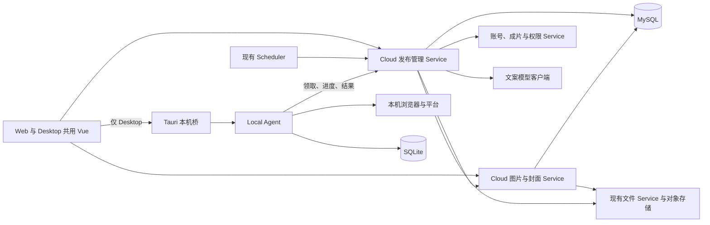
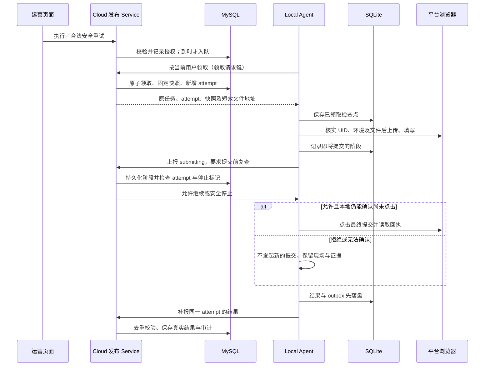
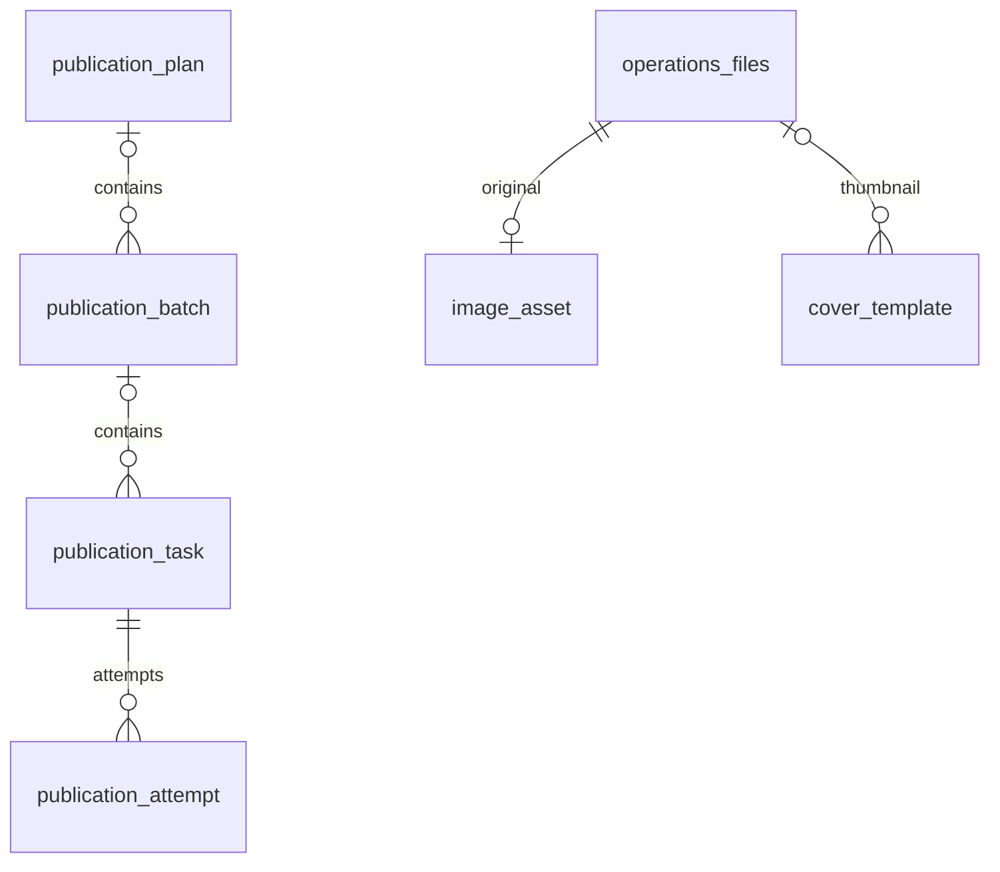

# 发布管理与运营工具工程设计

**发布管理继续使用现有 Cloud、Local Agent 和 Desktop。Cloud 管任务、作品事实和执行授权，Agent 操作浏览器，Desktop 连接本机能力。业务表按模块保存，文件仍由现有文件服务管理。**

本文回答三个问题：系统由谁负责、数据怎么保存、出现并发和故障时怎么处理。**这是待实现的设计，不表示功能已经上线。** 用户流程和操作规则见 [PRD 第六章](../../product/prd/详细文档/第六章_发布管理.md)，页面见 [原型](https://github.com/piqiu96/wt-media-cloud/tree/main/web/example/proto/publishing-design)。本文的字段、接口和状态是实施建议；实际数据库迁移与接口契约由提供方在开发时落地。

依赖：[系统架构](../architecture/社媒运营平台工程架构与分层设计_V1.md)、[社媒账号](social-accounts.md)、[运营资源](2026-10-29-operating-resources.md)、[内容生产](2026-09-24-m4-m5-cloud-content-production.md)、[认证 ADR-0022](../../decisions/0022-session-only-auth-and-agent-token.md)、[契约映射](../../contracts/contract-map.md)。

## 1. 总体架构

### 1.1 模块与调用边界



| 位置 | 职责 | 实现边界 |
| --- | --- | --- |
| Cloud 发布管理 | 配置校验、正式创建、占用、授权、派发、结果核实、推进、统计和审计 | 在 `internal/modules/publish` 内按 Handler → Service → Repository 组织；通过所属模块 Service 使用账号、成片、身份和文件 |
| Cloud 图片模块 | 图片库、模板草稿与发布配置、真实封面渲染 | 后端归 `internal/modules/image/`，共用前端归 `web/src/modules/image/`；图片、模板、渲染按主题分文件，供发布管理引用，不使用 `cover` 作为领域根目录；不拆独立部署服务或通用资源引擎 |
| Cloud 作品管理 | 可信公开作品去重、权限查询及实际发布时间统计 | 后端归 `internal/modules/work/`，共用前端归 `web/src/modules/work/`；发布Service调用作品Service完成事务内关联，不操作本机浏览器 |
| Cloud Scheduler | 到时入队、计划推进、失联检查 | 调用发布 Service，不访问浏览器或运营电脑，不自行改写另一套状态 |
| Local Agent | 实读账号环境、取文件、上传、填写、提交、保留现场和执行证据、补报结果 | 只执行所属用户的账号；不直接写 Cloud 数据库，不自行授予重试权限 |
| 共用 Vue / Desktop | 配置与审阅、显示进度、调用本机能力 | Vue 不直连 SQLite；Tauri 不复制业务校验、平台自动化或 Cloud 页面源码 |

### 1.2 复用范围与新增实现

**现有文件能力、单任务接口和百度投稿执行链路可以复用；CHG106继续补齐图片工具、内容准备、结果处置和公开核验。** 下表说明复用边界，不替代当前CHG的实际完成记录。

| 已有能力与代码依据 | 可以复用 | 发布管理仍需实现 |
| --- | --- | --- |
| [Cloud Scheduler](https://github.com/piqiu96/wt-media-cloud/blob/main/internal/scheduler/scheduler.go) | 作业注册、周期调用和进程退出控制 | 发布入队、推进和失联检查的业务函数 |
| Cloud `mediaaccount`、`production` Service | 授权范围、账号身份、成片与文件事实 | 发布资格、同平台占用及资源盘点投影；不复制账号或成片管理模块 |
| [Cloud files Service](https://github.com/piqiu96/wt-media-cloud/blob/main/internal/modules/files/service/service.go) | 上传、对象存储、摘要、文件登记和短效访问地址 | 图片尺寸、生成来源元信息、渲染文件登记及业务引用删除保护 |
| [Cloud Agent 鉴权](https://github.com/piqiu96/wt-media-cloud/blob/main/internal/modules/localagent/auth.go) | 新工作严格鉴权、已领取工作 report-safe 收尾 | 为每次发布执行增加归属、状态和证据校验；不能像普通下载那样超时后自动重领 |
| [Agent checkpoint/outbox](https://github.com/piqiu96/wt-media-agent/blob/main/src/wt_media_agent/storage/checkpoint_store.py) | 本机保存发布执行进度、现场与未成功上报原结果的能力 | 补齐原现场人工继续及指定稿件核验，不在补报时重新投稿 |
| [Desktop 本机调用](https://github.com/piqiu96/wt-media-desktop/blob/main/src-tauri/src/commands/account.rs) | Tauri → Local Agent 的受控桥接方式 | 发布现场继续及新建续编接口的桥接 |

Agent已有文件下载与百度单任务投稿能力；其余平台、真实文案生成和模板封面渲染不能由原型演示推定为已经实现。不新建 MQ、Redis 锁、工作流引擎、设备节点或通用执行许可系统。

### 1.3 V1 实施边界

产品范围以 [PRD 平台范围](../../product/prd/详细文档/第六章_发布管理.md)和[批次资源配置](../../product/prd/详细文档/第六章_发布管理.md#632-新建批次)为准。工程实现沿用已有身份与任务边界：

- 一个批次只选同一系统用户的本人账号；start从账号事实确定task.operator_id，并与批次本人身份核对。保存候选不建task，领取核对Token/本人账号/Profile；离线不转派，不建设混合归属授权流程。
- 当前百度账号与待执行任务入口正常展示，不设置百度准备开关。创建任务只保存 pending，不等于授权执行或已接通投稿。其他平台按 PRD 顺序接入；授权及领取必须独立验证执行能力，不能靠隐藏准备入口代替执行校验。
- 资源查询与推荐只消费已有资格、顺序和数量，不新增质量评级字段、维护 API／页面或等级匹配输入。

## 2. 服务交互

### 2.1 配置保存与批次启动

批次保存只写publication_batch的候选config、设置、必要文件引用和审计，不生成task、不占成片；未执行批次可整体编辑并以revision保护。只选本人账号，不建设跨用户授权。计划只组织批次，不复制执行能力。

首次start在一个事务内复查本人/父级/配置修订/文件及缺口，写全部确认task、成片唯一占用、授权、首次时间和审计。外部文件/模型/渲染检查事务外，事务内复查关键事实；任何冲突整体回滚。创建并发布只合并用户动作，保存成功启动失败必须明确，沿原请求键找回。

任务生成属于CHG108；CHG107只保存候选。最终validate只读，无预检许可或会话。配置候选row_key保持稳定，任务task_order在启动时从候选顺序冻结。计划推进调用同一个事务化批次启动器，游标与授权不能分开提交。详细实施/API见Delivery的107/108/109清单。

### 2.2 授权、领取与浏览器提交

**只有已授权且满足时间、间隔和父级条件的任务才能被领取；每次领取固定一次输入。**



领取时先核对 Agent 认证用户、任务 `operator_id` 与账号所属用户一致，再检查真实平台 UID、Profile 归属、当前输入、成片占用和文件引用；Agent 还须在本机实读 UID 与文件摘要，不能以最近一次 Cloud 登录检查替代。同一浏览器 Profile 即使绑定了不同平台的账号，也不能同时执行发布。Cloud 领取时由 attempt 的活动 Profile 唯一约束裁决排他，检查旧执行现场是否已安全结束；Agent 在本机也按实际 BitBrowser Profile 串行。编辑与领取竞争时按对象修订阻止覆盖。

到时判断使用 `not_before`；批次按执行组运行，组内无额外间隔，组自动处理结束或可靠挂起后加组间隔。同一真实平台账号有执行、人工或结果未知任务时，不领取下一条；不同账号若共用一个浏览器 Profile，也不能并行。不同账号且不同 Profile 才允许受控并行。时间到达不会自动授权尚未启动的任务。

提交前复查通过 report 的 submitting 阶段完成，不另设通用许可 API。允许响应与平台点击之间仍有竞态窗口：后发生的停止不能撤回平台提交，必须根据真实回执收尾。提交前响应丢失时，不能把旧允许响应当作永久许可，也不能自动重放点击。

#### 浏览器操作与平台发布器

**页面操作采用 Python Playwright，连接 BitBrowser 已启动的账号 Profile；任务授权和恢复仍由发布执行器负责。** 普通点击、输入、上传和等待使用 Playwright 的 `Page` / `Locator`；已有 CDP 能力按需保留，不再为普通表单重复实现点击命中、遮挡判断和轮询。

| 组件 | 轻量实现思路 |
| --- | --- |
| `PublicationJob` | 组织所属任务资源准备、心跳、阶段持久化、提交许可、关闭核实和原结果保存/补报；通过必填控制回调调用独立发布入口，不直接执行平台页面步骤 |
| `BrowserSession` | 根据 BitBrowser 启动响应取得动态 CDP 地址，连接对应 Profile 的现有默认 context；管理本次页面和连接，核对账号，不另起空白账号环境。断开 Playwright 不等于现场已安全结束，Profile 关闭仍须使用现有 BitBrowser 能力核实 |
| `Publisher` | `platforms/publish.py` 用 Protocol 约定 `publish(payload, control, *, method=PublishMethod.BROWSER)`；消费固定内容、本地路径与预期 UID，返回本次回执。控制含停止检查、准备完成通知与提交前许可；公共入口不接收 Page、Token 或数据库模型 |
| `BaiduPublisher` / `BrowserPublisher` | 同放 `platforms/baidu/publisher.py`。前者选择实现，组织两次身份核对、准备、提交许可与一次提交；后者封装当前页面、选择器、填写、平台检查与回执。基础 API 仍通过 clients，公共会话经 services/browser；一期只支持 browser，不创建 API 投稿占位或浏览器子目录 |

目录和依赖边界见 [ADR-0034](../../decisions/0034-agent-platform-capabilities-and-publish-boundary.md)。首次实读 UID 成功后，准备完成回调才允许持久化 prepared 并报告 ready；上传后再次核实 UID，提交前回调记录屏障且取得新鲜许可后才可提交。业务入口通过参数固定 browser，暂不增加用户选择页面、Cloud 字段或外部契约。

使用现有 bootstrap 显式装配，通过简单平台映射选择 Publisher；不引入动态插件、全局单例注册系统或通用工作流引擎。页面操作直接使用 Playwright API，不再包装一套同名浏览器操作接口。首版可使用同步 API 对接现有同步执行器，同一会话的 Playwright 调用留在同一执行线程；心跳线程只传递停止信号，不操作页面。

**大文件通过本地路径上传，不转为内存 buffer。** Python Playwright 从 1.58 起支持 `connect_over_cdp(..., is_local=True)`；只有 Agent 与 BitBrowser 确实共用本机文件系统、浏览器能够读取该绝对路径时才启用。连接地址来自启动结果，不写死端口；文件沿用本次执行已校验摘要的私有文件，不重新下载或擅自改写内容。

```python
browser = playwright.chromium.connect_over_cdp(
    endpoint_url=bitbrowser_endpoint,
    is_local=True,
)
page = browser.contexts[0].new_page()
page.locator(video_input_selector).set_input_files(video_path)
```

这是连接与传文件方式的示意，不包含任务授权和完整执行流程。该设置避免 CDP 远程文件传输分支的 50 MiB 限制，不能取消 buffer、平台文件规格或存储网关的限制；跨主机／文件系统隔离时不能靠设置此参数假定文件可读。依据：[官方 API](https://playwright.dev/python/docs/api/class-browsertype#browser-type-connect-over-cdp)、[1.58 上传实现](https://github.com/microsoft/playwright/blob/v1.58.0/packages/playwright-core/src/server/fileUploadUtils.ts)。

平台实现按以下边界处理页面和结果：

- 填写阶段使用明确的可见控件及当前弹窗范围，按上传进度、处理结果和实际封面预览等待；超时、封面失败或必填值不符即停止，不靠固定睡眠、默认 `force=True` 或静默降级继续。提交前读回本次已确认内容，不截断、改写或替换。
- 先建立本次投稿请求的回执监听，再由执行器完成提交前复查与本地阶段记录，调用 `submit()` 点击最终发布。每次尝试最多发起一次最终提交，不把该操作放入业务重试循环；点击后超时、断网或结果不明，按本节及 [4.4](#44-安全停止与迟到结果) 核实，不再次点击。
- `read_receipt()` 返回本次投稿的作品 ID 和必要证据，不只返回 `success: true`；按账号、本次请求和实际平台响应关联，作品 ID 使用字符串保留精度。上传／保存成功、HTTP 200、跳转或列表最新作品都不能单独证明投稿成功；平台接受与公开结果仍按既有任务状态分别核实。
- 发现安全验证时停止自动操作，使用既有人工处理流程；更换浏览器驱动不改变原用户、原现场、原 attempt 和停止控制的约束。调试截图、响应或 trace 只保留必要且脱敏的证据，不记录凭据或完整会话。

参考 [social-auto-upload](https://github.com/dreammis/social-auto-upload/tree/main/uploader) 的页面操作及上传判断，参考 [wt-media-flow 平台层](https://github.com/piqiu96/wt-media-flow/tree/main/src/platforms) 的协议与独立载荷组织；外部代码仅作实现参考，不是业务事实源。不沿用其中的人工最终提交、跳过封面、失败后继续或以最新作品猜测本次结果等做法，也不带入评论等本轮范围外能力。

Playwright 作为 Local Agent 的运行依赖管理，固定经验证且不低于 1.58 的兼容版本；Cloud 模式不因发布能力启用浏览器。连接现有 BitBrowser 不需要另装一套 Playwright Chromium，但 Desktop Sidecar 仍须包含匹配的 Playwright 驱动及运行文件，不能依赖开发机环境。macOS 重签名须保留包内 Node 所需的 JIT 权限，不因修复驱动而关闭其 hardened runtime 或添加其他权限。兼容性、大文件与安装包验证见 [技术验证](#6-技术验证)。

### 2.3 计划推进与停止控制

**自动检查、人工恢复、确认继续和批次接管共用一个推进 Service，事务内重检位置和当前事实。** 条件优先级直接遵守 [PRD 6.2.4](../../product/prd/详细文档/第六章_发布管理.md#624-执行与推进计划)。


阈值固定使用 PRD 的 10%，不增加每计划可配置参数。明确结果数大于零时用整数比较 `failed × 10 <= published + reviewing + failed`；零分母须确认跳过，人工确认也不能绕过未决任务。确认绑定当前批次、预期下一批及对象修订，不是可反复使用的额外授权。

人工暂停只阻止后续批次启动，已启动任务继续按真实结果收尾。**计划启动前全部待执行批次必须完成配置，启动后冻结全部所属批次配置；后续原资源失效时计划仍为 `running`，界面显示「等待资源」。** 原资源恢复后 Scheduler 重新检查未决任务、失败率、批次位置和执行条件；满足条件就继续。人工暂停、失败率超阈值和零明确结果都必须由运营恢复／确认，不能因为资源恢复而自动解除。从批次入口接管仅限当前合法位置，先暂停自动推进，再授权本批。

首次启动前已有前序终止批次时，在确认无未决执行后保留其终止结果，选择后续首个合法位置；全部待执行批次未准备完整不得首次启动，后续原资源失效则等待恢复，不修改冻结配置。已推进批次的迟到结果只更新任务和统计，不回退游标；其真实未决会阻断再启动下一批，不停止已经启动的当前批次。

计划终止封住全部所属批次的新派发；单批终止／停止只封住本批。安全收尾和结果核实继续使用原 attempt，不把晚到结果转换成新的启动或重试授权。

首次计划启动持久化每个待执行批次明确确认的纳入/排除row_key、缺口和配置修订；跨批同平台纳入同一成片须整体拒绝并定位冲突，不提前占未来成片。后续推进复用这份冻结范围，资源失效等待原资源。正常9公开加1确认失败达到10%时可原子移交，不能仅因108批次尚未标ended要求另点一次结束；批次自身人工暂停仍须按原入口处理，移交后原批不能再retry。

人工确认绑定服务端只读判断摘要：全部已启动前缀任务修订/状态/原attempt、核验停止及人工核实、当前位置和下一批。事务内重算摘要并重检所有门槛；摘要不能替代安全判断。全计划永久停止围栏同时被领取、恢复、重试和report提交前许可/心跳反馈读取；计划人工pause仅拦后续批启动。

自动核验停止或超过有效期仍reviewing时，若没有更新有效人工明确核实则投影待核实，阻后续推进。复用原resolve四结论，补齐本人reviewing可凭原身份、可信关闭和真实依据核实未公开失败、仍审核、未知或公开；管理他人的补录权限不扩张。Task仅保存最新人工核实小投影及原审计，不创建第二套统计或流程；正常审核可参与衔接分母，但不能作为公开成功或最终结束依据。

最终结束复用 PRD 6.2.5：全部批次处理完且最终公开结果核实后，按平台×类目保留真实缺口，达成结束或填写原因未达成结束。不提供计划内追加或补量API、类型和轮次；追加发布另建独立批次或新计划。迟到公开只更新统计，不删除正式任务或重开执行。计划内每批快捷按钮复用原批次的动作投影、权限、确认和业务命令，不复制处置内核。

### 2.4 内容生成、采用与封面

**生成结果必须先让运营审阅。生成文字、采用文字、确认内容、创建发布任务，是四件不同的事。**

文案由 Cloud 调用模型生成。M6 使用用户指定的 DeepSeek，通过其 Chat Completions JSON 输出生成一条完整建议；模型名称与HTTP连接配置可配置，密钥由部署凭据文件提供，不进入代码或前端。只传经授权的成片素材标题、当前文案和本次要求，不发送平台凭据、视频文件或未经选择的声明。无密钥、限流、超时或不完整结果明确失败，不自动重放模型请求。只有一条内容完整返回并通过检查，页面才显示「采用」；不能把生成到一半的文字直接写进表单。模板封面由 Cloud 生成实际图片，再交给文件服务保存。两者通过同一套流式进度反馈返回结果，见 [5.4](#54-生成流与接口反馈)。

| 检查什么 | 为什么需要 |
| --- | --- |
| 这条内容是否还是原来的内容（`row_key/input_revision`） | 平台、资源或生成依据变化后，旧结果不得覆盖新内容 |
| 某个字段是否被改过（`field_revisions`） | 用户改了标题后，旧标题建议失效；未改动的标签建议仍能采用。页面只认这个字段的最新生成请求 |
| 整条记录是否被别人保存过（`revision`） | 保存之前比较修订号，避免覆盖其他人的修改 |
| 确认后的内容是否发生变化（输入摘要） | 内容真的变了才要求重新确认，重复保存不清除确认 |
| 封面是否对应当前标题和模板（`render_input_hash`） | 正式创建时核对标题、底图、模板、规格和渲染版本，防止使用过期图片 |

批量配置只修改用户本次勾选的字段。取值顺序是：本条明确填写的值优先，其次是批次默认值，最后是创建时的平台默认值。默认只填空，覆盖手工内容要明确选择。用户审阅期间不改原记录；点击应用时如果内容已被修改，就提示重新审阅，不能直接覆盖。应用成功也不代表内容已经确认。

| 封面路径 | 服务实现 |
| --- | --- |
| 素材自带图片／图片库现成封面 | 检查实际文件、权限与平台规格；无需模板、封面文字或生成记录，替换后重新确认 |
| 模板合成 | 固定实际底图、短标题和各必要规格的启用发布模板；逐规格校验实际排版、渲染并登记文件，收齐输出才可确认 |

快速发布的业务底图可来自当前成片的真实缩略图，或图片库中允许作底图的图片。`POST /cover/render` 用 `background_output_id` 或 `background_image_asset_id` 二选一表达业务底图；Cloud分别通过 production Service 或图片 Service 取得已鉴权的实际文件，不接受任意底图文件ID。固定图片和纯色模板使用其发布快照中的背景，不接受额外业务底图。成品快照记录成片/图片、实际文件、短标题、发布模板及修订和渲染版本。

2026-11-22原账号编辑器实测：百度横版16:9、竖版3:4，单张不超过5MiB。快速发布逐规格准备，模板列表只允许匹配画布；现成图也检查实际尺寸，不依赖平台裁切。`cover_file_id/cover_render`保存横版，`portrait_cover_file_id/portrait_cover_render`保存竖版，两个引用分别冻结、鉴权及保护删除。执行输入、短期文件授权和准备证据分别带两张图的摘要；Agent仅向对应控件上传，不复用横版充当竖版。作品列表继续使用横版封面。既有历史任务不自动补图，旧结果仍可只读核验；新建、编辑和新执行必须收齐两张有效图片。

`GET /cover/{id}` 只读取当前用户有权访问的真实正式模板成品及其快照，供续编恢复；不重新生成、不要求原模板仍启用。任务内容中的 `cover_render` 固定本次短标题、模板/发布修订、业务底图和输入摘要，创建/编辑时与实际成品来源核对；模板成品缺少该依据、输入不符或预览样例均拒绝。封面短标题与发布正文分别保存，正文变化不隐式改写短标题或重绘封面。没有模板的现成图片不要求生成记录。

随机底图按当前类目、再通用范围选择启用且用途匹配的图片；最终选定的 ID 固定保存，不随查看重选，不实时生成底图或提取关键帧。模板标签仅用于推荐，可用性按实际输出要求判断；图片停用不参与新渲染。

真实栅格渲染在 Cloud 图片模块内使用 Go 图像与 OpenType 能力，随程序固定分发 Noto CJK 字体及许可；编辑器加载相同字体，正式预览和出图均以服务端结果为准。不依赖运营电脑字体，不引入浏览器渲染服务。缺字、缺少底图及溢出明确报错。

模板渲染复用编辑器定义的画布、图层、字体、描边和行距参数。唯一动态主标题绑定业务短标题，隐藏仍计入数量；先换行再在允许范围缩字，仍溢出则报错，不截断标题或拉伸其他比例。样例预览标记为预览文件，不能代替实际标题的正式封面。

输入变化只使相关封面失效，正文等无关变化不重绘；预览、采用和导出指向同一实际成品。已确认文件及模板快照不因模板后续更新／停用而失效，再次生成才读取当前可用配置。

### 2.5 资源查询与推荐

发布管理直接读取已有账号、成片和任务占用数据，不再维护第二份库存。查询时说明账号为什么不可用，并返回数据读取时间。读取失败、库存为零、日额度未知必须分别显示；今日已发布按实际公开时间统计。

2026-11-20 CHG101 真实快速发布走查补齐：发布模块提供自己的成片候选只读列表 `GET /api/v1/publication/output`，复用 production Service 的范围鉴权、筛选及分页，再由 publish Repository 对本页成片 ID 和目标平台批量读取正式任务占用，附加 `occupied`。占用读取复用 `occupied_output_id` 生成列作为唯一事实，覆盖所有仍持有占用的状态和任务页（含结束状态；`abandoned` 按原约束释放），不以当前页面的任务缓存、成片 publish_status 或当前操作者的任务子集推断；仅暴露可读成片是否被占用，不返回其他用户任务信息。基础 production 不感知发布、不新增反向依赖。候选读取不预占，最终创建继续依赖原唯一约束，查询失败明确报错，不把未知当作可用。

配对先过滤权限、平台、类目、身份和占用，再按用户确定的类目优先级、账号顺序与每号本批上限分配；同账号跨类目共享剩余数量，不把本批上限当作日额度。保留兼容的人工配对，短缺指出原因；推荐不预占，最终创建重新验证。

计划“AI 推荐”调用真实模型，结果仍须通过平台分组、逐格守恒及锁定行位置校验。不用确定性分配结果冒充 AI 输出；模型不可用时反馈失败，用户仍可手动拆批。推荐遵循 [V1 实施边界](#13-v1-实施边界)，不引入质量等级输入或等级匹配。

### 2.6 新建续编与正式记录

Desktop 把新建表单保存在 Agent 本地 SQLite；Web 只保存在当前页面内存，刷新后不恢复。已经创建的计划或批次属于 Cloud 正式记录，后续编辑直接保存到 Cloud，不再使用本地新建草稿。

本地内容包含表单、已采用结果、文件 ID、版本及原创建请求键，不存图片 Base64、Cookie 或长期文件 URL。正式创建成功后清理，失败保留；结果不明保留原键和原提交内容先核对，不生成第二份正式记录。仅存于本地的引用不构成 Cloud 占用或删除保护。

## 3. 核心模型

### 3.1 表结构总览

**六张新 Cloud 表都用自增 ID 作主键。** 计划、批次、任务和执行尝试分别保存各自的事实；图片库和封面模板复用已有文件服务，不再复制文件数据。



| 新表 | 保存什么 |
| --- | --- |
| `publication_plan` | 目标、周期、推进位置和结束原因 |
| `publication_batch` | 单平台批次的目标、资源配置和执行控制 |
| `publication_task` | 一条正式发布任务的资源、内容、授权和真实结果 |
| `publication_attempt` | 每次 Agent 领取后的固定输入、执行过程及证据 |
| `image_asset` | 已上传图片的用途、类目、启停和引用 |
| `cover_template` | 封面画布、一份草稿、一份当前发布配置 |

**建表共同约定：**
- 六张表均含 `id BIGINT UNSIGNED NOT NULL AUTO_INCREMENT PRIMARY KEY`，不使用业务组合键作主键；通过 API 传递 ID 时使用十进制字符串。
- 除 `publication_attempt` 外，其余五表均含 `created_by BIGINT UNSIGNED NOT NULL`、`created_at/updated_at DATETIME(6) NOT NULL` 和 `revision BIGINT UNSIGNED NOT NULL DEFAULT 1`。attempt 用 `started_at` 记录创建时刻、按报告序号维护执行进度。
- MySQL 使用 InnoDB、utf8mb4；时间在数据库存 UTC、接口按 RFC3339 返回，按业务时区 `Asia/Shanghai` 计算运营日期。
- 下表是**拟实施字段设计**：名称、类型、可空和关键索引需要在 Cloud migration 中实现。引用现有文件、账号、成片、用户表时，外键类型必须先核对已有列类型，不强行统一成无符号。
- `JSON` 保存小型配置与执行快照，不保存文件二进制、Cookie 或长期签名地址；数据库字段与读写校验均由所属服务维护。

### 3.2 发布计划：`publication_plan`

| 字段 | 建议类型 / 是否可空 | 含义 |
| --- | --- | --- |
| `id` | BIGINT UNSIGNED，自增主键 | 计划编号 |
| `team_id`、`owner_id` | BIGINT UNSIGNED，必填 | 团队及负责人 |
| `name` | VARCHAR(128)，必填 | 名称 |
| `description` | VARCHAR(1000)，默认空串 | 备注 |
| `date_start/date_end` | DATE，可空 | 计划周期，起止关系需校验 |
| `goals_json` | JSON，必填 | 平台 × 类目目标，例如 `[{platform,category_id,target_count}]`；组合不得重复 |
| `status` | VARCHAR(16)，必填，默认 ready | 计划执行控制 |
| `pause_reason` | VARCHAR(32)，可空 | 只有人工暂停或需要人工确认时填写 |
| `current_batch_id` | BIGINT UNSIGNED，可空 | 当前推进位置 |
| `first_started_at/cancel_requested_at/ended_at` | DATETIME(6)，可空 | 首次启动、终止请求及结束时间 |
| `end_reason/end_note` | VARCHAR(16)/VARCHAR(1000)，可空 | 结束原因与说明 |
| `request_key/request_hash` | VARCHAR(64)/CHAR(64)，必填 | 创建防重键与输入摘要 |
| `revision`、审计公共列 | 见 3.1 | 保存冲突检查与审计 |

**索引：** `UNIQUE(created_by,request_key)`；团队＋创建时间用于列表；`status`＋ID 用于待推进计划扫描。目标数由 `goals_json` 求和，不另存一个可写总目标；10% 失败阈值固定遵守 PRD，不增加每计划配置列。

内部 `ready/running/paused/stopping/ended` 分别表示待启动、运行推进、需人工解除的暂停、停止收尾、已结束。列表把 running 和 paused 都展示为「进行中」，暂停原因显示在当前进展。

**等待资源不等于人工暂停。** 首次启动前检查全部待执行批次的配置完整性并冻结；后续资源失效时计划仍是 running，只显示「等待资源」。原资源恢复后重新检查，若仍有人工暂停、失败率超限或无明确结果，不能自动继续。`first_started_at` 只记录计划首次合法启动，不能因确认某批资源而提前写入。

### 3.3 发布批次：`publication_batch`

batch保存身份/本人operator/团队/名称/平台/targets_json/config_json/revision/request_key/hash和审计。config_json在本批和所属计划均未首次启动时才可写；所属计划启动即冻结，不能因本批未启动而修改；本批启动后只留追溯快照，不与task维护两份可写内容。task生成在start，不在保存。计划关联plan_id及顺序字段在plan表建立后迁移。

执行设置：concurrency_limit、group_interval_seconds、between_group_policy、exception_task_limit。运行控制：首次时间、当前执行组/成员、组结束及下一组时间、paused/pause_id/依据/已确认异常范围、stopping/结束及handoff依据。字段及枚举由提供方Contract定版；支持可恢复暂停与不可逆终止，不沿用“没有批次暂停”。

用户并发槽与Profile占位分开：可靠挂起可退出自动执行组，环境仍独占，恢复前重新准入；未知且可能仍执行不能直接释放。task/attempt保存组关联以支持重启。108以旧每用户3槽和串行Runner为迁移基线，协同拆分自动名额和保留窗口；旧活动尝试保守承接，不能仅改变数字而宣称已有并发。

索引：UNIQUE(created_by,request_key)，本人/团队+创建时间，(plan_id,group_order,batch_order,id)用于计划查询；task的batch_id/task_order和状态索引在108引入。普通心跳不增业务revision。数量/待办来自正式任务聚合，不维护第二套可写成功数。

### 3.4 发布任务：`publication_task`

| 字段 | 建议类型 / 是否可空 | 含义 |
| --- | --- | --- |
| `id` | BIGINT UNSIGNED，自增主键 | 正式任务编号 |
| `team_id/operator_id` | BIGINT UNSIGNED，必填 | 归属团队、账号所属用户；后者由账号事实确定，不取批次创建人或当前操作者 |
| `batch_id` | BIGINT UNSIGNED，可空 | 为空表示快速发布的独立任务；不另存 plan_id |
| `platform` | VARCHAR(32)，必填 | 发布平台 |
| `category_id/media_account_id/composite_output_id` | BIGINT UNSIGNED，必填 | 类目、Cloud 账号、成片身份；外键类型最终核对提供方 |
| `platform_account_uid` | VARCHAR(255)，必填，精确比较 | 平台真实 UID，不等于 Cloud 账号 ID |
| `resource_snapshot_json/content_json` | JSON，必填 | 选定资源和已确认内容；只存必要快照及文件 ID／摘要 |
| `cover_file_id` | BIGINT，必填；外键类型沿用 `operations_files.id` | 当前已确认封面，与 content_json 中的文件 ID 同一事务更新；供固定引用检查及删除保护使用 |
| `task_order` | INT UNSIGNED，默认 0 | 批次内顺序 |
| `status` | VARCHAR(24)，默认 pending | 当前业务状态 |
| `current_attempt_id` | BIGINT UNSIGNED，可空 | 最近一次执行 |
| `attempt_count` | INT UNSIGNED，默认 0 | 已领取的次数 |
| `not_before/authorized_at/cancel_requested_at` | DATETIME(6)，可空 | 执行时间、授权和停止请求 |
| `accepted_at/published_at` | DATETIME(6)，可空 | 平台接收与确认公开时间 |
| `platform_submission_id/target_url` | VARCHAR(255)/VARCHAR(2048)，可空 | 实际投稿回执与平台提供的目标链接，不作为公开成功依据 |
| `work_id/platform_work_id/work_url` | BIGINT UNSIGNED/VARCHAR(255)/VARCHAR(2048)，可空 | 去重作品关联、真实公开作品 ID与公开链接 |
| `failure_code/failure_message` | VARCHAR(64)/VARCHAR(1000)，可空 | 明确失败的原因 |
| `request_key/request_hash` | VARCHAR(64)/CHAR(64)，可空 | 独立任务创建防重 |
| `occupied_output_id` | BIGINT UNSIGNED，生成列，可空 | 非 abandoned 时固定为成片 ID |
| `executing_account_uid` | VARCHAR(255)，生成列，可空 | 执行中、等待人工或结果未知时固定为平台 UID |
| `revision`、审计公共列 | 见 3.1 | 并发编辑与审计 |

**索引：** `UNIQUE(platform,occupied_output_id)` 防止同一成片同平台重复占用；`UNIQUE(platform,executing_account_uid)` 保证真实 UID 串行；`UNIQUE(created_by,request_key)` 为独立快速创建防重；按 batch/status、operator/status/not_before、team/published_at 建查询索引。生成列在 `status=abandoned` 或不执行时返回 NULL；详细表达见下方 SQL 规则。

Go 发布状态由 `internal/modules/publish/model.Status` 及同包常量维护，其他业务的任务状态留在各自模块，不建立通用 `TaskStatus`。发布业务错误码统一放在 Cloud 的 `internal/shared/errcode/publish.go`，与 `contracts/cloud-error-codes/v1/publish.yaml` 对齐；HTTP 状态使用框架常量。

任务只使用十个状态；这里列出内部代码供迁移和 Contract 对齐，**允许动作以 [PRD 6.4.1](../../product/prd/详细文档/第六章_发布管理.md#641-任务列表) 为准**。

| 内部状态 | 页面显示 | 内部状态 | 页面显示 |
| --- | --- | --- | --- |
| pending | 待执行 | queued | 排队中 |
| running | 执行中 | awaiting_human | 等待人工 |
| uncertain | 结果待确认 | reviewing | 平台审核中 |
| failed | 发布失败 | published | 已发布 |
| cancelled | 已取消 | abandoned | 已放弃 |

缺少链接时仍按审核中或结果待确认处理，不新建主状态。提交阶段在 attempt 保存，不在 task 另建同义状态。

生成列需要在 MySQL migration 中实现：

```sql
occupied_output_id = CASE WHEN status <> 'abandoned'
                          THEN composite_output_id ELSE NULL END
UNIQUE (platform, occupied_output_id)

executing_account_uid = CASE WHEN status IN ('running', 'awaiting_human', 'uncertain')
                             THEN platform_account_uid ELSE NULL END
UNIQUE (platform, executing_account_uid)
```

同 UID 多窗口仍不能并行；跨平台共用同一个浏览器 Profile 的任务，还须按 2.2 和 4.2 串行领取。取消保留成片占用，只有安全放弃才释放；不能因为一次历史检查结果允许重试或释放。

作品公开后由 Cloud `work` 模块保存正式作品事实，并在原发布任务关联 `work_id`；同平台作品 ID唯一，重复核实复用，账号或成片不符则拒绝覆盖。作品管理菜单与发布管理平级，子菜单作品列表，共用Vue归 `web/src/modules/work/`，业务路由 `/work`。只读列表与详情遵循[作品管理产品规则](../../product/作品管理.md)，不额外提供作品新建或结果日志系统。

`internal/modules/work/{model,repository,service}` 分别保存作品模型、SQL及权限／事实校验，模块Handler只处理HTTP协议；发布Service调用作品Service，在同一事务内完成原任务修订、原attempt核对、作品去重关联和审计。Repository不得调用其他模块Service。作品记录保留平台、真实作品 ID、公开链接、平台UID、账号／用户／团队／类目、来源任务／尝试／成片、标题、封面、视频摘要、平台实际发布时间及首次核实时间。原attempt输入、原结果与摘要不改写。

新增 `GET /api/v1/work`（权限、查询、筛选与分页）、`GET /api/v1/work/:id`（只读详情）、`GET /api/v1/work/summary`（同权限下去重总数与今日数量）。所有实体名为单数；汇总按Asia/Shanghai下平台实际发布时间计算，不按入库或首次核实时间计算。共享页面从作品跳转原发布任务，并从已发布任务打开关联作品。

现有原始执行结果中的 `platform_work_id` 字段曾承载投稿回执；该不可变报文及摘要保留。正式任务字段按真实语义分为投稿 ID和公开作品 ID，保留已发生的外部投稿身份，不增加兼容双读或补造公开作品。人工核实/补录以原attempt、任务revision和原账号为条件；published要求明确的公开及内容匹配证据、真实作品身份和实际发布时间，reviewing只登记指定回执。链接校验只检查身份绑定，不能替代公开证据。

### 3.5 执行尝试：`publication_attempt`

| 字段 | 建议类型 / 是否可空 | 含义 |
| --- | --- | --- |
| `id` | BIGINT UNSIGNED，自增主键 | 执行编号 |
| `publication_id` | BIGINT UNSIGNED，必填 | 所属正式任务 |
| `attempt_no` | INT UNSIGNED，必填 | 此任务的第几次领取 |
| `executor_user_id/browser_profile_id` | BIGINT UNSIGNED，必填 | 实际执行用户及领取时冻结的 Cloud Profile |
| `claim_request_key` | VARCHAR(64)，必填 | 领取防重键 |
| `input_snapshot_json` | JSON，必填且创建后不可改 | 此次真实使用的账号、内容、文件、封面及版本 |
| `status/stage` | VARCHAR(24)/VARCHAR(32)，必填 | 执行进程状态和当前步骤 |
| `report_seq` | BIGINT UNSIGNED，默认 0 | 上报顺序，拒绝过期结果 |
| `started_at/heartbeat_at` | DATETIME(6)，必填 | 领取与最后心跳时间 |
| `submit_started_at/finished_at` | DATETIME(6)，可空 | 提交开始、执行结束 |
| `result_status/error_code/error_message` | VARCHAR(24)/VARCHAR(64)/VARCHAR(1000)，可空 | 本次结果或错误 |
| `steps_json/evidence_json` | JSON，必填 | 必要步骤与原始证据，不含 Cookie 或签名 URL |
| `result_hash` | CHAR(64)，可空 | 结果去重与冲突识别 |
| `resolved_by/resolved_at/resolution_note` | BIGINT UNSIGNED/DATETIME(6)/VARCHAR(2000)，可空 | 后续人工核实记录 |

**索引：** `UNIQUE(publication_id,attempt_no)`、`UNIQUE(executor_user_id,claim_request_key)`；`(status,heartbeat_at,id)` 供失联扫描；`(browser_profile_id,status,id)` 供同一 Profile 领取前检查。

状态只有 running、awaiting_human、completed、interrupted，描述**执行过程**，不表示是否公开。排队不产生 attempt；人工介入继续原 attempt；合法重试下次领取才新增一条。旧执行证据不能因新结果而改写。失联仅表示还需核实，不能据此自动启动新发布。

#### 自动执行席位与实际 Profile 使用

`automatic_slot`表示当前原attempt的自动操作准入，可靠挂起确认时间独立保存；原窗口额度和UID/Profile排他不随自动名额释放。旧活动记录保守迁移：没有可信停手信号不得推断挂起、不得释放已有名额。普通心跳只保活，不增加task/batch业务revision。

发布域使用一份持久的实际Profile使用记录，以BitBrowser主账号与实际Profile ID唯一标识环境，持有人只允许原发布attempt或原任务的核验代次。它是资源排他记录，不是新任务、租约或调度引擎，没有到时自动释放。发布领取与原稿核验领取在同一数据库准入边界争用它；冲突先等待，不生成空attempt。正常发布继续沿既有UID及成片唯一约束。

核验领取沿原请求键找回同一原任务/attempt/代次。Agent必须在发前持久键、收到后持久原代和输入、可能开窗前持久屏障，保存关闭证据和原结算包到确认。应答丢失且原代尚未持久化时，原键仅结算或保存取消围栏，防止迟到原请求产生孤儿；不返回新快照或许可，已结算键不重开。正常观察继续受任务修订和原身份围栏约束；即使观察已过期，原执行方仍可仅结算已证实未开窗或已安全关闭的原核验占位，不更新旧观察、任务结果或作品。释放必须匹配原持有人及当前占位；不能释放后继执行。会话失效时仅安全收尾走既有ReportSafe认证，不扩大新工作或作品更新权限。

### 3.6 图片库与封面模板

**图片库只登记用途，实际文件继续由 `operations_files` 保存。模板保存一份草稿和一份生效配置。**

图片库删除仅移除无引用的业务登记，原始文件继续由文件管理独立维护；模板、正式任务和历史尝试均保护实际文件。删除检查与业务引用写入共用原始文件行锁，失败保留登记。批量启停和双用途维护逐项校验修订并返回结果，保留未成功项供重试。

#### 图片库 `image_asset`

| 字段 | 建议类型 / 是否可空 | 含义 |
| --- | --- | --- |
| `id` | BIGINT UNSIGNED，自增主键 | 图片业务编号 |
| `team_id` | BIGINT UNSIGNED，必填 | 团队 |
| `file_id` | BIGINT，必填 | 已上传文件 ID；必须与现有文件表类型一致 |
| `name` | VARCHAR(160)，必填 | 展示名称 |
| `allow_as_cover/allow_as_background` | TINYINT(1)，默认 1/0 | 至少一种用途，可同时勾选 |
| `category_ids_json` | JSON，必填 | 类目 ID 数组，空数组为通用 |
| `enabled` | TINYINT(1)，默认 1 | 是否允许新选用 |
| `revision`、审计公共列 | 见 3.1 | 修改与审计 |

**索引：** `UNIQUE(file_id)`，以及 `(team_id,enabled,created_at,id)`。文件登记只能使用已完成上传且有权限的图片，尺寸由文件实际解码取得。停用不破坏旧任务的成品；被正式引用时不允许删除。

#### 封面模板 `cover_template`

| 字段 | 建议类型 / 是否可空 | 含义 |
| --- | --- | --- |
| `id` | BIGINT UNSIGNED，自增主键 | 模板编号 |
| `team_id` | BIGINT UNSIGNED，必填 | 团队 |
| `name` | VARCHAR(128)，必填 | 名称 |
| `canvas_width/canvas_height` | INT UNSIGNED，必填 | 画布规格，均须大于 0 |
| `scope` | VARCHAR(16)，默认 general | 适用范围 |
| `platform_codes_json/category_ids_json` | JSON，必填 | 推荐平台与类目，不能代替规格校验 |
| `draft_config_json/published_config_json` | JSON，可空 | 一份草稿、一份当前发布配置 |
| `published_revision` | INT UNSIGNED，默认 0 | 当前发布配置版本，不建历史版本表 |
| `published_thumbnail_file_id` | BIGINT，可空 | 当前模板缩略图文件 |
| `enabled` | TINYINT(1)，默认 0 | 未发布不能启用 |
| `request_key/request_hash` | VARCHAR(64)/CHAR(64)，必填 | 创建防重 |
| `revision`、审计公共列 | 见 3.1 | 修改与审计 |

**索引：** `UNIQUE(created_by,request_key)`、`(team_id,enabled,canvas_width,canvas_height,id)`。保存草稿只更新 draft；发布时校验当前保存的草稿、生成真实缩略图，再原子替换 published 并提升 `published_revision`。首次发布仍停用，后续更新保持已有启停。基础信息与规格固定，调整规格通过复制生成新模板。

图层、底图、动态标题、样式与排版保存在模板 JSON，不另建图层表；正式封面只用当前生效的模板配置渲染。样例预览不是正式成品；已有成品保存当时输入与模板快照，不因模板更新而改变。

#### 已有文件表扩展

`operations_files` 保持既有自增主键及文件字段。仅按需增加 `metadata_json JSON NULL`（宽高、格式、模板输入与渲染来源）和 `deleted_at DATETIME(6) NULL`（删除开始时间），以实现 4.6 的安全删除。**不新增文件表或引用计数表。**

### 3.7 本地存储

Agent 在现有 SQLite 中维护一张 `publication_draft`。**本地草稿也使用自增主键 `id INTEGER PRIMARY KEY AUTOINCREMENT`**；另加 `UNIQUE(environment,user_id,draft_type)`，保证同一环境、用户、类型只保留一份。`environment/user_id/draft_type/payload_json/saved_at` 为必填 TEXT，`schema_version INTEGER NOT NULL DEFAULT 1`。`draft_type` 只允许 plan、batch、task；保存时按组合唯一键更新原行，不建草稿历史或状态机。环境与用户取自当前已认证上下文，前端不能指定别人的身份。

M6只开放 `task` 新建续编。增加单调 `revision INTEGER NOT NULL`，接口按字符串返回，保存和清除均携带 `expected_revision`；冲突先读取核对，不自动覆盖。清除将原行的 `payload_json` 置为 JSON `null`，保留修订号，防止迟到自动保存恢复已清除的输入。未保存时返回空输入和修订 `"0"`；相同请求的响应丢失可按原修订找回当前一次结果，不重放后续修改。输入上限2MiB，不保存凭据或临时签名地址。

环境由Agent已配置的运行环境 `environment` 决定，不以连接目标 `cloud_env` 代替；例如 test 与 pre 即使连接同一Cloud，续编仍相互隔离。用户来自Cloud已认证Desktop会话签发执行凭证时返回的字符串 `user_id`，由Rust在内存中持有。受控草稿命令只接受页面当前用户用于比对，发往Agent的身份由Rust填入；不能以解析未验签Token内容作为授权。Agent草稿接口必须配置本机Runtime Token，身份只通过此受控通道传递。退出只停用续编身份，保留在途结果上报所需Agent Token；切换账号必须重新换取凭证，不复用上一账号身份。

发布执行与续编分开，Agent 使用 SQLAlchemy ORM 访问既有 SQLite 文件；不保留第二套业务 SQL 或双写路径。历史版本 DDL 只保留在同一 Engine 上的迁移层。

| 本地表 | 职责与关联 |
| --- | --- |
| `task_checkpoint` | 本地自增主键 `id`；保存 Cloud 原始 `task_id`、`task_type`、`cloud_env`、`user_id`、`attempt_id`、设备 `agent_id`，以及固定输入摘要、执行阶段和现场占用。发布按 attempt 隔离；下载按环境、用户、类型和任务隔离，保留跨租约重领的断点信息 |
| `task_result` | 本地自增主键 `id`；`checkpoint_id` 是外键且唯一，每个 checkpoint 有 0 或 1 条原始最终结果；保存原报文、原摘要及投递情况，不按裸 task_id 关联 |
| `agent_metadata` | 下载目录等小配置，以及按环境、用户隔离的未确认领取请求键 |
| `schema_migrations` | 已执行的存储升级版本，沿用既有名称与历史 |

`cloud_env` 为 `dev/test/pre/prod`，是明确配置的连接目标，Agent/Desktop 的运行环境 `environment` 也统一使用 `dev/test/pre/prod`；两个字段独立配置，例如应用 `dev` 连接 Cloud `prod`，debug/release 仍是构建模式。URL 只用于通信，不作为身份或组合摘要。Desktop 成对传递 Cloud 地址和 `WT_MEDIA_CLOUD_ENV`，另用 `WT_MEDIA_ENV` 传递自身有效运行环境。Desktop 保留既有 release 构建强制 prod 的策略和校验；test/pre 在非 release 下按非 prod 处理。现有数据库路径保持不变；实际 Profile 的未结束现场在同一数据库内跨用户、跨环境互斥。

同一个 Cloud task 可以产生多个 attempt，因此可对应多条检查点和结果。所有业务查询、更新和删除携带完整作用域。重复领取不能覆盖固定输入；相同结果写入幂等，冲突结果保留原记录并拒绝覆盖。提交阶段先落盘，最终结果和检查点更新同一事务保存；补报只发送原报文，检查点不构成重启后恢复点击的授权。原现场丢失时进入核实，不伪造可继续执行的现场。

初始化由 `bootstrap/app.py` 显式装配：唯一配置入口 → 既有数据路径 → 一个 Engine/Session 工厂 → 版本化升级 → 各 Storage → 业务循环。`storage/database.py` 管理唯一 Engine/Session 工厂，数据库类型常量仅在该模块声明，默认 SQLite；配置不声明 URL 或数据库类型，`app.py` 仅传入数据目录和连接策略。`storage/dialect.py` 集中 SQLite 连接、WAL、`foreign_keys=ON`、`synchronous=FULL`、超时、冲突写入及历史升级；使用正常 ORM 事务，不在业务方法中设置 PRAGMA 或执行 `BEGIN IMMEDIATE`。Session 按操作创建且不跨线程共享，网络、浏览器及文件读取在数据库事务外；停止循环后再释放数据库资源。 SQLite 遇到 BUSY/LOCKED（包括快照写入冲突）时，只在配置超时内重试已回滚的纯数据库短事务，沿用同一份输入、结果和序号；不重放浏览器或 HTTP 操作。

普通唯一键和外键在模型中声明并于建表时创建。条件唯一规则也在模型统一声明，由适配在升级事务内、导入历史数据前创建；Store 写入引用既有规则名称，不再次定义冲突列和条件。替换数据库需要新增对应适配和迁移，并验证相同约束及事务语义；不保证只改类型就能迁移旧数据。

发布结果发送由既有 `runner/publication.py` 协调，网络在数据库事务外；`PublicationJournal` 只读取原报告、保存阶段和记录确认。恢复流程可直接确认已经核对的原报告，不通过遍历待回传列表伪造发送。待回传数量使用带环境/用户作用域的数据库统计。

下载成功确认后删除续传检查点。未知现场、未确认投递和冲突证据保留；发布结算后保留最小防重标识、输入摘要、原报告及序号依据，可清理冗余输入，不按时间直接删除防重记录。结果投递和现场核实分别扫描：现场已经人工结算也不能隐藏未送达结果；Cloud 拒绝晚到结果时保留原结果，不伪造报告确认。

旧库通过追加版本迁移还原原始身份和关联，保留原报告、摘要、序号及防重信息。缺少可靠环境/用户的下载或领取记录须先核实映射；无法确认时事务回滚并保留原库，不自动归给当前登录用户，也不重新生成请求键绕过未知领取。

### 3.8 查询投影

状态按钮、阻断原因、配置就绪、数量及成功率由同一发布 Service 生成。`allowed_actions/action_blockers` 是读投影，不是独立权限系统；服务端命令再次检查。

统计按 [PRD 6.8.4](../../product/prd/详细文档/第六章_发布管理.md#684-目标进度与结果口径)实现：目标 JSON 在内存逐格合计，任务先按 batch／平台／类目聚合，再组合结果；不展开目标数组后与任务相乘，不用 attempt 计数。公开作品先去重再计入对应任务，独立任务不进入计划汇总。

列表先应用权限、筛选与分页，再按页内父 ID 批量聚合，避免逐行请求。详情按需读取批次任务、尝试和审计，不返回全计划所有快照。批次只输出产品要求的发布成功率进度条，派发收口作为控制判断，不制造另一条产品进度。

## 4. 并发与恢复

### 4.1 怎样避免重复创建、重复领取和覆盖编辑

| 操作 | 最小机制 | 重复／冲突处理 |
| --- | --- | --- |
| 创建计划、独立批次、快速任务、模板 | 创建人＋请求键唯一，保存规范化输入摘要 | 同键同输入返回原对象；同键异输入冲突 |
| 确认已有批次 | 锁批次，检查定版事实与预期修订 | 已定版返回原创建结果，不再次套用传入配置 |
| 编辑、启动、重试、人工推进 | 预期修订及当前前置条件 | 过期拒绝，响应不明先读取当前对象；不为每条命令另建幂等记录 |
| 领取 | 执行用户＋领取请求键唯一 | 响应丢失重用原键取得原 attempt，不误领下一条；无任务不写领取记录 |
| 阶段、心跳、结果 | 当前用户／attempt、报告序号、结果摘要 | 旧序号不重复应用；同结果成功返回，冲突保留证据并核实 |

编辑时用 `WHERE id=? AND revision=?` 确认版本未变。任务结果或控制状态变化才增加修订号，普通心跳不增加，避免运营正在编辑时反复产生冲突。Agent 收到重复领取结果时，先查本地记录，绝不能再操作一次浏览器。每次心跳和提交前检查都读最新停止状态，不沿用上次允许提交的结果。

### 4.2 事务与约束

需要同时修改父子对象时，按 **plan → batch（同类按ID排序）→ 本路径涉及的文件正式引用／实际Profile → task → attempt** 的固定次序处理；必要的资源行锁同类多行按 ID 升序。task 与 attempt 使用 revision 条件更新，竞争失败回滚。账号普通资料修改不因发布运行而拒绝；领取由活动 Profile、用户执行槽唯一约束原子准入，文件正式引用继续使用保障删除一致性的最小锁范围。事务内只做数据库读写；模型、渲染、对象存储删除及平台操作都在事务外。只有纯数据库事务死锁才可有限重试，绝不自动重放已产生外部副作用的操作。

| 命令 | 必须原子完成的写入 |
| --- | --- |
| 创建／编辑计划 | 平台能力与目标守恒校验、计划及骨架／允许编辑行、排序和审计；未启动候选允许修改；已正式启动行不能改身份 |
| 保存批次候选 | 配置、采用文件引用、对象修订及审计；无task/成片占用，启动前可整体修改 |
| 批次start生成任务／快速任务创建 | 最终资源与当前内容校验、全部正式任务、成片唯一占用、定版及审计；失败整体回滚 |
| 编辑内容与时间 | pending 且未领取、父级允许、实际内容及确认指纹、执行时间、对象修订；不更换身份 |
| 启动／推进 | 当前位置、实时未决聚合、阈值与明确确认、必要首次启动、授权、移交与审计；首次启动还须原子复查全部待执行批次配置修订并冻结；一个位置只推进一次 |
| 领取 | 父级控制与时间／间隔复查、真实 UID 唯一执行位、活动 Profile 唯一约束与未完成现场检查、task 状态、attempt 与输入快照 |
| 终止／停止 | 封住对应父级与任务派发、取消未领取任务、原因和审计；在途不能直接伪造成已取消 |
| 结果／核实／安全放弃 | 当前 attempt 与证据校验、平台身份去重、任务结果及核实审计；仅符合安全放弃条件时释放占用 |
| 最终结束 | 全部既有批次真实处置、逐格公开缺口、结束原因及修订；不追加批次或补量 |

不对最终缺口、阈值和安全条件使用可能跳过行的查询。预检和外部文件检查完成后，写入事务仍复查状态、修订、文件元数据及唯一占用，不能把预检结果当作最终保证。

### 4.3 Scheduler 与容量控制

| 现有 Scheduler 内的作业 | 扫描范围与行为 | 建议初始周期 |
| --- | --- | --- |
| 到时入队 | 已有授权且到时的 pending，重新检查父级、资源及间隔 | 5 秒 |
| 计划推进与收尾检查 | `running` 计划含等待原资源恢复者；原资源恢复后重检全部条件，人工 `paused` 和等待人工确认者绝不自动放行 | 5 秒 |
| 失联检查 | 活动 attempt 超过心跳阈值，标记 interrupted／uncertain，不创建新尝试、不释放资源 | 30 秒 |

Cloud 重启从业务表恢复观察；多实例重复扫描通过行锁、对象条件及游标收敛，不新增调度租约。审核中的任务不作为活动执行心跳超时处理，也不后台轮询全部平台作品。

百度投稿被平台接收后，沿用 `reviewing`，保存原任务／attempt、投稿回执 ID 及平台实际提供的目标链接；投稿 ID 与公开作品 ID 不假定相同。链接尚未取得时，Agent 按指定投稿定位获取，不能拼造地址或用账号最新作品替代。Cloud 在现有 Scheduler 内安排定向周期核验，由所属用户的 Agent 检查该稿件；不新建发布 attempt、不再上传，也不增加任务状态或页面动作。

定向核验回报与原投稿结果分开保存，不修改已冻结输入或原结果摘要。只有与原账号、指定稿件匹配的可信公开依据才能按既定规则收敛为 `published` 并关联作品；HTTP 200、登录后预览或审核页面不能单独证明公开。网络／登录异常或暂时不可访问不直接判定投稿失败。平台实际发布时间与首次核验公开时间分别记录，人工核实／补录与周期回报通过修订及原尝试校验防止互相覆盖。

M6 定向核验复用现有 Scheduler 和 Agent 串行发布循环：Scheduler 为 `reviewing` 且有原投稿回执的任务安排 `next_check_at`；所属 Agent 通过 `POST /cloud-agent/publication-task/check/claim` 读取一条到时任务、原 attempt 冻结输入、任务修订和核验代次，不领取文件、不创建新发布尝试。领取只推进下一次核验时间和代次；即使读取或回报中断，下个周期也只重新读取指定稿件，不触发投稿。按原接收时间逐步降频：前30分钟4～6分钟一次，30分钟至3小时10～15分钟一次，3至24小时25～35分钟一次，每次区间内随机计算。成功接收后立即首次定位，完整列表查询未找到原投稿时仅再重试两次，间隔依次45～75秒、150～210秒；网络／登录异常不计入未找到次数。Cloud持久化未找到次数及停止时间，三次仍未找到或原接收满24小时停止自动核验，保留审核中并提示人工核实／补录；重启不重置次数、阶段或截止，离线错过不补跑。已公开任务立即退出调度。停止标记同时约束补排和领取，不通过清空next_check_at后再自动重排。不增加调度租约或另一套任务引擎。

`POST /cloud-agent/publication-task/{id}/check` 接收当前代次的独立观察，沿用既定核实事实结构，但仅允许未知、已接收和已公开三种观察，不允许据此自动判失败或重试。观察单独保存于 `publication_observation`，按任务／代次去重；同一原请求应答丢失可读取原确认，改变内容不能覆盖。当前代次、原 attempt、原账号、冻结输入及任务修订共同约束回报，人工补录和后一个核验代次均使旧回报失效。公开投影、作品去重关联、观察和审计同事务提交；原 attempt 的输入、结果、哈希与人工核实记录不改写。详情展示最近核验时间和说明，暂时不可访问仍保留审核中。

Agent 只在原 Profile 没有在途执行或人工占用时进行只读核验，不接管或关闭已打开的人工窗口。优先使用比特Local API中原Profile的Cookie、UA／相关Client Hints和完整代理配置发起本机只读请求，禁用环境代理和代理失败后的直连降级；仅原配置明确直连时允许直连。每次使用独立内存会话及域名／路径隔离的Cookie，不写Cloud、普通日志或任务快照；详情读取及同代理身份查询核对原UID，配置变更下次读取即生效。无需完整模拟Canvas等页面JavaScript指纹，也不声称TLS／HTTP指纹完全一致。

百度原稿定位使用已观测到的`GET /pcui/article/lists`实际页码与总页数，按原投稿ID匹配并读取记录实际`url`字段；不访问作品列表UI、不点击翻页、不从ID拼造链接。只有完成成功的必要API分页才可报告`lookup_result=not_found`。HTTP原预览链接仍只对精确平台域名、路径、唯一原ID参数且无用户信息／锚点的已观测地址升级HTTPS。接口形状变化、分页异常或临时网络故障不混入未找到次数。

本机方式不兼容或缺少可用登录态时，可打开原Profile在浏览器内读取同一JSON接口，沿用原代理与浏览器网络栈。Cloud记录`browser_used`并在后续领取返回`browser_fallback_allowed`，避免同任务因持续不兼容反复开窗；兜底失败、安全验证或身份不符报告`lookup_result=blocked`，停止自动核验并提示人工处理，不自动绕过验证。API记录显示已公开时，仍可为最后的匿名媒体证明使用浏览器；若该证明不能取得，不反复开窗，转人工核实。

公开依据仍要求原账号、指定原链接实际跳转、匿名上下文中相同作品与内容、已解码可播放媒体及平台实际发布时间同时成立；API列表“publish”只能触发公开证明，不能直接登记作品。浏览器关闭须实证，本机请求没有创建现场时须检查原Profile确已关闭；人工核实／原attempt回执和既定状态动作不变。

心跳 15 秒／失联 90 秒、AI 分组 10 条／流截止 180 秒、单候选封面截止 60 秒、单份配置约 2 MiB 为部署与验证初值，不是已验证容量或新增产品承诺。同账号并发始终为 1；服务繁忙在建流／领取前反馈，不引入通用容量平台。批次 500 条、计划 100 批及总 API 100 QPS 用作代表性压力样本，不直接写成产品硬上限。

#### 批次并发的本机边界

协调升级及恢复取舍见[ADR-0037](../../decisions/0037-publication-admission-and-profile-settlement.md)。切换必须封旧领取并证明旧Agent/核验退出及实际Profile安全关闭；旧代次或24小时截止不是关闭证据，无法证明的Profile保持阻断。

Cloud部署配置与Agent本机配置分别提供自动并行和保留窗口上界，按两端较小的有效能力准入。108先以自动5、保留窗口10作为受控验证初值，实测后调整；这不是要求运营填写的新参数或真实5个Profile已验证的承诺。批次的并发数N仍是每组上限，可用独立Profile少于N就直接形成较小组，不为凑满等待。

可靠挂起只由原执行线程在提交前的已知等待回调内确认：停止从原调用继续发起上传、填写或提交动作，登记仍存活的原调用与原现场后，再以原attempt和递增报告序号发送停手信号。Cloud校验原身份、保存的暂停阶段及未进入提交屏障后释放自动名额；仍保留Profile/UID/窗口。信号或应答丢失不能自行认为Cloud已释放；失联不创造可靠挂起事实。人工显示只操作原现场，继续须先从Cloud重新取得自动名额才唤醒原调用。

Agent主轮询串行申请领取并保存原键，已领取任务由有界独立执行承担；SQLite每次使用独立Session，Playwright对象只在其创建线程使用。人工现场按原identity分开保存，心跳、结果补报和停止控制不能等待另一条人工处理结束；报告序号围栏按attempt隔离，不能用一个跨任务网络锁阻塞所有心跳。浏览器核验也计入实际窗口容量并与发布共用Profile排他。

### 4.4 安全停止与迟到结果

**点击停止后，不再启动新发布；已经运行的任务仍要查明真实结果。停止和结果核实是两回事。**

| 情况 | 处理 |
| --- | --- |
| 取消与领取同时到达 | 父对象控制与 task revision 条件更新裁决；未领取才可直接取消，领取成功后按当前 attempt 安全条件处理 |
| 已运行，确认安全停止且未提交 | 允许按现有任务操作记录已取消，保留成片占用；不能只凭用户点击或没有提交标记认定安全 |
| 批次停止／计划终止 | 未领取任务取消；已领取在心跳和提交前复查收到停止，已提交或不确定者继续核实；任何较晚授权都不能绕过父级停止 |
| 失联、客户端退出、现场丢失 | 保存未知结果与执行位，不因超时重领或自动重试；先核实旧进程和平台结果 |
| 原 attempt 迟到回报 | 无新 attempt 且无人工冲突结论时收敛真实结果；重复结果幂等，冲突追加证据并转核实，不覆盖人工依据 |
| 已有新 attempt 的旧回报 | 留在历史并提示核实，不驱动当前任务，不恢复父级控制或覆盖已发生的释放事实 |
| 审核状态后来不确定 | 恢复结果核实，保留资源；不因此重新授权上传、倒退计划或重开已停止批次 |

安全重试必须确认未形成可发布作品、旧执行已结束、原资源及内容仍有效，且任务与父级均允许；只新增原任务的尝试。原资源恢复不等于改账号或成片；失败任务不新增任意编辑、改期或父级停止后的执行入口。

结果核实由有权用户在 Desktop 查看原账号稿件，沿用 resolve 保存明确接收、公开、确认失败或仍未知的证据。公开时间不得在未来；无作品与旧执行停止均有依据后才能安全放弃。取消与放弃不是可互相自动转换的恢复流程，现有入口条件仍以 PRD 为准。

单任务 `cancel` 携带字符串 `expected_revision` 和必填终止原因（最多200字）；未领取的 pending/queued 任务以当前修订原子取消，保留占用与原授权记录，写入取消时间和操作审计。审计同时保留操作者、原因及实际未领取状态依据。与领取竞争时只能有一方成功；已经领取不能按未领取分支处理。

执行中可在原尝试尚未取得提交许可时发出停止请求：与提交许可共用任务修订的原子竞争检查，保存停止时间及原因，主状态仍为 running，不立即显示已取消。原执行器通过既有心跳／提交前复查收到停止；只有原尝试回报账号、Profile、视频及封面哈希均匹配的安全关闭且未提交结果时，任务才投影为 cancelled，原 attempt 的 failed 观察、输入、结果和哈希保持原值。回报不确定则保留 uncertain，已接收回执则按 reviewing 收尾；不得改写实际投稿结果。读接口 `can_cancel` 仅表示当前可发起上述命令；提交许可已发出、已有停止请求或非适用状态时为 false，命令端仍原子复查。界面须区分“已请求安全停止”与“已取消”，不新增业务状态。提交前明确收到 `stop_requested=true/allow_submit=false` 且现场安全关闭时，执行器可回报未投稿；许可响应缺失、竞争冲突或关闭失败仍按未知结果处理，不能推断安全。

条件复制使用只读 `GET /publication/{id}/copy?expected_revision=` 取得当前可复用内容：已发布、已取消、已放弃可复制；失败须原 attempt 已安全结束且结论为未发布。服务端复查权限、修订和原尝试，仅返回平台、类目、文案、话题和声明，不携带账号、成片、封面成品、请求键、确认或授权。页面进入既有新建／续编选择，继续原草稿时不得覆盖；选择新建后生成新请求键并带入可复用内容，账号、成片、封面重新选择，人工重新确认。读取复制内容不创建正式任务、不取得占用，也不改变旧任务。

`abandon` 携带字符串 `expected_revision/attempt_id` 及原账号 UID、原因、核实依据、现场已结束和无可发布稿件的明确确认。仅 failed 的当前原尝试有可信安全失败结论时允许，不能依赖状态文字或临时资源不可用。事务同时更新任务为 abandoned、通过既有占用生成列释放成片并记录操作依据；不修改历史输入、原结果或核实记录。普通取消、审核中和结果不明不提供放弃入口。

### 4.5 本地补报与认证失效

Agent 领取新任务时，必须有当前有效的 Desktop 会话及 Agent Token。会话失效后禁止领取；但已经执行过的任务仍可按现有 `report-safe` 规则补报结果，补报时核对用户、执行编号和令牌有效期。不能靠创建新的设备身份绕过限制。

Agent 在本地记录领取和提交阶段。平台操作有结果后，先把结果写入本地 SQLite 待补报区，再调用 Cloud 的 complete。断网重启只补报原结果，不重新点击平台发布按钮。本地有记录不等于可以重新执行；现场丢失时先核实。

文件短效链接过期后，只有原任务及其当前执行可以申请同一个文件的新链接；不能改选资源。普通下载允许的超时重领或断点续传，不能直接用于恢复可能已经提交的平台发布。

### 基础资料与执行现场的边界

基础模块允许账号、Profile、代理的普通资料、启停和 Cloud 绑定修改，不反向查询发布运行状态。发布在准备、就绪及取得提交许可前复查冻结的执行条件；条件失效时明确请求停止并保留原因。已明确没有获得提交许可、且实际现场已结束，才可记为失败；许可响应丢失、可能已点击或现场不能确认结束，都保留结果待确认。

涉及实际浏览器的 Cookie 写入、代理应用/移除、关闭/删除/重建 Profile 与发布共用 Agent 的 Profile 操作互斥。未决发布的占位持久化，重启不自动释放。只修改 Cloud 资料不等于操作真实浏览器。

任务冻结快照中的 Profile ID 同时派生为存储生成列，并由真实外键保护。新建任务与删除 Profile 的并发由数据库引用完整性裁决；缺失的旧 Profile 引用会阻止迁移，需先核实既有数据，不静默改写历史。

确有删除引用保护的基础模块，在自己的 `service/reference.go` 集中组织依赖检查，使用消费方定义的最小函数或接口调用外部 Service；Repository 只保留所属数据查询。发布的引用查询放在现有 Service/Repository 中。不新增 `shared/reference`、`bootstrap/reference.go`、发布专用 reference 文件或基础 Repository reference 文件；既有启动装配只负责注入具体实现，不承载业务判定。

任务与 attempt 更新采用 revision 条件更新。普通基础资料读取不添加 FOR SHARE / FOR UPDATE，也不为发布调用另建基础 publication.go；复用所属 Service 的事实读取，在发布 Service 中比较冻结输入和权限。执行事务使用 READ COMMITTED，复查读取当时已提交事实；复查之后的资料变更由后续阶段或 Agent 现场校验发现，不承诺跨资源快照与实际浏览器动作的原子性。

attempt 保存用户执行槽（1–3），以活动状态生成列的唯一索引同时约束实际 Profile 排他和每用户最多三个未结束现场。running、awaiting_human 和未核实 interrupted 均继续占位，completed 或 resolved 自动释放；不存在额外租约、计数器或清理任务。竞争失败回滚事务，用户槽碰撞只允许有限次数重新读取再分配。迁移为既有活动记录按用户分配槽，重复 Profile 或超限旧数据显式阻止迁移，需先核实，不能静默释放。停止 Cloud 写入后可删除本次新增索引/生成列/执行槽回退；恢复旧版本前需确认仍采用其原有准入保护。文件正式引用和删除保持原有保护。

报告 JSON 使用通用库解析和序列化，不维护手写字符转义器。摘要仍严格匹配 Agent 持久报文的排序键、UTF-8 和整数语义；保留原始结果与既有摘要，不改补报协议。

### 发布执行缓存清理

Agent 复用原执行日志记录清理状态（pending/failed/complete），不新增业务任务、数据库表或外部接口。以环境、用户、任务、原尝试标识定位唯一缓存目录，仅删除该目录的 video.mp4、cover、portrait-cover、space-cover 及对应 .part，以及平台适配器固定生成的封面上传副本（cover/portrait-cover/space-cover-upload.png、.jpg、.webp）、editor-failure 与 cover-selection-0/1 的 .png/.json 诊断文件；不使用通配扫描。清理仍以原尝试已结算、结果已确认、现场已关闭为前提，正式凭据保留在执行日志中；拒绝符号链接、目录联接及未知条目，不扫描或删除云端原件、用户下载或 Profile。

删除前须取得原尝试 reviewing/published 的 Cloud 确认、无待补报结果，且有原现场安全结束依据；不使用当前任务或后续尝试的成功推断旧尝试。清理资格持久化后才删除，删除失败保留状态并重试，目录已缺失视为完成。已接收后核验只依赖原稿件/账号/内容及公开依据，不再需要本地视频。失败、未知及活动现场不进入自动清理。

当前执行恢复后立即尝试清理；启动及周期（10分钟）补扫本用户/环境的已结束日志，历史缺失明确状态时只读查询原尝试补齐证据。删除失败不影响原发布结果，不修改 outbox、Cloud 状态或资源占用，不触发上传/投稿。保留已有执行证据及文件摘要；无法重建的历史摘要不伪造。

### 4.6 引用与文件删除保护

**保护已知业务引用，不维护通用引用表或易失真的引用计数。**

| 已保存引用来源 | 删除时检查的对象 |
| --- | --- |
| 图片库、模板草稿与发布配置、正式缩略图 | 图片业务条目、固定底图及文件 |
| 生成封面文件来源 | 底图文件、模板快照与对应成品依据 |
| 已有批次配置、任务当前内容、历史 attempt | 已固定图片、封面与执行所需的历史文件 |

引用详情通过这些固定模式查询；图片停用只影响新选用，不释放或破坏历史。仅本地续编、未保存表单和未采用建议不阻止 Cloud 文件删除，恢复时重新校验。

成片缩略图由Cloud生产Worker从最终视频实际取帧，保存为既有文件引用；字段与成功事务见生产工程设计§3.5。快速发布读取已授权成片的 `thumbnail`，不以素材图、占位图或失效旧图补造。新建选择成片可默认采用真实缩略图；图片库替换及模板合成仍需重新校验与确认。

图片库与文件管理删除必须调用同一套引用检查。创建正式引用和删除都锁现有 `operations_files` 文件行；多文件按 ID 排序。**删除分为数据库确认和物理删除两步，不在数据库事务里删除对象。**

1. 短事务中锁文件行，检查图片、模板、已定版批次、任务及历史执行是否引用它。无人引用才设置文件的 `deleted_at` 并提交。标记后不能再建立新引用，也不再签发访问地址。
2. 事务结束后删除对象存储里的文件，最后删除数据库文件记录。对象不存在视为物理删除已完成；若对象删除或数据库最终结算失败，保留已有 `deleted_at` 的记录及对象键，允许原删除动作安全重试。对象已经删掉时绝不能把文件重新改成可用。

文件只用 `deleted_at` 表示删除是否已开始，不另加删除状态：为空表示可用，有值时拒绝访问和新的文件 ID 引用；删除重试保留第一次记录的时间。删除保护仅检查明确保存的 `file_id`；M6-A 已实现任务的 `cover_file_id` 检查，表中其他业务引用按对应功能落地。生产策略、批次和任务中保存的 URL（包括本站和外部链接）不反查、不锁文件行，也不阻止文件删除；实际生产读取不到资源时明确报错。不新增通用引用表、引用计数中心或后台自动回收系统。

## 5. 接口契约

### CHG130 平台规则与兼容扩展

Cloud 在发布模块维护固定平台规则，提供只读 `GET /api/v1/publication/platform-rules`。登录用户获得规则修订、各平台开放状态、内容限制、封面规格和新建默认；客户端仅把默认值应用到全新内容，草稿和正式配置的显式字段优先。该接口不创建配置记录，不提供动态表单或工作流编排。

B站通过部署配置 `publication_platforms.bilibili_enabled` 显式开放，缺省关闭；本轮真实验收通过前仅在验收环境开启。百度继续默认开放，未注册平台保持关闭。服务端创建、保存、启动及领取校验同一开放条件，前端选项不构成授权。

发布领取和公开核验领取增加可选 `supported_platforms` 能力声明，缺省仅百度；只有声明支持B站的新Agent才能领取B站工作，Cloud 在候选查询中按平台过滤。旧Agent继续处理百度及原尝试的补报，不因枚举增加而领取不会执行的平台。当前Cloud-Agent修订推进至2026.11.26.2，新Agent要求此提供方版本；旧百度消费者最低修订保持2026.11.25.2。该声明只收窄领取范围，不能突破账号归属、平台开放、Profile互斥或提交许可。

内容保持旧百度字段及其 JSON 序列化不变。B站增加可选 `title`、`bilibili` 和 `space_cover_file_id` / `space_cover_render`：`description` 表示简介，`bilibili` 保存分区ID/名称、标签、创作声明、转载说明、可选自制权利声明和可见性。主封面为推荐封面，空间封面独立引用；不借用百度竖封面字段。新字段在百度内容中省略，避免改变已有请求摘要及执行快照。

2026-11-26窗口51当前投稿页复核：标题80字、简介2000字、最多10个标签且单标签输入最多20字；创作声明单选六项，其中“个人观点，仅供参考”保留实际标点；选择“内容为转载”出现200字来源/时间/地点说明，来源不限定为URL；“内容为自制：未经作者允许，禁止转载”为独立可选勾选，不增加页面不存在的“原创/转载”二选一。两张封面分别为4:3首页推荐、16:9个人空间，默认自动推荐的标签必须清空后采用正式任务的明确标签。公开/仅自己可见独立于声明，私密结果不能进入公开成功数。付费花火等商业业务不在本轮范围，不自动填写或代签商业合作。

本轮扩展使用既有内容、资源快照和尝试输入JSON，不新增业务表或列。任务/尝试引用查询、批次文件引用及事务锁均覆盖空间封面，正式文件仍受同一删除保护。B站采用十进制 `aid` 作为稿件与公开作品的稳定标识，链接规范为 `https://www.bilibili.com/video/av{aid}`；这是原标识绑定校验，不是公开证明。平台实际回执、原稿读回、账号UID与匿名公开播放均匹配后才记录作品；不得用另一个BV链接或仅标题相似的作品替代。百度仍执行原数字标识及百度专属URL规则。

当前投稿页的分区使用 `GET /x/vupre/web/archive/human/type2/list` 的 `data.type_list`，按ID与名称成对核对；2026-11-26实读“游戏”为1008，不使用旧作品的 `tid=17` 替代。最终投稿使用平台当前 `POST /x/vu/web/add/v3`，正式发送前校验独立标题、简介、标签、`human_type2`、声明、权利勾选、可见性及唯一视频CID/文件标识，禁止重复提交或修改其他稿件。两张封面只支持当前上传控件允许的PNG/JPEG，Cloud保留5MB内部上限；该上限不宣称为已实测的平台最大值。

上传回执监听同时覆盖页面事件与同一受控BrowserContext内的后台SDK请求。上传身份可由匹配本次冻结文件名/大小的预上传响应取得，也可从当前编辑器已经上传完成的唯一视频取得；后者必须持有本次实际文件选择事件捕获的同一File对象，文件名/大小仍与已校验本地路径一致，且读取到有效CID及上传文件标识。File引用只在本次页面会话内保存，不复制或重新读取大视频buffer，不从标题、列表顺序、旧稿或任意网络响应猜测。两类依据同时存在时必须一致；页面与Context重复事件按请求去重。平台Service Worker的外发投稿仍经同一最终字段与一次授权检查，不通过停用Worker或跳过输入核对来解决漏监听。后台请求可见性依据Playwright的Context事件语义，隔离真实Worker测试不替代平台验收。普通浏览器检查耗时计入超时预算，只排除实际人工验证等待；浏览器依赖在执行路径按需导入，Cloud启动不强制加载Playwright。

简介校验按段落与空行读取编辑文档，保留用户确认的末尾换行，不能用rstrip删除全部换行后与原文比较。最终投稿请求仍精确匹配冻结简介。百度优先使用已显示的首页视频发布入口，避免不必要地依赖悬浮菜单；菜单兼容路径限定明确展开入口，成功路径不插入诊断截图延迟。Passport透明、空白或短暂加载的组件不视为已呈现的人工验证；真正持续可见的登录／验证仍保持原尝试处理。

封面“完成”动作通过当前 `/x/vu/web/cover/up` 上传实际导出图片。Agent只记录本次已确认双封面保存期间的两笔回执，按实际导出图片比例分别绑定4:3推荐封面和16:9空间封面；最终投稿中的`cover43`、`cover`必须逐一匹配本次回执，不能只检查CDN域名。临时上传副本在读取成功或失败后均清理，保留原冻结文件供既有缓存生命周期管理。

原稿读取使用 `GET /x/web/archives` 的实际 `data.page` 分页与 `data.arc_audits[].Archive`，精确匹配原aid、mid和标题。审核、退回、非公开及未知分别保留，不据缺失记录重新投稿；后台开放浏览仍需匿名页面的原aid/BV映射、UID、标题、CID、发布时间和可加载媒体共同证明公开。匿名核验还须取得可信api.bilibili.com中原CID对应的播放响应，将其媒体地址与实际媒体请求（含重定向链）关联；直链播放核对currentSrc，Blob播放同时要求对应媒体已实际加载及页面唯一视频已解码。只有相近时长或元数据、没有原CID播放来源依据时不能计为公开。二创授权是独立协议，本轮默认关闭，不沿平台默认勾选自动授予。

平台规则返回 `partition_options`：B站使用本轮当前页面复核的完整分区ID/名称列表，百度返回空列表。页面只显示业务名称，保存真实ID与名称；执行器再次与该账号当时的官方目录核对，目录变化时停止提交并提示重新配置。该列表是固定平台适配的一部分，不新增用户维护平台表或通用字典模块。新建默认仍只由部署配置提供，不把列表第一项隐式写成默认。

批量封面继续复用图片域 `/cover/render` 流式接口：百度保留 `landscape`（16:9）和 `portrait`（3:4），B站使用 `recommendation`（4:3）和 `space`（16:9）；提供方按行平台校验规格组合，禁止跨平台复用同名规格造成误裁切。单张模板本已支持4:3，不新建渲染引擎。批量现成图片选择必须按实际比例与格式筛选，不能把“4:3”传给只接受横/竖/方分类的接口冒充已匹配。

### 5.1 提供方与认证

**现有任务接口以 Cloud 提供方的正式契约 `contracts/cloud-api/v1/publication.openapi.yaml` 为准；未实现的工具和生成接口由提供方在对应实现中补齐契约。** 本文记录业务边界和路径约定，不替代正式契约，也不表示下列接口均已上线。

| 提供方 | 契约范围 | 消费方 |
| --- | --- | --- |
| Cloud | 发布业务、运营工具、SSE；Cloud-Agent 发布领取、过程、结果与文件访问 | 共用 Vue、Local Agent |
| Agent | Local API：原现场继续、本地续编；本地事件／状态／错误 | Desktop 原生桥 |
| Desktop | 引用提供方版本并更新 `contracts.lock.json` 与生成消费代码 | 不自行另定义Cloud 状态或让 Vue 直调本机地址 |

业务接口使用用户 session；Agent 接口使用 Agent Token；本机调用沿用 Tauri 安全桥。权限复用身份、团队、负责类目及账号所属规则，不新建发布专用策略引擎，也不因管理角色扩大本机执行权限。

管理员只保留基础 Cloud 查看与管理能力，不承担执行。共用 Vue 在 Web 与 Desktop 均关闭其快速发布、复制进入快速发布、续编和本机执行入口，并在流程入口阻止草稿与本机桥调用；不得通过放开 Agent Token 或改用内存草稿补通管理员流程。Cloud 查看与管理按既有权限和业务状态保留，执行命令的服务端校验仍然有效，不新增权限框架。

高级运营的本人／成员任务边界以[PRD 6.8.5](../../product/prd/详细文档/第六章_发布管理.md#685-操作权限与历史保留)为准。执行与重试沿用已有 Service，在读取有权访问的任务后检查当前运营是否为任务执行人，随后复用原有状态、版本及资源校验；不为按钮显隐增加角色中间件或独立授权服务。纯展示限制仅由共用 Vue 处理；详细分工见[前端交互规范 §13.2](../../standards/frontend/前端交互规范.md#132-前后端各自负责什么)。Agent 保留原有本人领取和原现场检查，不因角色边界整理而新增一套本机权限规则。

### 5.2 按业务职责组织的命令与查询

以下为路径意图，统一省略 `/api/v1`；不是按表生成 CRUD，也不以接口数量作为验收目标。接口实体名统一使用单数，多词资源用短横线连接，业务操作使用明确动词；列表与详情通过 HTTP 方法及 ID 区分，不通过实体变复数区分。任务资源为 `/publication`，后端包名 `publish` 不决定接口路径。既有复数路径的调整须同步提供方契约与全部调用方，不凭本文直接删除已使用的接口。

英文类型名使用单数名词，如 `ImageAsset`、`CoverTemplate`；函数使用动词表达行为，如 Go 的 `ListImageAsset`、`SelectImageAsset`、`GeneratePublicationContent`，前端对应使用 camelCase。Go 导出名使用 PascalCase，未导出名使用 camelCase；缩写遵循语言惯例，如 Go 的 `TaskID`、`WorkURL` 和前端的 `taskId`、`workUrl`。不使用含义模糊的 `handleData`、`processResult` 作为业务函数名。

| 主题 | 查询／命令边界 | 必须保持的语义 |
| --- | --- | --- |
| 计划 | `/publication-plan` 列表／创建；`/{id}` 详情；`precheck`、`structure`、`start`、`pause`、`resume`、`confirm-next`、`finish`、`cancel` | 启动前全部待执行批次准备完整，启动后计划和批次配置冻结，不追加或补量；首次启动、人工恢复、确认继续／跳过是不同意图，确认绑定当前位置；自动推进仅内部调用 |
| 批次准备 | `/publication-batch`保存；`allocate`、`validate`；`/{id}/configuration`整体编辑 | 保存候选不建task/占用；本人账号；不提供独立确认批次接口 |
| 批次执行 | 列表／详情／分页任务、`execution-preview`、`start`、`pause`、`resume`、`stop`、`finish` | 创建检查与执行检查职责不同；暂停可恢复，终止不可恢复，start统一建task/占用/授权；不提供恢复停止队列的命令 |
| 任务 | `/publication` 列表／快速创建／预检；`/{id}` 详情；`content` 编辑、`start`、`retry`、`cancel`、`resolve`、`abandon`、`attempt` | 一次编辑保存内容及执行时间，只允许 pending 且未领取；核实与补录共用结果写入，失败重试与原现场继续分开 |
| 资源与推荐 | `/publication-capability`、`publication/resource`、`publication/account`、`publication/output`、`publication-plan-recommendation` | 复用原模块查询，成片复用已有 `/publication/output`，不增加同义接口；增加发布资格／占用投影，不预占、不复制资源 CRUD、不把未知返回为零 |
| 生成 | `POST /publication/generate`、`POST /cover/render` | 分别生成文案与真实封面，复用流式事件；只返回结果，不创建发布任务，不直接替用户采用或确认 |
| 图片库 | `/image-asset` 登记／列表；详情、属性、批量修改、引用查询及无引用删除；`POST /image-asset/select` | 上传和资源访问仍复用现有文件能力；按 file_id 登记防重；选图用途（如 background）和类目作为请求条件，保持既定候选规则，仅返回固定选择、不预占、不立即建立任务引用 |
| 模板 | `/cover-template` 新建／查询；草稿保存、`validate`、`publish`、`usage`、`copy` 及合法删除 | 校验不发布，发布不启用；内容与启停分开；复制有明确的新规格适配职责 |
| 统计与记录 | 计划统计、各主体操作记录及任务尝试分页 | 聚合同一事实，不重复建设统计写入；复制使用 §4.4 的只读白名单输入填充新建，不提供另一个创建复制任务的命令 |

本轮确认的两个接口按以下位置实现；这是后续代码落位约定，不表示文件或接口已存在：

| 路由 | Handler 位置（Cloud 仓） | 业务函数 |
| --- | --- | --- |
| `POST /image-asset/select` | `internal/modules/image/asset_handler.go` | `SelectImageAsset`；图片选择规则放在 `service/image_asset.go`，数据查询归 Repository |
| `POST /publication/generate` | `internal/modules/publish/content_handler.go` | `GeneratePublicationContent`；生成规则放在 `service/content_generation.go`，外部模型调用归 `internal/infra/client/` |

#### 关键接口在编码前需要明确哪些字段

**已实现部分查提供方正式 Contract；下表固定其余设计中会影响多端协作的最少字段，不覆盖已有契约。** 其他筛选和表单字段按 PRD 与平台配置整理。实施对应 CHG 时，由 Cloud／Agent 的提供方补齐正式 OpenAPI／Schema，再由消费者生成或锁定版本；不要在 Workspace 维护第二套可写契约。

| 操作 | 必要输入 | 主要返回 | 必须拒绝的情况 |
| --- | --- | --- | --- |
| 创建计划 `POST /publication-plan` | `request_key,name,date_start/date_end,goals,batches` | `id,revision,batch_ids,status` | 同键异输入、目标矩阵不守恒、无权操作 |
| 启动批次 `POST /publication-batch/{id}/start` | `request_key,expected_revision,included_row_keys,excluded_row_keys,allow_shortfall,expected_shortfalls` | `batch_id,revision,task_ids,target_count,created_count,creation_shortfall` | 本人/父级不允许、资源文件变化、占用冲突或实际缺口变化 |
| 快速创建任务 `POST /publication` | `request_key,platform,category_id,media_account_id,composite_output_id,content,not_before` | `id,status,revision` | 账号不合格、平台未开放、同平台成片已占用 |
| 修改待执行任务 `PUT /publication/{id}/content` | `expected_revision,content,not_before` | `id,revision,content_ready` | 非 pending、已领取、父级不允许、输入已变化 |
| 首次启动／人工继续 `start、confirm-next` | `expected_revision`；继续还需 `expected_current_batch_id,next_batch_id` | `status,current_batch_id,revision` | 任务未决、未准备好、阈值需确认、位置已变化 |
| Agent 领取 `claim` | `request_key`；执行用户从认证令牌获取 | `task_id,attempt_id,input_snapshot,platform_uid,profile_id,file_ids/digests,download_urls,not_before` | 无有效授权、账号所属用户不符、账号或 Profile 忙、资源身份不符 |
| Agent 完成 `complete` | `attempt_id,report_seq,result_hash,result,evidence` | `task_status,attempt_status` | 非当前 attempt、序号过期、同键结果冲突 |
| 核实／补录 `POST /publication/{id}/resolve` | `attempt_id,expected_revision,conclusion,evidence`；确认公开还需 `platform_work_id/work_url,published_at` | `task_status,work_id/work_url,revision` | 不能证明公开、冲突作品身份、历史尝试不匹配 |

创建类使用 `request_key`，同键同内容必须返回原结果；修改类使用 `expected_revision`，冲突时返回当前修订以便重新加载。ID 一律是十进制字符串；时间使用 RFC3339。失败响应沿用既有 `errcode/message/data/logid`，`data` 应包含可定位的冲突行、字段或原因，不允许返回假成功。具体枚举和错误码由提供方 Contract 最终定义。

例如确认部分创建不是“能成功几条就悄悄创建几条”，必须明确列出本次包含与排除的候选及预期缺口。旧请求重放时，服务端返回上次已创建的结果，而不是重新占用成片。


### 5.3 执行端与本机接口

| 调用链 | 路径意图 | 必要语义 |
| --- | --- | --- |
| Agent → Cloud | `POST /api/v1/cloud-agent/publication-task/claim` | 按用户领取，输入请求键；同一事务检查真实 UID 串行及浏览器 Profile 互斥，返回 task/attempt、冻结快照、UID／Profile、文件摘要及短效地址 |
| Agent → Cloud | `/api/v1/cloud-agent/publication-task/{id}/report`、`complete` | 均绑定 attempt；report 不带 stage 时只保活并读取停止指令，带 stage 时上报进度并兼提交前复查；保活不追加进度历史或授予提交许可，complete 去重保存原证据与结果 |
| Agent → Cloud | 当前 attempt 的文件资源读取／续签 | 复用文件 Service；只允许快照已绑定文件，提供方在发布协议内定义，不新建下载任务或存储凭证体系 |
| Desktop → Agent | `POST /publication-run/{attempt_id}/resume` | 原用户、原现场、原 attempt 安全继续；父级停止后只允许收尾，不再提交 |
| Desktop → Agent | `POST /publication-run/{attempt_id}/scene` | 只把仍存活的原现场带到前台，不打开替代窗口，不上传或提交 |
| Desktop → Agent | `GET/PUT/DELETE /publication-draft/{draft_type}` | 当前环境／用户／类型的一份 SQLite 输入；Web 不调用，正式创建成功或明确丢弃后清理 |

快速发布创建响应丢失时，先以原 `request_key` 查询 `GET /publication/request?request_key=...`。只返回当前创建用户有权访问的原任务；没有结果时才允许沿用原请求键及冻结输入再次提交，不自动换键或清除续编。请求键找回不扩大任务读取权限。

领取结果的文件身份与快照固定，短效地址可重签。空领取返回空任务，不是执行失败；领取响应丢失先按原键核对，不用下一次轮询掩盖结果未知。

人工卡点在提交屏障之前保留当前浏览器连接和调用栈，Agent上报既定 `awaiting_human` 并持续保活。平台能力通过执行控制回调等待用户处理，不依赖Cloud客户端或本地任务表；继续后复读真实UID并从原调用位置继续，不能重入上传函数。提交屏障之后不能以“已经处理”恢复点击，只能核实原结果。

Cloud `GET /cloud-agent/publication-task/{id}/attempt/{attempt_id}/scene` 与 `POST /cloud-agent/publication-task/{id}/resume` 均要求当前Desktop会话、原所属用户、任务revision和原attempt。前者只读核对现场资格；后者在同一事务复核固定输入、停止标记、未提交及保存的暂停前阶段，恢复原阶段并审计，不产生新attempt或文件授权。attempt保存 `paused_stage` 及 `last_resume_revision`，用于同一继续请求丢失响应后的精确确认；原输入和结果不改写。

本地仅保留当前存活调用的等待控制，不把重启检查点当成可继续现场。Native桥从受信身份取得用户，页面只提供期望身份和任务／尝试／修订；Agent核对当前令牌及活动等待现场后才显示或继续。现场丢失、身份改变、输入改变、已进入提交或停止时拒绝继续，并沿原尝试收尾／核实。显示现场与继续均不允许重新打开已丢失的浏览器。Web保留同一业务入口，并明确要求在Desktop处理本机现场。

### 5.4 生成流与接口反馈

两个生成接口使用 POST JSON 与 `Accept: text/event-stream`；共用 Vue 用 fetch 增量解析完整 SSE 事件，不能把网络 chunk 当事件。正式事件字段在 Cloud Contract 维护，这里固定生命周期含义：

| 事件 | 含义 |
| --- | --- |
| `start` | 参数、权限与并发检查通过，给出请求关联和总条数 |
| `progress` | 真实阶段及已完成条数，不编造模型内部百分比 |
| `item_result` / `item_error` | 一个候选的完整可审阅结果或失败；带候选及输入版本，一条只有一个终结结果 |
| `done` | 全部条目结束，成功数＋失败数＝总数 |
| `error` | 整体无法继续；保留完整已收结果，未完成项可重试 |

连接生命周期只负责本次处理。断流且无终结事件视为中断；客户端 Abort 停止后续分组，服务端感知断开后取消未开始及可取消的在途调用。前端和代理不自动重放生成 POST，不建后台继续执行或事件回放机制。

建流前失败用普通 HTTP／JSON 错误；响应头发出后的逐条错误用 item_error、整体错误用 error 后结束，不能再改 HTTP 状态。事件完整写出并 flush，空闲注释心跳不增加进度或延长截止时间。路由关闭代理缓冲与缓存，代理／客户端超时覆盖流截止，验证事件确实逐步到达。

普通响应沿用现有 `errcode/message/data/logid`。错误至少区分修订冲突、重复键异输入、成片被占用、账号执行繁忙、推进位置变化、未决阻断、内容／封面过期、平台未接通和真实依赖失败；数字码由 Cloud 维护。不得把数据库、模型、文件错误转成零库存、预检通过或模拟成功。

查询继续使用现有分页与授权规则；列表筛选状态使用 PRD 的查询投影，不直接暴露内部控制枚举作为另一套选项。详情中的引用只含有权查看的摘要与入口，返回来源及列表位置由前端维护，不持久化业务路由。

## 6. 技术验证

**验证要证明业务约束在并发、断网及真实平台操作下成立；原型、模拟回执和 HTTP 200 均不能代替发布验收。**

按当前交付阶段选取适用场景。快速发布以正常业务流程、常见异常流转及关键边界的定向模拟为主，覆盖角色准入、停止与提交边界、结果未知不重投、原现场继续、核实／补录、重试／放弃及重启补报；关键安装版流程和真实公开作品单独验收，不要求每个异常分支逐一在原生 GUI 重演，不扩展穷举安全组合测试。多账号联合执行与隔离验收在批量发布完成后统一进行，既有单用户／账号归属约束继续有效。下表中的批次、计划和多账号场景不作为快速发布阶段的额外关闭条件。

| 验证主题 | 方法及通过条件 |
| --- | --- |
| 六表与文件扩展 | 隔离 MySQL migration 验证字段类型、外键、生成列与唯一索引；不依赖 SQLite 或 mock 模拟 MySQL 锁语义 |
| 正式创建防重 | 重复请求、同键异内容、响应丢失；返回原结果或明确冲突，没有半批任务和重复占用 |
| 成片、账号与 Profile 互斥 | 同平台同成片仅一条任务可占用；同真实 UID 多窗口不可并行；不同平台账号共用同一个 Profile 时仍只能领取一条，人工卡点及未证明停止的失联现场不得释放占位 |
| 三阶段与启动 | 保存候选不占用且可修改；首次start原子建task/占用/授权，成功才锁结构，失败保留配置 |
| 编辑与领取竞争 | 未领取待执行任务按父级规则合法编辑；已启动计划所属任务禁止改内容或时间；排队后改内容或改期均拒绝；失败任务不出现额外编辑入口；旧快照不被覆盖 |
| 推进与接管竞争 | 自动／人工／重复确认只启动一次；1/10 放行、2/10 等确认、零分母等待确认、有未知始终阻断；全部待执行批次准备完整才启动，启动后不能改计划/批次配置或追加；原资源恢复的 `running` 计划可重检推进，人工暂停和待确认不能自动解除 |
| 前序终止与后续执行 | 首次启动前终止第一批仍可在确认后启动合法后续；未就绪不跳过；单批停止不连带终止后续批次 |
| 停止与提交竞争 | 安全未领取可取消；已取得安全停止且未提交证据时运行任务可终止；提交复查通过后停止不伪造未提交或承诺撤稿 |
| 停止不可逆 | 计划终止停止全部所属批次；更晚授权、安全重试或迟到回报都不能绕过停止标记；已停止批次只核实收尾 |
| 失联与补报 | 断网／重启后补报原结果，重复完成幂等；失联不自动释放／重跑，旧 attempt 不覆盖新 attempt，冲突证据保留 |
| Playwright 与本机大文件 | 使用实际 BitBrowser Profile 和动态 CDP 地址，以 `is_local=True` 上传有效且超过 50 MiB 的本地视频，确认真实上传及处理完成；不可读路径、上传失败和超时明确报错，不转 buffer 或压缩文件来冒充大文件验证 |
| 平台页面与提交边界 | 浏览器验证正文、各必需封面、声明及弹窗；遮挡、失效控件或安全验证不强行继续。授权拒绝不点击，点击后断网／超时不二次提交；回执匹配本次请求，公开结果另行核实。本地 fixture 只验证操作与异常分支，不代替真实平台验收 |
| Playwright 安装包 | 在不依赖开发机 Python／Node 环境的 Desktop 安装包中连接实际 BitBrowser，验证驱动资源、文件权限、填写、停止及退出；断开连接不误报 Profile 已关闭，不携带另一套无关浏览器 |
| 派发收口与待办 | 审核／失败仍可有待办；仅未结束且未停止的合法失败可重试；迟到未知不把已结束控制改为运行 |
| 公开结果与统计 | 目标 30、创建 28、公开 28，成功率约 93.33%、缺口 2；补录同平台作品不重复关联或计数，attempt 不增加任务数 |
| 冻结与迟到公开 | 计划启动后配置不可改，无追加或补量入口及写入旁路；原目标不变；迟到公开只更新统计，不隐式改正式任务或重复推进 |
| 字段采用与批量配置 | 旧请求不能覆盖新手稿；采用标题后仍可采用未改标签；仅改封面不动文案；并发变化须重新审阅，已应用项不重放 |
| 内容确认 | 无变化保存保持确认；实际修改只使受影响行待确认；模板输入变化必须更新受影响输出 |
| 封面真实产物 | 自带／现成图无需生成记录；模板按实际标题生成全部必需比例，溢出报错，样例与正式成品不可混用 |
| 图片、模板与历史文件 | 停用不破坏历史成品；两个删除入口均保护引用；设置 `deleted_at` 后不得再引用，物理删除失败或数据库结算失败可安全重试，不恢复为可用文件 |
| SSE 与网关 | 分块、代理缓冲、取消、单条失败、整体超时、断流；逐事件到达，已收结果保留，仅失败／未完成项重试 |
| 续编与认证 | Desktop 重启可恢复本用户输入，Web 刷新清空；续编无正式行或占用；session 替换禁止新工作，已有结果按 report-safe 规则收尾 |
| 查询与负载 | 代表性任务／attempt 数据验证 EXPLAIN、分页聚合与索引；100 QPS、500 条批次、100 批计划作为测试样本，记录耗时与资源后确定部署配置 |
| 三端与各平台 | 提供方契约校验、消费生成与 Desktop 版本锁一致；每个开放平台独立验证真实账号／文件、上传填写、提交回执、未知核实和公开关联，未通过不宣称该平台可用 |

技术验证只保存通过条件；实际测试结果、平台授权证据与实施安排进入相应 PR／Delivery，不在本规格追加开发计划或执行流水账。


### CHG101：真实重试遇到平台自动恢复草稿

B站上传首页的“继续编辑／不用了”旧稿提示不等于当前编辑器已恢复旧视频。空白上传入口可用且当前没有已上传完成视频时，允许直接上传本次固定输入，不点击恢复或丢弃旧稿；已载入视频的编辑现场继续执行下述归属保护。最终投稿仍要求本次匹配上传回执、单视频及固定字段精确核对，不能仅因存在旧稿提示永久阻止新的正常投稿。

平台恢复的文案相同不能单独证明现场归属。新attempt仅在本地同Profile最近一次发布记录属于同环境、用户、任务且固定输入摘要一致，并且原不可变结果已送达并结清、明确not_submitted与scene_closed时，才由Runner通过PublishControl授予替换匹配草稿许可。平台适配只消费许可，不读取journal；无许可或文案不一致继续保护原编辑现场。许可不恢复旧attempt，也不授予提交：仍重新上传本次视频，确认视频源替换和上传就绪、重新填写全部固定字段及两种封面、读取真实UID并获得本次提交许可后才可单次投稿。未知结果、已过提交边界、其他任务/归属/输入或未回传记录不自动恢复。

失败诊断限本机：固定阶段/序号/错误代码位置，不写异常文本、完整路径、URL或局部变量。失败截图在原0700任务目录以0600保存，不进入Cloud回报；诊断失败不替换原执行错误。封面本地上传后留一份同样受限的本机诊断图，供本轮真实平台排查。


对于已通过正式核实流程确认为失败的原UNCERTAIN结果，只在原结果已送达、已结清且无投稿回执时，读取其精确attempt的Cloud明确失败结论；核实须明确现场结束和无可发布作品，原attempt及原结果哈希一致。该明确结论与本地范围/输入证明合用，不能从当前task已失败推断旧attempt。新尝试读不到或验证失败时不授予草稿替换，原始结果不改写。
