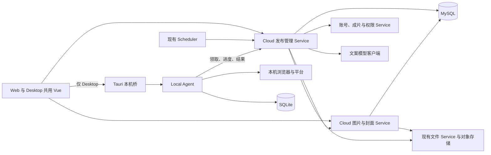
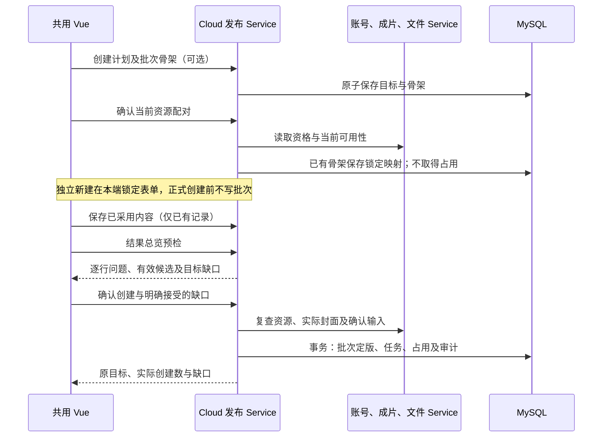
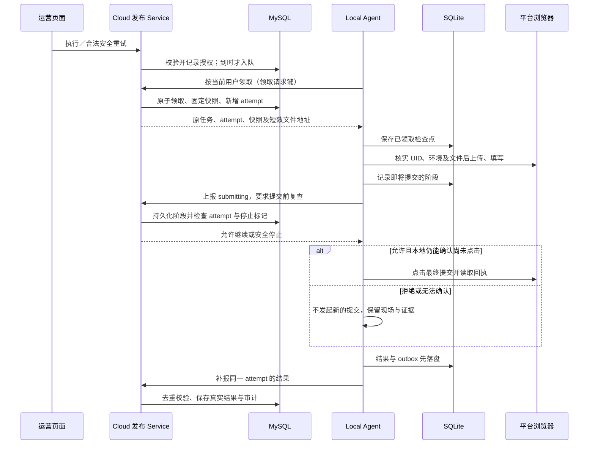
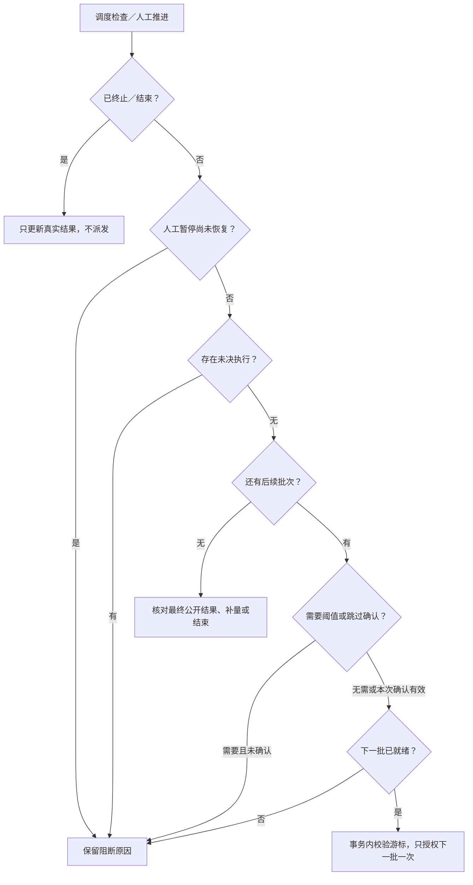
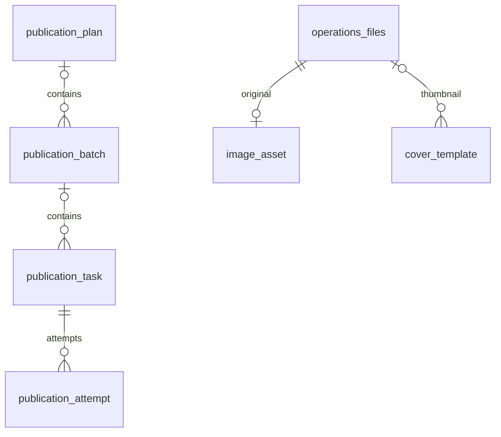

# 发布管理与运营工具工程设计

**Cloud 保存业务事实并决定是否派发，Local Agent 执行浏览器操作，Desktop 提供本机桥接；采用现有模块化单体、MySQL 六张业务表及文件服务。**

本规格描述目标实现，不代表发布业务、平台适配或接口已经交付。产品流程、允许动作和统计口径以 [PRD 第六章](../../product/prd/详细文档/第六章_发布管理.md)为准；页面参照 [Cloud 原型](https://github.com/piqiu96/wt-media-cloud/tree/main/web/example/proto/publishing-design)。下文英文状态、接口路径和字段表达工程设计意图，正式定义由提供方 Contract 与 migration 维护，不在 Workspace 复制 OpenAPI 或完整 DDL。

依赖：[系统架构](../architecture/社媒运营平台工程架构与分层设计_V1.md)、[社媒账号](social-accounts.md)、[运营资源](2026-10-29-operating-resources.md)、[内容生产](2026-09-24-m4-m5-cloud-content-production.md)、[认证 ADR-0022](../../decisions/0022-session-only-auth-and-agent-token.md)、[契约映射](../../contracts/contract-map.md)。

## 1. 总体架构

### 1.1 模块与调用边界



| 位置 | 职责 | 实现边界 |
| --- | --- | --- |
| Cloud 发布管理 | 配置校验、正式创建、占用、授权、派发、结果核实、推进、统计和审计 | 在 `internal/modules/publishing` 内按 Handler → Service → Repository 组织；通过所属模块 Service 使用账号、成片、身份和文件 |
| Cloud 运营工具 | 图片库、模板草稿与发布配置、真实封面渲染 | 图片、模板、渲染按主题分文件，供发布管理引用；不拆独立部署服务或通用资源引擎 |
| Cloud Scheduler | 到时入队、计划推进、失联检查 | 调用发布 Service，不访问浏览器或运营电脑，不自行改写另一套状态 |
| Local Agent | 实读账号环境、取文件、上传、填写、提交、保留现场和执行证据、补报结果 | 只执行所属用户的账号；不直接写 Cloud 数据库，不自行授予重试权限 |
| 共用 Vue / Desktop | 配置与审阅、显示进度、调用本机能力 | Vue 不直连 SQLite；Tauri 不复制业务校验、平台自动化或 Cloud 页面源码 |

### 1.2 复用范围与新增实现

**复用基础设施，不复活已退役的通用任务运行时。**

| 已有能力与代码依据 | 可以复用 | 发布管理仍需实现 |
| --- | --- | --- |
| [Cloud Scheduler](https://github.com/piqiu96/wt-media-cloud/blob/main/internal/scheduler/scheduler.go) | 作业注册、周期调用和进程退出控制 | 发布入队、推进和失联检查的业务函数 |
| Cloud `mediaaccount`、`production` Service | 授权范围、账号身份、成片与文件事实 | 发布资格、同平台占用及资源盘点投影；不复制账号或成片管理模块 |
| [Cloud files Service](https://github.com/piqiu96/wt-media-cloud/blob/main/internal/modules/files/service/service.go) | 上传、对象存储、摘要、文件登记和短效访问地址 | 图片尺寸、生成来源元信息、渲染文件登记及业务引用删除保护 |
| [Cloud Agent 鉴权](https://github.com/piqiu96/wt-media-cloud/blob/main/internal/modules/localagent/auth.go) | 新工作严格鉴权、已领取工作 report-safe 收尾 | 发布 attempt 的归属、状态和证据校验，不复用下载租约的超时重领语义 |
| [Agent checkpoint/outbox](https://github.com/piqiu96/wt-media-agent/blob/main/src/wt_media_agent/storage/checkpoint_store.py) | SQLite 检查点与待补报结果存储 | 发布执行器、提交前检查点、按发布协议补报的循环及原现场恢复 |
| [Desktop 本机调用](https://github.com/piqiu96/wt-media-desktop/blob/main/src-tauri/src/commands/account.rs) | Tauri → Local Agent 的受控桥接方式 | 发布现场继续及新建续编接口的桥接 |

当前 Agent 运行入口注册的是文件下载执行器；文案模型客户端、模板封面渲染与三平台发布适配也不能由原型演示推定为已经实现。不新建 MQ、Redis 锁、工作流引擎、设备节点或通用执行许可系统。

### 1.3 待产品负责人裁定

**以下三项只用于评估成本，不是已批准的产品限制；实现与验收范围须在裁定后确定。**

| 事项 | 推荐评估方案 | 裁定前的边界与影响 |
| --- | --- | --- |
| 跨用户批次 | 本期不新增负责人指派与多人协同；评估同批使用单一所属用户账号 | 本机只能执行本人账号已由既有权限确定，但不能据此认定批次必须单一归属。若支持混合归属，任务仍按账号所属用户领取，需评估协同待办与离线等待；不允许一台 Agent 代执行他人账号 |
| 三平台分阶段开放 | B站、百家号先完成联通，小红书通过专用验收后开放 | PRD 的三平台目标不变；是否允许分阶段交付待裁定。各平台分别维护能力开关，未接通时明确拒绝创建或执行，不让任务运行后必然失败 |
| 质量等级维护 | 暂缓新增账号、成片质量字段及人工维护入口 | 不从标签、登录状态或分辨率猜测质量。若质量优先分配必须落地，先确认权威来源与维护范围，再由所属模块提供；不把模拟质量写成正式输入 |

## 2. 服务交互

### 2.1 配置、确认资源与正式创建

**资源确认锁定本份映射，正式创建取得占用，执行授权另行发生。** 批次界面始终为「资源配置 → 内容配置 → 结果总览」，结果总览是预览与创建检查，不增加持久化配置状态。



计划创建只写计划和骨架。独立批次提交完整配置；计划骨架确认使用同一创建校验器。已有骨架进入内容配置时，服务端将平台、类目目标、账号及成片映射固定；之后内容保存不得把配置退回资源阶段。此锁定不等于整个计划首次启动后的结构锁定。

部分创建显式携带包含／排除的候选及预期缺口；服务端重算后对该集合全成或全败。启动时的“只执行当前可用任务”是另一项明确确认：其余正式任务保持待执行及阻断原因，不静默取消或降低目标。

预检只读当前事实，不占用、不颁发可执行令牌、不建立预检会话。创建结果不明按原请求核对；创建成功不自动串联 start。

### 2.2 授权、领取与浏览器提交

**只有已授权且满足时间、间隔和父级条件的任务才能被领取；每次领取固定一次输入。**



领取时检查真实平台 UID、Profile 归属、当前输入、成片占用和文件引用；Agent 还须在本机实读 UID 与文件摘要，不能以最近一次 Cloud 登录检查替代。同一浏览器 Profile 即使绑定了不同平台的账号，也不能同时执行发布。Cloud 领取时锁定已有 `browser_profiles` 行，检查该 Profile 的旧执行现场是否已安全结束；Agent 在本机也按实际 BitBrowser Profile 串行。编辑与领取竞争时按对象修订阻止覆盖。

到时判断使用 `not_before`；批次间隔使用上一条执行结束时间加间隔。同一真实平台账号有执行、人工或结果未知任务时，不领取下一条；不同账号若共用一个浏览器 Profile，也不能并行。不同账号且不同 Profile 才允许受控并行。时间到达不会自动授权尚未启动的任务。

提交前复查通过 progress 完成，不另设通用许可 API。允许响应与平台点击之间仍有竞态窗口：后发生的停止不能撤回平台提交，必须根据真实回执收尾。提交前响应丢失时，不能把旧允许响应当作永久许可，也不能自动重放点击。

### 2.3 计划推进与停止控制

**自动检查、人工恢复、确认继续和批次接管共用一个推进 Service，事务内重检位置和当前事实。** 条件优先级直接遵守 [PRD 6.2.4](../../product/prd/详细文档/第六章_发布管理.md#624-执行与推进计划)。



阈值固定使用 PRD 的 10%，不增加每计划可配置参数。明确结果数大于零时用整数比较 `failed × 10 <= published + reviewing + failed`；零分母须确认跳过，人工确认也不能绕过未决任务。确认绑定当前批次、预期下一批及对象修订，不是可反复使用的额外授权。

人工暂停只阻止后续批次启动，已启动任务继续按真实结果收尾。**仅下一批未配置好时，计划仍为 `running`，界面当前进展显示「等待配置」。** 配置完成后 Scheduler 重新检查未决任务、失败率、批次位置和就绪情况；满足条件就继续。人工暂停、失败率超阈值和零明确结果都必须由运营恢复／确认，不能因为配置完成而自动解除。从批次入口接管仅限当前合法位置，先暂停自动推进，再授权本批。

首次启动前已有前序终止批次时，在确认无未决执行后保留其终止结果，选择后续首个合法位置；后续未就绪就等待，不自动跳过未配置批次。已推进批次的迟到结果只更新任务和统计，不回退游标；其真实未决会阻断再启动下一批，不停止已经启动的当前批次。

计划终止封住全部所属批次的新派发；单批终止／停止只封住本批。安全收尾和结果核实继续使用原 attempt，不把晚到结果转换成新的启动或重试授权。

补量、最终结束复用 PRD 6.2.5 的条件。补量事务重算原目标缺口，已有一轮补量未处置完成时不再追加；迟到公开结果只重算缺口并提示处置，不静默删除正式任务或发出超量任务。

### 2.4 内容生成、采用与封面

**生成在当前 HTTP 请求内执行；结果先进入建议或预览，采用、确认、正式创建分别发生。**

文案请求按候选读取有权使用的素材信息，调用模型并验证完整结构；每条完整结果才可采用，不把流式半句写入当前内容。封面渲染在 Cloud 运营工具内完成，通过文件 Service 登记真实产物，不另建生成业务表。事件语义见 [5.4](#54-生成流与接口反馈)。

| 防覆盖依据 | 用途与保存位置 |
| --- | --- |
| 候选 `row_key`、`input_revision` | 标识本行生成上下文；资源、平台、类目、底图、模板或被用作生成依据的值变化时失效，随候选配置保存 |
| `field_revisions` 与各字段最新请求 | 阻止旧建议覆盖手工字段；采用标题只增加标题修订，不让未改动的正文、标签同时过期；最新请求关联由页面管理 |
| 业务对象 `revision` | 保存已存在的批次／任务时阻止覆盖并发修改，不负责逐字段协作合并 |
| 内容确认对应的输入指纹 | 证明运营确认的是当前实际内容；实际变化只清除受影响条目的确认，无变化保存保持确认 |
| 封面 `render_input_hash` | 绑定实际标题、底图文件摘要、模板发布配置、规格及渲染器版本；服务端正式创建时复查 |

批量配置只处理勾选的字段和内容类型，按“本行明确值 > 批次默认值 > 新建时解析的平台默认值”确定实际内容；已解析的默认值及配置版本随配置保存，后台默认值更新不追改已有记录。默认补空白，覆盖手工内容需明确选择。审阅期间不写原行；应用前修订变化则重新基于最新内容审阅，保留人工稿，只重试失败／未完成项。应用不代替内容确认。

| 封面路径 | 服务实现 |
| --- | --- |
| 素材自带图片／图片库现成封面 | 检查实际文件、权限与平台规格；无需模板、封面文字或生成记录，替换后重新确认 |
| 模板合成 | 固定实际底图、短标题和各必要规格的启用发布模板；逐规格校验实际排版、渲染并登记文件，收齐输出才可确认 |

随机底图按当前类目、再通用范围选择启用且用途匹配的图片；最终选定的 ID 固定保存，不随查看重选，不实时生成底图或提取关键帧。模板标签仅用于推荐，可用性按实际输出要求判断；图片停用不参与新渲染。

模板渲染复用编辑器定义的画布、图层、字体、描边和行距参数。唯一动态主标题绑定业务短标题，隐藏仍计入数量；先换行再在允许范围缩字，仍溢出则报错，不截断标题或拉伸其他比例。样例预览标记为预览文件，不能代替实际标题的正式封面。

输入变化只使相关封面失效，正文等无关变化不重绘；预览、采用和导出指向同一实际成品。已确认文件及模板快照不因模板后续更新／停用而失效，再次生成才读取当前可用配置。

### 2.5 资源查询与推荐

发布 Service 组合现有账号、成片查询与发布占用，返回资格、不可用原因及查询时间；不另建资源库存副本。资源失败、真实为零、日额度未知分别返回，今日公开按实际公开时间和业务时区查询。

配对先过滤权限、平台、类目、身份和占用，再按用户确定的类目优先级、账号顺序与每号本批上限分配；同账号跨类目共享剩余数量，不把本批上限当作日额度。保留兼容的人工配对，短缺指出原因；推荐不预占，最终创建重新验证。

计划“AI 推荐”调用真实模型，结果仍须通过平台分组、逐格守恒及锁定行位置校验。不用确定性分配结果冒充 AI 输出；模型不可用时反馈失败，用户仍可手动拆批。质量优先输入受 [1.3](#13-待产品负责人裁定)约束，不隐式新增评级机制。

### 2.6 新建续编与正式记录

Desktop 经 Tauri 调用 Agent 保存一份本地输入；Web 仅使用当前应用内存，刷新、关闭或退出登录清空。已有计划骨架的配置属于 Cloud 业务记录，已有记录编辑走 Cloud 保存，不混入新建续编。

本地内容包含表单、已采用结果、文件 ID、版本及原创建请求键，不存图片 Base64、Cookie 或长期文件 URL。正式创建成功后清理，失败保留；结果不明保留原键和原提交内容先核对，不生成第二份正式记录。仅存于本地的引用不构成 Cloud 占用或删除保护。

## 3. 核心模型

### 3.1 六表与数据边界



| 云端表 | 保存的唯一主要事实 |
| --- | --- |
| `publication_plan` | 计划目标、周期、推进位置、控制及结束原因 |
| `publication_batch` | 单平台分目标、所属计划、配置、启动与停止控制 |
| `publication_task` | 固定任务身份、当前内容、执行授权、当前平台结果与占用 |
| `publication_attempt` | 每次领取的不可变输入、过程、结果及核实依据 |
| `image_asset` | 已有文件的图片用途、类目、启停和归属 |
| `cover_template` | 固定基础信息、一份编辑草稿、一份当前发布配置及启停 |

`operations_files` 复用扩展；账号、成片、类目和审计继续由原模块拥有。图片与模板不设发布父对象外键，配置引用它们；不新增发布结果表、生成任务表、版本表或引用计数表。

六张新表使用单数实体名、自增整数主键、InnoDB 与 utf8mb4；新增 ID 对外输出十进制字符串。外键类型按现有被引用列核对，不能把新主键的 unsigned 约定直接套到已有文件、账号和成片 ID。云端时刻为 UTC `DATETIME(6)`，接口 RFC3339；运营日期按 `Asia/Shanghai`，日期周期不自动启动或终止计划。

普通列保存身份、状态、排序、修订和索引条件；有界 JSON 保存目标、配置及快照。通用审计列为创建人、创建时间和更新时间，业务修改增加 `revision`。以下只列领域字段与约束，具体类型、完整索引及约束名归 Cloud migration。

业务变更与必要审计同事务保存。审计记录操作者、对象、动作、前后状态、原因及关联标识；自动动作明确标为系统。日志和审计不记录 Cookie、Agent Token 或文件签名 URL。

### 3.2 计划

| 字段组 | 内容 |
| --- | --- |
| 身份与目标 | `team_id`、`owner_id`、名称、备注、周期、`goals_json`；目标为去重的平台 × 类目正整数集合 |
| 控制 | `status`、`pause_reason`、`current_batch_id`、`first_started_at`、`cancel_requested_at` |
| 结束事实 | `ended_at`、`end_reason`、`end_note`；真实结果迟到更新统计，不覆盖原结束原因 |
| 创建防重 | `request_key`、规范化输入的 `request_hash`；按创建人及请求键唯一 |

内部控制 `ready/running/paused/stopping/ended` 分别表达未启动、自动推进、暂停推进、安全收尾和最终结束。界面将 `running/paused` 映射为「进行中」，暂停及等待原因只作为当前进展；不扩充 PRD 主状态。本轮派发完成由游标和批次事实计算，等待最终核实或补量决定时仍未最终 ended，不能提前关闭处理入口。

`pause_reason` 只保存需要人工解除的原因：人工暂停、失败率超阈值和零明确结果。「等待配置」由下一批是否就绪实时计算，计划保持 `running`，不写入 `pause_reason`；若同时存在人工阻断，优先保持 `paused`。`first_started_at` 记录计划整体结构锁定；资源确认只锁当前批次映射。目标总数由 JSON 计算，10% 阈值不另存可修改配置。

### 3.3 批次

| 字段组 | 内容 |
| --- | --- |
| 归属与顺序 | `team_id`、`owner_id`、可空 `plan_id`、`kind`、平台、名称、备注、`group_order/batch_order` |
| 目标与配置 | `targets_json`、`config_stage`、`config_json`；配置包含候选映射、默认内容、覆盖值、输入修订、确认指纹与执行设置 |
| 控制事实 | `execution_state`、`confirmed_at`、`first_started_at`、`cancel_requested_at`、`handoff_at` |
| 创建防重 | 独立创建的请求键与输入摘要；已有骨架确认依对象修订及定版事实防重 |

`kind=original/makeup` 分开原始分配与补量；前者逐格等于计划目标，后者不改原目标。`handoff_at` 记录已推进位置，迟到结果不能再次推进该位置。已锁定行位置固定，其余仅在连续可编辑区间排序。

`config_stage=resource/content/confirmed` 是持久化进度：资源确认后进入 content 并锁映射，正式任务创建成功进入 confirmed。定版时移除可写候选，正式当前内容只在任务表维护；批次公共配置与执行间隔保留，不随清理候选丢失。结果总览无需单独状态列。

**派发收口是实时任务投影，不是可恢复的批次控制状态。**

| 维度 | 实现含义 |
| --- | --- |
| 执行控制 | `ready/running/stopping/finished/cancelled`；running 表示已启动且控制未结束，不保证当前有浏览器正在操作。停止标记永久禁止新派发，finished 不回迁为 running |
| 派发是否收口 | 当前不存在 pending、queued、running、awaiting_human、uncertain；每次查询／推进重算，不以历史时间戳代替当前事实 |
| 是否仍有待办 | 从任务失败、审核、人工及未知结果和相应处理权限计算；派发收口仍可有审核或失败待办 |
| 列表主状态 | 按 PRD 从配置、控制及任务聚合得到待执行／执行中／待处理／已结束／已取消；骨架不进正式批次列表，收尾原因不增加列表状态 |

正常批次的任务全部已发布、已取消或已放弃后才关闭控制；移交下一批只记录 handoff，不以此把仍有失败待办的批次置为 finished。停止批次在没有在途、人工或未知执行后关闭控制，审核等真实结果仍可后续核实。尚未结束、未停止批次的安全失败任务可单独重试；不以“派发收口”误禁合法重试，也不借晚到结果重开已结束控制。

### 3.4 任务与结果

| 字段组 | 内容 |
| --- | --- |
| 固定身份 | `team_id`、`operator_id`、可空 `batch_id`、平台、类目、账号 ID、真实平台 UID、成片 ID；任务不重复存 `plan_id` |
| 输入 | `resource_snapshot_json`、`content_json`；保存最终值、平台默认配置版本、实际封面文件和来源，不保存长期访问 URL |
| 执行 | `status`、`task_order`、`not_before`、`authorized_at`、`current_attempt_id`、`attempt_count`、`cancel_requested_at` |
| 平台结果 | `accepted_at`、`published_at`、`platform_work_id`、`work_url`、失败代码与摘要；安全结论以当前尝试证据为准 |
| 并发与防重 | 修订、创建请求键、同平台成片唯一占用、真实 UID 串行和浏览器 Profile 互斥 |

任务只使用以下十个主状态；动作权限直接复用 [PRD 6.4.1](../../product/prd/详细文档/第六章_发布管理.md#641-任务列表)，不在本规格维护第二张业务操作表。

| 任务状态代码 | 界面状态 |
| --- | --- |
| `pending` | 待执行 |
| `queued` | 排队中 |
| `running` | 执行中 |
| `awaiting_human` | 等待人工 |
| `uncertain` | 结果待确认 |
| `reviewing` | 平台审核中 |
| `failed` | 发布失败 |
| `published` | 已发布 |
| `cancelled` | 已取消 |
| `abandoned` | 已放弃 |

缺少链接不单列主状态：已有明确接收证据保持 reviewing，结果不能确定则 uncertain；保留缺失资料的待办原因及核实／补录入口。阶段上传、填写、提交写在 attempt，不扩充任务主状态。

占用通过现有任务表生成列和唯一索引保证，概念约束如下；实际列类型与迁移由 Cloud 定义：

```sql
occupied_output_id = CASE WHEN status <> 'abandoned'
                          THEN composite_output_id ELSE NULL END
UNIQUE (platform, occupied_output_id)

executing_account_uid = CASE WHEN status IN ('running', 'awaiting_human', 'uncertain')
                             THEN platform_account_uid ELSE NULL END
UNIQUE (platform, executing_account_uid)
```

`platform_account_uid` 是平台真实 UID，不是 Cloud 的账号记录 ID。同 UID 多窗口不能同时执行；不同平台共用一个浏览器 Profile 时，也必须串行。领取时先锁现有 Profile 行，再查询该 Profile 尚未安全结束的 attempt，同事务确认无冲突后才领取；冻结 Cloud Profile ID 以便查询。失联不能自动释放 Profile 的执行占位，核实旧执行已经停止后才能释放；任务结果未知及成片占用另行处理。Profile 绑定调整也应检查旧执行是否仍占用现场，不增加锁表或设备节点。取消仍占用成片，只有满足安全条件的明确放弃才释放。

核实／补录在任务结果字段保存平台作品身份与公开依据，作品管理复用该事实的查询投影。Cloud 对可核实的同平台作品身份实施去重，重复补录复用已有关联，冲突关联返回核实问题；具体唯一键与 URL 规范化规则随平台契约落实，不另建发布结果表，也不把 URL 格式有效等同公开。

### 3.5 执行尝试

| 字段组 | 内容与约束 |
| --- | --- |
| 身份 | `publication_id`、递增 `attempt_no`、`executor_user_id`、冻结的 Cloud `browser_profile_id`、`claim_request_key`；任务与次数唯一，执行用户与领取请求键唯一 |
| 不可变输入 | `input_snapshot_json`：领取时的实际内容、UID、Profile 引用、成片与封面 ID／摘要、模板配置及发布修订；不随编辑或模板更新改变 |
| 执行事实 | `status`、`stage`、`started_at`、`heartbeat_at`、`submit_started_at`、`finished_at`、步骤及必要证据 |
| 结果与核实 | `result_status`、错误、`report_seq`、`result_hash`、核实人／时间／依据；平台后续核实不改写原上报证据 |

attempt 状态为 running、awaiting_human、completed、interrupted；表达执行进程，不替代平台结果。排队不建 attempt，合法重试在下次领取时新增；人工继续沿用原 attempt。completed 仍可能对应 uncertain，失联标为 interrupted 也不证明旧进程停止。

当前任务内容与历史执行快照是两类事实，不做未执行编辑的历史版本。必要输入快照可重复少量文字与文件引用，媒体文件不复制；旧尝试保留原证据，人工核实追加依据，不能伪装为 Agent 原始回执。

### 3.6 图片、模板与文件

| 对象 | 字段与约束 |
| --- | --- |
| 图片 | `team_id`、唯一 `file_id`、名称、`allow_as_cover/allow_as_background`、类目数组、`enabled`、修订及审计；至少一种用途，空类目表示通用，原文件不可替换 |
| 模板基础信息 | 团队、名称、画布宽高、适用范围、推荐平台／类目；基础信息固定，改规格通过复制；无全局默认项 |
| 模板内容 | `draft_config_json`、`published_config_json`、`published_revision`、当前正式缩略图文件 ID、`enabled`、对象修订及创建防重；图层不建表 |
| 文件扩展 | 在已有 `operations_files` 增加 `metadata_json`：实际宽高／格式、生成用途、输入摘要、模板发布快照、底图 ID／摘要、实际标题和渲染器版本；只由服务端写入 |

图片上传复用文件上传再登记，按文件逐条反馈；同 file_id 同配置重复登记返回已有记录，改配置走编辑。尺寸由真实解码取得，图片库不重复保存对象地址、大小和 SHA。生成封面直接登记文件，不强制加入图片库。

模板一行最多一份草稿和一份当前发布配置，内容标签据此计算，启停另列。打开编辑器不写草稿；保存实际差异才更新 draft，与发布配置一致时清除差异。发布读取已保存草稿，校验、真实渲染后在事务中复查修订，再替换 published、增加发布修订并清草稿；保持原启停，首次发布仍停用。

模板样例校验与实际业务渲染共用排版实现和字体资源。样例产物标为 `cover_preview`，业务成品标为 `cover_render`；只有实际输入匹配的业务成品或合格现成图可创建任务。复制优先使用已保存草稿，否则用当前发布配置；新画布调整区域与裁切，不拉伸字形，产生独立停用草稿。已发布或有引用的模板只能停用，历史发布内容由各成品与 attempt 快照保留，不建设模板历史版本界面。

### 3.7 本地存储

Agent 在现有 SQLite 中维护 `publication_draft`，唯一键为环境、当前用户和 `plan/batch/task` 类型，保存 `payload_json/schema_version/saved_at`。覆盖同一份续编输入，不保留草稿历史或状态机。环境和用户来自 Desktop／Agent 已建立的上下文，不接受前端任意指定他人身份。

发布执行复用 checkpoint/outbox 的存储方式，与续编分开。记录键区分业务域，避免下载与发布的任务 ID 相互覆盖；适配层保存 Cloud task/attempt 映射。补报循环仅发送原结果，检查点用于识别已发生阶段，不能据其存在自动恢复提交。原现场丢失时进入核实，不伪造可继续执行的现场。

### 3.8 查询投影

状态按钮、阻断原因、配置就绪、数量及成功率由同一发布 Service 生成。`allowed_actions/action_blockers` 是读投影，不是独立权限系统；服务端命令再次检查。

统计按 [PRD 6.8.4](../../product/prd/详细文档/第六章_发布管理.md#684-目标进度与结果口径)实现：目标 JSON 在内存逐格合计，任务先按 batch／平台／类目聚合，再组合结果；不展开目标数组后与任务相乘，不用 attempt 计数。公开作品先去重再计入对应任务，独立任务不进入计划汇总。

列表先应用权限、筛选与分页，再按页内父 ID 批量聚合，避免逐行请求。详情按需读取批次任务、尝试和审计，不返回全计划所有快照。批次只输出产品要求的发布成功率进度条，派发收口作为控制判断，不制造另一条产品进度。

## 4. 并发与恢复

### 4.1 不同请求使用不同防重依据

| 操作 | 最小机制 | 重复／冲突处理 |
| --- | --- | --- |
| 创建计划、独立批次、快速任务、模板 | 创建人＋请求键唯一，保存规范化输入摘要 | 同键同输入返回原对象；同键异输入冲突 |
| 确认已有批次 | 锁批次，检查定版事实与预期修订 | 已定版返回原创建结果，不再次套用传入配置 |
| 编辑、启动、重试、人工推进 | 预期修订及当前前置条件 | 过期拒绝，响应不明先读取当前对象；不为每条命令另建幂等记录 |
| 领取 | 执行用户＋领取请求键唯一 | 响应丢失重用原键取得原 attempt，不误领下一条；无任务不写领取记录 |
| 阶段、心跳、结果 | 当前用户／attempt、报告序号、结果摘要 | 旧序号不重复应用；同结果成功返回，冲突保留证据并核实 |

编辑以 `WHERE id=? AND revision=?` 更新；最终结果和控制变化提升对象修订，普通心跳／进度不提升，避免上传过程中反复打断运营编辑。Agent 读取原领取结果后先核对本地检查点，不能因重复响应再运行一次浏览器流程。

上报序号只去重事实写入；心跳和提交前 progress 的停止响应每次读取当前控制，不返回缓存的旧允许结论。

### 4.2 事务与约束

需要同时修改父子对象时，按 **plan → batch → Profile／文件 → task → attempt** 的固定次序取锁；同类多行按 ID 升序。领取、账号绑定修改、文件正式引用都要遵守各自的互斥规则，只锁涉及的行，防止并发操作绕过检查。事务内只做数据库读写；模型、渲染、对象存储删除及平台操作都在事务外。只有纯数据库事务死锁才可有限重试，绝不自动重放已产生外部副作用的操作。

| 命令 | 必须原子完成的写入 |
| --- | --- |
| 创建／编辑计划 | 平台能力与目标守恒校验、计划及骨架／允许编辑行、排序和审计；首次启动前也不能改已确认资源的行 |
| 确认资源 | 已有骨架的映射、目标与阶段、对象修订及锁定审计；不占成片、不锁整个计划 |
| 正式创建批次／快速任务 | 最终资源与当前内容校验、全部正式任务、成片唯一占用、定版及审计；失败整体回滚 |
| 编辑内容与时间 | pending 且未领取、父级允许、实际内容及确认指纹、执行时间、对象修订；不更换身份 |
| 启动／推进 | 当前位置、实时未决聚合、阈值与明确确认、必要首次启动、授权、移交与审计；一个位置只推进一次 |
| 领取 | 父级控制与时间／间隔复查、真实 UID 唯一执行位、Profile 行锁与未完成现场检查、task 状态、attempt 与输入快照 |
| 终止／停止 | 封住对应父级与任务派发、取消未领取任务、原因和审计；在途不能直接伪造成已取消 |
| 结果／核实／安全放弃 | 当前 attempt 与证据校验、平台身份去重、任务结果及核实审计；仅符合安全放弃条件时释放占用 |
| 补量／最终结束 | 全部既有批次真实处置、公开缺口、补量唯一当前轮／结束原因及修订 |

不对最终缺口、阈值和安全条件使用可能跳过行的查询。预检和外部文件检查完成后，写入事务仍复查状态、修订、文件元数据及唯一占用，不能把预检结果当作最终保证。

### 4.3 Scheduler 与容量控制

| 现有 Scheduler 内的作业 | 扫描范围与行为 | 建议初始周期 |
| --- | --- | --- |
| 到时入队 | 已有授权且到时的 pending，重新检查父级、资源及间隔 | 5 秒 |
| 计划推进与收尾检查 | `running` 计划含等待下一批配置者；配置就绪后重检全部条件，人工 `paused` 和等待人工确认者绝不自动放行 | 5 秒 |
| 失联检查 | 活动 attempt 超过心跳阈值，标记 interrupted／uncertain，不创建新尝试、不释放资源 | 30 秒 |

Cloud 重启从业务表恢复观察；多实例重复扫描通过行锁、对象条件及游标收敛，不新增调度租约。审核中的任务不作为活动执行心跳超时处理，也不后台轮询全部平台作品。

心跳 15 秒／失联 90 秒、每用户并发 3、AI 分组 10 条／流截止 180 秒、单候选封面截止 60 秒、单份配置约 2 MiB 为部署与验证初值，不是已验证容量或新增产品承诺。同账号并发始终为 1；服务繁忙在建流／领取前反馈，不引入通用容量平台。批次 500 条、计划 100 批及总 API 100 QPS 用作代表性压力样本，不直接写成产品硬上限。

### 4.4 安全停止与迟到结果

**停止是永久禁止新派发的控制事实，收尾是确认旧执行真实结果；两者不能互相覆盖。**

| 情况 | 处理 |
| --- | --- |
| 取消与领取同时到达 | 锁相同父对象及任务；未领取才可直接取消，领取成功后按当前 attempt 安全条件处理 |
| 已运行，确认安全停止且未提交 | 允许按现有任务操作记录已取消，保留成片占用；不能只凭用户点击或没有提交标记认定安全 |
| 批次停止／计划终止 | 未领取任务取消；已领取在心跳和提交前复查收到停止，已提交或不确定者继续核实；任何较晚授权都不能绕过父级停止 |
| 失联、客户端退出、现场丢失 | 保存未知结果与执行位，不因超时重领或自动重试；先核实旧进程和平台结果 |
| 原 attempt 迟到回报 | 无新 attempt 且无人工冲突结论时收敛真实结果；重复结果幂等，冲突追加证据并转核实，不覆盖人工依据 |
| 已有新 attempt 的旧回报 | 留在历史并提示核实，不驱动当前任务，不恢复父级控制或覆盖已发生的释放事实 |
| 审核状态后来不确定 | 恢复结果核实，保留资源；不因此重新授权上传、倒退计划或重开已停止批次 |

安全重试必须确认未形成可发布作品、旧执行已结束、原资源及内容仍有效，且任务与父级均允许；只新增原任务的尝试。原资源恢复不等于改账号或成片；失败任务不新增任意编辑、改期或父级停止后的执行入口。

结果核实由有权用户在 Desktop 查看原账号稿件，沿用 resolve 保存明确接收、公开、确认失败或仍未知的证据。公开时间不得在未来；无作品与旧执行停止均有依据后才能安全放弃。取消与放弃不是可互相自动转换的恢复流程，现有入口条件仍以 PRD 为准。

### 4.5 本地补报与认证失效

领取使用当前有效 Desktop session 派生的 Agent Token 严格鉴权；已有 attempt 收尾使用现有 report-safe 模式并检查用户、attempt 与 Token 有效期。身份替换或失效不能领取新工作，也不通过创建新设备身份继续执行；已发生结果按既有认证边界补报。

Agent 先持久化领取与提交边界，最终结果和 outbox 同事务写入，再发 complete；断网或重启后只重发相同结果，不重跑浏览器操作。没有可证明安全的原现场就核实，不能把“本地存在检查点”当作可自动重试的依据。

文件地址过期只为已绑定的 task/attempt 重新签发相同文件访问地址，按报告安全鉴权校验归属；不能重新配对或重复上传。既有文件下载执行器的租约重领、自动断点下载不能作为发布提交恢复方案。

### 4.6 引用与文件删除保护

**保护已知业务引用，不维护通用引用表或易失真的引用计数。**

| 已保存引用来源 | 删除时检查的对象 |
| --- | --- |
| 图片库、模板草稿与发布配置、正式缩略图 | 图片业务条目、固定底图及文件 |
| 生成封面文件来源 | 底图文件、模板快照与对应成品依据 |
| 已有批次配置、任务当前内容、历史 attempt | 已固定图片、封面与执行所需的历史文件 |

引用详情通过这些固定模式查询；图片停用只影响新选用，不释放或破坏历史。仅本地续编、未保存表单和未采用建议不阻止 Cloud 文件删除，恢复时重新校验。

图片库与文件管理删除必须调用同一套引用检查。创建正式引用和删除都锁现有 `operations_files` 文件行；多文件按 ID 排序。**删除分为数据库确认和物理删除两步，不在数据库事务里删除对象。**

1. 短事务中锁文件行，检查图片、模板、已定版批次、任务及历史执行是否引用它。无人引用才把文件标记为 `deleting` 并提交。标记后不能再建立新引用，也不再签发访问地址。
2. 事务结束后删除对象存储里的文件，最后删除数据库文件记录。对象不存在视为物理删除已完成；若对象删除或数据库最终结算失败，保留 `deleting` 记录及对象键，允许原删除动作安全重试。对象已经删掉时绝不能把文件重新改成可用。

现有 files Service 是先删除对象、后删数据库行，需要按上述规则改造。JSON 中的文件引用在写入时也必须锁同一文件行并检查 `delete_state`；不新增通用引用表、引用计数中心或后台自动回收系统。

## 5. 接口契约

### 5.1 提供方与认证

**Workspace 定义职责及必要语义，提供方维护正式路径、参数、枚举、错误码和生成产物。** 当前发布接口尚未形成可直接调用的正式 Contract。

| 提供方 | 契约范围 | 消费方 |
| --- | --- | --- |
| Cloud | 发布业务、运营工具、SSE；Cloud-Agent 发布领取、过程、结果与文件访问 | 共用 Vue、Local Agent |
| Agent | Local API：原现场继续、本地续编；本地事件／状态／错误 | Desktop 原生桥 |
| Desktop | 引用提供方版本并更新 `contracts.lock.json` 与生成消费代码 | 不自行另定义 Cloud 状态或让 Vue 直调本机地址 |

业务接口使用用户 session；Agent 接口使用 Agent Token；本机调用沿用 Tauri 安全桥。权限复用身份、团队、负责类目及账号所属规则，不新建发布专用策略引擎，也不因管理角色扩大本机执行权限。

### 5.2 按业务职责组织的命令与查询

以下为路径意图，统一省略 `/api/v1`；不是按表生成 CRUD，也不以接口数量作为验收目标。

| 主题 | 查询／命令边界 | 必须保持的语义 |
| --- | --- | --- |
| 计划 | `/publication-plans` 列表／创建；`/{id}` 详情；`precheck`、`structure`、`start`、`pause`、`resume`、`confirm-next`、`makeup-batches`、`finish`、`cancel` | 结构编辑仅合法范围；首次启动、人工恢复、确认继续／跳过是不同意图，确认绑定当前位置；自动推进仅内部调用 |
| 批次准备 | `/publication-batches` 创建；`allocation-preview`、`precheck`；已有骨架的 `/{id}/resources`、`content`、`confirm` | resources 明确区分保存与确认锁定；confirm 原子创建任务，独立批次直接提交完整配置 |
| 批次执行 | 列表／详情／分页任务、`execution-preview`、`start`、`stop`、`cancel` | 创建检查与执行检查职责不同；首次执行前终止、执行后停止按产品阶段使用；不提供恢复停止队列的命令 |
| 任务 | `/publications` 列表／快速创建／预检；`/{id}` 详情；`content` 编辑、`start`、`retry`、`cancel`、`resolve`、`abandon`、`attempts` | 一次编辑保存内容及执行时间，只允许 pending 且未领取；核实与补录共用结果写入，失败重试与原现场继续分开 |
| 资源与推荐 | `/publication-capabilities`、`publication-resource-inventory`、`publication-account-options`、`publication-output-options`、`publication-plan-recommendations` | 复用原模块查询，增加发布资格／占用投影；不预占、不复制资源 CRUD、不把未知返回为零 |
| 生成 | `POST /publication-content/generate`、`POST /covers/render` | 分别生成文案与真实封面，复用流式事件；只返回结果，不直接替用户采用或确认 |
| 图片库 | `/image-assets` 登记／列表；详情、属性、批量修改、引用查询及无引用删除；`select-background` | 上传和资源访问仍复用 files；按 file_id 登记防重，选底图仅返回固定选择、不预占、不立即建立任务引用 |
| 模板 | `/cover-templates` 新建／查询；草稿保存、`validate`、`publish`、`usage`、`copy` 及合法删除 | 校验不发布，发布不启用；内容与启停分开；复制有明确的新规格适配职责 |
| 统计与记录 | 计划统计、各主体操作记录及任务尝试分页 | 聚合同一事实，不重复建设统计写入；复制取已有详情在新建表单填充，不另建复制任务 API |

### 5.3 执行端与本机接口

| 调用链 | 路径意图 | 必要语义 |
| --- | --- | --- |
| Agent → Cloud | `POST /cloud-agent/publication-tasks/claim` | 按用户领取，输入请求键；同一事务检查真实 UID 串行及浏览器 Profile 互斥，返回 task/attempt、冻结快照、UID／Profile、文件摘要及短效地址 |
| Agent → Cloud | `/{id}/heartbeat`、`progress`、`complete` | 均绑定 attempt；心跳读停止指令，progress 兼提交前复查，complete 去重保存证据与结果 |
| Agent → Cloud | 当前 attempt 的文件资源读取／续签 | 复用文件 Service；只允许快照已绑定文件，提供方在发布协议内定义，不新建下载任务或存储凭证体系 |
| Desktop → Agent | `POST /publication-runs/{attempt_id}/resume` | 原用户、原现场、原 attempt 安全继续；父级停止后只允许收尾，不再提交 |
| Desktop → Agent | `GET/PUT/DELETE /publication-drafts/{draft_type}` | 当前环境／用户／类型的一份 SQLite 输入；Web 不调用，正式创建成功或明确丢弃后清理 |

领取结果的文件身份与快照固定，短效地址可重签。空领取返回空任务，不是执行失败；领取响应丢失先按原键核对，不用下一次轮询掩盖结果未知。

### 5.4 生成流与接口反馈

两个生成接口使用 POST JSON 与 `Accept: text/event-stream`；共用 Vue 用 fetch 增量解析完整 SSE 事件，不能把网络 chunk 当事件。正式事件字段在 Cloud Contract 维护，这里固定生命周期含义：

| 事件 | 含义 |
| --- | --- |
| `start` | 参数、权限与并发检查通过，给出请求关联和总条数 |
| `progress` | 真实阶段及已完成条数，不编造模型内部百分比 |
| `item_result` / `item_error` | 一个候选的完整可审阅结果或失败；带候选及输入版本，一条只有一个终结结果 |
| `done` | 全部条目结束，成功数＋失败数＝总数 |
| `error` | 整体无法继续；保留完整已收结果，未完成项可重试 |

连接生命周期只负责本次处理。断流且无终结事件视为中断；客户端 Abort 停止后续分组，服务端感知断开后取消未开始及可取消的在途调用。前端和代理不自动重放生成 POST，不建后台继续执行或事件回放机制。

建流前失败用普通 HTTP／JSON 错误；响应头发出后的逐条错误用 item_error、整体错误用 error 后结束，不能再改 HTTP 状态。事件完整写出并 flush，空闲注释心跳不增加进度或延长截止时间。路由关闭代理缓冲与缓存，代理／客户端超时覆盖流截止，验证事件确实逐步到达。

普通响应沿用现有 `errcode/message/data/logid`。错误至少区分修订冲突、重复键异输入、成片被占用、账号执行繁忙、推进位置变化、未决阻断、内容／封面过期、平台未接通和真实依赖失败；数字码由 Cloud 维护。不得把数据库、模型、文件错误转成零库存、预检通过或模拟成功。

查询继续使用现有分页与授权规则；列表筛选状态使用 PRD 的查询投影，不直接暴露内部控制枚举作为另一套选项。详情中的引用只含有权查看的摘要与入口，返回来源及列表位置由前端维护，不持久化业务路由。

## 6. 技术验证

**验证要证明业务约束在并发、断网及真实平台操作下成立；原型、模拟回执和 HTTP 200 均不能代替发布验收。**

| 验证主题 | 方法及通过条件 |
| --- | --- |
| 六表与文件扩展 | 隔离 MySQL migration 验证字段类型、外键、生成列与唯一索引；不依赖 SQLite 或 mock 模拟 MySQL 锁语义 |
| 正式创建防重 | 重复请求、同键异内容、响应丢失；返回原结果或明确冲突，没有半批任务和重复占用 |
| 成片、账号与 Profile 互斥 | 同平台同成片仅一条任务可占用；同真实 UID 多窗口不可并行；不同平台账号共用同一个 Profile 时仍只能领取一条，人工卡点及未证明停止的失联现场不得释放占位 |
| 三阶段与锁定 | 确认资源不占用、不锁整个计划；内容阶段不能改映射；最终创建取得占用；首次合法启动才关闭计划结构编辑，失败启动不误锁 |
| 编辑与领取竞争 | 未领取待执行任务合法编辑；排队后改内容或改期均拒绝；失败任务不出现额外编辑入口；旧快照不被覆盖 |
| 推进与接管竞争 | 自动／人工／重复确认只启动一次；1/10 放行、2/10 等确认、零分母等待确认、有未知始终阻断；仅等待配置的 `running` 计划在下一批就绪后可重新检查推进，人工暂停和待确认不能自动解除 |
| 前序终止与后续执行 | 首次启动前终止第一批仍可在确认后启动合法后续；未就绪不跳过；单批停止不连带终止后续批次 |
| 停止与提交竞争 | 安全未领取可取消；已取得安全停止且未提交证据时运行任务可终止；提交复查通过后停止不伪造未提交或承诺撤稿 |
| 停止不可逆 | 计划终止停止全部所属批次；更晚授权、安全重试或迟到回报都不能绕过停止标记；已停止批次只核实收尾 |
| 失联与补报 | 断网／重启后补报原结果，重复完成幂等；失联不自动释放／重跑，旧 attempt 不覆盖新 attempt，冲突证据保留 |
| 派发收口与待办 | 审核／失败仍可有待办；仅未结束且未停止的合法失败可重试；迟到未知不把已结束控制改为运行 |
| 公开结果与统计 | 目标 30、创建 28、公开 28，成功率约 93.33%、缺口 2；补录同平台作品不重复关联或计数，attempt 不增加任务数 |
| 补量与迟到公开 | 并发只创建一轮合法补量；原目标不变；迟到公开重新提示缺口，不隐式改正式任务或重复推进 |
| 字段采用与批量配置 | 旧请求不能覆盖新手稿；采用标题后仍可采用未改标签；仅改封面不动文案；并发变化须重新审阅，已应用项不重放 |
| 内容确认 | 无变化保存保持确认；实际修改只使受影响行待确认；模板输入变化必须更新受影响输出 |
| 封面真实产物 | 自带／现成图无需生成记录；模板按实际标题生成全部必需比例，溢出报错，样例与正式成品不可混用 |
| 图片、模板与历史文件 | 停用不破坏历史成品；两个删除入口均保护引用；标记 `deleting` 后不得再引用，物理删除失败或数据库结算失败可安全重试，不恢复为可用文件 |
| SSE 与网关 | 分块、代理缓冲、取消、单条失败、整体超时、断流；逐事件到达，已收结果保留，仅失败／未完成项重试 |
| 续编与认证 | Desktop 重启可恢复本用户输入，Web 刷新清空；续编无正式行或占用；session 替换禁止新工作，已有结果按 report-safe 规则收尾 |
| 查询与负载 | 代表性任务／attempt 数据验证 EXPLAIN、分页聚合与索引；100 QPS、500 条批次、100 批计划作为测试样本，记录耗时与资源后确定部署配置 |
| 三端与各平台 | 提供方契约校验、消费生成与 Desktop 版本锁一致；每个开放平台独立验证真实账号／文件、上传填写、提交回执、未知核实和公开关联，未通过不宣称该平台可用 |

技术验证只保存通过条件；实际测试结果、平台授权证据与实施安排进入相应 PR／Delivery，不在本规格追加开发计划或执行流水账。
