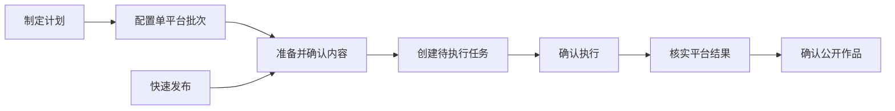

# 第六章：发布管理

发布管理帮助运营把可用成片安排给合适的账号，准备发布内容，执行发布并跟进真实结果。本章同时定义发布所使用的图片库和封面模板，属于“运营工具”，可供其他业务复用。

当前发布平台为 B站、小红书、百度。平台原生字段和账号能力需要按实际生效规则检查，不能把平台页面中可见的控件等同于本系统已支持的能力。

本章是产品规则的正式来源。页面组织、交互和视觉分别遵循 [AdminUI 页面规范](../../../standards/frontend/AdminUI页面规范.md)、[前端交互规范](../../../standards/frontend/前端交互规范.md)和[前端架构与视觉规范](../../../standards/frontend/前端架构与视觉规范.md)。原型入口见[设计导航](../../../design/README.md)。

## 6.1 模块定位与整体流程

### 6.1.1 什么情况下使用计划、批次或任务

| 用户要完成的事 | 使用入口 | 管理范围 |
| --- | --- | --- |
| 围绕周期目标安排多平台、多轮发布，并持续查看目标完成情况 | 发布计划 | 平台 × 类目目标、有序批次、整体进展与后续安排 |
| 集中准备并执行同一平台的一组内容 | 发布批次 | 多个账号与成片的分配、内容准备、执行与待办 |
| 发布一条内容，或处理某条发布的具体问题 | 发布任务 | 一个平台、一个类目、一个账号和一个成片的发布及结果 |
| 提前准备可重复使用的图片或封面版式 | 运营工具 → 图片库／封面模板 | 图片资源与模板设计，不负责执行发布 |

计划只通过批次组织任务，不直接绑定独立任务。独立批次和单条任务可以没有计划；它们不计入其他计划的目标和进度。发布后的作品表现观察与点赞、评论等操作分别由数据统计、作品及互动模块承接。

### 6.1.2 从准备内容到获得发布结果

制定计划只生成待配置的批次骨架。批次完成资源、内容和创建检查后，才生成正式任务；快速发布则直接创建一条独立任务。正式创建时取得成片在目标平台的占用，执行需要另外发起。

平台接收投稿、审核中和公开发布是不同结果。只有确认作品已经公开，才计入发布目标；点击提交、取得投稿编号或任务执行结束都不能代替公开成功。

### 6.1.3 图片库和封面模板如何参与发布

图片库提供现成封面或模板底图，封面模板提供布局与文字样式，发布内容决定实际使用的图片和文字。运营可以直接使用成片自带的可用图片，也可以选图或使用模板合成。

最终采用的封面属于本次发布内容。任务保留当时的图片、模板配置与实际成品，后续维护资源库不能覆盖历史发布内容。具体使用流程见 [6.5.3](#653-为内容选择或制作封面)。

## 6.2 发布计划

发布计划用于回答“要发布多少、分几批完成、现在到哪一批、目标还差多少”。账号、成片与文案在对应批次中配置，任务异常也进入具体批次处理。

### 6.2.1 创建发布计划

运营从计划列表新建，也可以复制已结束计划作为新计划的起点。有可继续的新建配置时，先选择继续填写或重新开始，规则见 [6.8.1](#681-新建续编与正式记录)。

创建过程按以下顺序完成：

1. 填写计划名称、执行周期和可选备注。发布平台与发布类目支持搜索、多选；负责人默认当前使用者，不提供日常指派表单，已有计划保留原负责人。
2. 查看所选范围内的账号、成片及可安排量，识别登录失效、类目不匹配、占用或资源不足。盘点有更新时间；读取失败与容量未知分别表达，不能显示成零或可无限发布。
3. 确定各平台、各类目的发布目标。目标矩阵、计划总目标与原始批次分配必须一致。可以先规划超过当前可用资源的目标，但需明确显示缺口，不伪装资源已经落实。
4. 使用“AI 推荐”生成拆批建议，或自行新增、拆分、合并和调整批次。每批严格单平台，可包含多个类目；同平台按组组织，组内有明确顺序。重新推荐会影响人工安排时，先确认影响。
5. 检查各平台、类目的目标均已分配，确认创建。失败保留输入；结果不明时先核对创建结果，不能重复生成计划和批次。

创建成功后进入计划详情，计划为“待执行”，生成的批次骨架从详情继续配置，不进入正式批次列表。此时尚未分配实际账号和成片，也没有正式任务或资源占用。AI 拆批是可调整的建议，不代替目标校验。

### 6.2.2 启动并跟进计划

运营在列表通过“综合搜索”查找计划名称或 ID，也可按计划状态、发布平台、发布类目筛选。四项直接展示，查询与重置使用通用规则；从名称或“详情”查看同一计划。

先从计划详情进入首批，完成批次创建，再从计划列表或详情“执行”并确认开始。系统重新检查首批就绪、资源有效、前序位置及是否存在重复执行；条件不满足时说明原因并指向对应配置。

首次合法启动后关闭计划编辑入口，锁定平台、类目、目标、周期及批次结构与顺序；执行过程中不追加补量。后续既有批次仍可按自身权限完成资源和内容配置，但配置完成不代表可以越过前序批次执行。

正常情况下，计划按平台组和组内批次顺序自动推进。每次衔接先检查当前批次的正式任务结果，再检查下一批是否就绪：

| 当前情况 | 系统与运营如何继续 |
| --- | --- |
| 仍有待执行、排队、执行、等待人工或结果待确认任务 | 保持当前批次，先完成或处理这些任务；人工确认也不能绕过 |
| 已无未决执行，明确失败率不超过 10% | 下一批就绪后自动执行；恰好 10% 仍允许继续 |
| 已无未决执行，明确失败率超过 10% | 等待运营查看结果，通过“确认进入下一批”决定是否继续 |
| 没有可计算的明确结果，且无未决执行 | 通过“确认跳过当前批次”明确处理；跳过不计为发布成功 |
| 下一批尚未配置完成 | 等待配置；完成后重新检查条件，不擅自跳过 |

失败率按“确认失败且未形成可发布作品的任务数 ÷ 有明确结果的任务数”计算。明确结果包括已公开、平台明确接收／审核中及确认失败；取消、放弃不计入分子或分母，分母为零不能当作失败率 0%。审核中可以参与衔接判断，但不计公开发布目标。

单独终止某个批次只结束该批，不终止整个计划或其余批次。该批无未决执行后，后续批次仍按原有衔接条件推进；人工暂停、未决结果和下一批未就绪等限制继续有效。

计划首次启动前已终止的前序批次，在无未决任务时保留终止结果，启动确认后从后续首个可执行批次开始。后续批次未就绪时仍需先配置，不自动跳过；执行过程中的衔接确认规则保持不变。

运营在详情查看目标完成矩阵、当前批次、批次推进、待办和执行记录。待办入口应指向实际有问题的批次；计划中不直接重试任务、编辑文案或核实作品。点击关联批次后继续使用同一条批次记录，返回时保留来源和查看位置。

需要暂缓后续批次时使用“暂停计划”，当前批次已经开始的执行继续按真实结果处理。“恢复计划”会重新检查当前任务、推进位置和下一批就绪情况；人工暂停不会因配置完成而自动恢复。

从批次入口单独启动计划所属批次时，需要明确确认人工接管，并暂停计划自动推进。只能接管当前合法位置的批次，不得与计划同时派发或重复启动。

### 6.2.3 启动前调整计划

运营从列表“编辑”进入计划，查看哪些安排仍可调整。未首次启动时，可以调整未锁定批次；已有正式任务或已确认资源的批次，其目标、平台、类目及资源映射保持只读。受影响的候选与内容需要重新检查，不能通过计划编辑覆盖正式任务。

未锁定批次可以拆分、合并、删除和拖拽排序。已锁定或已执行的行不可拖拽、位置固定；其余行只能在连续可编辑区间内排序，不能跨过固定行。操作前后，各平台、类目的原始批次分配都须与目标矩阵保持一致。

首次启动后不再编辑计划，暂停也不解锁；不能在执行期间通过新增批次补发。后续工作转到既有批次准备资源和内容、处理异常；待执行任务能否修改按 [6.3.3](#633-修改尚可编辑的发布内容) 判断。保存失败保留本次输入，不改变已生效安排。

### 6.2.4 补足目标或结束计划

必须等计划内全部批次执行完毕或合法终止，且没有待执行、排队、执行、等待人工或结果未知的任务，才能处理补量。不能因为某一批已经结束，就在其他批次执行期间追加补发。

执行完毕后，运营仍需区分“本轮执行已结束”和“计划目标是否达成”。先核实仍在审核或结果不明的任务，再依据平台 × 类目的实际公开数量判断缺口。

符合上述条件、有缺口且计划未终止、未最终结束时，可以在详情选择：

- **创建补量批次**：只针对仍有缺口的平台、类目安排补量，继续完成批次配置和执行；原计划目标不变，补量单独标识，不加入原始拆批合计。
- **确认结束**：填写未达成原因或结果说明，保留真实完成数量，将计划结束结果记为“未达成结束”。

补量批次开始后仍遵守执行期间不编辑计划、不继续追加补量的规则；本轮补量全部执行完后再核对剩余缺口。

目标已达成且无未决执行时结束为“目标达成”。仍等待公开结果时表达“待最终核实”，不提前标成全部成功。结束后的计划不重新启动、不再追加补量；如需继续安排，从列表复制或另建计划。迟到的真实结果可以更新统计，不改写原结束说明或重放已经发生的执行。

复制只复用适合复用的目标与配置。新计划重新确定周期、检查资源与拆批，不继承原任务、执行结果、占用或锁定状态，也不自动并入原计划。

### 6.2.5 提前终止计划

运营从计划列表“终止”，查看全部所属批次的影响范围并填写原因后确认。终止计划会一并停止计划内所有未结束批次，包括尚未配置的批次；已经结束的批次及其结果保持原值。

全部所属批次停止新的任务派发，尚未开始的任务取消并保留占用，无须运营再逐批终止。已经进入执行、人工处理或结果未知的任务继续安全跟进，不能为了结束计划强改为失败或已取消，也不能撤回已经发生的平台投稿。

尚有未收尾工作时，计划显示“停止中”，保留任务处理入口；全部所属批次安全收尾后，计划以终止原因结束。终止后禁止继续执行、重试或补量。

最终保留终止原因、已发生的执行和真实发布结果。已终止计划不能恢复调度；有新目标时重新创建。

## 6.3 发布批次

发布批次将同一平台的一组账号和成片集中准备、执行并处理待办。它可以独立创建，也可以从计划生成的骨架继续配置；两种来源共用同一套工作区。

### 6.3.1 创建发布批次

从批次列表新建时，自行确定平台、类目和各类目数量；从计划详情进入时继承平台、类目和分目标，不在批次中重复修改。成片管理多选后也可带入批次配置；带入资源仍需检查有效性与平台占用。

**先确认资源。** 查看各类目的可用账号与成片，按类目优先级选择资源和分配数量。可用成片数量可点击查看具体成片；类目优先级通过拖拽调整。运营可调整账号选择、账号顺序、每号本批次上限和具体成片配对。

独立批次的“目标数量”用于推荐与差额提示，最终类目数量需要明确；未填写参考目标、与类目合计不同或资源不足，不应阻止继续配置，但差额必须可见。计划来源的类目目标保持原值。

配对必须满足平台、类目资格和资源可用条件。同一账号跨类目共用本批次上限；每号本批次数量不是平台日额度。系统给出可调整的匹配建议，保留兼容的人工分配，资源不足需指出具体原因。

点击“确认资源”后，弹窗展示匹配数量、缺口和锁定影响。运营可继续调整，或确认“进入内容配置”。确认后，本份配置的平台、类目目标、账号和成片映射锁定；不取得正式资源占用，也不创建任务。

**再准备内容。** 内容配置采用列表，发布账号与发布成片分别展示。运营逐条“编辑”，或选择条目使用“批量配置”；文案、封面与确认规则统一见 [6.5](#65-发布内容与执行设置)。已锁定资源只读，不能通过编辑内容换账号或成片。

**最后创建检查。** “预览检查”进入独立检查区域，核对批次名称、原目标、本次创建数量、缺口、发布设置及每条最终内容。问题定位到具体条目，修复后重新检查；“返回内容配置”保留已有内容。

候选少于目标时，运营明确确认部分创建才能继续；原目标和缺口保留。无有效候选、内容未就绪或资源被其他任务占用时不能创建。点击“创建批次”后，再次检查全部资源与当前内容，统一创建正式批次和所属任务并取得平台成片占用。重复提交不重复生成；失败保留配置，结果不明先核对。

成功后展示原目标、实际创建数和缺口，批次进入“待执行”。正式批次列表只展示已创建任务的批次，待配置骨架仍从计划进入。

### 6.3.2 执行并跟进批次

运营通过“综合搜索”查找批次名称或编号，并按平台、批次状态筛选。从列表或详情“执行”，查看本次可执行任务及阻断原因后确认。部分资源不可用时，需明确选择是否只执行可用任务，异常任务继续保留待办；不能静默忽略或更换原资源。

首次执行固定批次结构、资源映射、发布设置和当次输入。任务按账号串行、不同账号受控执行；是否到达执行时间、是否满足任务间隔及账号环境有效性，在实际执行前重新检查。

详情展示批次信息、目标与任务统计及任务列表，进度条只展示“发布成功率”（确认已发布数／原发布目标）。审核、失败、待处理及创建缺口通过统计和任务状态查看。发布数为零的结束批次显示“未发布”，不能用“已结束”代替发布成功。

任务处理与公开目标分别统计。例如目标 30、明确只创建 28 条、28 条均已发布，可以结束本批次的执行，但仍保留目标缺口 2。计划是否继续，由计划的衔接规则判断，不以批次页面是否仍有审核待办代替。

### 6.3.3 修改尚可编辑的发布内容

首次执行前，从批次列表“编辑”调整已创建任务的文案、封面及允许的平台内容字段；批次名称、目标、任务数量、平台、账号和成片身份不变。保存前重新校验，失败保留修改。

首次执行后不再开放全批编辑。批次尚未停止时，仍为“待执行”、尚未被领取的任务可以单独“编辑”内容和执行时间；已经排队、执行、提交或结束的内容保持只读。保存时再次检查任务状态，不能覆盖刚被领取的任务。

后续修改不覆盖批次首次执行记录或历史尝试。必须更换账号或成片时，先合法处置旧任务，再通过新批次或新任务安排，不能修改原任务身份。

### 6.3.4 处理批次中的待办任务

从批次列表“去处理”或详情待办入口，定位到具体任务及原因：

| 待办原因 | 处理闭环 |
| --- | --- |
| 原账号登录、成片文件或其他资源暂时不可用 | 恢复原资源，再重新检查并执行；不替换原账号或成片 |
| 登录、验证码等需要人工操作 | “去处理”，在原账号环境完成处理，验证后继续原现场 |
| 可能已提交，平台结果不明 | “核实结果”，取得可信结论前保持占用，不重发 |
| 确认发布失败 | 满足安全条件后“重试”；无法继续时明确“放弃” |
| 平台审核中或公开链接未齐 | 查看平台结果，通过“补录结果”完善公开依据 |

恢复、核实和重试沿用 [6.4](#64-发布任务) 的规则，批次内外同一任务应有相同结果。放弃须确认不会形成发布结果且旧执行已经停止；它会永久结束旧任务、按规则释放资源，目标缺口仍需另行补足。

单条失败不停止无关账号；登录问题影响该账号后续执行，共享平台故障只阻断受影响范围。10% 阈值用于计划的批次间衔接，不用于将批次内一次失败扩大为全批停止。

### 6.3.5 停止后续发布

首次执行前，列表“终止”确认后取消批次及尚未开始的任务，保留记录和占用，不恢复原任务。

首次执行后，若仍有未开始的任务，使用“停止发布”。确认时区分未领取、执行中、已提交和结果未知的数量。停止后不再派发新任务，未领取任务安全取消；已领取、已提交和结果未知的任务按真实情况收尾。

停止不能撤回平台稿件，也不能恢复原队列或重新重试本批次。需要继续的新内容通过新批次安排；复制已结束或已取消批次会进入新建流程，重新校验资源，只保留来源用于追溯。

单独终止计划中的一个批次，作用范围仅为该批；其余批次不会被连带终止。该批完成必要的结果核实后，计划按 [6.2.2](#622-启动并跟进计划) 继续后续批次。若要结束全部批次，使用“终止计划”。

## 6.4 发布任务

发布任务管理一次单账号、单成片的发布。列表用于直接处理日常动作，独立详情用于看清内容、资源、当前结果与执行证据，不重复放置整组列表操作。

### 6.4.1 创建并执行单条发布任务

运营从发布任务“快速发布”进入，或从成片管理单选带入。先确定平台和类目，再选择合格账号及一条可用成片；从账号名称可查看账号与绑定窗口，选择器展示资格和不可用原因，不随机替运营决定账号。

在同一表单准备发布内容和封面，检查声明与平台必需字段，最后设置发布时间。更换平台或资源时检查已有内容是否兼容，并明确提示受影响部分。

“创建任务”成功后生成一条独立待执行任务并占用成片，不隐式创建批次、加入计划或立即执行。失败保留表单，重复提交核对同一创建结果。运营随后从列表“执行”，系统再次校验并进入队列。

正常发布由系统打开对应账号环境、获取文件、上传、填写并自动点击最终提交，再核实平台反馈。运营在系统内确认内容后授权执行，正常流程没有每条任务等待人工点击提交的固定关卡。

### 6.4.2 查看任务进展与发布结果

列表通过“综合搜索”查找任务名称或 ID，结合平台、任务状态、内容类目筛选，创建时间放在高级筛选。展示实际发布标题和最终封面，以及平台、账号、状态和当前可执行动作；点击状态统计可定位对应任务。

详情中的“任务信息”包含任务名称、身份、来源和时间；“发布内容”展示实际采用内容；“执行历史”记录每次尝试的输入、阶段、时间和结果依据。

尚未执行的任务查看当前内容；已经执行的任务查看对应尝试的固定输入，后续修改不覆盖历史。没有尝试时显示尚未执行，不制造空的执行历史。账号、成片、批次和计划可只读查看并保留返回来源。

待执行且未领取的任务可以“编辑”；排队或执行后不能覆盖当次内容。各状态允许的动作见 [6.8.4](#684-状态权限与动作速查)。

### 6.4.3 处理需要人工介入的任务

任务进入“等待人工”时，通过“去处理”查看具体卡点，在原账号环境完成登录、验证码等操作。系统取得可安全继续的验证后，继续同一次尝试，不重新上传。

运营仅反馈“已经处理”不能直接认定成功；如可能已经提交，转入结果核实。暂不处理时保持待办和现场。批次已停止的任务只允许必要的安全收尾，不重新发起发布。

### 6.4.4 核实不明确的发布结果

任务“结果待确认”表示有提交可能但没有可信最终结论。通过“核实结果”检查原账号已有稿件与原尝试证据，选择实际结论：

- 确认已公开：提供匹配平台的具体作品链接及实际发布时间，关联公开作品。
- 确认平台已接收、尚在审核：保留稿件或审核证据，进入“平台审核中”。
- 确认未发布：须有失败原因、核实依据及原尝试已经安全结束的证据，才能进入发布失败。
- 仍无法判断：保持“结果待确认”，保留核实记录继续跟进。

结果不明期间禁止重试、终止或释放成片。网络中断、客户端退出或页面未识别不能直接当作确认失败；链接格式通过也不等于已公开。

### 6.4.5 处理失败或终止任务

“发布失败”先说明具体失败阶段和可恢复原因。确认未形成可发布作品、原执行已结束、资源与内容仍有效，且所属批次未停止时，才能“重试”。重试仍使用原任务，增加一次执行尝试，不增加任务数，不覆盖旧尝试。

平台拒绝但仍存在可继续处理的稿件时，先核实原稿件，不直接重新上传。原资源无法恢复时，按安全条件放弃，再创建新的安排。

列表“终止”只在未领取，或已取得当前执行安全停止且尚未提交的证据时可用。确认后为“已取消”，不恢复原任务，资源占用仍保留。已公开、平台已接收或结果未知的任务不能这样终止。

已结束任务如有“复制”，只复用允许复用的内容进入新建，重新选择或校验资源；同平台原成片仍被占用时，不能直接复制成第二条有效任务。

### 6.4.6 补录发布结果

平台审核中、已确认有提交但公开资料未齐的任务，通过“补录结果”打开“补录发布结果”，填写最终公开作品链接与实际发布时间，点击“确认补录”。

链接必须对应任务平台的具体作品，不能用账号主页、投稿后台或审核页代替；实际发布时间必须有效且不能在未来。运营根据实际平台结果确认公开，系统保留核实人、时间与依据，避免把补录当成修改旧执行历史。

补录成功后关联已有作品或创建作品关联，更新任务与所属批次、计划的公开统计。相同平台作品不重复创建；审核未结束或资料仍不充分时继续保留待办，不重复上传。此流程补充已有任务的结果，不增加没有前置任务的独立批量补录入口。

## 6.5 发布内容与执行设置

单条任务和批次使用同一套内容规则。内容准备的结果是“本条实际要发布什么”；发布设置决定“授权后怎样执行”，两者分别确认。

### 6.5.1 编辑一条发布内容

批次内容配置列表中，每一项的“编辑”打开内容编辑弹窗，账号与成片分别展示且只读；单条创建与待执行编辑使用相同字段和封面能力。表单按内容从上到下组织，封面不另设长期并排侧栏。

| 平台 | 运营需要核对的核心内容 |
| --- | --- |
| B站 | 发布标题、封面、标签、分区、创作声明；简介和参与话题按需填写 |
| 小红书 | 发布标题、封面、正文及话题、适用的创作声明 |
| 百度 | 作品描述、封面、适用的创作声明；仅呈现已支持的平台选项，不额外制造同义标题字段 |

平台默认分区、标签、可见范围等由统一配置带入，不设置运营维护平台默认值的独立页面。单条明确配置优先；新配置只作用新建时的默认解析，不自动覆盖已有草稿、任务或执行记录。创作声明依据实际内容来源确认，不能无条件套用“原创”或其他权利声明。

AI 可按所选字段生成或润色发布标题、封面短标题、话题、标签及可选正文。发布标题和封面标题相互独立，封面标题绑定模板唯一动态主标题。平台字数、必填及素材要求由生效的发布规则检查；不静默截断、不拿文件编号填充正式文案，也不替运营作未经确认的授权声明。

### 6.5.2 批量完善或修改内容

运营选中条目后使用“批量配置”，按本次目的勾选公共设置、AI 文案、封面设置，可以只选一项，也可组合。每次打开默认不选；没有选择的字段保持原值。例如已生成文案后只调整封面，不重新生成标题和正文。

一次配置按“配置 → 生成并审阅／预览配置 → 应用配置”完成：

1. 明确处理条目、字段、文案风格及封面方式。AI 默认只补空白，主动勾选“替换已有文案”才覆盖所选字段。
2. 在独立审阅结果中查看逐条文案与实际封面，允许原位修改字段、单项重新生成或更新封面；人工修改再生成前需确认。调整批量条件保留已写的人工稿。
3. 检查本次变化后“应用配置”，才写回原内容。取消不改变原条目；已经应用的条目不被后续重试重复处理。

失败展示具体条目和原因，只重试未成功项。应用前发现原条目并发变化时阻止覆盖，先核对最新内容再重新审阅；账号或成片已改变时重新选择资源，不把旧结果套到新任务。

应用批量配置不等于确认内容，更不创建任务或执行发布。“清空选择”只取消选中，不清除已配置内容。

### 6.5.3 为内容选择或制作封面

| 运营选择 | 如何完成 | 何时可采用 |
| --- | --- | --- |
| 使用素材自带图片 | 检查成片自带图片并预览 | 图片有效且满足当前输出要求，无需生成记录 |
| 使用已有图片 | 从图片库选择启用且用途为现成封面的图片 | 实际图片可读且满足输出要求，无需模板和封面文字 |
| 使用模板合成 | 选择底图、匹配输出规格的已发布且启用模板，填写实际封面标题，生成并查看成品 | 所有要求比例均有与当前配置一致的有效输出 |

模板底图可以来自素材自身或图片库。随机底图只从启用且用途匹配的资源中选择，优先当前类目，无匹配时使用通用资源；仍为空则要求补充图片或更换方式，不能跨类目随意选图。最终选择固定保存，不因重新查看而随机变化。

模板合成发生在内容准备阶段。每个要求比例分别匹配模板和生成结果，不将一种比例强行拉伸成其他比例。实际封面标题、底图或模板配置变化后，受影响的旧成品需要更新；缺少任一必需输出、渲染失败或标题溢出时不能确认。

现成图片不强制填写封面短标题。使用模板时先检查模板与实际标题，再生成；样例图不能替代本条成品。AI 图片可以提前制作并上传图片库，发布流程不提供实时 AI 生底图或视频关键帧提取。

### 6.5.4 检查并确认内容

系统检查账号与成片资格、平台必填和长度、声明取值、图片可用性及模板成品是否对应当前配置；运营检查文案准确性、实际封面效果和声明是否符合内容事实。

| 配置状态 | 含义 | 下一步 |
| --- | --- | --- |
| 待完善 | 内容缺失、资源／图片不可用，或必需封面输出缺失、过期 | 编辑、补充或更新成品 |
| 待确认 | 系统检查通过，当前内容尚未人工确认 | 审阅当前文案与实际封面并确认 |
| 已就绪 | 系统检查通过，当前内容已人工确认 | 进入创建检查；创建时仍复查资源 |

单条编辑可“仅保存”继续完善，或“保存并确认”确认当前内容；批量使用“确认内容”逐条检查并反馈结果。单条已经确认的内容无须重复批量确认，检查失败的条目保持待完善。

实际内容改变会使对应条目重新待确认；取消、没有变化的保存不使确认失效。封面文字变化必须先更新成品。确认不代替封面生成，不创建正式任务，也不启动发布。

### 6.5.5 设置发布方式与执行节奏

一期发布方式固定为“浏览器辅助发布（自动提交）”，系统完成上传、填写和最终提交；API 发布不在当前范围。

单条“发布时间”表示系统开始执行的时间，留空表示获得执行授权后尽快执行，不等同于平台预约发布时间。创建不取得执行授权，到了时间也不能绕过计划、批次控制或资源检查。

批次创建检查中设置“任务间隔”，单位秒，非负整数，默认 0。大于 0 时，上一条执行结束后再等待该时长启动下一条；仍在执行、等待人工或结果未知时，不能仅因时间已到继续。间隔与单条执行时间均满足后才可派发，0 不绕过同账号串行和其他安全限制。

批次首次执行后，执行设置保持锁定；尚可编辑任务的执行时间按任务自身权限调整。

## 6.6 图片库

图片库是统一的运营图片资源池。现成封面和底图是用途，同一图片可同时具备两种用途，无须重复上传。

### 6.6.1 上传并整理图片

运营点击“上传图片”，选择图片文件、填写名称并至少选择一种用途，再按现有类目体系设置类目或通用范围。支持的图片格式与文件限制由上传控件明确展示；尺寸、比例和文件元信息由系统读取。

上传成功默认启用，可用于后续选择。读取、上传或保存失败保留表单和原图片并允许重试，不能产生看似可用的空记录。人工制作或提前生成的 AI 图片使用同一入口，不另建一套 AI 图片库。

### 6.6.2 查找与查看图片

按名称、类目、用途和比例筛选，来源放在高级筛选；以表格查看缩略图、名称、用途、类目、尺寸和启用情况。缩略图可放大预览，“详情”查看大图、文件信息和引用记录，关闭后保留筛选与分页。

业务选图使用缩略图浏览，只提供启用、用途与输出要求匹配的图片。没有记录、筛选无结果和资源加载失败分别反馈，不让用户误认为没有权限或资源数量为零。

### 6.6.3 维护和清理图片

运营通过“编辑”维护名称、用途和类目等信息；需要确认图片正在何处使用时先查看引用详情。单条启停统一通过列表开关，多选后可批量标记双用途、启用或停用。

停用阻止新的选择与随机底图引用，保留已确认封面及历史任务。被模板或正式任务引用的图片不能直接删除，入口说明原因；没有引用的图片可确认删除。启停或删除失败保留原值，不用前端先消失的效果代替成功。

## 6.7 封面模板

封面模板用于重复使用封面版式。模板管理将“正在编辑的设计”“已发布配置”“是否允许新使用”分开，避免编辑影响正在使用的封面。

### 6.7.1 制作可用的封面模板

运营新建模板，填写名称、规格／分辨率、适用范围及可选平台标签，默认规格为 3:4、1080×1440。创建成功进入独立编辑页，基础信息固定；需要更改这些信息时通过复制新建。

编辑页围绕图层、画布和当前对象属性工作：

- 背景可选择纯色、固定图片或业务底图。业务底图在编辑时只提供样例，正式生成时由具体内容传入。
- 每模板最多一个动态主标题，绑定业务“封面标题”；其他文字固定。隐藏的动态标题也计数，不能通过复制制造第二个。
- 可调整文字内容、字体、字号、颜色、换行、行数、描边、对齐及区域位置；固定文字与基础装饰支持新增、复制和删除。
- 图层选中与画布同步，可显隐、锁定、排序；锁定对象可查看但不能修改。支持移动、调整区域、缩放、撤销和重做；背景保持底层。

未完成的设计可以“保存草稿”。草稿保存不要求发布校验全部通过，也不立即发布或启用。通过“预览与校验”使用精简、较长或自定义标题样例查看效果，问题能定位回对应图层继续修改。

回到列表使用“发布”，检查已保存草稿。动态主标题必须存在且可见，固定文字、字体、图片和排版均有效；标准样例超出画布、安全区或发生文字溢出时阻止发布。先换行再在允许范围内缩字，达到下限仍不适配时要求调整，不能截断实际标题。装饰超出安全区只提醒，背景允许铺满。

首次发布成功后仍为停用，运营再通过列表开关启用，模板才可被新选择。预览通过只代表对应样例通过；正式使用时仍需使用实际标题和底图检查。预览样例导出需明确标识，不能作为业务成品。

### 6.7.2 更新已有模板

“编辑”基于模板继续设计，只在实际修改并保存后形成待发布草稿；仅打开编辑器不改变状态或正式缩略图。当前已发布配置与一份编辑草稿可以共存。

保存后回列表“发布更新”，通过校验才替换已发布配置，并保持原启停值；失败保留原配置与编辑草稿。更新后新的封面生成读取新配置，旧任务和已经确认的封面继续使用各自快照。

有未保存修改离开时，可保存并离开、放弃修改或继续编辑；保存失败保留现场。模板没有协同、审批或版本历史管理界面。

### 6.7.3 复用模板制作其他规格

从列表“复制”填写新名称、目标规格、范围和可选平台标签，生成独立的停用草稿。原模板保持不变，新模板不继承发布或启用状态。

复制适配新画布时调整位置与区域，图片按目标比例裁切，不拉伸字形。运营检查布局、标题和安全区后重新校验、发布、启用；复制结果不能直接当成另一规格的合格输出。

平台标签只用于推荐，不是跨平台使用禁令；实际可用性由输出尺寸和使用要求决定。模板不设置全局默认项，由发布内容选择合适模板。

### 6.7.4 停用和清理模板

列表通过名称、内容状态、使用状态查找模板，规格、适用范围和平台标签放在高级筛选。已有发布内容又有草稿的模板可同时匹配两类内容筛选；使用开关只控制已发布配置，未发布的草稿不能启用。

停用后不允许新选择，已确认图片与任务快照保留，重新启用仍使用当前已发布配置，不暗中发布草稿。启停失败保持原值。

只有从未发布且没有引用的草稿可以删除。已发布或有引用的模板通过停用退出新使用，不删除历史依据。

## 6.8 共用业务规则与验收

### 6.8.1 新建续编与正式记录

计划、批次、任务的新建填写不属于正式记录，不进入列表、筛选或统计，也不占用成片。Desktop 为当前环境、登录用户和模块保留一份本机新建草稿，重启可继续；浏览器仅暂存当前应用中的填写，刷新、关闭或退出登录后清空，不承诺恢复。

再次新建或复制新建时，有可用续编才提示继续或重新开始；关闭提示保留草稿和当前页面。Desktop 使用“保存草稿”，浏览器暂存需明确刷新后清空。创建成功清理对应续编，失败保留；结果不明先查询正式记录，不重新创建一份。

已有记录的编辑只“保存”，不另存为新建草稿。模板草稿属于模板设计内容，可以出现在模板列表，与这里的新建续编不同。

### 6.8.2 资源占用与防重复发布

同一成片可以用于不同平台，同平台只允许存在一条有效占用任务。判定依据为成片身份和目标平台，不以标题、封面、账号更换或重新分批规避。

计划盘点、批次骨架、候选匹配和资源确认均不取得占用；正式创建任务时统一复查，任何一项失败不能遗留半份正式记录。候选与草稿可以提示软冲突，但不能代替创建时检查。

正式任务的平台、类目、账号和成片身份固定。终止或取消保留占用；明确放弃且确认无发布可能、旧执行已停止后才释放。结果未知、平台已接收或已公开均不能释放或重发。

同账号任务串行。账号本批次上限、平台真实日额度与资源估算各自表达；没有真实额度时显示未知，不把空额度当作零或无限。失效账号或不可取得文件应给出恢复入口和原因。

### 6.8.3 目标、进度与结果口径

| 信息 | 统一口径 |
| --- | --- |
| 计划目标 | 平台 × 类目目标矩阵合计；等于原始批次对应分目标合计，补量不提高原目标 |
| 批次目标 | 独立配置或从计划继承的各类目目标合计，不因少创建任务而降低 |
| 候选数量／正式任务数 | 前者是待创建分配；后者只计成功创建的任务，不按尝试次数增加 |
| 创建缺口 | 原目标减去正式创建数量，最低为零；明确未创建的差额不是待执行任务 |
| 公开已发布数 | 确认公开且有可信作品依据的任务数，审核、失败、取消和放弃不计入 |
| 目标完成率／目标缺口 | 已发布数 ÷ 原目标；缺口为目标减已发布数，最低为零；目标为零时比例显示不适用 |
| 任务处置情况 | 通过统计和任务状态查看，不另设进度条；取消、放弃不计入发布成功 |
| 计划推进进度 | 已处理批次／计划批次及当前位置，不等于公开目标完成率 |
| 今日已发布 | 按实际确认公开时间和统一业务时区统计，不按创建、提交或补录操作时间统计 |

计划只汇总所属批次的正式任务并按任务去重；独立任务和其他批次不混入。未知数量显示未知，资源读取失败与确实为零区分。迟到的公开结果更新实际统计，不覆盖执行历史或重复推进批次。

### 6.8.4 状态、权限与动作速查

以下表格归纳正常入口。按钮需同时满足权限、资源和执行安全条件；列表与详情复用相同条件和确认结果。详情只保留看完信息后必要的决策，日常编辑、终止和复制从列表发起。

| 对象／状态 | 列表动作 | 详情与限制 |
| --- | --- | --- |
| 计划 · 待执行 | 执行、详情、编辑、终止 | 查看并配置首批，具备条件后启动；列表执行条件不满足时禁用并说明 |
| 计划 · 进行中 | 详情、终止 | 暂停／恢复，按条件推进；执行期间不编辑或补量，全部批次执行完后才处理补量或结束 |
| 计划 · 停止中 | 详情 | 全部所属批次停止新派发，未开始任务取消，在途与未知结果继续核实 |
| 计划 · 已结束 | 详情、复制 | 只读，无页底复制或其他业务按钮；结束原因与目标结果分别显示 |
| 批次 · 待执行 | 执行、编辑、详情、终止 | 详情保留执行；身份与任务数量不可编辑 |
| 批次 · 执行中／待处理 | 去处理或详情；有未开始任务时停止发布 | 按条件停止发布、查看任务与处理待办；不开放全批编辑 |
| 批次 · 已结束／已取消 | 详情、复制 | 历史只读，复制进入新建 |

计划的人工暂停、等待配置、等待继续和等待跳过在当前进展中明确展示，不与目标达成结果混成一套状态。待配置骨架与新建续编不作为正式批次列表的“草稿”状态。

| 任务状态 | 主要动作与约束 |
| --- | --- |
| 待执行 | 详情、编辑、执行、符合条件时终止；批次任务执行需满足所属批次授权 |
| 排队中 | 详情；未领取且安全时终止，不重复执行或编辑输入 |
| 执行中 | 详情查看实际步骤；取得安全停止且未提交证据前不终止 |
| 等待人工 | 去处理；完成验证后继续原尝试，有提交可能先核实 |
| 结果待确认 | 核实结果；禁止直接重试、终止和释放 |
| 平台审核中 | 详情、补录结果；不计公开目标，不重新投稿 |
| 发布失败 | 详情；安全条件满足时重试，批次中按条件恢复原资源或放弃；复制仍需重新校验 |
| 已发布 | 详情、复制，可查看关联作品；历史只读 |
| 已取消 | 详情、复制；不恢复，普通取消保留占用 |
| 已放弃 | 详情、复制；原任务永久结束，资源已按条件释放 |

“编辑内容”统一使用“编辑”，“补录公开结果”统一使用“补录结果”；任务详情只读，不重复整组列表动作。缺少公开链接等兼容记录进入结果核实／补录流程，不新增一套草稿或成功口径。

普通运营在已有授权范围内操作；高级运营仍受同团队和负责类目限制，管理员遵循通用权限。负责人、创建人和当前操作人分别记录，隐藏负责人表单不取消权限校验。所有修改和执行在提交时复查权限、状态与内容是否已变化，不能只依赖入口是否可见。

计划、批次、任务及其结果不物理删除。保留创建、确认、派发、暂停／停止、核实、重试和结束的操作者、时间、原因与结果依据；历史尝试与作品关联不可被普通编辑覆盖。

### 6.8.5 关键业务验收场景

| 用户场景 | 必须得到的结果 |
| --- | --- |
| 新建计划并继续配置批次 | 创建计划只有骨架；批次完成检查才创建任务和占用；两个动作均不自动发布 |
| 开始与推进计划 | 首次人工授权；未决任务阻断，10% 边界正确；下一批未就绪等待配置，人工暂停必须显式恢复 |
| 调整计划 | 未锁定部分可在约束内修改和排序；已锁定行不能拖拽或跨越；首次启动后结构不可改 |
| 执行期间出现目标缺口 | 不开放计划编辑或补量；等待全部批次执行完，再按实际公开缺口安排补量 |
| 终止整个计划 | 所属全部批次停止新派发，未开始任务取消；安全收尾前保留处理入口，之后不再执行或补量 |
| 单独终止计划内某批次 | 只结束该批，不连带终止其他批次；无未决执行后，后续按原有衔接条件继续 |
| 确认资源后进入内容配置 | 映射锁定但尚未占用，最终创建仍检查竞争占用，失败保留配置 |
| 二次批量操作只改封面 | 原文案保留；审阅修改未应用不写回，失败只重试未成功项，旧响应和并发变化不覆盖当前内容 |
| 直接用图与模板合成 | 自带／现成图片无需生成；模板按实际标题和全部必需规格产生有效成品，样例不能冒充 |
| 内容确认后再修改 | 仅实际变化使相应内容重新待确认；修改封面文字后旧成品不可确认 |
| 执行中需要编辑或停止 | 仅未领取待执行内容可单独保存；停止不伪造在途结果、释放占用或恢复队列 |
| 发布结果未知或失败 | 未知先核实，确认安全失败才重试，原任务历史保留；审核中不算公开成功 |
| 目标 30、创建 28、公开 28 | 实际任务可结束，目标仍为 30、缺口 2；补量不提高原目标，未达成结束需说明 |
| 更新或停用资源 | 模板草稿不影响已发布配置；发布不等于启用；停用阻止新选择，已确认成品与历史保留 |
| 新建续编、保存失败和返回 | 草稿不进正式列表；按运行端恢复能力提示；失败保留输入，返回原来源并保留列表上下文 |
