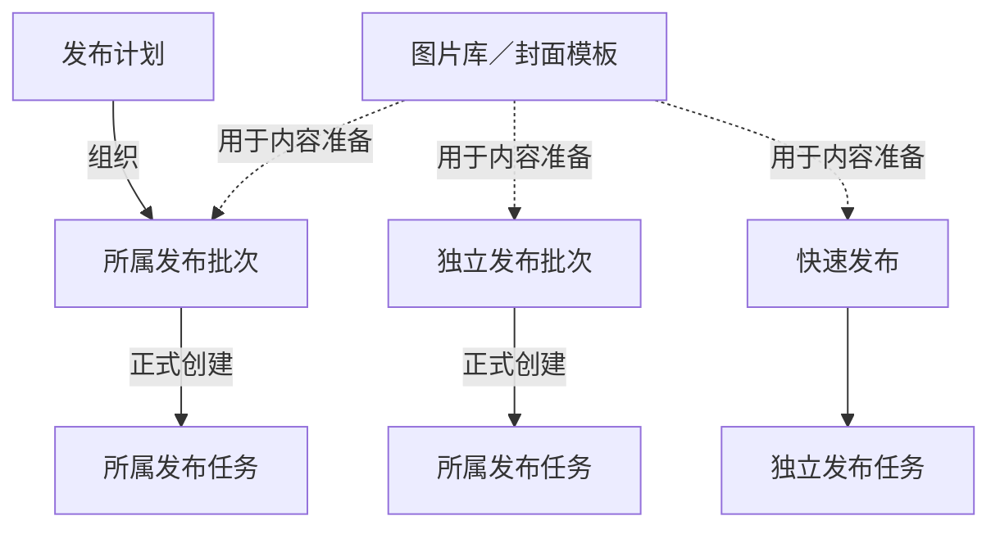
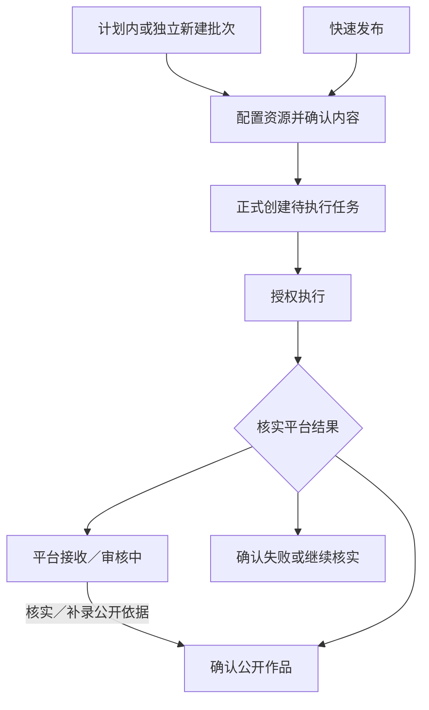
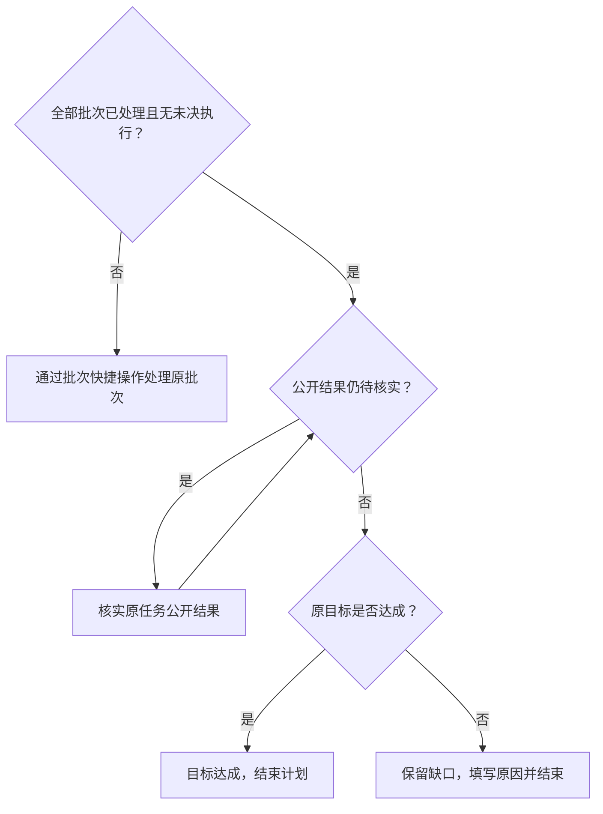
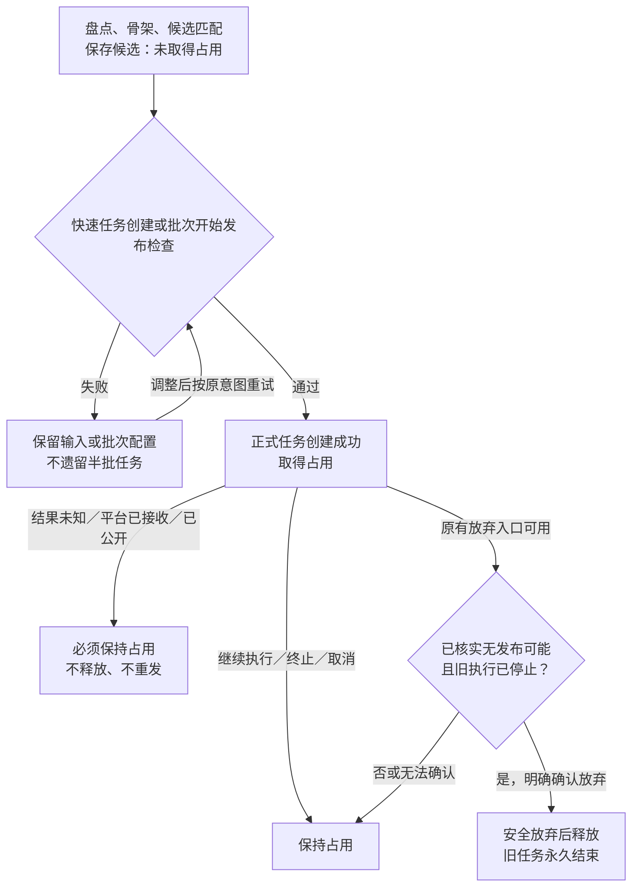

# 第六章：发布管理

发布管理将可用成片安排给合适的账号，完成内容准备、发布执行和真实结果跟进。V1 按 百度（百家号） → B站 → 小红书分阶段开发、真实验收并逐平台开放，最终三平台全部交付。平台字段和账号能力按生效规则检查，仅展示已开放的平台选项；未开放的平台不得创建或执行发布任务。

页面、交互和视觉遵循 [AdminUI 页面规范](../../../standards/frontend/AdminUI页面规范.md)、[前端交互规范](../../../standards/frontend/前端交互规范.md)和[前端架构与视觉规范](../../../standards/frontend/前端架构与视觉规范.md)。原型入口见[设计导航](../../../design/README.md)。

## 6.1 发布管理概览

### 6.1.1 计划、批次、任务与工具的使用入口

**计划管周期目标，批次管一组发布，任务管一条发布，运营工具提供可复用的图片与版式。**

| 用户需要 | 使用入口 | 管理内容 |
| --- | --- | --- |
| 安排多平台、多轮发布，跟进周期目标 | 发布计划 | 平台 × 类目目标、有序批次、进展和后续安排 |
| 集中准备同一平台的一组内容 | 发布批次 | 多账号与成片分配、内容准备、执行和待办 |
| 发布一条内容或处理一条发布的问题 | 发布任务 | 单平台、单类目、单账号、单成片及其结果 |
| 准备重复使用的图片或封面版式 | 运营工具 → 图片库／封面模板 | 图片资源、模板设计与使用管理 |

计划只通过所属批次组织任务。独立批次、独立任务不计入其他计划；发布后的作品表现和点赞、评论等操作由作品、数据统计及互动模块承接。

### 6.1.2 从准备内容到确认公开的完整流程

**正式创建、授权执行、确认公开是三个不同节点；只有确认公开才计入发布目标。**

计划创建只生成待配置骨架，批次保存只写候选配置；快速任务创建或批次开始发布生成正式任务时才取得成片在目标平台的占用。点击提交、取得投稿编号和执行结束均不能代替公开成功。

图片库提供现成封面或底图，模板提供版式，发布内容确定实际图片和文字。最终采用的封面及模板配置随任务保留，后续资源维护不覆盖历史内容，使用方式见 [6.5.3](#653-选择或制作封面)。

## 6.2 发布计划

发布计划管理“发布多少、分几批、执行到哪里、目标还差多少”。资源、内容和任务问题进入对应批次处理。

### 6.2.1 计划列表

列表查看计划名称、ID、状态、当前进展、发布进度、批次进度、执行周期和更新时间。名称与「详情」进入同一计划。

综合搜索（名称／ID）、计划状态、发布平台、发布类目四项直接展示，查询和重置遵循通用规则。列表不展示新建续编的草稿记录。

| 状态 | 列表操作 | 详情中的决策与条件 |
| --- | --- | --- |
| 待执行 | 执行、详情、编辑、终止 | 全部待执行批次完成配置后执行；条件不足时禁用执行并说明原因。编辑限首次启动前的可编辑范围 |
| 进行中 | 详情、终止 | 暂停／恢复，按条件确认继续或跳过；通过批次快捷操作处理待办，全部批次处理后核实并结束 |
| 停止中 | 详情 | 保留安全收尾及结果核实入口 |
| 已结束 | 详情、复制 | 历史只读，展示结束原因与目标结果；页底不放复制或其他业务按钮 |

人工暂停、等待资源、等待批次处理、等待继续和等待跳过属于当前进展；「目标达成」「未达成结束」属于结束结果，分别展示。列表与详情复用的动作使用相同名称和条件，日常编辑、终止、复制从列表发起。

### 6.2.2 新建与编辑计划

**首次启动前可调整未锁定安排；首次合法启动后，计划及所属批次配置固定。**

从列表新建，或复制已结束计划进入新建；存在续编时按 [6.8.1](#681-新建续编与正式记录) 选择继续或重新开始。

#### 制定目标与拆批

**基础信息。** 填写计划名称、执行周期和可选备注；负责人默认当前使用者，不提供日常指派项，已有计划保留原负责人。

**资源盘点。** 查看可用账号、成片、可安排量及更新时间，识别登录失效、类目不匹配、占用和资源短缺。读取失败、容量未知与实际为零分别表达，不将未知视为无限可用。

**目标设定。** 发布平台与发布类目采用可搜索的多选下拉框，同排展示。填写平台 × 类目目标，矩阵合计、计划总目标和原始批次分目标保持一致；允许目标超过当前资源，同时显示缺口。

**批次拆解。** 使用「AI 推荐」或手动新增、拆分、合并、删除和拖拽排序。每批单平台、可含多个类目；同平台分组，组内有明确顺序。重新推荐可能影响人工安排时先确认，AI 建议可调整。

**创建确认。** 检查各平台、类目目标是否分配完整。创建成功进入计划详情，状态为「待执行」；批次骨架仍在计划内继续配置，不进入正式批次列表，也不分配实际账号或成片、不创建正式任务或资源占用。创建结果不明时先查询，防止重复生成。

#### 编辑范围

| 计划与批次情况 | 可调整范围 |
| --- | --- |
| 计划未首次启动，批次未锁定 | 可编辑安排、拆分、合并、删除及拖拽排序；各平台、类目分配仍须与目标矩阵一致 |
| 批次已保存候选但未启动 | 未锁计划内可修改允许结构；目标变化须重新检查受影响内容，候选仍无占用 |
| 批次已启动并有正式任务 | 平台、目标和资源身份固定，不能普通编辑覆盖正式任务 |
| 已锁定或已执行的行 | 位置固定且不可拖拽；其余行仅在连续可编辑区间内排序，不能跨过固定行 |
| 计划已首次启动 | 关闭计划及所属批次配置编辑，不新增、删除、排序或修改资源、内容和设置；暂停不解锁。保留批次原有的继续、重试、核实及终止等执行处理 |

创建或保存失败保留输入和原生效安排；创建结果不明时先查询，避免重复生成计划与批次。

### 6.2.3 计划详情

详情集中展示目标完成矩阵、当前批次、批次推进、待办与执行记录；每个批次提供与独立批次一致的快捷操作，名称、权限、可用条件和确认行为共用。执行处理进入原批次或任务，不另建计划专用处置流程；计划启动后不修改发布配置。

| 入口 | 展示与返回 |
| --- | --- |
| 批次推进 → 详情 | 以铺满内容区的只读抽屉展示批次信息、执行情况、任务和记录；固定左侧菜单与顶栏不被覆盖。关闭后保留计划位置 |
| 去配置／去处理 | 进入同一条批次记录的配置或待办流程，完成或返回后回到关联计划并保留位置 |
| 批次快捷操作／计划待办 | 复用原批次状态对应的操作按钮，处理后重检计划推进条件，不另建处置流程 |

详情只保留查看信息后必要的决策，分别见[执行与推进](#624-执行与推进计划)、[核实与结束](#625-核实与结束计划)。

### 6.2.4 执行与推进计划

**首次启动由运营确认；后续按平台组和组内顺序推进，未决任务优先处理，下一批就绪后才执行。**

先在计划详情完成全部待执行批次的资源、内容和设置配置，再从列表或详情「执行」并确认开始；首批启动时统一生成任务、占用和授权。系统复查全部待执行批次配置完整及其修订、首批当前资源有效、前序位置和重复执行；不满足时说明原因并指向配置。首次合法启动同时锁定计划结构、顺序及全部所属批次的候选资源、内容和执行设置；后续逐批按冻结配置启动，不提前取得后续批次的成片占用。

#### 批次衔接判断

有后续批次时按下表从上向下检查，前项未通过不进入后项：

| 顺序 | 条件 | 反馈／下一步 |
| --- | --- | --- |
| 1 | 计划已人工暂停 | 等待「恢复计划」，恢复时重新检查 |
| 2 | 当前仍有待执行、排队、执行、等待人工或结果待确认任务 | 停留当前批次，先处理；人工确认也不能绕过 |
| 3 | 无未决执行，明确结果数为 0，尚未确认跳过 | 等待「确认跳过当前批次」；跳过不计发布成功 |
| 4 | 无未决执行，明确结果数大于 0，失败率超过 10%，尚未确认继续 | 查看结果后「确认进入下一批」 |
| 5 | 前述判断通过，下一批资源等执行条件失效 | 等待原资源恢复后重新检查，不换资源、不少发、不自动跳过 |
| 6 | 前述判断通过，下一批已就绪 | 执行下一批 |

失败率＝确认失败且未形成可发布作品的任务数 ÷ 明确结果任务数。明确结果包括已公开、平台明确接收／审核中和确认失败；取消、放弃不计分子或分母。审核中可参与衔接判断，但不计公开目标；零分母按第 3 项处理。

在计划未暂停、无未决执行且下一批就绪时：

| 明确结果 | 失败率 | 衔接结果 |
| --- | --- | --- |
| 9 条公开＋1 条确认失败 | 10% | 自动继续 |
| 8 条公开＋2 条确认失败 | 20% | 等待确认进入下一批 |

#### 暂停、接管与单批终止

| 操作／情况 | 作用范围 |
| --- | --- |
| 暂停计划 | 暂缓后续批次；已经开始的执行继续跟进真实结果 |
| 恢复计划 | 重新检查当前任务、推进位置和下一批就绪情况；配置完成不会自动解除人工暂停 |
| 从批次入口单独执行计划所属批次 | 确认人工接管，并暂停计划自动推进；只接管当前合法位置，不与计划重复派发 |
| 单独终止某批次 | 只结束该批；无未决执行后仍按衔接表判断，不连带终止其余批次 |
| 首次启动前，前序批次已终止 | 无未决任务时保留终止结果，启动确认后从后续首个可执行批次开始；全部待执行批次仍须准备完整，不自动跳过 |

### 6.2.5 核实与结束计划

**全部所属批次执行完毕或合法终止、未决执行处理完成后，核实公开结果并结束；原计划不追加批次或补量。**

- 未决执行包括待执行、排队、执行、等待人工和结果未知；审核或公开结果不明确时先核实，缺口按平台 × 类目实际公开数计算，不能跨格抵消。
- 计划启动后不新增、删除或修改批次配置，不提供计划内补量入口；追加发布另建独立批次或新计划，不并入原计划统计。
- 未达成结束须填写原因或结果说明，保留原目标和真实数量。结束后不重新启动；迟到真实结果只更新统计，不改原结束说明或重放执行。
- 列表「复制」只复用允许的目标和配置；新计划重新确定周期、检查资源，不继承任务、结果、占用或授权。

### 6.2.6 终止计划

**终止计划作用于全部所属批次；先停止新派发，再安全收尾，最后结束。**

从列表「终止」确认全部所属批次的影响范围并填写原因，包括尚未配置的骨架，无须逐批终止；已结束批次及其结果保持原值。尚未开始的任务取消并保留占用，在途、人工处理和未知结果继续安全跟进；不能强改为失败或取消，也不能撤回平台投稿。

终止后不继续执行、重试或补量，不恢复调度；保留终止原因和真实发布结果，新目标另建计划。

## 6.3 发布批次

发布批次集中安排同一平台、同一系统用户本人的多个社媒账号与成片。本人可使用多个Profile，同一Profile可绑定不同平台账号，但实际操作跨平台、跨批次互斥。高级运营对成员保留云端查看/管理，不代成员准备或授权执行；不建设混合归属批次和跨用户授权流程。

### 6.3.1 批次列表

已保存的独立批次进入列表，未提交本机续编不进入；计划待配置骨架从计划进入。按名称/编号、平台、状态筛选。未启动批次可编辑、开始发布；运行/暂停/待处理批次按实际条件处理或继续/终止；已结束只读并可合法复制。配置就绪、执行控制、待办与公开结果分开表达。

### 6.3.2 新建批次

新建保留“资源配置 → 内容配置 → 结果总览”。保存只写Cloud批次与候选配置，不生成正式发布任务、不占用成片；开始发布才最终检查、一次生成正式任务并取得占用/授权。用户不操作独立“确认批次”。

#### 资源配置

选择本人账号、成片、类目目标/优先级、账号顺序与每号本批上限，允许人工配对。同账号跨类目共用上限；平台真实日额度、估算和本批上限分开，零/未知/读取失败分开。V1不建设账号/成片质量等级。计划来源的平台和目标继承只读。

#### 内容配置

账号和视频分列，逐条编辑或批量按需配置公共字段、AI与封面，审阅采用后确认受影响内容。保存后仍可在首次启动前换账号/视频、增删候选和重排；变化只使受影响确认失效，原目标不因少选候选降低。

#### 结果总览

展示原目标、候选数量、缺口、逐条问题及并发数/组间发布间隔/组间处理/异常任务上限。新建提供“保存批次／创建并发布”，编辑提供“保存修改／开始发布”；准备不完整可保存，开始发布必须完整校验。开始发布已明确确认的范围不再重复弹确认，资源或缺口发生变化必须重新确认，不自动替换/少发。

开始发布事务对明确包含集合全成全败；结果未知沿原请求键找回。创建并发布在页面一次操作编排保存及启动，保存成功但启动失败明确显示已保存未开始，不重复新建。

### 6.3.3 编辑批次

独立批次首次启动前允许保存候选资源、数量/顺序、内容及执行设置；计划内批次还须所属计划未启动，继承的计划目标不改；已保存是Cloud业务配置，编辑只有取消/保存修改，不另存一份编辑草稿。启动成功后平台/正式任务资源身份/数量/整批执行设置固定；独立批次单任务内容与时间仅按未授权pending等既有状态规则修改；已启动计划所属任务还受计划配置冻结限制。旧revision保存不得覆盖新状态。

### 6.3.4 批次详情

“批次信息 → 执行情况 → 候选配置或正式任务 → 执行记录”。未启动展示候选，不能假装是正式task；已启动展示正式任务和原attempt。唯一主进度条为可信公开数/原目标，审核中不计成功；自动流程跑过但还有未决显示待处理。计划只读Drawer复用主体，关闭恢复原位置；处理进入原任务。

### 6.3.5 执行与处理待办

并发数表示每组同时自动执行的不同本人账号上限，组内不增加发布间隔；本组自动处理完成或任务已被可靠挂起后，等待组间发布间隔再安排下一组，最后不足上限也可执行。不是有空位就立即滚动补一条。

| 配置项 | 选项/行为 |
| --- | --- |
| 组间处理 | 自动继续、异常暂停；后者在本组存在异常时暂停后续发布 |
| 异常任务上限 | 填写条数；异常任务达到该数量时，暂停发布，人工决定继续或终止。自动继续模式也受上限约束 |

异常按task去重统计明确失败、待人工、结果待确认，审核中不计。可靠挂起仍保留本人原现场和Profile占位，其他独立账号可继续；未知失联不能直接视为已停止，先自动补报/核实。自动操作名额与保留窗口容量分开且均有界，不能无限开窗或超时释放未决占位。人工随时可处理，不要求每条立刻介入。

暂停只封新派发，已开始安全收尾；人工继续确认本次问题，不清历史，不对同一已确认异常立即重复暂停。所有可自动处理任务跑完后集中处理剩余：安全重试、原现场继续、核实/补录或安全放弃仍沿§6.4，未知不重发。没有未决执行时，明确失败可选择重试或结束本批并保留失败/占用；结束后本批不再重试，不能借结束把人工/未知强改失败。

### 6.3.6 终止与停止发布

未启动终止仅结束批次配置，无正式任务或成片占用需要释放。已启动终止封新派发、未领取任务取消且保持占用，在途沿真实结果收尾；不撤稿、不恢复原队列。暂停可继续，终止不可恢复；原attempt结果补报和作品核实仍保留。单批终止不连带终止整个计划。

## 6.4 发布任务

发布任务管理一条发布及每次执行尝试。列表直接处理日常业务，独立详情只读查看内容、结果与证据。

### 6.4.1 任务列表

综合搜索查找名称／ID，结合平台、任务状态、内容类目筛选，创建时间放在高级筛选。列表展示实际发布标题、最终封面、平台、账号、状态和可用操作；点击状态统计筛选对应任务。

**所有状态均支持查看详情。下表只列随状态变化的业务动作，已发布任务还可查看关联作品。**

| 状态 | 主要操作 | 关键条件 |
| --- | --- | --- |
| 待执行 | 编辑、执行、终止 | 编辑须未领取，批次首次执行后还须未停止；执行满足授权、时间、间隔与资源条件；未领取且安全时可终止 |
| 排队中 | 终止 | 未领取且安全；不重复执行或编辑当次输入 |
| 执行中 | 符合条件时终止 | 已取得当前执行安全停止、且尚未提交的证据 |
| 等待人工 | 去处理 | 在原账号环境验证后继续原尝试；有提交可能先核实 |
| 结果待确认 | 核实结果 | 不直接重试、终止或释放成片 |
| 平台审核中 | 补录结果 | 不计公开目标，不重新投稿 |
| 发布失败 | 重试、放弃、复制（按条件） | 先确认失败阶段及可恢复原因；批次内按条件恢复原资源或放弃，见 [6.4.7](#647-处理失败任务) |
| 已发布 | 复制 | 历史只读 |
| 已取消 | 复制 | 原任务不恢复，普通取消保留占用 |
| 已放弃 | 复制 | 旧任务永久结束，已按安全条件释放占用 |

复制仅在既有入口提供时使用，复用允许的内容进入新建，重新选择或校验资源；同平台原成片仍占用时，不能产生第二条有效任务。

按钮统一为「编辑」「补录结果」。缺少公开链接等兼容记录进入核实／补录，不另增草稿或成功口径。

### 6.4.2 快速发布与编辑

**快速发布创建独立待执行任务；创建成功后仍需单独授权执行。**

1. 从任务列表「快速发布」或成片管理单选进入，确定平台和类目，选择合格账号与一条可用成片。点击账号名称可查看账号信息与绑定窗口；选择器说明资格及不可用原因，不随机分配账号。
2. 在同一表单准备文案、封面、声明及平台必需字段，设置发布时间。更换平台或资源时检查内容兼容性并提示受影响部分。
3. 「创建任务」生成一条独立待执行任务并取得占用，不隐式创建批次或加入计划。失败保留表单，不产生部分正式记录；重复提交核对同一结果，结果未知先查询。

待执行且未领取时从列表「编辑」内容与执行时间，使用同一套[内容与封面](#65-内容配置与封面)字段。正式任务的平台、类目、账号和成片身份固定；保存时复查状态，已排队或执行后不覆盖当次输入。

### 6.4.3 任务详情

| 区域 | 查看内容 |
| --- | --- |
| 任务信息 | 任务名称、任务身份、来源和相关时间 |
| 发布内容 | 实际采用的文案、封面及平台字段 |
| 执行历史 | 每次尝试的固定输入、阶段、时间、结果与证据 |

未执行时展示当前内容且说明「尚未执行」；有执行尝试后查看对应输入快照，后续编辑不覆盖历史。执行历史按尝试编号倒序列出执行记录、起止时间、结果和简要原因，每行以「查看执行详情」打开内容区右侧只读抽屉。抽屉依次展示「执行结果」「执行过程」、存在时的「人工核实」和「发布内容」，使用公共标题与分区样式；只展示实际记录，不推断缺失步骤。失败原因在执行过程中表达一次，不另设重复摘要或技术信息区；原始代码和审计记录保留在排障资料中。关闭抽屉回到原记录及滚动位置，不添加空底栏或重复业务按钮。账号、成片、批次和计划只读查看并保留返回来源，详情不重复整组列表业务操作。

### 6.4.4 执行与终止任务

**执行沿用当前任务和原资源；终止必须确认尚未提交且执行安全。**

列表「执行」复查内容、账号、文件与占用后进入队列；批次任务还须满足所属批次授权。此操作不更换账号或成片。系统打开账号环境、获取文件、上传、填写、自动点击最终提交并核实反馈。运营在系统内确认内容后授权执行，正常流程不设置逐条人工点击提交的固定关卡。

「终止」可用条件为：未领取且安全，或已取得当前执行安全停止且尚未提交的证据。确认后为「已取消」，保留占用且不恢复原任务；已公开、平台已接收、结果未知的任务不适用此操作。

### 6.4.5 处理人工介入

「等待人工」通过「去处理」查看卡点，在原账号环境完成登录、验证码等操作；验证可安全继续后沿用原尝试，不重新上传。

反馈「已经处理」不等于发布成功；有提交可能先进入结果核实。暂不处理保留待办和现场；所属批次已停止时仅允许必要的安全收尾，不重新发起发布。

### 6.4.6 核实与补录结果

**结果不明先核实原稿件，取得可信依据后记录结果；补录只补全已有任务的公开资料。**

#### 核实结果

「结果待确认」表示有提交可能但缺少可信结论。「核实结果」检查原账号稿件和原尝试证据：

| 核实结论 | 必要依据与结果 |
| --- | --- |
| 已公开 | 匹配任务平台的具体作品链接与实际发布时间，关联公开作品 |
| 平台已接收、尚在审核 | 稿件或审核证据，进入「平台审核中」 |
| 确认未发布 | 失败原因、核实依据及原尝试安全结束的证据，进入「发布失败」 |
| 仍无法判断 | 保持「结果待确认」，记录本次核实并继续跟进 |

结果不明期间不重试、终止或释放成片。网络中断、客户端退出、页面未识别不能直接判失败；链接格式有效也不能直接证明公开。

#### 补录结果

平台审核中或已确认提交但公开资料未齐时，通过「补录结果」打开「补录发布结果」：

| 填写／检查 | 要求 |
| --- | --- |
| 最终公开链接 | 对应任务平台的具体作品，不是账号主页、投稿后台或审核页 |
| 实际发布时间 | 有效且不在未来 |
| 公开依据 | 根据实际平台结果确认，保留核实人、时间及依据 |

点击「确认补录」后关联已有作品或创建作品关联，更新任务及所属批次、计划的公开统计，同平台作品不重复创建。审核未结束或依据不足时保持待办，不重新上传；补录不改写旧执行历史，也不新增无前置任务的独立批量补录入口。

### 6.4.7 处理失败任务

**确认无可发布作品且原尝试已结束，才考虑重试；原资源无法恢复时按安全条件放弃。**

| 当前情况 | 处理 |
| --- | --- |
| 未形成可发布作品、原执行已结束、资源及内容有效，且所属批次未停止 | 「重试」沿用原任务新增尝试，不增加任务数、不覆盖旧尝试 |
| 平台拒绝，但仍有可继续处理的稿件 | 先核实原稿件，不直接重新上传 |
| 原账号或成片暂不可用 | 先恢复原资源并复查 |
| 原资源无法恢复 | 核实符合[安全放弃条件](#682-资源占用与防重复发布)后明确放弃，永久结束旧任务并释放占用，再创建新安排；目标缺口仍保留 |

## 6.5 内容配置与封面

单条任务与批次共用内容规则。内容确认回答“本条实际发布什么”，执行时间和节奏见 [6.8.3](#683-执行时间与任务间隔)。

### 6.5.1 编辑单条内容

批次列表项「编辑」打开内容弹窗，发布账号与发布成片分列且只读；任务创建与编辑使用相同字段。内容自上而下排列，封面不设长期并排侧栏。

| 平台 | 核心字段 |
| --- | --- |
| B站 | 发布标题、封面、标签、分区、创作声明；简介和参与话题选填 |
| 小红书 | 发布标题、封面、正文与话题、适用的创作声明 |
| 百度 | 发布标题、封面、适用的创作声明；发布标题对应平台作品描述文案栏，沿用同一内容字段，不再另设重复文案栏；仅展示已支持的平台选项 |

快速发布选择成片后，发布标题默认带入该成片的原素材标题，可直接修改。更换成片时，尚未修改的默认标题跟随更新，人工修改的标题保留；缺少素材标题时留空供填写，不以成片文件名代替。编辑已有任务和查看执行历史保持已保存的内容，不重新套用默认值。

平台默认分区、标签、可见范围等由统一配置带入，单条明确配置优先；新默认值仅作用新建解析，不覆盖已有草稿、任务或执行记录，不设置独立运营维护页。创作声明按实际内容来源确认，不能无条件使用「原创」或其他权利声明。

AI 按选定字段生成或润色发布标题、封面短标题、话题、标签及可选正文。发布标题与封面标题独立，后者绑定模板唯一动态主标题。按生效规则检查字数、必填和素材要求，不静默截断、不用文件编号填正式文案、不代作未经确认的授权声明。

### 6.5.2 批量配置内容

**每次只处理勾选的内容类型，审阅后应用；应用不等于确认内容、创建任务或执行。**

1. **配置。** 选中条目，打开「批量配置」，勾选公共设置、AI 文案、封面设置中的一项或组合，每次默认不选。确定字段、文案风格和封面方式；AI 默认只补空白，勾选「替换已有文案」才覆盖所选字段。
2. **生成并审阅／预览配置。** 逐条查看实际文案与封面，可原位修改、单项重新生成或更新封面。重新生成影响人工修改时先确认，调整批量条件保留人工稿。
3. **应用配置。** 写回本次变化，未选字段保持原值；取消不改原条目。应用前发现并发变化，先核对最新内容再审阅；账号或成片已变则重新选择资源，不套用旧结果。

文案已完成后只改封面，勾选封面设置即可。失败按条目说明原因，仅重试未成功项，已应用项不重复处理。

「清空选择」仅取消选中，不清除内容。

### 6.5.3 选择或制作封面

**自带图片和现成封面合格即可采用；只有模板合成需要生成与当前配置一致的成品。**

| 方式 | 选择与操作 | 可采用条件 |
| --- | --- | --- |
| 使用素材自带图片 | 检查并预览成片自带图片 | 图片有效、满足输出要求，无需生成记录 |
| 使用已有图片 | 从图片库选启用且用途为现成封面的图片 | 图片可读、满足输出要求，无需模板或封面文字 |
| 使用模板合成 | 选底图、匹配规格的已发布且启用模板，填写实际封面标题并生成 | 全部要求比例均有与当前配置一致的有效成品 |

底图可来自素材或图片库；随机选图限启用且用途匹配的资源，先当前类目、再通用，无资源则补图或改方式，不跨类目随机。最终选择固定保存，不因查看而重选。

各要求比例分别匹配模板并生成，不能拉伸其他比例代替。实际标题、底图或模板配置改变后更新受影响成品；缺少必需输出、渲染失败或标题溢出时阻止确认。模板先检查实际标题再生成，样例不能代替本条成品；现成图片不强制填写封面短标题。

提前制作的 AI 图片可上传图片库，发布流程不提供实时 AI 生底图或视频关键帧提取。

### 6.5.4 检查并确认内容

**系统检查可发布性，运营确认文案、封面和声明事实；只有当前内容已确认才为已就绪。**

系统检查账号与成片资格、平台必填和长度、声明取值、图片可用性及模板成品是否对应当前配置；运营审阅文案准确性、实际封面和声明依据。

| 配置状态 | 判断 | 操作 |
| --- | --- | --- |
| 待完善 | 内容缺失、资源／图片不可用，或必需封面输出缺失、过期 | 编辑、补充或更新成品 |
| 待确认 | 系统检查通过，当前内容未人工确认 | 审阅并确认 |
| 已就绪 | 系统检查通过，当前内容已人工确认 | 进入创建检查，创建仍复查资源 |

「仅保存」用于继续完善，「保存并确认」确认当前内容；批量「确认内容」逐条检查并反馈，已确认项无须重复确认，失败项保持待完善。

实际变化只使受影响条目重新待确认；取消或无变化保存不使确认失效。封面文字变化先更新成品，确认不代替生成，也不创建任务或启动发布。

## 6.6 图片库（运营工具）

图片库统一提供现成封面与模板底图。同一图片可具备两种用途，无须重复上传。

### 6.6.1 图片列表与选用

按名称、类目、用途和比例筛选，来源放在高级筛选；表格展示缩略图、名称、用途、类目、尺寸及启用情况。

缩略图可放大，「详情」查看大图、文件信息和引用记录，关闭后保留筛选与分页。业务选图采用缩略图浏览，仅提供启用、用途和输出要求匹配的图片。无记录、筛选无结果、加载失败分别反馈，不将加载失败显示为无权限或数量为零。

### 6.6.2 上传图片

「上传图片」选择文件、填写名称、至少一种用途，以及现有类目或通用范围。支持格式与文件限制在上传控件展示；尺寸、比例及文件元信息自动读取，成功默认启用。

人工制作与提前生成的 AI 图片使用同一入口。读取、上传、保存失败保留表单及原图供重试，不生成空的可用记录。

### 6.6.3 维护与清理图片

| 操作 | 结果与条件 |
| --- | --- |
| 编辑 | 维护名称、用途和类目；引用详情可查使用位置 |
| 列表开关／批量启停 | 停用阻止新选用和随机引用，保留已确认封面与历史任务；失败保持原值 |
| 批量标记双用途 | 同一图片同时作为现成封面和底图 |
| 删除 | 无引用时确认删除；被模板或正式任务引用时说明原因并阻止删除，失败保留记录 |

## 6.7 封面模板（运营工具）

**编辑草稿、已发布配置与启停状态分开管理；编辑不影响当前可用模板，发布不等于启用。**

### 6.7.1 模板列表

按名称、内容状态、使用状态查询；规格、适用范围和平台标签放在高级筛选。已发布又有草稿的模板同时匹配两类内容筛选，使用开关只控制已发布配置，未发布草稿不能启用。

平台标签只用于推荐，可用性按输出尺寸与实际要求判断，不作为跨平台使用禁令；模板无全局默认项，由发布内容选择。

### 6.7.2 新建模板

填写名称、规格／分辨率、适用范围及可选平台标签，默认 3:4、1080×1440。创建进入独立编辑页，基础信息固定，修改这些信息通过复制新建。

#### 设计与预览

| 编辑内容 | 能力与约束 |
| --- | --- |
| 背景 | 纯色、固定图片或业务底图；业务底图在设计中是样例，正式生成由内容传入，背景保持底层 |
| 动态主标题 | 每模板最多一个，绑定业务「封面标题」；隐藏仍计数，不通过复制增加第二个 |
| 文字与装饰 | 调整文字、字体、字号、颜色、换行、行数、描边、对齐及区域位置；固定文字和基础装饰可新增、复制、删除 |
| 图层与画布 | 选中同步，显隐、锁定、排序；锁定对象可查看但不可改。支持移动、调整区域、缩放、撤销及重做 |

「保存草稿」可保留未完成设计，无需全部发布校验通过，也不发布或启用。「预览与校验」使用精简、较长或自定义标题样例，问题定位到图层。

#### 发布校验

列表「发布」检查已保存草稿：

- 动态主标题存在且可见；固定文字、字体、图片与排版有效。
- 标准样例超出画布、安全区或发生文字溢出时阻止发布；装饰超出安全区仅提醒，背景可铺满。
- 文字先换行，再在允许范围内缩字，达到下限仍不适配则调整设计，不截断实际标题。

首次发布后保持停用，列表启用后才可新选用。预览仅证明对应样例通过，正式使用仍检查实际标题与底图；样例导出明确标识，不能作为业务成品。

### 6.7.3 编辑与发布更新

「编辑」仅在实际修改并保存后形成待发布草稿；打开编辑器不改变状态或正式缩略图。当前已发布配置与一份草稿共存。

列表「发布更新」通过校验后替换已发布配置，保持原启停值；失败保留原配置和草稿。新的封面生成读取新配置，旧任务与已确认封面使用各自快照。

未保存离开时选择保存并离开、放弃修改或继续编辑；保存失败保留现场。模板不提供协同、审批或版本历史管理界面。

### 6.7.4 复制制作其他规格

列表「复制」填写新名称、目标规格、范围及可选平台标签，生成独立停用草稿，不改变原模板，不继承发布与启用状态。

适配新画布时调整位置、区域并按目标比例裁切图片，不拉伸字形。检查布局、标题及安全区后重新校验、发布、启用，不能把复制结果直接视为合格输出。

### 6.7.5 停用与清理模板

停用阻止新选择，保留已确认图片与任务快照；重新启用使用当前已发布配置，不发布草稿，启停失败保持原值。

仅从未发布且无引用的草稿可以删除；已发布或有引用的模板通过停用退出新使用，保留历史依据。

## 6.8 共用业务规则与验收

### 6.8.1 新建续编与正式记录

**计划、批次和任务的新建续编不是正式记录，不进列表、筛选或统计，也不占用成片。**

| 运行端 | 保留范围与恢复 |
| --- | --- |
| Desktop | 当前环境、登录用户、模块各保留一份本机新建草稿；「保存草稿」后重启可继续 |
| 浏览器 | 仅暂存当前应用中的填写；刷新、关闭或退出登录后清空，明确提示，不承诺恢复 |

再次新建或复制新建时，有续编才提示继续或重新开始；关闭提示保留草稿与当前页面。创建成功清理对应续编，失败保留；结果不明先查询正式记录，不重复创建。

已有记录编辑使用「保存」，不另存新建草稿。模板草稿是可出现在模板列表的设计内容，与新建续编不同。

### 6.8.2 资源占用与防重复发布

**同一成片在同一平台只允许一条有效占用任务。快速发布创建正式任务时取得占用；批次保存不占用，开始发布生成任务时取得占用。已有任务取消和终止保持占用，符合安全条件的明确放弃才释放。**

占用按成片身份与目标平台判断；同成片可用于不同平台，改标题、封面、账号或重新分批不能绕过同平台限制。正式任务的平台、类目、账号和成片身份固定，候选或草稿的软冲突提示不能代替最终创建检查。

### 6.8.3 执行时间与任务间隔

到时不等于获得授权，父级控制、时间、组间隔、本人身份与资源条件共同检查。一期使用浏览器辅助自动提交，不建设平台API投稿。

| 设置 | 含义 |
| --- | --- |
| 单条时间 | 开始执行的最早时间，不是平台预约；快速任务创建本身不授权，批次由开始发布统一取得授权 |
| 并发数 | 每组不同账号自动执行上限，同UID和同Profile仍互斥 |
| 组间发布间隔 | 非负秒数，组自动处理结束后等待；组内不额外等待 |
| 组间处理/异常上限 | 按§6.3.5执行，暂停与终止分开 |
| 设置修改 | 首次启动前可编辑；首次成功启动后冻结，独立任务及独立批次单任务内容/时间沿原状态条件，已启动计划所属任务配置冻结 |

### 6.8.4 目标、进度与结果口径

**执行结束与目标达成分别判断；公开发布率始终以原目标为分母。**

| 指标 | 口径 |
| --- | --- |
| 计划目标 | 平台 × 类目矩阵合计，等于所属批次分目标合计；启动后不追加批次或提高原目标 |
| 批次目标 | 独立配置或计划继承的类目目标合计，不随少创建任务而降低 |
| 候选／正式任务数 | 候选为待创建分配；正式任务只计创建成功的任务，重试次数不增任务数 |
| 创建缺口 | max（原目标－正式任务数，0）；未创建差额不是待执行任务 |
| 公开已发布数 | 确认公开且有可信作品依据的任务数，不含审核、失败、取消和放弃 |
| 目标完成率／发布成功率 | 公开已发布数 ÷ 原目标；目标为零显示不适用 |
| 目标缺口 | max（原目标－公开已发布数，0） |
| 任务处置情况 | 以统计和状态查看，不另设进度条；取消与放弃不算发布成功 |
| 计划推进进度 | 已处理批次／计划批次及当前位置，与公开目标完成率分开 |
| 今日已发布 | 按实际确认公开时间和统一业务时区统计，不按创建、提交或补录操作时间 |

#### 数量实例

原目标 30 条，明确只创建 28 条；以下为同批次的两个时间点：

| 指标 | 24 条公开、4 条审核中 | 28 条全部公开 |
| --- | --- | --- |
| 正式任务数 | 28 | 28 |
| 创建缺口 | 30－28＝2 | 仍为 2 |
| 发布成功率 | 24÷30＝80% | 28÷30≈93.33% |
| 目标缺口 | 30－24＝6 | 30－28＝2 |

实际任务全部完成可结束批次执行，原目标仍为 30；计划保留目标缺口并按真实结果结束；追加发布另建独立批次或新计划。

计划只汇总所属批次正式任务并按任务去重，独立任务和其他批次不混入。未知数量显示未知，读取失败与零分开；迟到公开结果更新统计，不覆盖历史或重复推进批次。

### 6.8.5 操作权限与历史保留

状态操作分别见[计划列表](#621-计划列表)、[批次列表](#631-批次列表)和[任务列表](#641-任务列表)。共用权限在提交时复查，不以按钮是否可见代替判断。

| 范围 | 要求 |
| --- | --- |
| 用户授权 | 普通运营在既有授权内操作；高级运营仍受同团队、负责类目限制；管理员仅保留基础 Cloud 查看与管理能力，不承担发布执行 |
| 人员记录 | 负责人、创建人、当前操作人分别记录；隐藏负责人表单不取消权限检查 |
| 操作复查 | 修改与执行提交时重新检查权限、状态、资源和内容是否变化；列表与详情使用相同条件和确认结果 |
| 历史保留 | 计划、批次、任务及结果不物理删除；保留创建、确认、派发、暂停／停止、核实、重试、结束的操作者、时间、原因和依据 |
| 输入与作品 | 历史尝试输入和作品关联不被普通编辑覆盖 |

管理员在 Web 与 Desktop 均不提供快速发布、复制进入快速发布、续编及本机执行入口，不读取本机草稿、不启动 Agent，也不通过切换为浏览器内存草稿开放这些功能。发布记录、作品及其他 Cloud 管理能力按既定权限和状态保留；隐藏执行入口不能替代服务端权限检查。通用角色边界见[第三章 §3.2.2](第三章_用户与账号管理.md#322-运营团队与类目范围)。

高级运营管理成员任务以监控和云端管理为主；不代成员执行或重试，不增加“安排执行／安排重试”等远程授权动作。实际发布仍依赖成员有效桌面会话、Agent 和比特浏览器；管理者点击授权不能消除该依赖。

| 动作 | 普通运营本人任务 | 高级运营本人任务 | 高级运营成员任务 | 管理员 |
| --- | --- | --- | --- | --- |
| 查看任务、资源、进度、结果和执行记录 | 可 | 可 | 授权范围内可 | 全局范围内可 |
| 编辑尚未授权的云端内容和执行时间 | 按状态允许 | 按状态允许 | 按状态允许 | 按状态允许 |
| 快速发布、复制进入新建和本地续编 | 可，使用本人可执行账号 | 同左 | 不代成员准备执行流程 | 不提供 |
| 执行、重试 | 按条件允许 | 按条件允许 | 不可 | 不可 |
| 登录验证、打开原现场、继续原尝试 | 本人原环境处理 | 本人原环境处理 | 不可 | 不可 |
| 终止尚未领取的云端任务 | 按状态允许 | 按状态允许 | 按状态允许 | 按状态允许 |
| 执行中停止及现场核实 | 本人按安全条件处理 | 同左 | 不代成员处理 | 不代运营处理 |
| 补录公开结果、放弃已确认失败任务 | 按已有结果和安全条件允许 | 同左 | 仅在已有依据满足条件时允许 | 同左 |

所有“可”仍受已有团队、类目、任务状态及资源规则约束。成员任务缺少现场结束或未发布依据时，管理者不能替成员勾选现场事实来结束任务、重试或释放占用。

管理员隐藏不承担的执行功能。高级运营查看成员任务时，可保留当前状态相关的执行／重试／去处理按钮为禁用态，提示“仅任务所属运营可操作”，并展示具体执行人；不因成员任务不可执行而关闭整个发布管理页面。本人任务按状态与本机条件正常操作。显隐、禁用及前后端职责统一遵循[前端交互规范 §13](../../../standards/frontend/前端交互规范.md#13-权限交互)，不另建发布权限系统。

### 6.8.6 关键业务验收场景

| 场景 | 结果 |
| --- | --- |
| 管理员查看与管理 | 可按权限查看和管理 Cloud 记录；不显示快速发布、续编及本机执行入口，不触发本地草稿或 Agent 调用 |
| 本人多账号批次 | 同批只包含本人账号，越权保存/领取被拒绝；同Profile跨平台/批次互斥，不转派他人 |
| 三平台逐步开放 | 按百度（百家号）、B站、小红书顺序完成真实发布与结果核实后逐平台开放；未开放平台拒绝创建或执行，最终覆盖三平台 |
| V1 资源配对 | 资格、顺序、数量匹配及人工调整有效；不依赖质量等级字段、维护页或等级匹配 |
| 新建计划，再配置批次 | 计划只有骨架；批次保存候选不占用，开始发布时生成正式任务/占用/授权 |
| 开始与推进计划 | 首次人工授权；未决阻断，10% 边界正确，零分母须确认跳过；全部待执行批次先准备完整，后续原资源失效则等待，人工暂停显式恢复 |
| 启动前已有前序批次被终止 | 保留终止结果，无未决后启动后续首个可执行批次；未就绪仍先配置 |
| 调整计划 | 未锁定部分按范围修改和排序；锁定行不可拖拽或跨越，首次启动后计划和批次配置均不可改 |
| 执行期间出现目标缺口 | 不修改计划或批次配置、不追加补量；全部批次处理完后核对公开缺口 |
| 终止整个计划／单独终止一批 | 前者停止全部所属批次，安全收尾前保留处理入口；后者仅结束该批，后续仍按衔接条件继续 |
| 保存后开始发布 | 保存可调整且不建task/占用；启动最终检查竞争占用，失败保留配置且无半批正式任务 |
| 二次批量配置只改封面 | 文案保留；未应用不写回，只重试未成功项，旧响应和并发变化不覆盖新内容 |
| 自带／现成图与模板合成 | 直接用图无需生成；模板以实际标题生成全部必需比例，样例不能冒充 |
| 内容确认后修改 | 仅实际变化使对应内容重新待确认，封面文字变化先更新成品 |
| 执行中编辑或停止 | 只编辑未领取待执行任务；安全停止且未提交证据具备时可终止，不伪造在途结果、不释放占用或恢复队列 |
| 结果未知、审核中或失败 | 未知先核实，确认安全失败才重试，沿用原任务保留尝试；审核中不算公开成功 |
| 目标 30、创建 28、公开 28 | 批次执行可结束，目标仍为 30、缺口 2；不在原计划追加补量，未达成结束填写原因 |
| 更新或停用资源 | 模板草稿不影响已发布配置，发布不等于启用；停用阻止新选，已确认成品及历史保留 |
| 新建续编、失败与返回 | 按运行端提示恢复能力，续编不进正式列表；失败保留输入，返回来源并保留列表上下文 |
