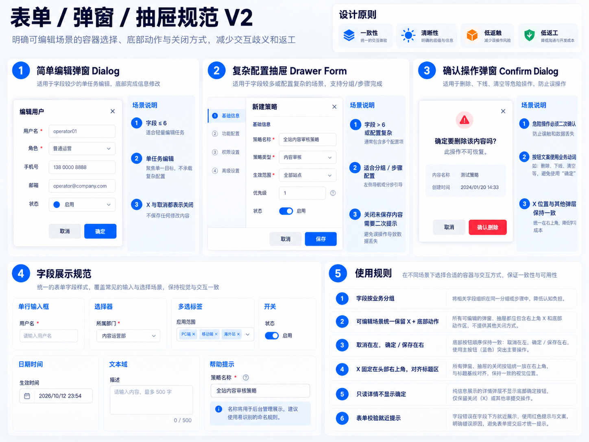
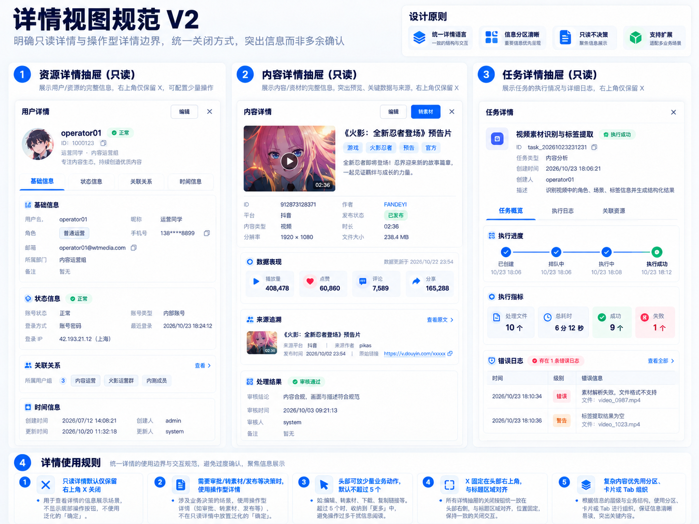

# AdminUI 页面规范

> 目标：建立统一的企业级中后台信息架构与页面模式。
> 本规范定义页面区域、实体列表、详情分区、关联信息与业务操作的位置。
> 适用于自媒体运营平台 Cloud Web / Desktop Vue 页面开发。

本文件是后台页面信息架构的唯一事实源。具体字段、状态、权限和页面能力以业务 PRD / 页面正式规格为准；[前端交互规范](前端交互规范.md)负责点击、关闭、提交与反馈行为，[前端架构与视觉规范](前端架构与视觉规范.md)负责组件、Token、样式与代码归属。一个规则只在负责它的规范中定义，其他规范只引用。

以下图片用于理解布局和信息层级。图中的按钮数量、业务状态和字段是示意；与正文或产品文档不一致时，以正文和产品文档为准。


# 0. 规范适用与 Review

极少数跨规范冲突按「业务 PRD / 页面正式规格 → 本规范 → 前端交互规范 → 前端架构与视觉规范」核对；正常情况依职责分工处理，不靠优先级覆盖。视觉稿只表达目标结构、信息关系与视觉方向，不能授权开发者或 AI 自行重构页面。

页面默认遵循项目规范。需要例外时，须在页面正式规格中写明差异与理由，并经需求方 review 确认；不得仅凭视觉稿、现有实现或 AI 判断覆盖规范。依据之间有冲突、例外尚未确认，或任务范围不清楚时，先提交冲突及可选方案供 review，再修改受影响部分。

现有页面的定点整改还须遵循[前端架构与视觉规范](前端架构与视觉规范.md) §8.1 的差异清单与范围冻结要求，不因视觉稿改变而重做未要求的区域。

# 1. 设计原则
## 1.1 信息层级原则
所有后台页面必须遵循：当前对象 > 关联对象 > 产出对象
禁止所有信息平均展示。

### 当前对象
页面核心管理对象，拥有最高视觉权重。
例如：
-   合成策略：策略配置
-   合成任务：任务状态、执行过程、结果
-   我的成片：视频资产

设计要求：
-   占据主要页面区域
-   优先展示核心状态和操作
-   详情页必须围绕当前对象展开

### 关联对象
用于解释来源和关系。
例如：
-   素材
-   策略
-   任务
-   游戏
-   模板

设计要求：
-   使用摘要信息展示
-   支持点击查看详情
-   不抢占主体空间

### 产出对象

当前对象产生的下一阶段结果。
例如：
-   合成任务 → 我的成片
-   我的成片 → 发布

设计要求：
-   提供明确下一步动作
-   不反向成为当前页面主体

## 1.2 一致性

所有页面统一：
-   布局结构
-   组件样式
-   按钮语义
-   状态表达
-   关闭方式
-   反馈方式

## 1.3 清晰性

信息展示与操作行为分离：
-   列表负责快速管理
-   详情负责完整理解
-   编辑负责修改配置
-   确认负责风险控制

## 1.4 高密度运营

后台页面不是展示页面。
要求：
-   减少无意义留白
-   提高单位区域信息量
-   优先展示运营决策需要的信息

# 2. 页面通用结构

标准管理列表页面：

```text
PageHeader
→ PageAlert（按需）
→ SummaryMetrics（按 §3.3 决定是否展示）
→ PageActions（按需）
→ FilterPanel
→ SelectionToolbar（按需）
→ DataTable
→ Pagination
```

PageHeader 展示页面名称和必要的用途说明。PageActions 承载页面级动作，放在筛选与列表之前；SelectionToolbar 仅在有选中项且有批量操作时出现。FilterPanel 默认保留高频筛选；分页与列表保持同一管理区域。

详情页面：

    当前对象核心信息
    ↓
    状态 / 关键数据
    ↓
    关联对象
    ↓
    历史记录

信息分区与去重规则详见 §7.2；详情 Drawer 的业务操作按 §7.4 放在固定 Footer，不插入正文信息层级。

其他稳定页面模式：

- **资源列表**：优先使用表格，封面和头像用「小图 + 表格」；点击记录打开只读详情 Drawer，轻量编辑在 Drawer 中完成，不频繁跳新页面。
- **任务工作台**：任务统计 + 任务列表；单个任务内部按当前进度、执行步骤、异常信息、日志分区，状态取值枚举以契约为准。
- **批量配置向导**：① 选择对象 → ② 配置规则 → ③ 预览与逐条调整 → ④ 确认执行 → ⑤ 查看结果；不把全部字段放在一个超长表单中。
- **设置页**：左侧设置分类 + 右侧分组表单 + 保存入口；确有高级 JSON 配置时，同时提供可视化表单、校验提示、恢复默认值与配置预览。
- **数据看板**：只用于需要长期观察整体运行态势的页面（首页工作台、数据统计、系统运行监控），不把所有业务管理页面做成图表看板。

具体模块是否采用这些模式由产品正式规格决定，不把示意模块和状态写成全局规则。

# 3. 列表与筛选规范

## 3.1 页面结构

管理列表的区域顺序与必选 / 可选条件见 §2；不为了保持模板完整而增加无实际动作的按钮或空工具栏。

## 3.2 筛选区域
规则：
-   高频条件默认展示
-   低频条件进入高级筛选
-   查询、重置固定顺序

筛选操作的文案和点击行为见[前端交互规范](前端交互规范.md)；组件样式与尺寸见[前端架构与视觉规范](前端架构与视觉规范.md)。

## 3.3 概览指标

SummaryMetrics 是可选模块。只在以下情况展示：

1. 指标本身有独立的业务决策价值；
2. 或指标能形成高价值快捷筛选；
3. 或产品正式规格明确要求 Dashboard / Overview。

禁止：重复 Pagination 的总条数；只是把状态筛选的数量再展示一遍；展示没有行动价值的数字（例如 0 / 18 / 5）；因为页面顶部空而增加统计。

本节只决定是否展示；点击、选中与筛选同步的行为见[前端交互规范](前端交互规范.md) §4，组件实现与视觉见[前端架构与视觉规范](前端架构与视觉规范.md) §4.1.2。


# 4. 表格设计规范
## 4.1 字段优先级

实体型管理列表原则上按以下顺序组织业务列（选择列不计入）：

1. 主体 ID；
2. 主体名称或核心描述；
3. 主体自身的其他核心属性；
4. 关联实体，原则上一种实体一列；
5. 状态或结果；
6. 时间等辅助信息；
7. 操作，位于最后。

主体 ID 独立成列，不与名称、时间合成一个单元格。可省略没有决策价值的字段，不为填满模板新增字段；调整上述语义顺序或合并字段，须有明确的页面正式规格并经过 review。

例如，某合成任务列表可以依次展示「任务 ID｜任务名称｜触发方式｜素材｜合成策略｜成片｜状态｜创建时间｜操作」；示例中的业务字段不构成其他页面的必选字段。

### ID 展示

- 内部业务 ID 默认直接展示原始数字或字符串，不添加 `#` 等视觉前缀；列名已包含「ID」时，值只显示 ID。
- 关联实体可以写作「实体名称 157」，不写作「实体名称 #157」。
- 较长 ID 需保留读取完整值的入口；省略、Tooltip 与复制的组件实现见[前端架构与视觉规范](前端架构与视觉规范.md)。
- 只有外部业务编号自身包含 `#` 等字符，且页面正式规格明确其完整编号时，才按原编号展示。

### 字段取舍

列表只展示用户扫描列表时真正需要比较、判断和操作的信息；不因为后台存在某个字段就把它放进列表，也不为填满模板新增字段。取舍优先级：

1. 当前实体的核心识别信息；
2. 重要配置摘要；
3. 高价值关联对象；
4. 用户需要快速判断的状态 / 配置；
5. 高频操作。

本节只决定字段是否进入列表；进入之后的列顺序仍按本节开头的顺序规则，两者不冲突。

默认不进主列表：低价值派生值；需要实时刷新才可靠的信息；只有进入详情才有意义的信息；与其他字段高度重复的信息；调试信息。

### 动态派生字段

下次执行时间、预计完成时间、即时进度、实时剩余时间属于动态派生信息，默认不进普通管理列表。只有满足至少一项才允许进入列表：

- 用户的主要工作就是监控它；
- 它直接影响用户的下一步操作；
- 页面有明确、可靠的刷新机制；
- 产品正式规格明确要求。

否则放在详情、配置 Drawer 或运行监控类页面（见 §2 数据看板）。「下次执行时间」属于这一类，默认放在自动执行配置或策略详情中，不默认出现在策略列表。列表与详情对过程信息的分工见[前端交互规范](前端交互规范.md) §10.2。

## 4.2 关联对象展示

禁止：直接展示大量关联字段。
错误：
    素材名称
    素材ID
    平台
    作者
    创建时间
    状态
    ...

正确示例（字段由具体业务决定）：
关联对象摘要：
    [缩略图]

    素材名称
    ID: xxx
    时长: xx秒

关联对象的展示形态按追溯价值分配，判定条件见 §7.6：

    核心追溯对象 → EntityLink
    归属与分类（所属游戏、所属团队、内容类型、业务分类） → 普通文本，不使用链接视觉
    ID → 按本节「ID 展示」
    行操作 → Text 或 Link Primary

不能让列表的大部分内容变成蓝色；链接点击后的行为见[前端交互规范](前端交互规范.md)。

## 4.3 操作列

规则：

-   同一行可执行的业务操作不超过 5 个时，按业务优先级全部平铺，不显示「更多」；只有超过 5 个时，才保留高频和重要操作，将其余操作收进「更多」。
-   同一区域最多突出一个主要操作；操作列固定在表格最后。行操作的视觉样式见[前端架构与视觉规范](前端架构与视觉规范.md)。
-   「更多」只负责收纳，不承担防误触职责；按钮显隐和危险操作确认见[前端交互规范](前端交互规范.md)。

表格列各承担一个主要语义，状态 / 结果独立表达；选择列可固定左侧，操作列固定右侧。分页区域展示总条数、每页数量、当前页及翻页入口，数据行与总数必须一致；具体组件实现见[前端架构与视觉规范](前端架构与视觉规范.md)。

## 4.4 列表内联可编辑控件

### 适用边界

本节只约束**列表单元格内**的开关。编辑表单、配置 Drawer 内的开关是普通表单控件，随表单一起保存提交，不受本节的适用条件与逐次确认约束；详情正文默认只读，不内联放开关（见 §11）。

业务结果状态、任务状态、健康状态和只读生命周期状态（例如成功、失败、处理中、已取消、异常）不得用按钮或开关伪装，仍按 §8 独立展示。

唯一例外是简单、可逆的布尔配置值：启用 / 停用、开启 / 关闭、是否自动执行、是否接收通知。这类配置允许在列表单元格内用开关同时表达「当前值 + 修改动作」，不再拆成「状态列 + 启用 / 停用操作列」。

判定口径是**用户能否直接设定并改回**：用户可随时改回、且不改变他人已完成结果的，是配置值；由系统执行产生、用户不能直接设定的，是状态。发布状态、审核状态、任务状态、运行结果和复杂生命周期状态不得做成开关。

### 内联编辑的前提

同时满足才允许：

1. 值是简单、明确的布尔状态；
2. 修改结果可逆；
3. 修改动作只有一个明确语义；
4. 不需要填写额外参数才能完成；
5. 不产生多步配置流程（确认 Dialog 是安全确认，不算配置步骤，见[前端交互规范](前端交互规范.md) §7.5）；
6. 用户对该配置有修改权限；
7. 操作结果可以即时确认；
8. 修改失败时能够恢复原显示值。

### 一个配置列的三态

同一业务列体现同一个配置的生命周期，不拆成三个语义：

```text
尚未配置         →  [配置]        点击打开配置 Drawer，保存完整配置后本列转为开关
已配置但暂停     →  [开关 OFF]    点击后直接启用，不再次强制进入配置页
已配置并启用     →  [开关 ON]     点击后暂停
```

用户对该配置没有修改权限时，本列只展示只读文本（启用 / 停用 / 未配置），不渲染开关，也不渲染「配置」按钮；权限显隐见[前端交互规范](前端交互规范.md) §13。

### 配置的查看与编辑入口

开关只负责启用 / 暂停，复杂配置不塞进开关。配置入口二选一，不得同时提供：

- 配置摘要可点击（例如执行计划「每 30 分钟」，样式见[前端架构与视觉规范](前端架构与视觉规范.md) §3.7.4）；
- 操作栏提供该配置项的编辑入口（例如「自动执行配置」）。

操作栏入口仍受 §4.3 的平铺与收纳门槛约束。

### 示例（合成策略列表）

```text
策略 ID｜策略名称｜合成模板｜所属游戏｜所属团队｜执行计划｜状态｜操作
```

其中：策略 ID 独立成列，不与名称合并；策略名称是当前实体，不做成关联链接；合成模板在确有独立详情、且用户需要追溯时使用 EntityLink；所属游戏、所属团队仅在已有可复用详情能力且有查看权限时使用 EntityLink，否则显示普通文本；执行计划展示手动执行、每 30 分钟或每天 09:00 等真实配置摘要；状态列用一个 Switch 表达并操作整条策略的启用/停用；操作列只承载业务动作。

该列表不设独立「自动执行」状态列或重复的启用 / 停用操作，也不展示「下次执行时间」（见 §4.1）；具体字段以[素材生产 PRD](../../product/prd/详细文档/第五章_素材生产.md) §5.5.8 为准。示例只说明本节的列与控件分配，字段与动作不构成其他页面的必选列。

点击、确认、Loading、成功与失败的执行流程，以及「配置」按钮打开配置 Drawer 的行为，见[前端交互规范](前端交互规范.md) §7.5；开关组件与视觉见[前端架构与视觉规范](前端架构与视觉规范.md) §4.3.5。

# 5. 按钮与操作文案

本规范只规定操作的区域位置和列表收纳门槛。按钮层级、样式见[前端架构与视觉规范](前端架构与视觉规范.md)；操作命名、权限显隐与点击结果见[前端交互规范](前端交互规范.md)。具体业务动作由业务 PRD / 页面正式规格决定。

# 6. 表单、新增、编辑规范



## 6.1 容器选择
  场景         组件
  ------------ ---------------
  简单配置     Dialog
  复杂配置     Drawer
  多模块配置   Drawer + 分区

## 6.2 信息分区

新增 / 编辑表单的字段分区由本节唯一定义，其余规范只引用：

    基础信息
    ↓
    业务配置
    ↓
    关联资源 / 备注（按需）
    ↓
    高级参数（确有才展示）

当前业务确有高级参数时才展示该分区；参数较多时默认折叠。字段集合由产品定义或模板 schema 决定，不按设计图增加尚未支持的参数。必填、校验、提交与失败处理的交互见[前端交互规范](前端交互规范.md) §8。

## 6.3 内容选择组件

候选对象较多时，主表单只展示选择入口及已选摘要，不直接展开大列表；候选项较少时可使用普通下拉。选择、确认和回填行为由[前端交互规范](前端交互规范.md)定义。

# 7. 详情视图规范



## 7.1 详情定位

详情用于理解当前对象。

不是信息堆积页面。

## 7.2 信息结构

推荐：

    当前对象
    ↓
    状态与关键数据
    ↓
    关联对象
    ↓
    历史记录

### 详情信息去重

同一业务事实原则上只完整展示一次。正文基础信息放实体名称、ID、状态、创建信息和业务属性；已有这些字段时，不再加重复的顶部 Summary Card / Hero Card。只有长页面需要固定定位、摘要包含正文没有的关键决策数据，或产品正式规格明确要求时，才可增加摘要。Header 承载什么见 §7.4。

## 7.3 Tab 规范

详情默认按内容分区展示。页面明显较长、各区域对应独立任务、某区域拥有独立列表或历史记录及数据加载，或连续滚动明显影响扫描效率时，才使用 Tab。

不得为了视觉整齐将少量字段单独拆成一个 Tab，也不得为结构对称添加尚未交付的内容。实体的最终结果应在概览或首要信息区可见，不能只放在深层 Tab 中。

## 7.4 详情 Drawer 操作区

- Header 只放详情标题与右上角 X，不放业务按钮。
- 所有当前可执行的业务操作放在固定 Footer；有操作才显示 Footer，无操作时不渲染空 Footer，也不放无意义的「关闭 / 取消 / 确定」。
- 同一个全局动作只在一处出现：Footer 不与 Header 或正文区块标题重复。操作数量与收纳门槛遵循 §4.3，行操作与按钮层级样式见[前端架构与视觉规范](前端架构与视觉规范.md) §3.7；危险操作仍需确认 Dialog，确认行为见[前端交互规范](前端交互规范.md) §12。

## 7.5 详情 Drawer 宽度

宽度按内容复杂度分三级，本节是三档数值的事实源：

| 级别 | 宽度 | 适用 |
|---|---|---|
| 简单详情 | 560–640px | 字段少、无关联实体 |
| 标准业务详情 | 720–800px | 常见业务详情 |
| 复杂任务 / 配置 / 多 Tab 详情 | 800–960px | 字段密、含关联实体或独立内容区 |

先根据字段密度、关联实体与独立内容区选级，再取区间内的具体宽度；页面正式规格可在区间内指定，两列信息不要因为 640px 强制拥挤。不得为固定窄宽度牺牲可读性，也不默认全屏。Drawer 组件、宽度实现与视口适配见[前端架构与视觉规范](前端架构与视觉规范.md) §4.4.2。

## 7.6 EntityLink

列表或详情中引用另一个可查看的业务实体时，满足以下至少一项才使用 EntityLink：

- 用户存在高频追溯需求；
- 它是当前业务链路的重要对象；
- 用户需要查看它详情才能继续判断；
- 该对象本身具有稳定、独立的详情能力。

外键不等于链接：简单归属与分类（所属游戏、所属团队、内容类型、业务分类）使用普通文本，不使用链接视觉，也不打开详情 Drawer。关联实体原则上一种实体独立一列；当前对象自身的名称和 ID 不因位于表格中就自动变成关联链接；不可点击的数据不得使用 EntityLink 的视觉，也不得渲染成看起来可点的控件；不满足上述条件、或查看权限 / 详情能力不存在时，退化为普通文本。

点击、嵌套详情与返回行为由[前端交互规范](前端交互规范.md) §9.4 定义；组件、色彩 Token 与复用边界由[前端架构与视觉规范](前端架构与视觉规范.md) §4.3.2 定义。


# 8. 状态规范

状态用于表达业务结果。

## 8.1 状态位置

实体列表中的状态 / 结果位于关联实体之后，详情在首要信息区展示当前业务状态。具体状态值和业务含义由业务 PRD / 契约定义，颜色映射和组件实现见[前端架构与视觉规范](前端架构与视觉规范.md)。

## 8.2 业务状态统一

同一业务对象在列表与详情中使用同一状态名称。状态取值由对应产品文档定义；设计稿中的示意状态不能直接进入页面。执行阶段可在详情辅助说明，但不能代替业务主状态，也不能直接把内部状态码展示给运营人员。

业务状态一律用只读的状态标签表达，不使用可点击控件；可直接编辑的布尔配置值不属于状态，其判据、三态与展示见 §4.4。


# 9. 反馈规范

反馈的触发、位置和关闭行为见[前端交互规范](前端交互规范.md)；反馈组件的详细生命周期见[用户反馈规范](用户反馈规范.md)。本规范只规定 PageAlert 在页面结构中按需出现，不定义反馈行为。


# 10. 关闭与提交规范

Drawer、Dialog、编辑页的关闭、取消、保存及未保存提醒，统一见[前端交互规范](前端交互规范.md)。本规范仅定义详情 Drawer 的操作位置（§7.4）。


# 11. 只读、编辑、确认规范


## 只读详情

详情正文以只读信息为主，不安排编辑字段或无实际提交内容的按钮；可执行的业务动作按 §7.4 放置。操作显隐和关闭行为见[前端交互规范](前端交互规范.md)。

## 编辑

编辑表单的字段分区见 §6.2；提交、取消和未保存提醒见[前端交互规范](前端交互规范.md)。

## 确认

需要确认的操作及 Dialog 点击行为见[前端交互规范](前端交互规范.md)；确认框的视觉实现见[前端架构与视觉规范](前端架构与视觉规范.md)。

# 12. 前端实现要求

组件、色彩、间距和共享 UI 的实现与复用见[前端架构与视觉规范](前端架构与视觉规范.md)；交互行为见[前端交互规范](前端交互规范.md)。页面具体字段与业务动作仍以业务 PRD / 页面正式规格为准。

最终目标：让产品、设计、前端、AI协作共同遵循统一后台设计语言。
