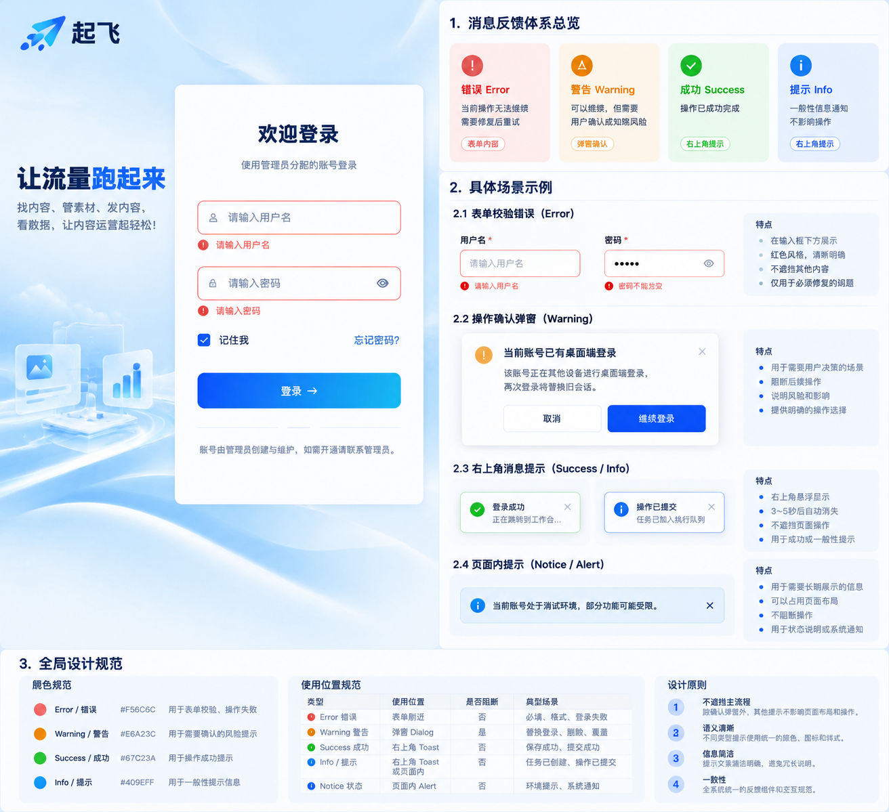

# 用户反馈规范

本文是[前端交互规范](前端交互规范.md) §14 反馈的执行细则：反馈组件的入口、Toast / Dialog / Alert 的选型与生命周期。反馈的触发时机与位置以交互规范为准；页面区域与操作位置见 [AdminUI 页面规范](AdminUI页面规范.md)；组件与 Token 实现见[前端架构与视觉规范](前端架构与视觉规范.md)。

适用于 Cloud Web 和 Desktop 共用的 Vue 页面。反馈只回答三件事：发生了什么、用户是否需要处理、消息何时消失。业务状态仍由页面和对应产品规格定义。

## 先判断反馈放在哪里

| 情况 | 展示方式 | 消失方式 |
| --- | --- | --- |
| 普通常识、字段格式或可选操作说明 | 相关字段旁的轻文字或按需展开的帮助 | 不用彩色 Alert；只在相关条件成立时展示 |
| 列表没有资源 / 筛选无匹配 | 一处空态，说明原因及恢复动作 | 不再同时重复空表格、Warning 与 Info |
| 某个表单字段需要修复 | 字段下方的错误文字 | 字段修复后消失；再次提交时重新校验 |
| 操作可以继续，但会覆盖、删除或替换已有结果 | 确认 Dialog，说明影响并提供取消与继续 | 用户主动选择后关闭 |
| 一次配置变更需要用户确认（如启用 / 暂停某项配置） | 确认 Dialog，说明本次变更的配置项 | 用户选择后关闭 |
| 一次操作已经成功或失败 | 右上角 Toast | 默认 4 秒后消失，可手动关闭 |
| 只需知道的短消息，如任务已提交 | 右上角 Toast | 默认 4 秒后消失，可手动关闭 |
| 需要持续可见的页面状态，如环境不可用 | 页面内状态 Alert，靠近相关内容 | 状态恢复或用户按规则关闭后消失 |

字段之外的页面加载失败、权限不足或核心依赖不可用，也属于页面状态：在相关内容区域说明原因和恢复动作。不能硬塞到某个输入框下面。

普通帮助与操作影响不是新的业务状态：零个关联对象不显示“影响 0 个”；有影响时保留对象范围、必要后果与入口。长格式说明和对象名称可按需展开；会清除代理、替换配置或导致检测失效等关键后果必须默认可见，不能藏进悬浮提示。单个状态只在最贴近任务的位置说明一次。

`shared/ui/resource/ResourceNotice` 承载这类静态轻说明与影响摘要，`ResourceEmptyState` 承载空数据与恢复入口。真正的错误、环境不可用和阻断仍按下列反馈类型处理，不为了减少颜色而删除或伪装。

## 五类反馈

- **Error 错误**：当前操作没有完成。字段错误贴近字段；单次操作失败用 Toast；整页无法使用时展示页面错误状态。说明用户下一步能做什么，保留已填写内容。
- **Warning 警告**：继续操作有明确风险，需要用户选择。用确认 Dialog，写清会发生什么、影响范围和取消方式。普通校验失败不算 Warning。
- **Success 成功**：操作已经真正完成。用 Toast。提交到异步队列只能写“已提交”，不能写“已完成”。
- **Info 提示**：不要求立即处理的短消息。用 Toast；长期操作说明可放在相关字段旁，用普通文字。
- **Notice 状态通知**：持续影响当前页面的环境、权限或系统状态。用页面内 Alert，必要时给恢复入口。它不是一次性操作结果。

同一件事只在最贴近对象的位置反馈一次。列表单项失败优先更新该行状态并提供详情；必要时再给一次 Toast，不同时堆叠页面 Alert。

## 组件与视觉

使用 `wt-media-cloud/web/src/shared/ui/feedback/` 的统一入口：

- `feedback.toast.success/error/info()` 显示右上角 Toast；
- `FeedbackDialog` 或 `feedback.confirmWarning()` 显示需要主动选择的风险确认 Dialog；
- `FormError` 显示字段错误；
- `FeedbackAlert` 显示持续的页面状态。

共享入口基于现有 TDesign Vue Next。业务页面不自行拼红色提示框，也不直接决定 Toast 的位置、时长和配色。业务状态标签仍按业务状态规范处理，不套用反馈色。

| 反馈色 | 值 | 用途 |
| --- | --- | --- |
| Error | `#F56C6C` | 校验和操作失败 |
| Warning | `#E6A23C` | 风险确认 |
| Success | `#67C23A` | 完成确认 |
| Info | `#409EFF` | 普通提示与状态说明 |

参考图：

颜色只能辅助识别；文字必须独立说清含义。Toast 放右上角，默认 4 秒；关键错误若需要长期阅读，应留在相关字段、行或页面状态中。Dialog 在用户选择前不自动消失。字段错误要和输入框通过 `aria-describedby` 关联。

## 页面实施规则

1. 先确定消息是字段错误、风险确认、一次性结果，还是持续状态，再选展示方式。
2. 反馈不得遮住主按钮。字段错误可以在字段下方占用少量空间；页面布局必须允许内容自然增长和滚动。
3. 提交期间在操作按钮上显示 Loading，并阻止重复提交。不要额外堆一块“正在提交”的 Alert。
4. Dialog 的确认文案使用实际动作，如“继续登录”“删除”；危险操作说明影响。取消必须可用。
5. 一次性消息不使用页面 Alert；持续状态不靠会自动消失的 Toast 承载。
6. 修复附近旧反馈时，保留原业务判断和权限边界，只改变反馈语义和展示。

## 登录页示例

用户名、密码为空时，在各自输入框下显示“请输入用户名”“请输入密码”。登录失败显示错误 Toast；当前角色不能登录 Desktop 时保留可读的页面状态说明。服务端要求替换已有登录会话时，弹出确认 Dialog，说明旧会话会被替换；只有点击“继续登录”才提交 `replace_existing`。登录按钮始终可见，提交期间在按钮上显示“正在登录…”。

## 内容生产示例

| 场景 | 反馈 |
| --- | --- |
| 创建合成任务的请求已被接受 | Info Toast“任务已提交”；任务行显示实际执行状态，不能提示“成片已完成” |
| 合成进行中或失败 | 在任务行和详情保留阶段、状态与失败原因；单次操作失败可补一次 Error Toast |
| 归档成片、取消执行中的任务 | 确有影响时用 Warning Dialog 说明影响范围；完成后更新对象状态 |
| 成片下载 | 下载中心显示传输状态；只有本地文件校验并落盘后才能提示“下载完成” |

任务、成片和下载的状态取值以[第五章《素材生产》](../../product/prd/详细文档/第五章_素材生产.md)为准。操作区布局遵循 [AdminUI 页面规范](AdminUI页面规范.md)。
