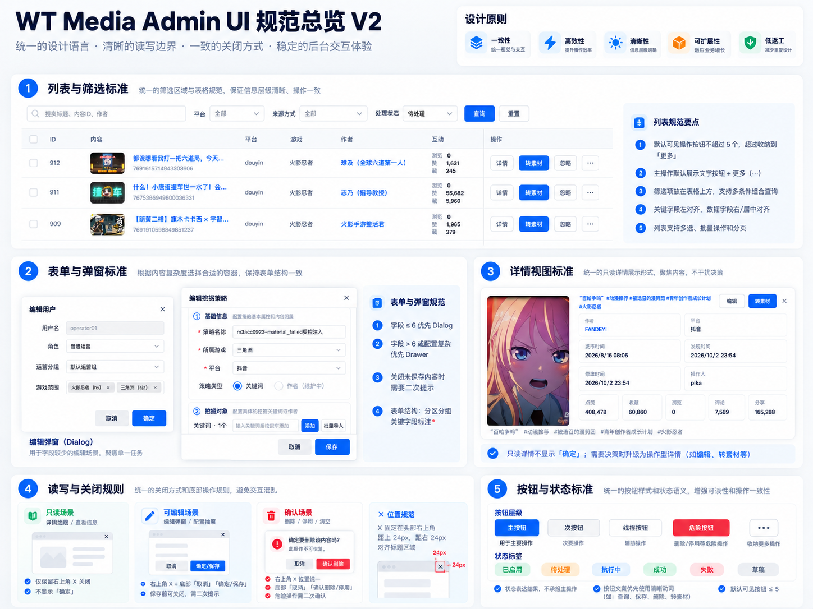
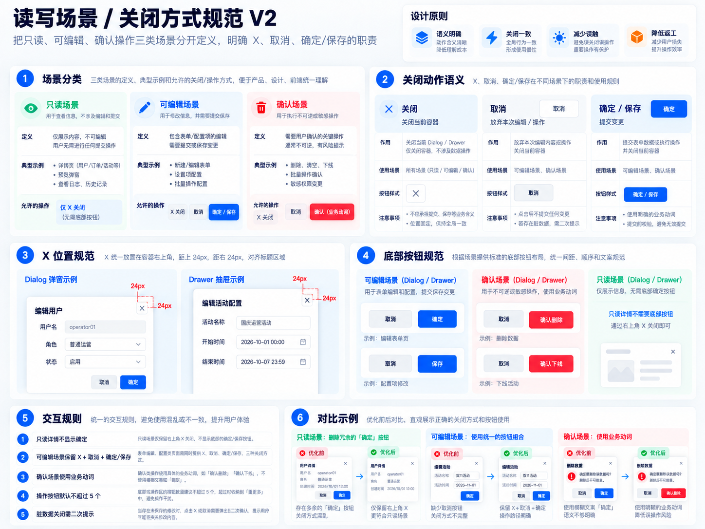

# Admin UI 设计规范 V2

> 目标：建立统一的后台管理系统设计语言，约束列表、表单、弹窗、抽屉、详情、按钮、状态等基础交互模式。
>
> 本规范只定义通用 UI
> 规则，不绑定具体业务模块，确保未来新增功能页面可以直接复用。

# 1. 设计原则

## 1.1 一致性

所有页面必须遵循统一的：

-   布局结构
-   组件样式
-   操作语义
-   关闭方式
-   状态表达

避免不同页面出现同类功能不同交互。

## 1.2 清晰性

信息展示与操作行为分离：

-   只读场景重点展示信息
-   编辑场景重点完成修改
-   确认场景重点防止误操作

## 1.3 低误触

涉及数据修改、删除、下线等风险行为时：

-   使用明确业务动作
-   提供二次确认
-   避免模糊按钮文案

## 1.4 低返工

产品、设计、前端统一使用本规范：

-   页面设计直接套用模板
-   开发减少重复实现
-   新增页面保持一致体验

参考规范总览：

# 2. 列表与筛选规范

列表页面统一由以下区域组成：

1.  页面标题区域
2.  筛选区域
3.  数据表格区域
4.  操作区域
5.  分页区域

## 2.1 筛选区域

规则：

-   查询条件默认位于表格顶部
-   高频条件优先展示
-   条件过多时使用高级筛选展开
-   查询、重置按钮保持固定顺序

按钮：

    查询（主按钮）
    重置（次按钮）

## 2.2 表格规范

规则：

-   表头统一高度
-   字段名称保持简洁
-   核心字段靠左展示
-   数值字段根据场景右对齐
-   操作列固定在右侧

## 2.3 操作列规范

单行默认：

    主操作 + 更多(...)

规则：

-   可见操作按钮默认不超过 5 个
-   超过 5 个必须收纳到「更多」
-   高风险操作不要直接堆叠

# 3. 按钮规范

## 3.1 按钮类型

  类型       用途
  ---------- ----------------------
  主按钮     页面主要提交动作
  次按钮     普通辅助操作
  线框按钮   低优先级操作
  危险按钮   删除、停用等风险操作
  更多按钮   收纳额外操作

## 3.2 按钮命名规范

统一使用明确动作：

  场景       推荐
  ---------- ------
  新增       新增
  查看       详情
  修改       编辑
  提交       保存
  执行       执行
  重新执行   重试
  删除       删除
  停止       停用

避免：

-   打开
-   处理一下
-   确认一下
-   操作

等模糊描述。

# 4. 表单、弹窗、抽屉规范

## 4.1 容器选择

  场景         组件
  ------------ --------------------
  简单编辑     Dialog
  复杂配置     Drawer
  长流程配置   Drawer + 分组/步骤

规则：

-   字段较少使用 Dialog
-   字段较多或结构复杂使用 Drawer

# 5. 关闭方式规范

关闭行为必须统一。

# 5.1 X 关闭

X 表示：

> 关闭当前窗口容器

适用于：

-   只读详情
-   编辑弹窗
-   抽屉
-   确认弹窗

规则：

-   固定右上角
-   与标题区域对齐
-   全局保持一致

# 5.2 取消

取消表示：

> 放弃当前编辑或操作

适用于：

-   编辑场景
-   确认场景

# 5.3 确定 / 保存

表示：

> 提交当前修改或执行动作

规则：

不要使用泛化：

    确定

优先使用业务动作：

例如：

    保存
    确认删除
    确认下线
    提交审核

# 6. 只读、编辑、确认场景规范

## 6.1 只读场景

例如：

-   查看详情
-   信息展示
-   历史记录

规则：

只保留：

    右上角 X

不显示：

    确定
    保存
    提交

## 6.2 编辑场景

必须包含：

    右上角 X
    +
    底部取消
    +
    底部保存/确定

如果存在未保存内容：

关闭时需要二次提示。

## 6.3 确认场景

用于：

-   删除
-   停用
-   清空
-   不可逆操作

规则：

按钮必须体现业务动作：

推荐：

    取消 | 确认删除
    取消 | 确认停用
    取消 | 确认清空

# 7. 详情视图规范

详情页面用于展示信息，不承担复杂编辑职责。

## 7.1 信息结构

推荐：

    基础信息
    状态信息
    关联信息
    时间信息
    操作记录

## 7.2 详情操作

头部允许少量业务操作：

例如：

-   编辑
-   导出
-   转换
-   下载

规则：

-   默认不超过 5 个
-   超过使用更多菜单

# 8. 状态规范

状态用于表达结果，不承担操作。

推荐：

  状态     颜色语义
  -------- ----------
  成功     绿色
  处理中   蓝色
  等待     黄色
  失败     红色
  禁用     灰色

禁止：

使用绿色按钮代表操作。

例如：

错误：

    绿色按钮：启用

正确：

    状态：已启用
    操作：停用

# 9. 前端实现要求

所有页面开发必须：

1.  优先复用已有组件
2.  不自行设计按钮样式
3.  不自行定义颜色
4.  不自行调整弹窗关闭规则
5.  新页面必须符合本规范

